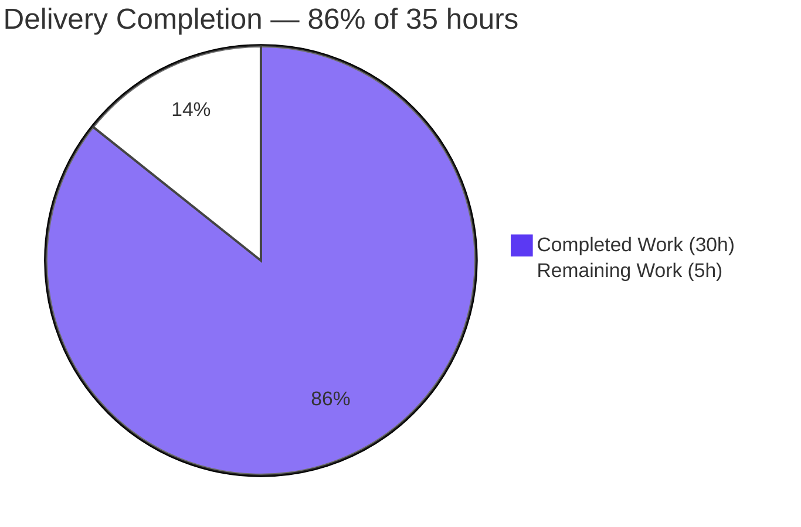

# 1. Executive Summary

## 1.1 Project Overview

`0610_hello_world` is a five-line CommonJS HTTP server whose single request handler answers every method and path with the constant body `Hello, World!`. This release makes the repository self-describing: it describes that handler where it is defined and gives the repository its first entry point saying what it is and how to run it. It is written for whoever receives this checkout and has to start it.

## 1.2 Completion Status



**86% complete** — 30 of 35 hours. Both requested requirements are delivered byte-exact; the remaining 5 hours are path-to-production.

| Metric | Value |
|---|---|
| Total Hours | 35 |
| Completed Hours (AI + Manual) | 30 |
| Remaining Hours | 5 |
| Completion | 86% — 30 ÷ (30 + 5) × 100 = 85.7% |

## 1.3 Key Accomplishments

- ✅ The request handler is described where it is defined, with no logic, formatting or naming change.
- ✅ The repository has a reader-facing entry point: `README.md` naming the project and how to start it.
- ✅ The documented run command boots from the repository root and serves the 14-byte `Hello, World!` body.
- ✅ Every path and method — root, unknown path, `/favicon.ico`, GET and POST — returns that same body; no 404 exists.
- ✅ 50 parallel requests all succeeded, with nothing logged beyond the startup banner.
- ✅ The response renders in a browser as plain text at three URLs, with no console output.
- ✅ All five original source lines are byte-identical to the previous version.
- ✅ The tree holds exactly the two delivered files: no manifest, test, CI or linter was added.

## 1.4 Critical Unresolved Issues

**Open items: 3 — 0 of the 2 requested requirements, plus 3 path-to-production items.** An owner must settle these before the service runs on an unprepared machine.

| Issue | Impact | Owner | ETA |
|---|---|---|---|
| `lodash` is required at load time but nothing in the repository provides it; a machine without an ambient copy fails at boot with `Cannot find module 'lodash'` | The documented run command cannot start on a bare machine | Repository owner | Before first deployment |
| The listener binds every interface while the banner advertises loopback; the response declares no media type and carries no hardening headers | Reachable off-loopback, with no declared or hardened response identity | Repository / runtime owner | Before any non-local deployment |
| No automated gate exists (no test, lint configuration or CI) | Any future edit to the handler or the document lands unverified | Repository owner | Next maintenance window |

## 1.5 Access Issues

No access issues identified. The runtime, the dependency provision and the browser were all reachable; no repository permission, service credential or third-party API access is required.

## 1.6 Recommended Next Steps

1. **[High]** Pin the load-time dependency in a manifest so the documented command starts on a clean machine.
2. **[High]** Settle the exposure: bind loopback explicitly, or accept and firewall the wildcard bind.
3. **[Medium]** Add a contract test, a lint configuration and a CI job.
4. **[Medium]** Surface a failed bind in plain language instead of an uncaught trace.
5. **[Low]** Add a readiness probe and request logging when the service is next in scope.

# 2. Project Hours Breakdown

## 2.1 Completed Work Detail

| Component | Hours | Description |
|---|---|---|
| Inline handler summary — `server (1).js` (requirement R1) | 3 | One single-line JSDoc summary describing what the request handler does, placed directly above the `require('http').createServer(...)` statement, with every pre-existing line preserved byte-for-byte and no logic, formatting or renaming change. |
| Repository README — `README.md` (requirement R2) | 4 | The repository's first reader-facing document: 5 lines at the root carrying the project name, the install position (no manifest exists; the source requires `lodash` at load time) and the run command, with no additional section. |
| Runtime verification of the served response (acceptance of R1 and R2) | 12 | Whole-package gate — the syntax check plus repeated boots of the documented command; the path and method matrix including unknown paths, `/favicon.ico` and non-GET requests; 50-way concurrency; browser rendering of the response at three URLs including a payload-shaped query; confirmation that the pre-existing runtime behaviour is unchanged. |
| Byte-provenance, scope and absence verification (acceptance of R1 and R2) | 11 | Byte comparison of both delivered files against their agreed contents; confirmation that the five original source lines are byte-identical to the previous version of the file; change-set, authorship and scope audit; the exclusions inventory confirming no manifest, test, CI, linter, documentation or artefact of any kind was added. |
| **Completed total** | **30** | Matches Completed Hours in Section 1.2. |

## 2.2 Remaining Work Detail

| Category | Hours | Priority |
|---|---|---|
| Dependency provisioning for the documented run command — pin the load-time `lodash` requirement in a manifest and drop the unused binding | 2 | High |
| Runtime exposure and response identity — explicit bind address, declared media type, standard hardening headers, and a clear message when the port cannot be bound | 1.5 | High |
| Automated verification gate — a contract test for the served response on the runtime's built-in runner, a lint configuration that also settles the two over-length lines, and a CI job running both | 1.5 | Medium |
| **Remaining total** | **5** | Matches Remaining Hours in Section 1.2 and the "Remaining Work" value in Section 7. |

Completed hours (30) + remaining hours (5) = 35 total project hours. None of the three items above is a defect in the delivered change: the first completes the load-time requirement the README documents, and the second and third are production concerns the change's agreed boundary left outside it.

# 3. Test Results

This repository ships no automated test suite, coverage tooling, linter or CI — that absence is part of what was agreed for this change. The checks below are therefore the complete gate for this release, and every count in the table was executed against the delivered tree and the running service.

| Area / Category | Framework | Tests | Passed | Failed | Coverage | What This Proves |
|---|---|---|---|---|---|---|
| Static syntax gate | `node --check` on Node v22.23.4 | 1 | 1 | 0 | n/a — no coverage tooling in the repository | The delivered source parses cleanly under the runtime the project pins. |
| HTTP request contract | `curl` against live instances | 57 requests | 57 | 0 | n/a | Every request — root, an unknown path, `/favicon.ico`, GET and POST — is answered `HTTP/1.1 200 OK` with the 14-byte body `Hello, World!\n`, and the service keeps answering under 50-way concurrency. |
| Startup and lifecycle | The documented run command | 7 boots | 7 | 0 | n/a | `node "server (1).js"` starts the service from the repository root, prints its banner, serves, and releases the port when stopped by the process it spawned; it fails exactly as documented when the load-time module is unresolvable and when the port is already held. |
| Browser rendering of the served response | Headless Chrome (1280×800) | 3 URLs / 9 requests | 9 | 0 | n/a | Chrome renders the response as `text/plain` with the correct body, no console message of any type, no dialog, and no status ≥ 400 — including for a payload-shaped query string that is never reflected. |
| Repository hygiene and exclusions | Shell probes over the whole tree | 1 audit | 1 | 0 | n/a | The tree holds exactly the two delivered files, with no manifest, lockfile, test file, CI definition, linter configuration, placeholder marker or leftover artefact of any kind. |

## Not Covered

- No repository test, lint, type-check or CI job protects either delivered file: the checks above are run by hand and nothing will re-run them on a future change. This is the gap the remaining-work item for an automated gate exists to close.
- Request-body handling for large payloads, malformed or ambiguous HTTP framing, and protocol edge cases such as `CONNECT` are handled — where handled at all — by the runtime's parser rather than by this application, and were not exercised here; anything relying on that layer should be probed deliberately before it is depended on.
- Sustained load beyond 50 concurrent requests was not exercised, nor was the service's behaviour under a dependency version change or on a machine where the load-time module resolves differently.
- The README was verified as a file and as a rendered page, but not across different Markdown renderers, and not with a repository-wide lint gate (none exists yet); the two lines that exceed a common 80-character limit would be the first thing such a gate flags.
- Before release a human should: boot the service on a clean machine with no ambient dependency provision, confirm the intended bind address is reachable exactly as intended, confirm a second instance surfaces its port collision clearly, and read the README start to finish as a first-time reader.

# 4. Runtime Validation & UI Verification

Every line below was driven against the running service on this machine.

- ✅ **Startup** — `node "server (1).js"` from the repository root on a free port 3000: banner `Server running at http://127.0.0.1:3000/` on stdout, nothing on stderr, socket in `LISTEN`.
- ✅ **Primary endpoint** — `GET /` returns `HTTP/1.1 200 OK` with exactly `Date`, `Connection: keep-alive`, `Keep-Alive: timeout=5` and `Content-Length: 14`, and the body `Hello, World!\n` (14 bytes, verified octet by octet).
- ✅ **Unknown path** — `GET /some/path/that/does/not/exist` returns 200 with the identical body: there is no routing and no 404 path, so a hit and a miss are indistinguishable by status.
- ✅ **Other methods and assets** — `POST /favicon.ico` and the documented path variants return the same 200/14-byte answer; the handler never reads the request.
- ✅ **Concurrency** — 50 parallel requests returned 50 × 200, with stdout still one line and stderr empty afterwards.
- ✅ **Browser rendering** — three URLs (root, unknown path, and a query string carrying a `<script>` payload) render as `text/plain` with the correct 14-byte body: zero console messages of any type, zero dialogs, and 9 of 9 network requests answered 200.
- ✅ **Shutdown and restart** — the service stops cleanly when signalled by the process it printed, releases the port immediately (0 listeners afterwards), and reboots deterministically with an identical banner and response.
- ⚠ **Response identity** — no `Content-Type` and none of the standard hardening headers are set on any response; the client infers the media type (Chrome renders `text/plain`). Correct for a constant, non-sensitive body, and the item the remaining-work list covers.
- ⚠ **Startup failure visibility** — a second instance on a held port exits 1 with an uncaught address-in-use trace on its own stderr while the holder keeps serving; there is no application-level error path, so nothing but the process exit tells an operator the bind failed.
- ❌ **Not present to exercise** — no health or readiness endpoint, no request logging, metrics or tracing, no authentication or authorization, no TLS, and no configuration surface (no environment variable, argument or file is read). Nothing was driven for these because nothing exists; a 200 on any path must not be read as a health, metrics or protected-resource contract.

Not exercised at runtime: request bodies larger than those sent during these checks, TLS handshakes against the listener, and any dependency-version change. No user interface exists to verify — every path renders the same constant plain-text document, with no screens, components, assets or navigation.

# 5. Compliance & Quality Review

## 5.1 Compliance Matrix

| # | Check | Benchmark / Requirement | Evidence | Status | Progress |
|---|---|---|---|---|---|
| 1 | Handler description present at the definition site | One single-line summary directly above the request handler | `server (1).js:3-4`, adjacent, no blank line between | ✅ PASS | 100% |
| 2 | Description form | Single line, no `@param`, no `@returns`, no tags, no example, no second comment anywhere | `grep -c '@'` = 0; one comment token in the whole tree | ✅ PASS | 100% |
| 3 | Description contents | Identical to the agreed literal | Byte diff against the agreed literal: no differences | ✅ PASS | 100% |
| 4 | No behaviour change | No logic, formatting or renaming change; the five original lines survive in order | All five original source lines are byte-identical to the previous version, in order and in place | ✅ PASS | 100% |
| 5 | Entry-point document exists | `README.md` at the repository root, within the 15-line ceiling | 5 lines / 230 bytes at the root, committed as a new file | ✅ PASS | 100% |
| 6 | Document contents | Only the project name, the install position and the run command — nothing prohibited | Content lines 1, 3 and 5; no contributing, licence, testing, deployment, architecture or contents section | ✅ PASS | 100% |
| 7 | Document fidelity | Identical to the agreed literal | Byte diff against the agreed literal: no differences | ✅ PASS | 100% |
| 8 | Scope discipline | Exactly two paths changed; no excluded artefact added | Change set `A README.md`, `M server (1).js`; 0 deletions, 0 renames; every exclusion probe returns nothing | ✅ PASS | 100% |
| 9 | Dependency and tooling inventory | No package, manifest, lockfile, build, generate, lint or deploy step introduced | No manifest or lockfile exists; no build or CI configuration anywhere | ✅ PASS | 100% |
| 10 | Documentation accuracy | Every claim the document makes is true of the code and the tree | Tracked filename and quoting, absent manifest, load-time requirement at `server (1).js:1` all confirmed | ✅ PASS | 100% |
| 11 | Static and runtime gates | Source parses; the documented command boots and serves the constant body | `node --check` exit 0; `HTTP/1.1 200 OK` with the 14-byte body on every path and method exercised | ✅ PASS | 100% |
| 12 | Security baseline | No credential, no input surface, no reachable injection, traversal or deserialization sink | Secret scans return nothing; the handler never reads the request; no such sink exists in the module | ✅ PASS | 100% |

## 5.2 AAP & Rule Divergences and Gaps

No user-specified rules were provided for this project, so every divergence below is a departure from process or enterprise practice that the agreed plan for this change, or the fixed text the requester specified, sanctions. Each is a departure in what was delivered, not a defect in it.

| # | What the AAP/Rule Required | What Was Delivered Instead | Why It Diverged | Impact | Remediation |
|---|---|---|---|---|---|
| 1 | A linter run over the changed files before commit | No linter step; `node --check "server (1).js"` used as the static gate | No linter, lint configuration, manifest or CI exists in the repository, and adding tooling was outside the change | No style gate ran, and no style gate can run on a repository with no configuration | Add a lint configuration with the automated gate (Sanctioned — minimal-change instruction) |
| 2 | Lines within the conventional 80-character limit | `README.md:3` is 178 characters and `server (1).js:3` is 97 characters, left verbatim | Both texts are fixed verbatim as the acceptance criterion; reflowing them would alter the agreed deliverables | A repository-wide Markdown or JavaScript lint gate introduced later flags two violations first | Configure the line-length rule, or reflow when the fixed-text constraint is revisited (Sanctioned — fixed contents) |
| 3 | Every module the code loads is declared, with a version | `lodash` is required at load time with no manifest or lockfile; the requirement is described in the README's install line only | The change's plan resolved this conflict explicitly by documenting the load-time requirement rather than adding a dependency, manifest or lockfile | The documented run command cannot start without an ambient copy, and the resolved version is unpinned | Pin the dependency in a manifest and drop the unused binding in the same change (2h) |
| 4 | A run instruction usable from any directory | The run line is a relative path, so it works only from the repository root | The document's bytes are fixed verbatim, so no working-directory hint could be added | A reader who runs the command from elsewhere meets a module-not-found error | None required: the command is correct from the documented root and the text cannot change without revising the agreed contents |
| 5 | An automated test gate protecting delivered behaviour | No test suite, lint configuration or CI; verification is manual | The change's boundary excludes any test suite, test file, lockfile or tooling and treats the fixed file contents as the acceptance criterion | Neither delivered file is protected by automation, so a future edit lands unverified | Add a contract test for the served response plus a CI job (1.5h) |

**Divergence 1 — no linter step.** The process expects the changed files to pass the project's linter before commit. This repository has no linter, no lint configuration, no manifest to hang one on and no CI, so there was no gate to run, and the requester's instruction for the smallest possible change excluded adding one. `node --check "server (1).js"` was used instead and exits 0, which confirms the source parses but says nothing about style. The impact is confined to future work: any change to this repository is unguarded by style or behavioural automation until a gate exists. Adding a lint configuration is part of the 1.5-hour automated-gate item in Section 2.2, so a human should treat it as one piece of work rather than a separate errand.

**Divergence 2 — two lines over the conventional length limit.** The entry document's install line is 178 characters and the inserted source comment is 97, both above the 80-character limit a Markdown or JavaScript linter would apply by default. Neither was reflowed, because the requester fixed both files' contents verbatim as the acceptance criterion and any reflow would change the agreed deliverables rather than improve them. The practical effect is that the first lint gate this repository ever gains will flag exactly these two lines, which a maintainer should expect rather than read as a fresh regression. Configuring the line-length rule alongside that gate settles it in the same edit.

**Divergence 3 — the load-time dependency is documented, not declared.** The source requires `lodash` at load time, yet no manifest or lockfile exists, so the repository declares no dependency at all. This was a deliberate resolution of a conflict between the code and the instruction to add nothing but documentation: the requester's boundary allows exactly two files and no dependency, manifest or lockfile, so the requirement is recorded in the README's install line instead. The cost is real and observable — on a machine without an ambient copy the documented run command fails at boot before it binds, and the version that does resolve is outside any manifest's control. Pinning the dependency and dropping the unused binding closes it.

**Divergence 4 — the run command is root-relative.** The documented command names the source file by its tracked relative path, which means it works only when run from the repository root; run from a parent or sibling directory it fails with a module-not-found error. No working-directory hint accompanies it, because the document's three items are fixed verbatim and adding a sentence would change the agreed contents. This is a reader-experience departure rather than a functional one: the command itself is correct, and the quoted form is mandatory because the filename contains a space and parentheses and the file carries no execute bit. No human work is needed here unless the document is ever reopened for revision.

**Divergence 5 — no automated gate protects the delivered behaviour.** Enterprise practice for a delivered service is a test that runs on every change. Nothing of the kind exists here: no test file, no runner, no lint configuration, no CI, and the change's own boundary excluded adding one, so the verification recorded in Section 3 was performed by hand. The consequence is forward-looking rather than present: the handler's constant response and the document's claims are correct today, but nothing will fail a future edit that breaks either. Adding a contract test for the served response and wiring it to a CI job, together with the lint configuration from divergence 1, is the 1.5-hour item listed in Section 2.2.

# 6. Risk Assessment

Every risk below is forward-looking: it is what could still go wrong in production, not what was corrected along the way. Status "Open" means it needs an owner's decision; "Accepted" means it is a deliberate consequence of the change's boundary.

| Risk | Category | Severity | Probability | Mitigation | Status |
|---|---|---|---|---|---|
| The listener binds every interface while the banner advertises loopback, so any host able to reach the machine reaches the service | Security | High | Medium-High | Bind loopback explicitly for local use, or firewall the port and accept the wildcard bind for a deploy target (2.2, item 2) | Open |
| The load-time `lodash` requirement is undeclared and unpinned: a machine without an ambient copy cannot start the service, and the resolved version is outside any manifest's control | Integration | Medium | Certain where no copy is provisioned | Pin the dependency in a manifest and drop the unused binding (2.2, item 1) | Open |
| No automated gate exists, so a future edit to the handler or the document lands unverified | Operational | Medium | Likely over the codebase's life | Add a contract test for the served response and a CI job running it (2.2, item 3) | Open |
| No `Content-Type` and no hardening headers: harmless while the body is a constant, but the first change that reflects request data into the response would create reflected-scripting and response-splitting exposure | Security | Medium | Low while the handler stays non-reflective | Declare the media type and set the standard headers; keep the handler non-reflective (2.2, item 2) | Open |
| No health or readiness endpoint, no request logging, no metrics and no graceful shutdown, so an operator has no application-side signal and in-flight requests are dropped on a signal | Operational | Medium | Certain if operated as a service | Probe with a TCP/HTTP check today; add a readiness path and request logging when the service is next in scope | Open |
| A failed bind is silent to the application: a port collision aborts the process with an uncaught trace on stderr and nothing reaches the service's own log | Operational | Low-Medium | Possible — the port is fixed, so a second instance always collides | Surface the bind failure in plain language, and check the port before launch (2.2, item 2) | Accepted within the current boundary |
| Every path and method is answered identically to any caller, with no authentication, authorization, rate limit or request-size limit | Security | Low here; Medium if the port is reachable | Possible | Expose on a trusted network only; add limits if it becomes a service | Accepted within the current boundary |
| The two fixed-text lines exceed a conventional 80-character limit, so the first repository-wide lint gate would flag them | Technical | Low | Likely if a linter is introduced | Configure the line-length rule, or reflow when the fixed-text constraint is revisited (2.2, item 3) | Open |

# 7. Visual Project Status


**Completed:** 30 hours (dark blue #5B39F3) · **Remaining:** 5 hours (white #FFFFFF) · **Total:** 35 hours · **Completion:** 86%

Remaining hours by category, as listed in Section 2.2:

| Remaining Category | Hours | Priority |
|---|---|---|
| Dependency provisioning for the documented run command | 2 | High |
| Runtime exposure and response identity | 1.5 | High |
| Automated verification gate | 1.5 | Medium |
| **Total** | **5** | — |

Priority distribution of the remaining work: 3.5 hours High (70%), 1.5 hours Medium (30%), 0 hours Low. Work already delivered is documentation and its verification; the outstanding work is entirely production-facing — making the service startable on a clean machine, deciding how it is exposed and what it declares about its responses, and giving it a gate that runs on every future change.

# 8. Summary & Recommendations

This release delivered both of the requested requirements and verified them against a running service. The request handler is now described where it is defined — one single-line summary placed directly above the statement that registers it, with no logic, formatting or naming change, and with all five original source lines byte-identical to the previous version of the file, in order and in place. The repository also gained its first reader-facing entry point: a five-line `README.md` at the root carrying the project name, the install position and the run command. Both files match their agreed contents exactly, and the change set is exactly those two paths — no manifest, test, CI, linter, documentation directory or other artefact was added.

The verification behind that claim was performed against the live system. The syntax gate exits 0; the documented command boots from the repository root, prints its banner and serves; 57 requests across the root, an unknown path, `/favicon.ico` and both GET and POST were answered `HTTP/1.1 200 OK` with the 14-byte body; 50 parallel requests all succeeded; and a browser session rendered the response at three URLs as plain text with no console output, no dialogs and no status at or above 400. The pre-existing runtime characteristics were confirmed unchanged rather than altered: the constant answer for every path, the fixed port, the single startup banner, the unused dependency binding and the absent `Content-Type` all behave exactly as they did before the change.

**Project status: 86% complete — 30 of 35 hours.** That figure measures the completed delivery against the whole of its scope: both requested items are done, and the 5 remaining hours are path-to-production work — provisioning the load-time dependency so the documented command starts on a clean machine (2h), settling the listener's exposure and the response's identity (1.5h), and adding an automated gate so future edits are protected (1.5h). None of those is a defect in what was delivered; each is a decision the change's agreed boundary deliberately left to an owner.

| Metric | Value |
|---|---|
| Completed Hours | 30 |
| Remaining Hours | 5 |
| Total Project Hours | 35 |
| Completion (AAP-scoped) | 86% |
| Requested requirements delivered | 2 of 2 |
| Automated tests in the repository | 0 — none was in scope |
| Change set | 2 files, 6 insertions, 0 deletions |

The critical path to production is short and starts with the dependency: until the load-time module is declared, the documented run command cannot start on a machine that does not already have it, which is precisely the machine a new reader arrives with. The second step is the binding decision — the service currently accepts connections on every interface while announcing loopback, so the exposure must be chosen deliberately before this runs anywhere reachable. The third is the automated gate, which converts the manual verification recorded here into something that runs on every future change. In that order, the three items are about four and a half hours of work plus a short decision, well within a single maintenance pass.

Production readiness, stated plainly: ready for the purpose this change defines — a locally run hello-world server with a documented entry point that anyone receiving the checkout can start and read about. Ready for a hostile or shared network: not yet, and by design. Nothing about the response path is hardened (no declared media type, no security headers, no authentication, no rate or size limits, no TLS) and there is no operational surface to monitor it with. If this service is ever promoted from a local demonstration to something reachable, the second and third remaining-work items are prerequisites rather than improvements, and the request logging, readiness probe and graceful shutdown noted in Section 6 should follow them.

# 9. Development Guide

## 9.1 System Prerequisites

| Requirement | Version present | Notes |
|---|---|---|
| Node.js | v22.23.4 | Any 22.x release satisfies the platform floor of 22.12; nothing here needs a version manager. `node` must be on `PATH`. |
| `lodash` | 4.17.21, resolvable outside the repository | Required at load time by `server (1).js:1` and never used. The repository declares no dependency, so this must be available from the environment. |
| `curl` | 8.x | Used only by the verification steps below. |
| `ss` (iproute2) | present | Used to confirm the listener. Optional. |
| Google Chrome | 156.x, as `google-chrome` | Optional, for viewing the response in a browser. |

There is no database, message broker, cache, container or other service associated with this project, and no build step of any kind.

## 9.2 Environment Setup

Nothing has to be created or configured. The project has no manifest, no lockfile, no `.env` file and no configuration surface at all: `server (1).js` reads no environment variable, no command-line argument and no configuration file. Run every command from the repository root, and give `server (1).js` its quotes — the filename contains a space and parentheses, and the file is mode 644 with no shebang, so it must be launched through `node` rather than executed directly.

```bash
cd /path/to/0610_hello_world          # the repository root
node --version                        # v22.23.4
```

## 9.3 Dependency Provisioning

There is no install step inside the repository. The one module the source loads must be resolvable from outside it, in any of these ways:

```bash
# a) an ambient copy in a node_modules directory above the repository (the usual case)
node -e "console.log(require.resolve('lodash'))"
# -> …/node_modules/lodash/lodash.js

# b) a host-global copy, pointed at explicitly (no repository file is touched)
export NODE_PATH="$(npm root -g)"

# c) last resort: install the module globally
CI=true npm install -g lodash@4.17.21
```

If none of these is available, the service fails at load time with `Error: Cannot find module 'lodash'` before it ever binds a port — see 9.7.

## 9.4 Start the Service

The documented run command, from the repository root:

```bash
node "server (1).js"
Server running at http://127.0.0.1:3000/
```

The port is a fixed literal in the source, so only one instance can run per host, and the banner always prints port 3000. To start it detached and keep a log outside the working tree, print the pid so you can stop exactly that process later:

```bash
setsid node "server (1).js" > "$HOME/hello-world.log" 2>&1 &
echo $!
```

## 9.5 Verify It Is Running

```bash
ss -ltn | grep ':3000'                          # a LISTEN socket exists
cat "$HOME/hello-world.log"                     # Server running at http://127.0.0.1:3000/
curl -fsS http://127.0.0.1:3000/                # Hello, World!   (exit 0)
curl -sS -o /dev/null -w 'status=%{http_code} bytes=%{size_download}\n' \
     http://127.0.0.1:3000/any/other/path       # status=200 bytes=14
```

Stop it by the pid you printed (a foreground run stops with Ctrl-C):

```bash
kill <pid>
ss -ltn | grep -c ':3000'                       # 0
```

## 9.6 Example Usage

Every method and every path answers identically, with the same four headers and the 14-byte body `Hello, World!\n`; there is no routing and no 404.

```bash
curl -i http://127.0.0.1:3000/
# HTTP/1.1 200 OK
# Date: …
# Connection: keep-alive
# Keep-Alive: timeout=5
# Content-Length: 14
#
# Hello, World!

curl -s http://127.0.0.1:3000/ | od -c        # H e l l o ,   W o r l d ! \n
curl -sS -X POST http://127.0.0.1:3000/       # Hello, World!
curl -sS http://127.0.0.1:3000/favicon.ico    # Hello, World!
```

Because no `Content-Type` is sent, the client infers the media type; Chrome renders the body as `text/plain`. To view it in a browser: `google-chrome http://127.0.0.1:3000/`.

## 9.7 Troubleshooting

| Symptom | Cause | Resolution |
|---|---|---|
| `Error: Cannot find module 'lodash'`, nothing on stdout, no port bound | No copy of the module is resolvable from the working directory | Provision it as in 9.3 — an ambient `node_modules` above the repository, `NODE_PATH` pointed at a global module directory, or a global install. |
| `Error: listen EADDRINUSE: address already in use :::3000` and exit 1 | Port 3000 is a fixed literal and something else already holds it | Stop the instance you started, or free the port. There is no configuration to change the port; rebinding it requires a source edit, which this change deliberately did not make. |
| `bash: syntax error near unexpected token '('` | The filename was used without quotes | Write `node "server (1).js"` — the quotes are mandatory. |
| `Error: Cannot find module '/path/server (1).js'` | The command was run from outside the repository root | `cd` to the repository root first; the run command uses a relative path. |
| `Permission denied` on `./server (1).js` | The file is mode 644 with no shebang | Launch it through `node`, as documented. |
| Browser shows the text but no page styling, and the Network tab shows no `Content-Type` | The application sets no response headers | Expected: the body is a constant plain-text string. Nothing is broken. |
| A request to any path returns 200, including a path that does not exist | The handler is a catch-all with no routing | Expected: a hit and a miss are indistinguishable by status code. Do not use this endpoint as a health or existence check. |
| No output beyond one startup line, however much traffic arrives | The startup banner is the application's entire log surface; there is no request logging | Expected. Check process state and the listener, not the log, when diagnosing traffic. |

# 10. Appendices

## Appendix A — Command Reference

| Command (run from the repository root) | Purpose | Observed result |
|---|---|---|
| `node "server (1).js"` | Start the service (the documented command; quotes are mandatory) | `Server running at http://127.0.0.1:3000/` on stdout, nothing on stderr |
| `node --check "server (1).js"` | The repository's static gate — parse without executing | exit 0, no output |
| `curl -fsS http://127.0.0.1:3000/` | Verify the service answers | `Hello, World!`, exit 0 |
| `curl -sS -o /dev/null -w 'status=%{http_code} bytes=%{size_download}\n' http://127.0.0.1:3000/<any-path>` | Check status and body size for any path | `status=200 bytes=14` |
| `ss -ltn \| grep ':3000'` | Confirm the listener | `LISTEN … :3000` |
| `setsid node "server (1).js" > "$HOME/server.log" 2>&1 & echo $!` | Start detached and capture the pid | Banner in the log; the printed pid stops it |
| `kill <pid>` | Stop the instance you started | Port released, 0 listeners |
| `node -e "console.log(require.resolve('lodash'))"` | Confirm the load-time dependency resolves | A path to a copy outside the repository |
| `git ls-files` | List the tracked files | `README.md`, `server (1).js` |

## Appendix B — Port Reference

| Port | Used by | Notes |
|---|---|---|
| 3000 | The application listener | A fixed literal in the source, bound on all interfaces. The startup banner always prints `http://127.0.0.1:3000/` regardless of the actual bind. Only one instance can hold it, and a second one exits 1 with an address-in-use error. |

No other port, socket or outbound connection is opened by this project.

## Appendix C — Key File Locations

| Path | Contents |
|---|---|
| `server (1).js:1` | `const _ = require('lodash');` — the load-time requirement, bound and never used |
| `server (1).js:3` | The single-line JSDoc summary describing the request handler |
| `server (1).js:4-6` | Server creation, the handler body `res.end('Hello, World!\n')`, and the `listen(3000, …)` call with the startup banner |
| `README.md:1` | Project name heading |
| `README.md:3` | Install position: no manifest exists; the source requires `lodash` at load time |
| `README.md:5` | Run command: ``node "server (1).js"`` |

## Appendix D — Technology Versions

| Technology | Version | Role |
|---|---|---|
| Node.js | v22.23.4 | The only runtime; provides the built-in `http` module |
| npm | 11.21.0 | Not required to run the project |
| lodash | 4.17.21 (resolved from the environment) | Required at load time by the source and never used |
| curl | 8.x | Verification only |
| Google Chrome | 156.x | Optional, to view the response as rendered |

No framework, bundler, transpiler, linter, test runner or CI tool exists in this repository.

## Appendix E — Environment Variable Reference

The application reads no environment variable, and the repository defines none — there is no `.env` file, no configuration file and no argument parsing. The only environment variable of practical relevance is the runtime's own module-resolution path:

| Variable | Set by the application | Effect |
|---|---|---|
| `NODE_PATH` | No | A fallback search path for `require`; pointing it at a global module directory (`npm root -g`) makes the load-time `lodash` requirement resolvable. |
| `PORT` | No | Not read. The listening port is a source literal; setting this variable changes nothing. |

## Appendix F — Developer Tools Guide

- **Gate the change:** `node --check "server (1).js"` — the only automated check the repository supports, and the one to run before every commit.
- **Prove the service end to end:** start it as in 9.4, then run the two `curl` commands in 9.5 and confirm `Hello, World!` and `status=200 bytes=14`.
- **Inspect the response exactly:** `curl -i …` for the header set, `curl -s … | od -c` for the body octets.
- **View it in a browser:** `google-chrome http://127.0.0.1:3000/` renders the constant body as plain text; the developer-tools console stays empty on every path.
- **Review the change:** `git log --oneline` shows two commits — the handler comment and the README — on top of the pre-existing baseline; `git diff <baseline>..HEAD` is six insertions and no deletions.

## Appendix G — Glossary

| Term | Meaning |
|---|---|
| Catch-all handler | The single request callback that answers every HTTP method and every path identically; this project has no routing. |
| Constant body | The fixed 14 bytes `Hello, World!` plus a newline, independent of the request. |
| Startup banner | The one line the application logs when it binds: `Server running at http://127.0.0.1:3000/`. It is the whole log surface. |
| Load-time requirement | A module the source must resolve before the process can run at all — here `lodash`, imported on the first line and never used. |
| Path-to-production work | The work needed to move a delivered change to a running deployment: provisioning, exposure decisions, monitoring and automated gates. |
| Static gate | A check that inspects the source without executing it; here, the syntax check. |
| Whole-package gate | The complete set of checks bound to a repository — here, the syntax check plus a boot-and-serve smoke test. |
