# Technical Specification

# 1. Introduction

## 1.1 Executive Summary

The repository `0610_hello_world` is a single-file Node.js demonstration. Its entire tracked content is one CommonJS script, `server (1).js` — 5 lines, 185 bytes — that starts an HTTP server on port 3000 and answers every request with the fixed text `Hello, World!`. There is no manifest, no documentation, no test suite, no configuration, and no deployment asset in the checkout.

| Attribute | Value | Evidence |
| --- | --- | --- |
| Repository | `0610_hello_world` (origin: `github.com/lakshya-blitzy/0610_hello_world.git`) | `.git` remote configuration; branches `main`, `0611_01` |
| Tracked files | 1 (`server (1).js`, 185 bytes) | `git ls-files`; full `find` excluding `.git` |
| History | 1 commit — `88dcb7d` "Add files via upload", `lakshya-blitzy <lakshya@blitzy.com>`, Tue Oct 6 18:14:42 2026 +0530 | `git log` |
| Entry point | `server (1).js` — no `main`, no start script, no `exports` | `server (1).js:1-5`; root folder listing |
| Runtime observed | Node v22.23.3 / npm 11.21.0 | Node execution of the file |
| External HTTP surface | One listener on TCP port 3000, all interfaces | `server (1).js:5`; listening socket observed in procfs |
| Dependencies | `lodash` required at line 1 and never used again; not installed, not declared in any manifest | `server (1).js:1`; absence of `node_modules` and `package.json` |

**Core business problem.** No business problem is recorded anywhere in the repository: there is no README, no specification, no issue content, and no license. The problem this artifact actually addresses is technical and narrow — proving that a Node.js process can load a module, bind a socket, and return a well-formed HTTP response from a minimal example. The repository name (`0610_hello_world`) and the single "Add files via upload" commit identify it as a dated exercise rather than a product.

**Key stakeholders and users.** All actors below are identified from repository evidence; the system itself defines no user cohorts, roles, or personas, because it has no authentication, authorization, sessions, or user interface.

| Stakeholder | Relationship to the system | Basis |
| --- | --- | --- |
| Repository owner/maintainer | Sole commit author and the only human actor recorded; holds push access to `origin` | Commit `88dcb7d` metadata; `.git` remote configuration |
| Anonymous HTTP client | The only consumer the code serves: any client that can open a TCP connection to port 3000 receives the same greeting | `server (1).js:3-4`; verified 200 responses to `GET /` and `POST /foo?bar=1` |
| Operator running the process | Starts the file on a host and relies on the console banner as the sole startup signal | `server (1).js:5` |

**Business impact and value proposition.** No revenue, user, cost, or service-level figure exists in the repository, so impact cannot be quantified from the checked-in material. The value the artifact demonstrably delivers is confined to being a runnable reference for the Node.js HTTP stack, with a single integration surface — TCP port 3000 — and a single behavior — a constant response. The one material engineering risk the repository itself creates is its own operability: line 1 requires `lodash`, no manifest declares it, and no `node_modules` is present, so the script fails to start on a clean checkout with `Error: Cannot find module 'lodash'`. Its sole third-party dependency is therefore both unpinned and unused.

| Finding | Detail | Evidence |
| --- | --- | --- |
| Whole system is one file | 5 lines, 185 bytes, no classes, no named functions, no exports | `server (1).js` |
| Does not start as checked out | `require('lodash')` unresolvable; verified startup failure before any socket bind | `server (1).js:1`; runtime execution |
| Unused dependency | `lodash` is bound to `_` and never referenced again | `server (1).js:1`; whole-file inspection |
| No package metadata | No `package.json`, no lockfile, no `engines` field, no scripts | Root listing; `git ls-files` |
| Uniform response for all traffic | Any method, path, query, or body yields `HTTP/1.1 200` with body `Hello, World!\n`, `Content-Length: 14`, and no `Content-Type` header | `server (1).js:3-4`; verified `GET /` and `POST /foo?bar=1` |
| Banner contradicts the real bind | Logs `http://127.0.0.1:3000/` while the listener is bound to all interfaces (`:::3000`) | `server (1).js:5`; procfs listener and `EADDRINUSE` message |
| No quality or delivery apparatus | No tests, no CI configuration, no container or deployment files, no documentation | Absence across the checkout; empty broad searches for docs and manifests |

Because the artifact is this small, the remainder of Section 1 states plainly which of the conventional introductory topics the repository supports with evidence and which it leaves unestablished.


## 1.2 System Overview

The system under specification is a single OS process executing one script. Everything below is derived from that script (`server (1).js`), from its observed runtime behavior under Node v22.23.3, and from the git metadata of the checkout; where the repository records nothing, that absence is stated rather than filled in.

### 1.2.1 Project Context

**Business context and market positioning.** The repository records no business context: no README, no product description, no license, no package metadata, and no linked documentation. The naming convention (`0610_hello_world`) and the single commit titled "Add files via upload" place it in the category of a dated demonstration or scratch exercise, and a program whose only output is a constant string carries no market, competitive, or commercial information from which positioning could be inferred. This specification therefore treats `0610_hello_world` as a technical demonstration artifact, not as a product with a market position.

**Current system limitations.** This artifact is not an upgrade: its complete history is one commit adding one file, so no earlier system is being replaced or migrated. The limitations below are those of the artifact as it stands today, each verified either by reading `server (1).js` or by running it.

| Limitation | Consequence | Evidence |
| --- | --- | --- |
| `lodash` required but absent and undeclared | The process aborts before binding: `Error: Cannot find module 'lodash'`; the checkout is not runnable as delivered | `server (1).js:1`; verified startup |
| Dependency bound but never used | The single third-party dependency contributes no behavior; it exists only as a startup gate | `server (1).js:1` (binding `_`); no further reference in the file |
| No manifest or lockfile | No reproducible install, no version pinning, no `start` script, no `engines` constraint, and no declaration of the very dependency line 1 requires | Root listing; `git ls-files` |
| Port hardcoded to 3000 | No environment variable, CLI argument, or config file can change the port; a busy port kills the process with an unhandled `EADDRINUSE` and exit code 1 | `server (1).js:5`; verified second-instance failure |
| Banner misreports the bind address | Operators are told `http://127.0.0.1:3000/` while the listener is in fact bound on all interfaces, so the true exposure is understated | `server (1).js:5`; procfs listener on `:::3000` |
| Request object ignored | No method, path, header, query, or body is read, so routing, validation, and content negotiation are impossible by construction | `server (1).js:3-4` (`req` unused) |
| No response metadata | No `Content-Type` is set; clients receive only `Date`, `Connection`, `Keep-Alive`, and `Content-Length` | Verified response headers |
| No error handling | Startup errors surface as unhandled exceptions; there is no `error` listener, `try`/`catch`, or graceful shutdown path | `server (1).js:3-5` |
| No observability | The only output is one startup banner; there is no per-request log, metric, trace, or health endpoint | `server (1).js:5`; whole-file inspection |

**Integration with the existing enterprise landscape.** None exists. A text search of the entire checkout for module loading finds exactly two `require` calls, both in `server (1).js`: the built-in `http` module (line 3) and `lodash` (line 1). No database driver, outbound HTTP client, message-broker client, identity-provider SDK, or telemetry agent appears anywhere in the repository. The system's only runtime integration surface is the OS network stack on TCP port 3000; its only install-time surface would be the npm registry, which the missing manifest renders unreachable.

### 1.2.2 High-Level Description

**Primary system capabilities.** Four behaviors exist, three of them visible at runtime and one a load-time side effect.

| Capability | Behavior | Evidence |
| --- | --- | --- |
| Load-time module binding | Binds `lodash` to the constant `_`; the binding is never used, but its resolution is mandatory for the process to continue | `server (1).js:1` |
| Listener establishment | Creates an HTTP server and listens on port 3000; the callback fires once, after a successful bind | `server (1).js:3,5` |
| Startup banner | Prints `Server running at http://127.0.0.1:3000/` to stdout | `server (1).js:5`; observed stdout |
| Uniform request response | Answers every request with status 200 and the 14-byte body `Hello, World!\n` | `server (1).js:3-4`; verified `GET /` and `POST /foo?bar=1` |

**Major system components.** There is no module structure, no layering, and no package boundary — the file defines no classes, no named functions, no exports, and no configuration objects. Its three internal parts are the module preamble (line 1), the request handler (lines 3–4), and the listener with its startup callback (line 5). The handler is an inline arrow function; the listener callback is a second inline arrow function. No state, cache, or shared resource exists between them.

**Core technical approach.** The system uses the Node.js `http` built-in directly, with commonJS `require`, a callback-style request handler, and no framework, router, or middleware. The response is a string literal written with `res.end`, which lets Node apply its defaults: status 200, `Content-Length: 14`, and keep-alive connection handling (`Connection: keep-alive`, `Keep-Alive: timeout=5` on the observed runtime) with no `Content-Type` emitted. Concurrency is whatever the Node event loop provides: the handler performs no I/O itself, holds no state, and cannot block, so responses are produced in constant time and in memory. `req` is accepted but never read, so the request's bytes are discarded and the response is independent of the request.

The diagram below separates the one-time startup path from the per-request path.

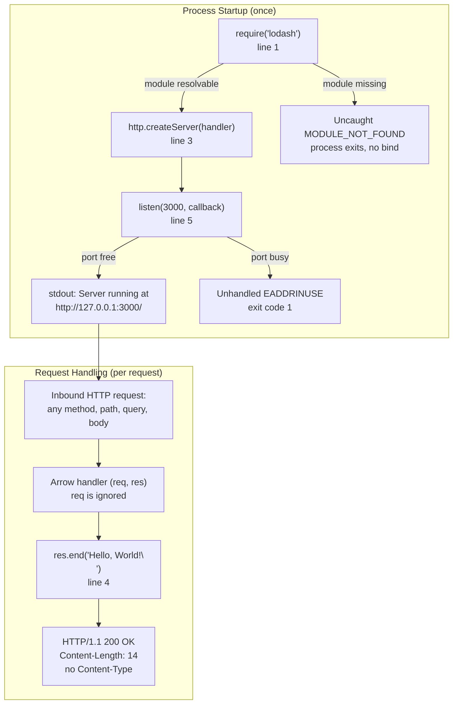

**Data flow.** Inbound request data has no destination: the handler never inspects method, URL, headers, or body, so nothing is parsed, validated, logged, or persisted. The outbound path is a single fixed byte sequence of 14 bytes (`Hello, World!` plus a newline, confirmed byte-for-byte). There is no data store, no cache, no session, and no file or network I/O beyond the socket write itself, so the process holds no application state across requests.

### 1.2.3 Success Criteria

**Measurable objectives.** The repository records none. There is no requirements document, no issue content in the checkout, no test suite, and no CI configuration, so it defines no target, no threshold, and no acceptance test. The table below presents the checks a reviewer can actually perform, each derived by this specification from the code's observed behavior; the "Objective type" column marks all of them as derived rather than authored by the project.

| Objective type | Check | Observed result | Evidence |
| --- | --- | --- | --- |
| Derived | Process reaches the listening state and prints the banner | Met only when `lodash` is resolvable; fails on a clean checkout | `server (1).js:1,5`; both runs performed |
| Derived | A client on port 3000 receives a response | Met: status 200 for `GET /` and for `POST /foo?bar=1` | `server (1).js:3-4`; both requests performed |
| Derived | Response is deterministic and independent of input | Met: identical status, headers (`Content-Length: 14`, no `Content-Type`), and 14-byte body for both requests | `server (1).js:3-4`; byte-level body inspection |
| Derived | A busy port is reported as a controlled failure | Not met: unhandled `EADDRINUSE` terminates the process with exit code 1 | `server (1).js:5`; second-instance run |

**Critical success factors.** Every factor below is mandatory for the artifact to function, and each is established by the code or by runtime observation.

| Factor | Why it is required | Evidence |
| --- | --- | --- |
| Resolvable `lodash` at load time | Line 1 is the first statement executed; unresolved, it aborts the process before any bind | `server (1).js:1`; verified `Cannot find module 'lodash'` |
| A Node.js runtime providing `http` and CommonJS `require` | The program is a script of that runtime only; no transpilation, build step, or polyfill exists | `server (1).js:1-5`; executed successfully under Node v22.23.3 |
| Port 3000 free, with permission to bind all interfaces | The port is hardcoded and the host is unspecified, so the OS chooses the wildcard address; a conflict is fatal | `server (1).js:5`; `EADDRINUSE: address already in use :::3000` |
| An HTTP client able to connect to the host | The only exposed capability is answering a request; no CLI, queue, or file interface exists | `server (1).js:3-4` |

**Key performance indicators.** No KPI, SLA, or service-level objective exists in the repository, and none can be measured from it: there is no metrics endpoint, no per-request logging, no tracing or APM instrumentation, no dashboard, and no test runner that could emit coverage. The only signals the system produces are the single startup banner and the fixed response.

| KPI dimension | Status in the repository | Evidence |
| --- | --- | --- |
| Availability, latency, error rate | Not instrumented; no `/health`, `/metrics`, or `/status` endpoint of any kind | `server (1).js:3-5`; whole-file inspection |
| Traffic or throughput | Not recorded; requests are not counted or logged | `server (1).js:3-4`; no logging statement exists |
| Test coverage or pass rate | Not measurable; no tests and no test tooling | Absence of test files and of a manifest to define test scripts |
| Operability (startup success rate) | Observable only through the banner and process exit status | `server (1).js:5`; exit code 1 observed on `EADDRINUSE` |

The determinism of the response is the one property that can be asserted without any instrumentation: because the handler reads no input and returns a constant, every request must produce the same 200 response with the same 14-byte body.


## 1.3 Scope

The repository contains no scope statement, no requirements list, and no roadmap. Because the checkout holds exactly one file, scope can be established exhaustively: everything listed as in-scope below is present in `server (1).js`, and everything listed as out-of-scope is absent from the entire repository, verified by a text search of every file plus a complete file listing.

### 1.3.1 In-Scope

**Core features and functionalities.** The repository assigns no priority to anything, so "must-have" here means exactly what the file implements — every capability the system has.

| Capability | Scope as implemented | Evidence |
| --- | --- | --- |
| Start an HTTP listener | Creates a server with the built-in `http` module and listens on port 3000; the startup callback confirms the bind | `server (1).js:3,5` |
| Report readiness | Writes one banner line to stdout, `Server running at http://127.0.0.1:3000/` | `server (1).js:5`; observed stdout |
| Answer any HTTP request | Returns status 200 with the constant body `Hello, World!\n` for every request | `server (1).js:3-4`; verified `GET /`, `POST /foo?bar=1` |
| Bind a load-time module | Loads `lodash` into `_`; the binding is unused but its resolution is mandatory | `server (1).js:1` |

**Primary user workflows.** Two workflows exist, both single-step and both verified by execution.

1. **Operator start-up.** Run the script with a Node.js runtime (`node "server (1).js"`). Requires `lodash` to be resolvable and port 3000 to be free. On success the process stays in the foreground and prints the banner; on a missing module it exits before binding, and on a busy port it exits with `EADDRINUSE` and code 1.
2. **Client request.** Any HTTP client opens a connection to port 3000 and sends a request. The response is always `HTTP/1.1 200 OK` with `Content-Length: 14` and body `Hello, World!\n`, regardless of method, path, query string, or body. There is no second step, no redirect, and no state carried into a follow-up request.

**Essential integrations.** Only three integration points exist, and one of them is broken as delivered.

| Integration | Direction | Status | Evidence |
| --- | --- | --- | --- |
| Node.js built-in `http` module | In-process, load time | Active; the server is built entirely from it | `server (1).js:3` |
| `lodash` package | In-process, load time | Unresolved: no manifest declares it and no `node_modules` exists, so startup aborts (`Cannot find module 'lodash`) | `server (1).js:1`; runtime execution |
| OS network stack on TCP port 3000 | Inbound, runtime | Active once started; listener on all interfaces | `server (1).js:5`; procfs listener on `:::3000` |

**Key technical requirements.**

| Requirement | Value in this system | Evidence |
| --- | --- | --- |
| Runtime | Node.js with CommonJS `require` and the `http` module; no build, transpile, or bundling step exists | `server (1).js:1-5`; executed under Node v22.23.3 |
| Language features used | `const`, arrow functions, callbacks; no classes, `async`/`await`, or `Promise` usage | `server (1).js:1-5` |
| Third-party module resolution | `lodash` must resolve from the script's directory at load time | `server (1).js:1`; verified failure when absent |
| Network endpoint | Port 3000, hardcoded; no host argument, so the OS wildcard address is used (dual-stack, IPv4 and IPv6) | `server (1).js:5`; `EADDRINUSE ... :::3000` |
| Host resources | Ability to bind all interfaces on port 3000, and a writable stdout | `server (1).js:5`; both exercised during verification |

**Implementation boundaries.**

| Boundary dimension | Inside the boundary | Outside the boundary |
| --- | --- | --- |
| System boundary | One OS process, one 5-line script, one listening socket on TCP port 3000 | No child processes, workers, clusters, schedulers, or companion services exist |
| User groups covered | Anonymous, unauthenticated HTTP clients with TCP reachability to the host; no roles, tenants, or accounts are modelled | No authenticated users, administrators, or tenant groups; no authentication or authorization code exists |
| Geographic / market coverage | None defined: no hosting configuration, region setting, domain name, TLS certificate, or deployment asset appears in the repository | All matters of distribution, hosting, and market reach are unaddressed by the code |
| Data domains included | One in-memory constant string literal, `Hello, World!\n`; nothing is read from or written to any store | No databases, files, caches, queues, sessions, logs, or analytics; no personal or business data is handled |

### 1.3.2 Out-of-Scope

**Explicitly excluded features.** Absent by construction from the whole checkout, hence out of scope for this system as delivered:

| Capability area | Status | Evidence |
| --- | --- | --- |
| Routing and URL handling | Absent: the request object is never read, so no path or method distinction exists | `server (1).js:3-4` |
| Request processing (parsing, validation, bodies, query strings, headers, cookies) | Absent: no parsing code exists and the request stream is never consumed | `server (1).js:3-4` |
| Response shaping (status codes other than 200, `Content-Type`, redirects, compression, CORS) | Absent: a single literal is written with `res.end` | `server (1).js:4`; verified headers lack `Content-Type` |
| Static file or template serving | Absent: no filesystem access of any kind exists in the repository | Whole-file inspection; no `fs` usage anywhere |
| Persistence, caching, and sessions | Absent: no database driver, cache client, or state object exists | Whole-repository search for module loading finds only `http` and `lodash` |
| Authentication, authorization, tenancy | Absent: no credential, token, session, or role logic exists | `server (1).js:1-5` |
| Configuration management | Absent: the port is a literal and no environment variable or config file is read | `server (1).js:5` |
| Error handling and graceful shutdown | Absent: no `error` listener, `try`/`catch`, signal handler, or shutdown path exists; startup faults are unhandled exceptions | `server (1).js:3-5`; unhandled `EADDRINUSE`, exit code 1 |
| Observability (logging, metrics, tracing, health checks) | Absent: the sole output is the one-time banner | `server (1).js:5` |
| Security controls (TLS/HTTPS, rate limiting, input filtering, security headers) | Absent: plain HTTP only, and no request input is inspected or restricted | `server (1).js:3-5` |
| Packaging, containerization, and deployment | Absent: no `package.json`, lockfile, `Dockerfile`, manifest, or CI configuration exists | Root listing; `git ls-files` |
| Automated testing and quality gates | Absent: no test files, no test framework, no linter configuration, no continuous integration | Whole-repository listing |
| Documentation | Absent: no README, no API description, no license file | Whole-repository listing |

**Future phase considerations.** None are recorded. The history is a single commit (`88dcb7d`) that added this file and nothing since; there is no roadmap, backlog, or issue content in the checkout to indicate planned work. Both branches (`main` and the checked-out `0611_01`) point at that same commit, so no divergent line of development exists in the repository.

**Integration points not covered.** No outbound integration of any kind is implemented or referenced: no upstream HTTP or gRPC service, no database, no message broker, no object store, no identity provider, no payment or notification service, and no telemetry backend. The only integration the repository even attempts is the load-time import of `lodash`, which fails on a clean checkout.

**Unsupported use cases.** Out of scope because no corresponding code exists: serving more than one distinct resource or response; distinguishing or restricting HTTP methods; handling bodies, uploads, or streaming responses; sustaining production traffic (no concurrency control, backpressure handling, health checking, or restart supervision); using the service over TLS; deploying to more than one instance on a host (the hardcoded port prevents a second copy from binding); and any multi-user, multi-tenant, or audited operation.


## 1.4 References

- `server (1).js` - the only tracked file and the entire system: 5 lines establishing the `lodash` binding (line 1), the `http.createServer` handler returning `Hello, World!\n` (lines 3–4), and the port-3000 listener with its startup banner (line 5).
- `/` (repository root folder) - inventory establishing that the folder holds exactly one first-order child file, `server (1).js`, and the `.git` folder, and therefore that no manifest, test, documentation, or deployment file exists anywhere in the checkout.
- `.git/` - repository metadata: remote `origin` = `github.com/lakshya-blitzy/0610_hello_world.git`, branches `main` and `0611_01` both pointing at the single commit `88dcb7d` ("Add files via upload", `lakshya-blitzy <lakshya@blitzy.com>`, Tue Oct 6 18:14:42 2026 +0530).
- Runtime environment used to verify the documented behavior: Node.js v22.23.3 with npm 11.21.0. Verified results reported in this section: startup failure `Error: Cannot find module 'lodash'`; banner `Server running at http://127.0.0.1:3000/`; identical `HTTP/1.1 200 OK` responses with `Content-Length: 14`, no `Content-Type`, and body `Hello, World!\n` for `GET /` and `POST /foo?bar=1`; listener on the wildcard address `:::3000`; and unhandled `EADDRINUSE: address already in use :::3000` with exit code 1 for a second instance.
- No web sources were used: external retrieval was unavailable during this investigation, so no claim about an external dependency version is made anywhere in this section.


# 2. Product Requirements

## 2.1 Feature Catalog

The repository records no product requirements of any kind: no README, no manifest, no issues or roadmap in the checkout, and no test suite that states expected behavior (Section 1.2). The catalog below is therefore a **reverse documentation** of `server (1).js` — every feature is a behavior the file actually exhibits, verified by reading the file and by executing it under Node v22.23.3. Nothing is aspirational and nothing is inferred from intent; where the product has no requirement, the tables say so.

**Completeness claim.** The feature set is exhaustive by construction rather than by sampling: the entire system is one 5-line file (185 bytes), and a text search of the whole checkout for module loading returns exactly two hits, both in that file — `require('lodash')` on line 1 and `require('http')` on line 3. The file contains one listener, one `res.end` call, and one `console.log`. The four features below account for all six content lines of the system.

### 2.1.1 Feature Index

| Feature ID | Feature name | Category | Priority |
| --- | --- | --- | --- |
| F-001 | Load-Time Dependency Binding | Startup & Dependency Loading | Critical |
| F-002 | HTTP Listener Establishment | Networking / Service Startup | Critical |
| F-003 | Startup Readiness Banner | Operability / Process Signaling | Low |
| F-004 | Uniform Greeting Response | Core HTTP Service / Request Handling | Critical |

Priority is assigned by this specification from functional necessity, since the repository assigns none: F-001, F-002 and F-004 are Critical because the process cannot serve at all without each of them (`server (1).js:1,3,5`), while F-003 is Low because no code and no automated consumer depends on it — it is a single informational line and it additionally misstates the bind address.

**Status convention.** All four features carry status **Completed**, meaning the implementing statement is present in the tracked file. This is a statement about code presence only. Feature F-001 is Completed in code yet non-operational as delivered, because the module it loads is neither declared nor installed (Section 1.2.1).

### 2.1.2 F-001 — Load-Time Dependency Binding

**Metadata**

| Attribute | Value | Evidence |
| --- | --- | --- |
| Feature ID / name | F-001 Load-Time Dependency Binding | `server (1).js:1` |
| Category | Startup & Dependency Loading | — |
| Priority / status | Critical / Completed | `server (1).js:1`; runtime failure when unresolvable |

**Description**

- **Overview.** The first statement the process executes resolves the package `lodash` and binds its export to the module-scope constant `_`. The resolution is mandatory: if it fails, the process terminates before any server object or socket exists.
- **Business value.** None is recorded, and none can be derived: the repository holds no product description, no license, and no commercial context, and a binding that is never read cannot produce an outcome a customer would pay for. The feature's only demonstrable effect is negative — it withholds the service on a clean checkout.
- **User benefits.** None. No user-visible behavior depends on this feature; deleting lines 1–2 leaves runtime behavior byte-identical, as verified below.
- **Technical context.** `const _ = require('lodash');` is the whole implementation. The identifier is never referenced again — a grep for `_` across the file matches line 1 only — so the binding is dead code whose sole effect is the load-time gate. The gate is currently closed: no `package.json` declares the dependency and no `node_modules` directory exists anywhere in the checkout, so `require.resolve('lodash')` from the repository root raises `MODULE_NOT_FOUND`. Verification: a copy of the file with lines 1–2 removed starts successfully and returns `HTTP/1.1 200 OK` with the 14-byte body from a directory where `lodash` is unresolvable (no `node_modules` in that directory or any ancestor), proving the dependency contributes no behavior.

**Dependencies**

| Dependency type | Detail | Evidence |
| --- | --- | --- |
| Prerequisite features | None; F-001 is the first executed statement and gates F-002, F-003 and F-004 | `server (1).js:1` before lines 3–5 |
| System dependencies | Node.js CommonJS `require` and the Node module-resolution algorithm (walking `node_modules` upward from the script directory) | Runtime error `Cannot find module 'lodash'`; Node v22.23.3 |
| External dependencies | The `lodash` package itself — undeclared, unpinned and absent | Whole-checkout listing (1 file, no manifest); `require.resolve` failure |
| Integration requirements | None at runtime; the only integration is the install-time npm registry, which the missing manifest renders unreachable | Absence of `package.json` anywhere in the checkout |

### 2.1.3 F-002 — HTTP Listener Establishment

**Metadata**

| Attribute | Value | Evidence |
| --- | --- | --- |
| Feature ID / name | F-002 HTTP Listener Establishment | `server (1).js:3,5` |
| Category | Networking / Service Startup | — |
| Priority / status | Critical / Completed | `server (1).js:3,5`; listening socket observed |

**Description**

- **Overview.** The process builds an HTTP server from Node's built-in `http` module and binds it to TCP port 3000 in a single statement, passing two inline arrow callbacks: the request handler and the post-bind listener callback. The process stays in the foreground for the life of the listener.
- **Business value.** None is recorded. The demonstrable value is technical: a bound socket on port 3000 is the system's single integration surface and the precondition for every externally observable behavior.
- **User benefits.** A caller able to reach the host gains a deterministic endpoint that always answers; the listener is what makes any request possible at all.
- **Technical context.** `require('http').createServer(handler).listen(3000, callback)` is the whole implementation — no framework, router, middleware, TLS terminator or reverse proxy appears anywhere in the repository. Because `listen` receives a port but no host argument, the OS selects the wildcard address: the socket appears in `/proc/net/tcp6` as `00000000000000000000000000000000:0BB8` in state `0A` (LISTEN), i.e. all interfaces on both stacks, and the failure message for a second instance names `:::3000`. The port is a source literal; a grep for `process.env`, `process.argv`, `require('fs')` and `config` in the file returns zero matches, so no environment variable, argument, or file can change it. There is no `error` listener, `try`/`catch`, or signal handler in the file, so bind faults are unhandled: a second instance exits with code 1 after `Error: listen EADDRINUSE: address already in use :::3000`, and SIGTERM terminates the process with default disposition, releasing the port without any shutdown output.

**Dependencies**

| Dependency type | Detail | Evidence |
| --- | --- | --- |
| Prerequisite features | F-001 must succeed first; the listener is never reached when the `lodash` load fails | `server (1).js:1,5`; observed `MODULE_NOT_FOUND` with no bind |
| System dependencies | Node.js `http` module, OS TCP stack, permission to bind all interfaces on port 3000, a writable stdout for the callback | `server (1).js:3,5`; LISTEN entry; observed `EADDRINUSE` |
| External dependencies | None. No certificate, DNS entry, load balancer, container runtime or orchestrator is referenced in the repository | Whole-checkout listing; grep finds no `https`/`tls` usage |
| Integration requirements | Inbound only: any client that can open a TCP connection to port 3000 on the host is served, with no authentication step | `server (1).js:3-4`; verified 200 for unauthenticated requests |

### 2.1.4 F-003 — Startup Readiness Banner

**Metadata**

| Attribute | Value | Evidence |
| --- | --- | --- |
| Feature ID / name | F-003 Startup Readiness Banner | `server (1).js:5` |
| Category | Operability / Process Signaling | — |
| Priority / status | Low / Completed | `server (1).js:5`; observed stdout |

**Description**

- **Overview.** After the socket binds, the listener callback writes one line to stdout: `Server running at http://127.0.0.1:3000/`. It is the only output the system produces beyond HTTP responses.
- **Business value.** None is recorded. Its operational value is that it is the sole readiness signal an operator has, since the repository defines no health endpoint, no metric and no log framework.
- **User benefits.** None directly: the line is written to the process's own stdout, not to any client. It confirms to the operator that the bind succeeded.
- **Technical context.** The message is a hardcoded string literal in the `listen` callback. It is emitted exactly once per process, never per request — after roughly fifteen requests of varied methods, the log still contained only this line and stderr remained empty. The address it advertises does not match the socket actually bound: the banner claims `127.0.0.1` (loopback only) while the listener occupies the wildcard address on all interfaces, so the banner understates the service's real exposure. The text also duplicates the port literal, so the two can drift independently.

**Dependencies**

| Dependency type | Detail | Evidence |
| --- | --- | --- |
| Prerequisite features | F-002: the callback runs only after a successful bind | `server (1).js:5`; no banner observed on `EADDRINUSE` or `MODULE_NOT_FOUND` |
| System dependencies | A writable stdout attached to the process; the `console.log` behavior of the Node runtime | `server (1).js:5`; observed stdout capture |
| External dependencies | None; no log collector, syslog, or logging library is referenced | Whole-checkout listing; no logging module required |
| Integration requirements | None. Nothing in the repository consumes the line, and no test asserts on it | Single commit, no test files, no CI configuration |

### 2.1.5 F-004 — Uniform Greeting Response

**Metadata**

| Attribute | Value | Evidence |
| --- | --- | --- |
| Feature ID / name | F-004 Uniform Greeting Response | `server (1).js:3-4` |
| Category | Core HTTP Service / Request Handling | — |
| Priority / status | Critical / Completed | `server (1).js:3-4`; verified for all methods |

**Description**

- **Overview.** Every request the runtime's HTTP parser accepts is answered with status 200 and the constant body `Hello, World!\n` — 14 bytes, verified byte-for-byte. No request attribute influences the response.
- **Business value.** None is recorded. This is the only capability visible to a consumer, and its demonstrated value is limited to confirming reachability and process liveness with a fixed payload.
- **User benefits.** Any caller reaches a predictable, always-available acknowledgement without credentials, parameters, or content negotiation. The same determinism means the endpoint cannot be used to retrieve or change any data.
- **Technical context.** The handler is an inline arrow function whose body is a single `res.end('Hello, World!\n')`; `req` is accepted and never read, so method, path, query string, headers and body are all discarded without inspection. Verified outcomes: `GET /`, `POST /foo?bar=1&baz=2` (with `Content-Type`, `Accept` and `Authorization` headers plus a body), `DELETE /a/b/c/d`, `PUT /big` with a 64 KiB body and `OPTIONS *` all returned `HTTP/1.1 200 OK` with headers `Date`, `Connection: keep-alive`, `Keep-Alive: timeout=5`, `Content-Length: 14` and no `Content-Type`. Because the handler never consumes the request body, it answers before the body arrives: a request declaring `Content-Length: 10000000` but carrying only 4 body bytes received the full response in 4 ms. Connection handling, `HEAD` body suppression (200 with no body and no `Content-Length`), HTTP/1.0 `Connection: close`, keep-alive reuse, pipelining and the `400 Bad Request` issued for unparseable request lines are all Node runtime behaviors, not application code — the file contains no status code, conditional, or error branch.

**Dependencies**

| Dependency type | Detail | Evidence |
| --- | --- | --- |
| Prerequisite features | F-002 (a listening socket) and, transitively, F-001 | `server (1).js:1,3,5`; no response possible without a successful bind |
| System dependencies | Node.js `http` server and HTTP/1.1 parser, the event loop, and the socket write path; no filesystem, database or outbound network use | `server (1).js:3-4`; grep shows no `fs`, database or HTTP-client usage |
| External dependencies | None. The body is an in-memory string literal, so no data source, template or asset is required | `server (1).js:4`; whole-checkout listing holds no asset files |
| Integration requirements | Inbound HTTP only, over cleartext TCP on port 3000, with no authentication, authorization or tenancy model to satisfy | `server (1).js:3-5`; `Authorization` header observed to be ignored |


## 2.2 Functional Requirements Table

No requirement text, acceptance test, or issue exists anywhere in the repository, so every requirement below is **derived by this specification** from the observable behavior of `server (1).js` (5 lines, 185 bytes) and its verified runtime results under Node v22.23.3. Each requirement is written to be testable against the code as it stands, and each acceptance criterion names what has actually been observed. Priority labels (Must-Have / Should-Have / Could-Have) and complexity ratings are assigned by this specification from functional necessity, because the project records none.

**Requirement inventory**

| Requirement ID | Feature | Priority | Complexity |
| --- | --- | --- | --- |
| F-001-RQ-001 | F-001 Load-time dependency binding | Must-Have | Low |
| F-001-RQ-002 | F-001 Load-time dependency binding | Could-Have | Low |
| F-002-RQ-001 | F-002 HTTP listener establishment | Must-Have | Low |
| F-002-RQ-002 | F-002 HTTP listener establishment | Must-Have | Low |
| F-002-RQ-003 | F-002 HTTP listener establishment | Must-Have | Low |
| F-002-RQ-004 | F-002 HTTP listener establishment | Should-Have | Low |
| F-003-RQ-001 | F-003 Startup readiness banner | Should-Have | Low |
| F-003-RQ-002 | F-003 Startup readiness banner | Could-Have | Low |
| F-004-RQ-001 | F-004 Uniform greeting response | Must-Have | Low |
| F-004-RQ-002 | F-004 Uniform greeting response | Must-Have | Low |
| F-004-RQ-003 | F-004 Uniform greeting response | Must-Have | Low |
| F-004-RQ-004 | F-004 Uniform greeting response | Should-Have | Low |
| F-004-RQ-005 | F-004 Uniform greeting response | Could-Have | Low |

Complexity is uniformly Low because the whole system is five statements with no branching, no I/O beyond one socket write, and no state; no requirement here implies algorithmic or data-modelling work.

### 2.2.1 F-001 — Load-Time Dependency Binding Requirements

**Requirement details**

| Requirement ID | Description | Acceptance criteria | Priority |
| --- | --- | --- | --- |
| F-001-RQ-001 | Resolve the package `lodash` from the script's module resolution path at load time, before any server object is constructed. | With a resolvable module named `lodash`, execution proceeds past line 1 and reaches the listener. With none, the process exits with code 1, prints `Error: Cannot find module 'lodash'` to stderr, writes nothing to stdout, and opens no listening socket — all three observed on the clean checkout. | Must-Have |
| F-001-RQ-002 | Bind the resolved export to the module-scope constant `_`. | Static inspection shows exactly one `require('lodash')`, bound to `_` on line 1, and a grep for `_` in the file matches line 1 only, i.e. the binding is never read. A variant with lines 1–2 deleted serves identical responses from a directory where `lodash` is unresolvable, so the binding has no behavioral effect. | Could-Have |

**Technical specifications**

| Requirement ID | Input parameters | Output / response | Data requirements |
| --- | --- | --- | --- |
| F-001-RQ-001 | None. No argument, environment variable, or configuration file influences the load. | A module-scope binding named `_`; on failure, a `MODULE_NOT_FOUND` error and process exit 1. | The `lodash` package must exist on the resolution path. Absent in the repository: no `package.json`, no lockfile, and no `node_modules` directory anywhere in the checkout. |
| F-001-RQ-002 | None. | A constant `_` holding the package export, never referenced again. | None; nothing is serialized, stored, or passed on. |

**Performance criteria**

| Requirement ID | Criterion | Basis of measurement | Observed value |
| --- | --- | --- | --- |
| F-001-RQ-001 | Synchronous module resolution completes before any bind is attempted. | Process startup order: resolution failure exits before a socket exists. | Verified — no LISTEN socket appeared on the `MODULE_NOT_FOUND` run. |
| F-001-RQ-002 | No performance criterion is recorded or implied. | Not instrumented: no timer, metric, or log exists. | Not measurable from the repository. |

**Validation rules**

| Requirement ID | Business rules | Data validation |
| --- | --- | --- |
| F-001-RQ-001 | None recorded. The only rule the code enforces is mandatory load: the dependency is required whether or not it is later used. | None. No value, payload, or record is validated at load time; the requirement concerns module presence only. |
| F-001-RQ-002 | None. The binding is dead code and enforces nothing. | None. |

| Requirement ID | Security requirements | Compliance requirements |
| --- | --- | --- |
| F-001-RQ-001 | None implemented. No integrity or provenance verification of the module exists (no lockfile, no signature or hash check), and the dependency version is unpinned because no manifest declares it. | None recorded. The repository has no license file and no supply-chain policy. |
| F-001-RQ-002 | None implemented. | None recorded. |

### 2.2.2 F-002 — HTTP Listener Establishment Requirements

**Requirement details**

| Requirement ID | Description | Acceptance criteria | Priority |
| --- | --- | --- | --- |
| F-002-RQ-001 | Construct an HTTP server from Node's built-in `http` module, supplying a request handler that receives the request and response objects. | `http.createServer` is invoked once with a two-parameter function; no third-party HTTP framework is loaded anywhere in the checkout (a text search for module loading finds only `lodash` and `http`). | Must-Have |
| F-002-RQ-002 | Bind the listener to TCP port 3000 on the OS-selected wildcard address, and run a callback once the bind succeeds. | The socket appears in `/proc/net/tcp6` on port `0BB8` (hex 3000) with an all-zero local address in state `0A` (LISTEN), i.e. all interfaces and both stacks; a conflicting bind reports `address already in use :::3000`. | Must-Have |
| F-002-RQ-003 | Keep the port a fixed source literal with no configuration surface. | Greps for `process.env`, `process.argv`, `require('fs')` and `config` in the file return zero matches; changing the port requires editing line 5. | Must-Have |
| F-002-RQ-004 | Terminate the process on a bind failure rather than continuing in a degraded state. | A second instance exits with code 1 and stderr `Error: listen EADDRINUSE: address already in use :::3000`, surfaced as an unhandled `error` event at line 5; no `on('error')` handler exists in the file, so the failure is fail-fast rather than a controlled error path. | Should-Have |

**Technical specifications**

| Requirement ID | Input parameters | Output / response | Data requirements |
| --- | --- | --- | --- |
| F-002-RQ-001 | A request handler of two parameters, `(req, res)`, defined inline. | An `http.Server` instance held only by the chained `.listen` call; the file exports nothing. | None. |
| F-002-RQ-002 | The literal `3000` as the port; no host argument, hence the wildcard address. | A bound listening socket, plus one invocation of the post-bind callback (F-003). | None. |
| F-002-RQ-003 | None accepted — no environment, argument, or file is read. | A fixed port for every process instance, which also means only one instance can bind per host. | None. |
| F-002-RQ-004 | An occupiable port 3000 and bind permission on all interfaces. | Process exit code 1 with the `EADDRINUSE` message on stderr and no stdout output. | None. |

**Performance criteria**

| Requirement ID | Criterion | Basis of measurement | Observed value |
| --- | --- | --- | --- |
| F-002-RQ-001 | None recorded. | Not instrumented. | Not measurable from the repository. |
| F-002-RQ-002 | The process must reach the listening state promptly after start; no target time is recorded. | Elapsed time from process start to the presence of a LISTEN socket. | Reached within the ~1.2 s observation window used for every run; the code performs no work between start and bind beyond one module load. |
| F-002-RQ-003 | None recorded. | Not instrumented. | Not measurable from the repository. |
| F-002-RQ-004 | Failure must be immediate, i.e. no retry loop or backoff. | Time from start to exit on a busy port. | Immediate: the second instance exited without ever printing the banner or binding. |

**Validation rules**

| Requirement ID | Business rules | Data validation |
| --- | --- | --- |
| F-002-RQ-001 | None recorded. The service accepts any request the runtime parses and applies no routing rule. | None. No request data is validated at the server level. |
| F-002-RQ-002 | Only one instance per host may hold the port; the second exits. | None. |
| F-002-RQ-003 | The port is a constant of the product, not a deployment parameter. | None; no value is read, so none can be rejected. |
| F-002-RQ-004 | Failure is reported only through the process exit status and stderr; there is no health or status signal. | None. |

| Requirement ID | Security requirements | Compliance requirements |
| --- | --- | --- |
| F-002-RQ-001 | None implemented. Cleartext HTTP only: no `https` or `tls` usage appears in the file. | None recorded. |
| F-002-RQ-002 | None implemented, and the wildcard bind is itself the material exposure: the service answers on every interface, not just loopback as the startup banner claims. | None recorded. |
| F-002-RQ-003 | None implemented. No allow-list, bind-address restriction, or privilege-separation option exists. | None recorded. |
| F-002-RQ-004 | None implemented. No `error` listener, `try`/`catch`, or signal handler exists, so fault paths are unguarded and SIGTERM terminates the process with default disposition. | None recorded. |

### 2.2.3 F-003 — Startup Readiness Banner Requirements

**Requirement details**

| Requirement ID | Description | Acceptance criteria | Priority |
| --- | --- | --- | --- |
| F-003-RQ-001 | Emit exactly one readiness line to stdout when the listener callback fires, reading `Server running at http://127.0.0.1:3000/`. | Stdout contains that exact line, once per process; stderr is empty on success; the line is absent when the `lodash` load or the bind fails; after roughly fifteen requests of varied methods the log still contains only this line. | Should-Have |
| F-003-RQ-002 | Report the service endpoint in the banner. | The banner states `http://127.0.0.1:3000/` while the socket is bound to the wildcard address (`/proc/net/tcp6` LISTEN on `0BB8`, `:::3000` in the bind-failure message). The advertised address therefore understates the real exposure and is documented as a known inaccuracy rather than a satisfied requirement. | Could-Have |

**Technical specifications**

| Requirement ID | Input parameters | Output / response | Data requirements |
| --- | --- | --- | --- |
| F-003-RQ-001 | None. The string is a literal in the `listen` callback. | One line on stdout, terminated by a newline: the observed log is exactly `Server running at http://127.0.0.1:3000/`. | None; nothing is read from or written to a store. |
| F-003-RQ-002 | None. The host and port appear as literals rather than being derived from the bound socket. | The fixed text above, which can drift from the real bind because it duplicates the port literal. | None. |

**Performance criteria**

| Requirement ID | Criterion | Basis of measurement | Observed value |
| --- | --- | --- | --- |
| F-003-RQ-001 | The line must appear once, and once only, per process lifetime. | Line count on stdout after start plus ~15 requests. | One line; no per-request output was added. |
| F-003-RQ-002 | None recorded. | Not instrumented. | Not measurable from the repository. |

**Validation rules**

| Requirement ID | Business rules | Data validation |
| --- | --- | --- |
| F-003-RQ-001 | Readiness is signalled by a console line, not by a health endpoint; no `/health`, `/status`, or `/metrics` route exists. | None. The line is emitted unconditionally after a successful bind. |
| F-003-RQ-002 | None; the message is informational and nothing in the repository consumes it. | None. The address text is validated against the actual socket only by an operator reading it. |

| Requirement ID | Security requirements | Compliance requirements |
| --- | --- | --- |
| F-003-RQ-001 | None implemented. The banner writes to stdout with no redaction or level control; no logging library or collector is configured. | None recorded. No audit-trail obligation is stated or satisfied. |
| F-003-RQ-002 | The banner's loopback claim conflicts with the wildcard bind, so an operator relying on it alone would misjudge the service's network exposure. | None recorded. |

### 2.2.4 F-004 — Uniform Greeting Response Requirements

**Requirement details**

| Requirement ID | Description | Acceptance criteria | Priority |
| --- | --- | --- | --- |
| F-004-RQ-001 | Answer every request the runtime's parser accepts with status 200 and the constant body `Hello, World!\n`. | Identical response for `GET /`, `POST /foo?bar=1&baz=2` (with `Content-Type`, `Accept` and `Authorization` headers and a body), `DELETE /a/b/c/d`, `PUT /big` with a 64 KiB body, and `OPTIONS *`; status line `HTTP/1.1 200 OK`, `Content-Length: 14`, and a 14-byte body verified by byte dump (`H e l l o , ␠ W o r l d ! \n`). | Must-Have |
| F-004-RQ-002 | Emit no application-defined response headers; the response body and status are the entire contract. | Raw header dump contains only runtime defaults — `Date`, `Connection: keep-alive`, `Keep-Alive: timeout=5`, `Content-Length: 14` — and no `Content-Type`; no cache, CORS, or security headers appear. For `HEAD /`, the response is `200` with no body and no `Content-Length`. | Must-Have |
| F-004-RQ-003 | Produce the response without reading the request. | The handler body is a single `res.end(...)` call and `req` is never referenced (no method, URL, header, query, or body access exists in the file); a request declaring `Content-Length: 10000000` with only 4 body bytes sent received the complete response in 4 ms. | Must-Have |
| F-004-RQ-004 | Serve HTTP/1.1 clients over persistent connections and close HTTP/1.0 connections. | Two pipelined `GET`s on one socket return two `200` responses; sequential keep-alive requests both return `Connection: keep-alive`; an HTTP/1.0 request without `Host` returns `200` with `Connection: close` and the body. This is Node runtime behavior, not application code. | Should-Have |
| F-004-RQ-005 | Reject requests the HTTP parser cannot parse, without application logic. | `FOOBAR /x HTTP/1.1` and a malformed request line both receive `HTTP/1.1 400 Bad Request` with `Connection: close`, generated by the runtime parser; the file contains no status code, conditional, or error branch, so the application contributes nothing to this outcome. | Could-Have |

**Technical specifications**

| Requirement ID | Input parameters | Output / response | Data requirements |
| --- | --- | --- | --- |
| F-004-RQ-001 | None consumed. Method, path, query string, headers and body are all ignored. | `HTTP/1.1 200 OK`, `Content-Length: 14`, body `Hello, World!\n`. | One in-memory string literal. No data store, session, cache, or file is involved. |
| F-004-RQ-002 | None. | Response headers limited to runtime defaults; no `Content-Type`, so the body's media type is undeclared. | None. |
| F-004-RQ-003 | None; the request stream is never consumed or drained by the handler. | The response is written as soon as the handler runs, independent of any body, and Node's parser frames and drains the unread body so the connection stays reusable. | None. No body-size limit, upload handling, or 413 path exists. |
| F-004-RQ-004 | An HTTP/1.1 or HTTP/1.0 connection to port 3000. | `Connection: keep-alive` with `Keep-Alive: timeout=5` for HTTP/1.1; `Connection: close` for HTTP/1.0. | None. |
| F-004-RQ-005 | A request line conforming to HTTP syntax. | `HTTP/1.1 400 Bad Request` with `Connection: close` for input the parser rejects. | None. |

**Performance criteria**

| Requirement ID | Criterion | Basis of measurement | Observed value |
| --- | --- | --- | --- |
| F-004-RQ-001 | No latency, throughput, or availability target is recorded; the response must merely be invariant per request. | Repeated requests across methods, paths, headers and bodies compared for identical status, headers, and body bytes. | Invariant in every case; no KPI, SLA, or metric endpoint exists to measure against. |
| F-004-RQ-002 | Header stability across requests; only `Date` varies. | Raw response dumps. | Confirmed — the same four headers every time, with `Date` advancing. |
| F-004-RQ-003 | The response must not wait on the request body, and the handler must not block. | Time from request to response while the body is deliberately incomplete, plus reading the handler for I/O calls. | Full response after 4 ms with 4 of 10,000,000 declared body bytes sent; the handler performs no I/O of its own, so response production is bounded by the single socket write. |
| F-004-RQ-004 | Connections must remain usable for more than one exchange under HTTP/1.1. | Pipelined and sequential requests on one socket. | Two `200` responses for the pipelined case; keep-alive reuse confirmed sequentially and after a body-carrying request. |
| F-004-RQ-005 | Unparseable input must be rejected, not answered with the greeting. | Raw socket probe of an unsupported method and a malformed request line. | `400 Bad Request` with `Connection: close` in both cases. |

**Validation rules**

| Requirement ID | Business rules | Data validation |
| --- | --- | --- |
| F-004-RQ-001 | One rule governs the whole service: every parsed request is successful. There is no routing, no method restriction, and no success or failure branch. | None implemented. No input is inspected, so nothing is accepted, rejected, or normalized on the basis of its content. |
| F-004-RQ-002 | The contract consists of status and body only; content negotiation is not offered. | None. Request `Accept` and `Content-Type` headers were sent and had no effect. |
| F-004-RQ-003 | The request is treated as a trigger, never as input. | None. Body bytes are neither parsed nor length-limited. |
| F-004-RQ-004 | Connection lifetime is delegated to the runtime's HTTP defaults. | None. |
| F-004-RQ-005 | Malformed-protocol handling is delegated to the runtime parser. | Syntax validation of the request line is performed by Node, not by the application. |

| Requirement ID | Security requirements | Compliance requirements |
| --- | --- | --- |
| F-004-RQ-001 | None implemented — no authentication, authorization, session, tenancy, or rate limiting exists. An `Authorization: Bearer xyz` header was sent with a request and the response was indistinguishable from an unauthenticated one. | None recorded. |
| F-004-RQ-002 | None implemented. No security headers (`Strict-Transport-Security`, `X-Content-Type-Options`, `Cache-Control`, or CORS policy) are emitted, and no `Content-Type` is declared. | None recorded. |
| F-004-RQ-003 | None implemented. Unbounded declared body sizes are accepted without a size check, and no input-filtering capability exists. | None recorded. |
| F-004-RQ-004 | None implemented. The service is cleartext; persistent connections are governed only by runtime defaults. | None recorded. |
| F-004-RQ-005 | None implemented. Rejection behavior is the parser's default and exposes no application detail, but no security control is asserted here. | None recorded. |

**Cross-references.** The startup and per-request paths these requirements describe are drawn in the flowchart in Section 1.2.2 (High-Level Description). The capabilities declared in scope, and the absent capabilities each requirement above refrains from asserting, are enumerated in Section 1.3.1 and Section 1.3.2. Implementation constraints behind these requirements are detailed in Section 2.4.


## 2.3 Feature Relationships

Relationships below are limited to those the code itself establishes. Because `server (1).js` is a single file with no modules, no exports, and no state, its four features relate through one linear startup chain and one shared runtime, and in no other way. No relationship is asserted that the file does not show.

### 2.3.1 Feature Dependency Map

| Feature | Depends on | Relationship type | Evidence |
| --- | --- | --- | --- |
| F-001 Load-time dependency binding | — | Entry point of the chain; depends on nothing in the system | `server (1).js:1` is the first statement executed |
| F-002 HTTP listener establishment | F-001 | Hard gate: the listener is unreachable if the module load fails, and no fallback or retry exists | `server (1).js:1,3,5`; `MODULE_NOT_FOUND` exits before any bind |
| F-003 Startup readiness banner | F-002 | Triggered by the post-bind callback; absent on any bind failure | `server (1).js:5`; no banner on `EADDRINUSE` |
| F-004 Uniform greeting response | F-002 (and transitively F-001) | Requires an accepting socket; independent of F-003 | `server (1).js:3-4`; responses served with the banner emitted once at startup |

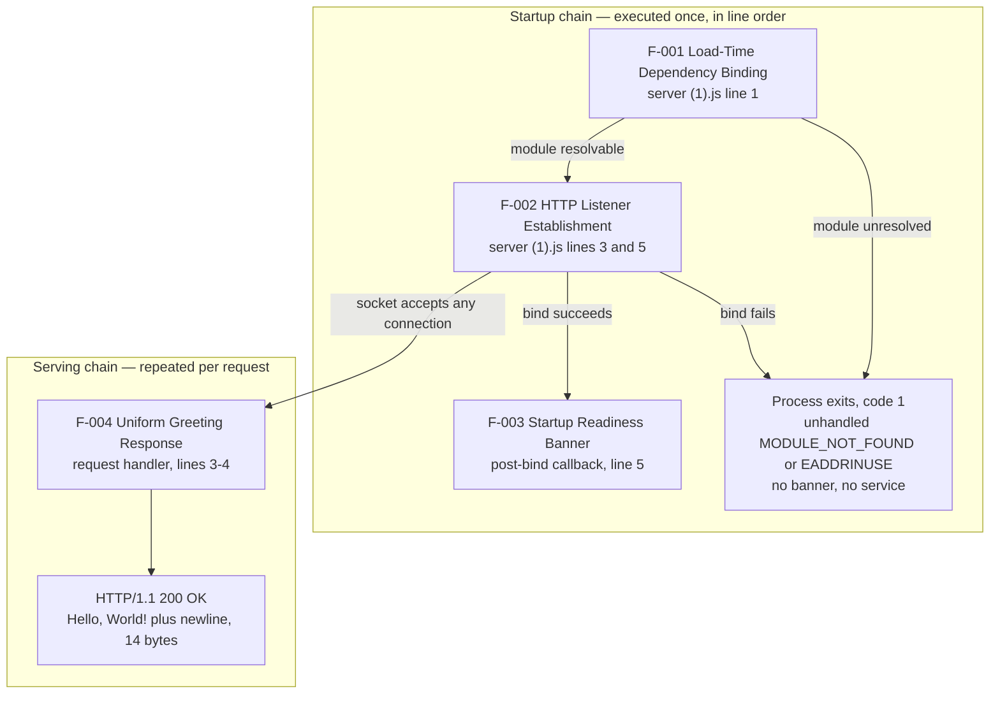

**Reading the map.** The startup chain is strictly linear and all-or-nothing: each feature's success is the next one's precondition, and both failure edges terminate the process with exit code 1 rather than degrading. The serving chain branches off F-002 and never loops back — no request updates any state that a later request can observe, so consecutive requests are mutually independent. F-003 sits outside the serving chain entirely: it runs once, its output is not read by the application, and no other feature references it.

**Coupling assessment.** The only interface between features is the Node `http` server object created on line 3 and consumed by the `.listen(3000, callback)` call on line 5. There are no function signatures, no shared data structures, and no module boundaries — the request handler and the listener callback are two inline arrow functions that capture nothing from each other. The one variable that could couple them, the module-scope constant `_` from F-001, is never read (grep for `_` matches line 1 only), so it mediates no relationship at all.

### 2.3.2 Integration Points

| Integration point | Direction, protocol | Participants | Evidence |
| --- | --- | --- | --- |
| OS network stack, TCP port 3000, wildcard address, cleartext HTTP/1.x | Inbound, per request | F-002 (listener) and F-004 (responder); any anonymous client | `/proc/net/tcp6` LISTEN entry on port `0BB8` with all-zero local address; verified 200 responses over 127.0.0.1 |
| Node.js built-in `http` module | In-process, load time | F-002 constructs the server; F-004 receives `req`/`res` from it; the runtime supplies parsing, keep-alive and header defaults | `server (1).js:3`; the only other `require` in the checkout is line 1 |
| Node module loader and filesystem resolution path | In-process, load time | F-001, gated on a resolvable `lodash` | `server (1).js:1`; `require.resolve('lodash')` fails from the repository root |
| Process stdout | Outbound, once per process | F-003 only; the operator's terminal is the consumer | `server (1).js:5`; observed single-line stdout |
| npm registry | Outbound, install time — currently unreachable | Would supply `lodash` for F-001 | No `package.json` or lockfile anywhere in the checkout, so no install can be performed |

No other integration exists. A text search of the whole checkout finds no outbound HTTP client, database driver, message-broker client, cache client, identity-provider SDK, telemetry agent, or file-system use outside the module loader; no `https`/`tls` term, no proxy, no service registry, and no configuration source appears.

### 2.3.3 Shared Components

| Shared component | Shared by | Nature of sharing | Evidence |
| --- | --- | --- | --- |
| One OS process and one script, `server (1).js` | F-001, F-002, F-003, F-004 | All four features live in the same 5-line file; no module boundary, class, or exported function exists | Whole-checkout listing: 1 tracked file; the file declares no exports |
| One `http.Server` instance | F-003 and F-004 | The same object bound on line 5 dispatches every request to the handler, and its post-bind callback prints the banner | `server (1).js:3,5` |
| The runtime's HTTP/1.1 parser | F-004 and F-002 | Parses every inbound request line and headers; also generates the `400 Bad Request` for unparseable input and frames request bodies the handler never reads | `server (1).js:3-4`; observed 400 responses and successful keep-alive reuse after a body-carrying request |
| The event loop | All features | Sequences the load-time gate, the bind, the post-bind callback, and every request; the handler performs no blocking work | `server (1).js:1-5`; handler body is a single non-blocking `res.end` |
| The module-scope constant `_` | Intended for F-001 alone | Declared once and never read by any feature, so it shares no state in practice | `server (1).js:1`; grep for `_` matches line 1 only |

Shared *state* is absent: no module-level mutable value, cache, counter, session, or connection pool exists, which is why concurrent and sequential requests cannot influence one another.

### 2.3.4 Common Services

No service is implemented inside the system. A text search of the repository finds no logging service, configuration service, data-access layer, authentication service, or health-check route; the entire checkout is one script. The only common services are those the Node runtime provides to all four features, and they are consumed rather than implemented.

| Common service (provided by the runtime) | Consumers | What it supplies | Evidence |
| --- | --- | --- | --- |
| Module loader | F-001 | Resolves `lodash` synchronously along the resolution path, and fails the process when it cannot | `server (1).js:1`; `MODULE_NOT_FOUND` |
| HTTP/1.1 parser and server implementation | F-002, F-004 | Request framing, status line and header emission, `Date`/`Content-Length`/`Connection` defaults, keep-alive timing, `HEAD` body suppression, parser-level 400 rejection | `server (1).js:3-4`; observed raw responses |
| TCP socket layer and OS bind | F-002 | Port binding on the wildcard address, backlog handling, and `EADDRINUSE` reporting | `server (1).js:5`; `/proc/net/tcp6` LISTEN entry |
| Console output | F-003 | Line-buffered stdout write with a newline | `server (1).js:5`; observed stdout |
| Default signal and exception handling | All features | Terminates the process on SIGTERM and on unhandled `error` events, since the application registers no handlers | `server (1).js:1-5`; observed `EADDRINUSE` exit and SIGTERM termination |

**Consequence for feature design.** Because every cross-cutting concern is either absent or inherited from the runtime, no feature has an extension point: there is no middleware chain, no plugin hook, no configuration object, and no dependency-injection seam. Any of the capabilities outside Section 1.3.1 would require editing `server (1).js` itself rather than configuring an existing service.


## 2.4 Implementation Considerations

Every consideration below applies to the system as it exists in the checkout: one 5-line CommonJS file, `server (1).js` (185 bytes, sha256 `7f27a666…ea203`), with no manifest, no tests, no configuration, and no deployment asset. Where a conventional consideration has no counterpart in the product, that absence is stated rather than filled with generic practice.

### 2.4.1 Technical Constraints

| Constraint | Effect on the implementation | Evidence |
| --- | --- | --- |
| Runtime is Node.js with CommonJS `require`; no engines constraint is declared | The program runs on the installed Node version and can break on an upgrade; no transpilation, bundling, or polyfill step exists | `server (1).js:1-5`; no `package.json`/`engines` field; verified on Node v22.23.3 / npm 11.21.0 |
| `lodash` is required but neither declared nor installed | A clean checkout cannot start: exit 1 with `Error: Cannot find module 'lodash'` before any bind. The dependency's version is unpinned, so even adding a manifest would pick an arbitrary release | `server (1).js:1`; whole-checkout listing (no `node_modules`, no lockfile) |
| Port 3000 is a source literal | The port cannot be changed without editing line 5, and only one instance can bind per host | `server (1).js:5`; grep returns zero hits for `process.env`, `process.argv`, `require('fs')`, `config` |
| Both the `listen` call and the banner repeat the port 3000 and the host | The two statements can drift; the banner already misreports the bind as `127.0.0.1` while the socket is wildcard-bound | `server (1).js:5`; `/proc/net/tcp6` LISTEN on `0BB8`, `:::3000` in the `EADDRINUSE` message |
| No error listener, `try`/`catch`, or signal handler | Faults are unhandled: a busy port ends the process with exit 1, and SIGTERM terminates it with default disposition and no shutdown output | `server (1).js:3-5`; observed stderr `Unhandled 'error' event`, exit code 1 |
| The whole system is one file with a space and parentheses in its name | Invocation requires quoting (`node "server (1).js"`), and any tooling that assumes plain filenames or a `main` entry must be adapted; the file is untrackable by name-based conventions | Filename bytes verified via `od`; `git ls-files` returns the single name |
| No manifest, no scripts, no exports | There is no `npm start`, no library entry point, and no dependency declaration; the file behaves only as a main script | Whole-checkout listing; the file declares no `exports` |

Per feature: F-001 is constrained by the missing declaration; F-002 by the hardcoded port and the absence of any error path; F-003 by the duplicated literals that make its message inaccurate; F-004 by the absence of every request-handling facility (routing, parsing, negotiation) that would be needed to read the request it currently ignores.

### 2.4.2 Performance Requirements

The repository records no latency, throughput, availability, or resource target, and no mechanism to measure one: there is no metrics endpoint, no per-request log, no counter, no tracing, and no benchmark. Any numeric target would therefore be authored by this specification rather than observed, so only the measurable properties of the implementation are stated below, each with its basis.

| Property | What the implementation guarantees | Observed basis |
| --- | --- | --- |
| Per-request work | Constant time and constant bytes: each response is one `res.end` call writing 14 bytes, with no computation, no I/O, and no allocation dependent on input | Handler body is a single statement, `server (1).js:4`; identical 14-byte bodies across all probed requests |
| Response latency independence | The response does not wait for the request body or for any external system, so latency is bounded by the socket write alone | Request declaring `Content-Length: 10000000` with 4 body bytes sent received the full response in 4 ms |
| Throughput ceiling | Not a property of the application but of the runtime: one event-loop thread serves every connection, and the handler never blocks, so throughput follows the runtime's HTTP and socket defaults | `server (1).js:3-5`; no clustering, worker-thread, or pool usage anywhere in the file |
| Header stability | Response headers are runtime defaults only, with `Date` the single varying value, so payload size per response is fixed at 14 bytes plus a small header block | Raw dumps: `Date`, `Connection`, `Keep-Alive`, `Content-Length: 14`, no `Content-Type` |
| Timeouts | None set by the application; keep-alive is the runtime default `timeout=5` | `server (1).js:3-5`; observed `Keep-Alive: timeout=5` |
| Startup latency | One module resolution plus one bind; nothing else happens before the service is ready | `MODULE_NOT_FOUND` and `EADDRINUSE` both terminate before serving; successful start reached the LISTEN state inside a ~1.2 s observation window |

Consequence: no performance requirement can be tested against this product. The only assertions available are functional — the same status, the same four headers, and the same 14 bytes on every request.

### 2.4.3 Scalability Considerations

| Dimension | Position in the implementation | Evidence |
| --- | --- | --- |
| Vertical: processes per host | Exactly one, because the port is a hardcoded literal; a second instance exits 1 with `EADDRINUSE` | `server (1).js:5`; second-instance run |
| Vertical: threads and workers | None. A grep of the only source file returns zero matches for `cluster` and `worker_threads`, so all request handling is single-threaded on the event loop | `server (1).js:1-5` |
| Horizontal: multi-instance deployment | No asset supports it — no container file, no orchestrator manifest, no reverse proxy, no listener-port override, and no health endpoint for a scheduler to probe | Whole-checkout listing; no configuration surface in the file |
| Load shedding and backpressure | None implemented. No queue, concurrency limit, timeout, or rate limiter exists; the handler accepts unbounded declared body sizes without a size check | `server (1).js:3-4`; 10 MB-declared request answered without reading the body |
| State and memory growth | None, and structurally so: no cache, session, counter, or buffer is retained between requests, so the process holds no growing state | `server (1).js:1-5`; no module-level mutable value exists |
| Connection scaling | Delegated entirely to the runtime: HTTP/1.1 keep-alive, pipelining, and connection acceptance all behave as Node defaults, since the application configures no server option | `server (1).js:3,5`; two pipelined requests on one socket each received 200 |

The practical ceiling of this system is therefore one process, one port, one host, and the event loop's default connection handling — with no in-product path to add capacity.

### 2.4.4 Security Implications

| Implication | Detail | Evidence |
| --- | --- | --- |
| Network exposure exceeds what the operator is told | The listener occupies the wildcard address on all interfaces and both stacks, while the banner names `127.0.0.1`; an operator reading only the banner would under-estimate reachability of the service | `/proc/net/tcp6` LISTEN on `0BB8`; `EADDRINUSE` message names `:::3000`; banner at `server (1).js:5` |
| No transport security | Cleartext HTTP only; the file contains no `https` or `tls` reference and the repository holds no certificate or key | `server (1).js:3-5`; grep for `https`/`tls` returns no match |
| No authentication, authorization, or tenancy | Any client that can reach the port is served identically; an `Authorization: Bearer xyz` header was ignored, and no session, token, role, or user model exists | `server (1).js:3-4`; request probe with credentials returned the same 200 |
| No response or request hardening | No security headers, no `Content-Type`, no CORS policy, no input filtering, no size limit, and no rate limiting; all are absent by construction | Raw header dump; `server (1).js:3-4` |
| Availability risk from unguarded fault paths | An unhandled `error` event terminates the process, so a port conflict or a later socket error takes the service down rather than degrading it | `server (1).js:3-5`; `Unhandled 'error' event`, exit code 1 |
| Supply-chain exposure | The single third-party dependency is unpinned and undeclared, so no integrity, provenance, or version guarantee exists; it is also unused, so its risk buys nothing | `server (1).js:1`; no manifest or lockfile |
| Injection surface | No request data reaches the response — method, path, query, headers, and body are never read — so no reflection, template, query, or command sink exists to inject into | `server (1).js:3-4`; identical responses for varied inputs, including a 64 KiB body |

No security requirement is satisfied by this implementation; the items above describe its actual posture, not controls it provides. Because the response is a constant and inputs are discarded, the material security concerns are exposure and availability rather than data compromise — no database, file store, or personal data is reachable through the service.

### 2.4.5 Maintenance Requirements

| Requirement | Why it is needed | Evidence |
| --- | --- | --- |
| Resolve the `lodash` gate | As delivered the product cannot start, since the module is required but undeclared and absent; either declare and pin it or delete lines 1–2, which the deletion test shows changes no behavior | `server (1).js:1`; `MODULE_NOT_FOUND`; identical behavior from the require-less variant |
| Correct or derive the banner address | The message misstates the bind and duplicates both literals, so it must be kept in step manually or generated from the bound socket | `server (1).js:5`; wildcard LISTEN evidence |
| Quote the filename in every invocation | The tracked name contains a space and parentheses, so unquoted shell use fails and path handling in scripts must account for it | `git ls-files`; filename bytes verified |
| Introduce a manifest before any packaging or dependency work | Without `package.json` there is no script entry point, no version metadata, no engines constraint, and no way to install the declared dependency | Whole-checkout listing |
| Pin the runtime version or document it | The code relies on Node's built-in `http` and CommonJS semantics with no `engines` constraint, so a runtime change is unmanaged | `server (1).js:1-5`; verification performed on Node v22.23.3 |
| Add regression tests before behaviour changes | No test file, framework, or CI configuration exists, so nothing detects a regression — including the loss of the constant response, the only contract the product has | Whole-checkout listing; no CI configuration |
| Add logging and error handling before operating the service | Diagnosis today rests on one startup line and stderr; request activity is invisible and startup faults are unhandled exceptions | `server (1).js:3-5`; ~15 requests produced no additional output |
| Maintain the constant response as a contract | The 14-byte body, the status 200, and the absence of `Content-Type` are the whole external contract; any intentional change is a breaking change for every client | `server (1).js:4`; byte-level verification |

### 2.4.6 Assumptions, Constraints, and Requirement Versioning

**Assumptions.** Each is a precondition this section relies on, not a statement from the repository, and each is testable.

| Assumption | Basis | If false |
| --- | --- | --- |
| The tracked file `server (1).js` is the whole product | Whole-checkout search finds one file and no other code, including code embedded in data files | Requirements would be incomplete |
| A Node.js runtime able to provide `http` and CommonJS `require` is available to run it | The file is an executable script of that runtime and nothing else | No feature from F-002 onward could be exercised |
| A resolvable module named `lodash` is placed on the resolution path to reach a serving state | Required by `server (1).js:1`; the checkout supplies none | Only the failure path of F-001 can be observed |
| Observed behavior on Node v22.23.3 represents the intended behavior | No specification, test, or issue exists to state intent otherwise | Requirements would have to be rewritten against the true target runtime |
| Port 3000 on the host running the process is free | The port is a literal with no override | F-002 fails fast with exit 1 |

**Constraints by requirement.** F-001-RQ-002 (bind `_`), F-002-RQ-003 (fixed port), F-003-RQ-002 (literal banner address), F-004-RQ-004 and F-004-RQ-005 (runtime-supplied connection and parse behaviour) are constrained by the implementation as it stands: each is a property of the current code rather than an independently chosen design, and changing any of them means editing `server (1).js`. Requirements F-001-RQ-001, F-002-RQ-001/002/004, F-003-RQ-001 and F-004-RQ-001/002/003 are hard constraints on the shipped behavior, since violating them removes or changes the system's only observable capability.

**Requirement versioning.** The repository history is a single commit, `88dcb7d` ("Add files via upload", 2026-10-06), on branches `main` and `0611_01`, with a clean working tree, so every requirement in Section 2.2 is version **R1** against that commit. The file's identity is fixed for traceability: 185 bytes, sha256 `7f27a6663b7656d9f7c838d207d038a6ef003805c90e64f89f3d56297f6ea203`.

### 2.4.7 Requirement Traceability Matrix

| Requirement ID | Source evidence | Verification method and result | Status |
| --- | --- | --- | --- |
| F-001-RQ-001 | `server (1).js:1` | Run from a checkout with no `node_modules`: exit 1, `Cannot find module 'lodash'`, no LISTEN socket. Run with a resolvable `lodash`: proceeds to bind. | Verified — failure and success paths both observed |
| F-001-RQ-002 | `server (1).js:1` | Grep for `_` in the file matches line 1 only; a variant with lines 1–2 removed serves identical responses where `lodash` is unresolvable | Verified — binding proven unused |
| F-002-RQ-001 | `server (1).js:3` | Text search of the checkout for module loading returns only `lodash` and `http`; the handler is a two-parameter arrow function | Verified by inspection |
| F-002-RQ-002 | `server (1).js:5` | `/proc/net/tcp6` shows LISTEN on port `0BB8` with all-zero local address; second instance reports `:::3000` | Verified at runtime |
| F-002-RQ-003 | `server (1).js:5` | Grep for `process.env`, `process.argv`, `require('fs')`, `config`: zero matches | Verified by inspection |
| F-002-RQ-004 | `server (1).js:3-5` | Second instance: stderr `Unhandled 'error' event … EADDRINUSE … :::3000`, exit code 1, no banner | Verified at runtime |
| F-003-RQ-001 | `server (1).js:5` | Stdout captured on startup and again after ~15 requests: exactly `Server running at http://127.0.0.1:3000/`, once; stderr empty | Verified at runtime |
| F-003-RQ-002 | `server (1).js:5` | Banner text compared with the actual socket: loopback claimed, wildcard bound — recorded as a known inaccuracy | Verified as a defect |
| F-004-RQ-001 | `server (1).js:3-4` | `GET`, `POST` with query/headers/body, `DELETE`, `PUT` with 64 KiB, `OPTIONS *`: all `HTTP/1.1 200 OK`, `Content-Length: 14`, body `Hello, World!\n` byte-verified | Verified at runtime |
| F-004-RQ-002 | `server (1).js:4` | Raw dumps show only `Date`, `Connection`, `Keep-Alive`, `Content-Length`; no `Content-Type` or other application header; `HEAD /` returns 200 without body or `Content-Length` | Verified at runtime |
| F-004-RQ-003 | `server (1).js:3-4` | Request declaring `Content-Length: 10000000` with 4 body bytes sent: full response in 4 ms; `req` never referenced in the file | Verified at runtime |
| F-004-RQ-004 | `server (1).js:5` | Two pipelined `GET`s on one socket: two 200 responses; sequential keep-alive and post-body requests: 200 with `Connection: keep-alive`; HTTP/1.0: 200 with `Connection: close` | Verified at runtime (runtime-supplied behaviour) |
| F-004-RQ-005 | `server (1).js:3-4` | `FOOBAR /x HTTP/1.1` and a malformed request line: `HTTP/1.1 400 Bad Request` with `Connection: close` | Verified at runtime (parser-supplied behaviour) |

Feature-level mapping: F-001 covers F-001-RQ-001/002, F-002 covers F-002-RQ-001/002/003/004, F-003 covers F-003-RQ-001/002, and F-004 covers F-004-RQ-001/002/003/004/005 — thirteen requirements across four features, all at R1 against commit `88dcb7d`.

**Related specifications.** The startup and request paths traced by these requirements appear as a flowchart in Section 1.2.2; the in-scope capabilities and the excluded feature areas are enumerated in Section 1.3.1 and Section 1.3.2; the requirement-level detail behind this matrix is in Section 2.2, and the dependency and integration structure it relies on is in Section 2.3.


## 2.5 References

- `server (1).js` — the only tracked file and the entire system: line 1 `const _ = require('lodash');` (F-001), line 3 `require('http').createServer((req, res) => {` (F-002), line 4 `res.end('Hello, World!\n');` (F-004), line 5 `}).listen(3000, () => console.log('Server running at http://127.0.0.1:3000/'));` (F-002, F-003). 5 lines, 185 bytes, sha256 `7f27a6663b7656d9f7c838d207d038a6ef003805c90e64f89f3d56297f6ea203`.
- `/` (repository root folder) — inventory establishing that the checkout holds exactly one first-order child file, `server (1).js`, and no subdirectory other than `.git`, and therefore that no manifest, lockfile, `node_modules`, test, documentation, configuration, or deployment asset exists for any requirement in this section to depend on.
- `.git/` — repository metadata: remote `origin` = `github.com/lakshya-blitzy/0610_hello_world.git`; branches `main` and `0611_01` both at the single commit `88dcb7d9848f72b81aebadc005113437720045a2` ("Add files via upload", `lakshya-blitzy <lakshya@blitzy.com>`, 2026-10-06 18:14:42 +0530, 1 file changed, 5 insertions); clean working tree. Establishes version R1 for every requirement in Section 2.2.
- Runtime environment used to verify the documented behavior: Node.js v22.23.3 with npm 11.21.0, plus `/proc/net/tcp6` for socket inspection. Verified results reported in this section: startup failure `Error: Cannot find module 'lodash'` (exit 1, no bind); banner `Server running at http://127.0.0.1:3000/` on stdout exactly once, stderr empty; LISTEN entry `00000000000000000000000000000000:0BB8` state `0A`, i.e. the wildcard address contradicting the banner; identical `HTTP/1.1 200 OK` responses with `Date`, `Connection: keep-alive`, `Keep-Alive: timeout=5`, `Content-Length: 14` and body `Hello, World!\n` (14 bytes, byte-verified) for `GET /`, `POST /foo?bar=1&baz=2` with `Content-Type`/`Accept`/`Authorization` headers and a body, `DELETE /a/b/c/d`, `PUT /big` with 64 KiB, and `OPTIONS *`; no `Content-Type` header; `HEAD /` → 200 with neither body nor `Content-Length`; HTTP/1.0 → `Connection: close`; two pipelined `GET`s and sequential keep-alive requests → two and two 200 responses; request with `Content-Length: 10000000` and 4 body bytes sent → full response in 4 ms; `400 Bad Request` with `Connection: close` for `FOOBAR /x` and for a malformed request line; second instance → unhandled `EADDRINUSE … :::3000`, exit code 1; SIGTERM → port released with no shutdown output; no per-request output after ~15 requests.
- Verification scaffolding outside the checkout (not repository content, used only to reach a serving state because `lodash` is undeclared and absent): a scratch copy of the file with a minimal resolvable module named `lodash`, and a two-line variant with lines 1–2 deleted (`/tmp/puredir/mod.js`, run in a directory with no `node_modules` in any ancestor) proving the `lodash` binding contributes no behavior.
- No web sources were used: external retrieval was unavailable during this investigation, so no claim about any dependency's external release or version is made anywhere in this section.


# 3. Technology Stack

## 3.1 Stack Overview and Default-Stack Applicability

The technology stack of `0610_hello_world` is one runtime, one language, one built-in module, and one library the code requires but the repository neither declares nor installs. Every other layer a stack taxonomy normally covers — framework, third-party service, datastore, build tool, container, pipeline — is absent from the checkout, and that absence is established here by exhaustive search rather than by omission (the sweep and its exact result are recorded in Section 3.9).

Two classes of version fact appear in this section, and they are labelled wherever they occur:

| Fact class | Basis | Confidence |
| --- | --- | --- |
| Runtime and dependency versions that were observed doing work | Executed the tracked file and read `process.versions`; installed lodash into a scratch directory outside the checkout and ran the file against it | Verified by execution |
| Versions of packages the repository does not contain | npm registry metadata and the Node.js release schedule, retrieved 2026-10-23 | Registry- and schedule-reported |

### 3.1.1 Observed Stack by Layer

| Layer | Technology | Version | State in the repository | Evidence |
| --- | --- | --- | --- | --- |
| Language | JavaScript (ECMAScript 2015 subset), CommonJS module format | `const` and arrow functions only, so ES2015 is the floor the code needs; no transpiler, so the runtime's own parser decides acceptance | The only language present | `server (1).js:1-5`; construct census in Section 3.2 |
| Runtime / platform | Node.js, "Jod" release line | v22.23.3 (executing the tracked file); npm CLI 11.21.0 | Not declared: no manifest, no `engines` field, no `.nvmrc`, no version file | `server (1).js:1-5`; execution on the observed host |
| Script engine | V8 | 12.4.254.21-node.57 | Supplied by the runtime | `process.versions` on the observed runtime |
| HTTP protocol parser | llhttp | 9.4.3 | Supplied by the runtime; it, not application code, frames requests and rejects unparseable ones | `process.versions`; parser-level `400` responses observed (Section 2.4.7) |
| Transport security library | OpenSSL | 3.5.8, present in the runtime | Never invoked: zero `https`/`tls` matches in the checkout | `process.versions`; keyword sweep |
| Unicode / Intl data | ICU | 78.3 | Supplied by the runtime | `process.versions` |
| Core library | Node.js built-in `http` | As shipped with Node v22.23.3 | The only library the code calls; supplies server, parser and header defaults | `server (1).js:3` |
| Third-party dependency | `lodash` | Required with no version constraint; registry `latest` is 4.18.1, published 2026-04-01 (MIT, no dependencies, no `engines` field) | Required on line 1, bound to `_`, never used again, absent from the checkout, undeclared in any manifest | `server (1).js:1`; registry metadata |
| Application framework | — | — | None: zero matches for Express, Fastify, Koa, Flask, Django, React and the other names swept | Keyword sweep (Section 3.9) |
| Database / cache | — | — | None: zero matches for MongoDB, Redis, PostgreSQL, MySQL, SQLite, Kafka, RabbitMQ | Keyword sweep (Section 3.9) |
| Third-party services | — | — | None: no SDK, endpoint, credential or API client of any kind | Keyword sweep; Section 3.5 |
| Build tooling | — | — | None: no manifest, no bundler/transpiler config, no `Makefile`; the source file is executed directly | Root listing; Section 3.7 |
| Container / IaC | — | — | None: no `Dockerfile`, compose file, Kubernetes manifest or `*.tf` | Root listing; absence of any YAML/TOML |
| CI/CD | — | — | None: no workflow directory, and `.git/hooks` holds only the 13 stock `*.sample` files | Root listing; `.git/hooks` |

The dependency graph the code actually establishes is small enough to draw in full. Solid edges are exercised at runtime; dotted edges are the install-time path that the repository never takes.

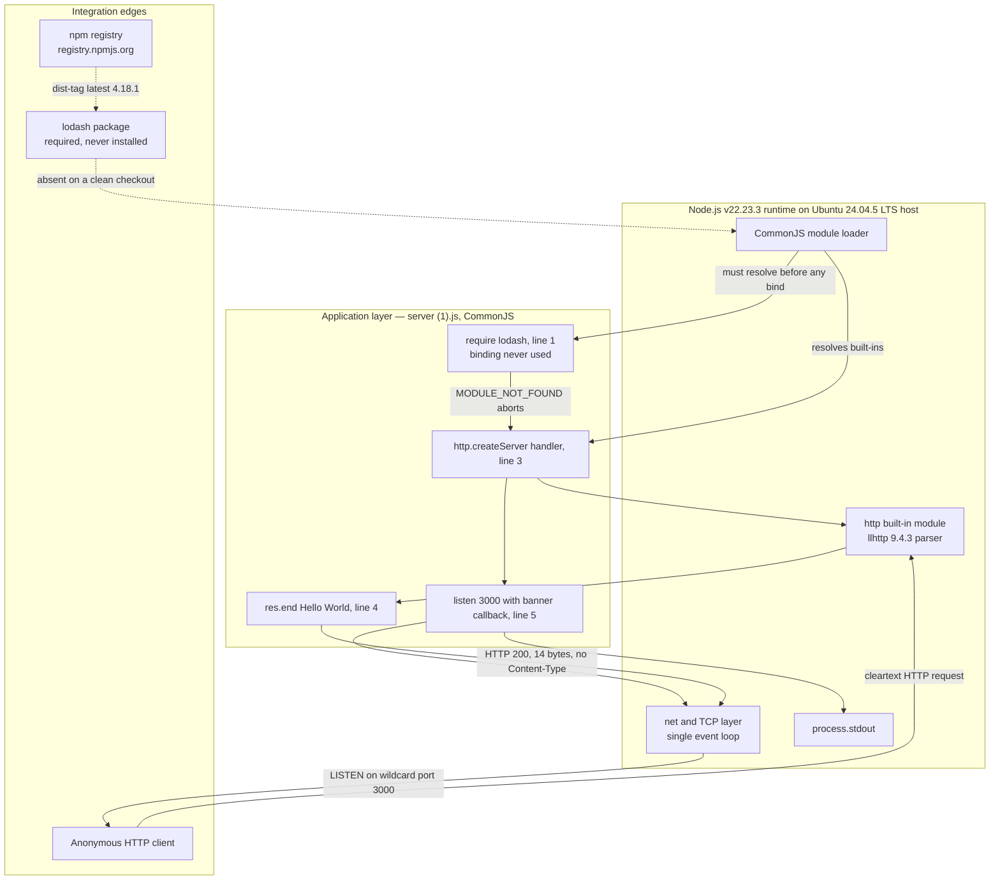

### 3.1.2 Applicability of the Default Technology Stack

The default stack supplied with this specification describes a multi-platform, service-backed application. It is assessed below against the repository rather than adopted, because every item in it is either absent from the checkout or contradicted by what the code does. Each verdict rests on the same exhaustive sweep: a case-insensitive text search of every file in the repository (there is exactly one) returned zero matches for each technology named.

| Default stack item | Present in this repository | Determination | Basis |
| --- | --- | --- | --- |
| Cloud platform: AWS | No | Not applicable. No cloud SDK, region, ARN, endpoint, credential or infrastructure file exists; the only deployment surface is a bare OS process | Zero matches for `aws`/`amazon`/`ec2`/`lambda`/`s3`/`dynamodb` |
| Containerization: Docker | No | Not applicable. No `Dockerfile`, no compose file, no image reference | Zero matches for `docker`; no container files in the root listing |
| Infrastructure as Code: Terraform | No | Not applicable. No `*.tf`, state file or provider block | Zero matches for `terraform`/`pulumi`/`cloudformation` |
| CI/CD: GitHub Actions | No | Not applicable. No workflow file and no active git hook; the single commit message "Add files via upload" is the entire delivery record | Zero matches for `actions`/`workflow`; no `.github` directory |
| Backend language: Python | No | Not applicable, and contradicted: the sole source file is JavaScript executed by Node.js | Zero matches for `python`; `server (1).js` is the only tracked file |
| Backend framework: Flask | No | Not applicable. No web framework of any kind is present; the system uses the runtime's built-in `http` module directly | Zero matches for `flask`, `django`, `fastapi` |
| Authentication: Auth0 | No | Not applicable. No identity SDK, token validation, session or credential logic exists; every request is served identically | Zero matches for `auth0`/`oauth`/`jwt`; no auth code in `server (1).js` |
| Database: MongoDB | No | Not applicable. No driver, connection string, collection or query exists; the only datum is a constant string literal | Zero matches for `mongodb`/`mongoose` |
| AI framework: Langchain | No | Not applicable. No model client, prompt, embedding or inference call exists | Zero matches for `langchain`/`openai`/`anthropic` |
| Frontend web: React with TypeScript | No | Not applicable. No client-side asset, build step or type annotation exists; the process emits one string and no HTML | Zero matches for `react`/`typescript`/`webpack`/`vite` |
| CSS framework: TailwindCSS | No | Not applicable. No stylesheet, markup or asset pipeline exists | Zero matches for `tailwind` |
| Mobile / cross-platform: React-Native with TypeScript | No | Not applicable. No mobile project, bundle or manifest exists | Zero matches for `react-native` |
| iOS: Swift; Android: Kotlin; macOS: Objective-C | No | Not applicable. No native project, toolchain, Xcode or Gradle asset exists | Zero matches for `swift`/`kotlin`/`objective-c`/`xcode` |
| Desktop: ElectronJS | No | Not applicable. No desktop shell, renderer or packaging configuration exists | Zero matches for `electron` |

The default stack's only overlap with this repository is the JavaScript ecosystem, and even that overlap is partial: the default stack names TypeScript and React for the browser and React-Native for cross-platform clients, while what exists here is untyped server-side JavaScript on Node.js, which the default stack does not list at all. Adopting any default-stack component would be new construction of a system that does not exist yet, which Section 1.3.2 places out of scope; this section therefore documents the stack as observed and states each default-stack item's non-applicability rather than presenting it as a decision of this project. The repository records no technology-selection rationale anywhere — no design note, no README, no commit discussion beyond "Add files via upload" — so the justifications in Sections 3.2 to 3.7 are derived from what the code's choices actually deliver and cost, and are labelled as derived.

Sections 3.2 to 3.7 then take the layers of the first table in turn — language and runtime, frameworks and libraries, open-source dependencies, third-party services, data storage, and development and deployment — and Section 3.8 states the integration and security requirements that follow from the combinations actually in use.


## 3.2 Programming Languages

### 3.2.1 Languages by Platform and Component

| Platform / component | Language and module format | Runtime | Evidence |
| --- | --- | --- | --- |
| Server application (`0610_hello_world`, the entire system) | JavaScript — ECMAScript 2015 subset, CommonJS module format | Node.js v22.23.3 (script engine V8 12.4.254.21-node.57) | `server (1).js:1-5`; execution on the observed host |
| Browser / client-side component | None exists. No HTML, stylesheet, script bundle or client build artefact is tracked | — | One tracked file in the checkout; zero matches for `react`/`webpack`/`vite` |
| Mobile, desktop and native clients | None exist. No XCTest, Gradle, Xcode or Electron project is tracked | — | Zero matches for `swift`/`kotlin`/`objective-c`/`electron` |
| Build, test and deployment tooling | None exists. No build script, test runner or pipeline definition is tracked | — | No manifest, no config files, no workflow directory |
| Operator interface | None exists beyond the console the process writes its banner to | — | `server (1).js:5`; stdout observed |

One language is used, in one module format, on one platform. Nothing in the repository is written in Python, TypeScript, Java, Go, Rust, C/C++ or any shell dialect, and no transpiler or compiler is configured that would map one language onto another.

### 3.2.2 Language Level Actually Used

The complete census of the language's features in the only source file is below; every count was produced by searching the file.

| Feature | Occurrences | Where | Notes |
| --- | --- | --- | --- |
| `const` binding | 1 | `server (1).js:1` | The only declaration form used; no `let` or `var` appears |
| Arrow function expression | 2 | `server (1).js:3` (request handler), `server (1).js:5` (post-bind callback) | Both are inline and anonymous |
| String literal | 4 | `'lodash'`, `'http'`, `'Hello, World!\n'`, the banner text | The banner and response texts are hardcoded, not formatted |
| Statement terminator (`;`) | 3 | `server (1).js:1,3,4-5` | Style is consistent but unenforced: no linter or formatter config exists |
| CommonJS `require` call | 2 | `server (1).js:1,3` | The module format of the file |
| `async` / `await` | 0 | — | Absent; the handler completes synchronously |
| `Promise` | 0 | — | Absent; no asynchronous control flow to coordinate |
| `class` declaration | 0 | — | Absent; no types or prototypes defined |
| `function` keyword | 0 | — | Only arrow functions appear |
| `import` / `export`, `module.exports` | 0 | — | No ES modules and no exported surface; the file is a main script |
| Template literal / backtick | 0 | — | String composition is literal concatenation-free |
| `"use strict"` directive | 0 | — | Not written; the file is not a strict-mode module as authored |
| `new` expression | 0 | — | No constructors invoked |

`node --check "server (1).js"` accepts the file as-is, so it is syntactically valid for the observed runtime with no preprocessing.

**Module format and file encoding.** The file uses `require`, and no `package.json` or `"type"` field exists anywhere in the repository, so Node.js interprets the `.js` extension as CommonJS — the runtime's default for that extension. The file is pure ASCII (185 bytes, 185 characters, no non-ASCII byte), uses LF line endings only, carries no byte-order mark and no shebang, and is stored with mode `100644`, so it is not marked executable and must be started through the runtime rather than invoked directly. Its name contains a space and parentheses (`server (1).js`), so every command line that addresses it must quote the path.

### 3.2.3 Selection Criteria, Justified

The repository records no language rationale — there is no design note, README or discussion beyond the single commit "Add files via upload" — so the criteria below are derived from what the choice demonstrably buys and costs in the code that exists.

| Criterion | How the language choice satisfies it | Evidence |
| --- | --- | --- |
| Zero-toolchain execution | The tracked source file is itself the deployable artefact: no compilation, transpilation, bundling or packaging step stands between the repository and a running process | `node "server (1).js"` starts the service; no build configuration exists |
| Server-only scope | With no browser, mobile or desktop component to serve, one server-side language covers the whole system, and no isomorphic or shared-type layer is needed | One tracked file; no client assets |
| Platform-supplied capability over added packages | The language's platform already exposes an HTTP server, so the selection keeps the third-party surface at one unused name and avoids a framework entirely | `server (1).js:3` uses the built-in `http` module |
| Concurrency without threading code | The language's single-threaded event loop with callback-style handlers expresses this workload without locks, pools or thread management | `server (1).js:3-5`; no `cluster` or `worker_threads` usage |
| Direct readability | Five lines, no classes, no build output and no generated code make the artefact auditable by reading it | `server (1).js:1-5` |

The style the code chose in the language is deliberately narrower than the language allows: `let`/`var`, promises, `async`/`await`, classes and template literals are all supported by Node v22.23.3 but unused, because the handler performs no I/O, holds no state and therefore has nothing to await, model or format. The costs of the choice are equally direct: no static types, so nothing is checked before execution; no interfaces or exports, so no part of the program can be reused as a library; and the module format locks the file to CommonJS resolution.

### 3.2.4 Language Constraints and Dependencies

| Constraint | Effect | Evidence |
| --- | --- | --- |
| No `engines` declaration and no version file | The runtime version is unpinned: any Node.js that can parse ES2015 and provide CommonJS plus `http` will run the file, and no version is enforced or warned about. The observed line, Node.js v22 ("Jod"), is in Maintenance LTS with support scheduled to end 2027-04-30, after which the runtime itself stops receiving fixes | `server (1).js:1-5`; no manifest; release schedule retrieved 2026-10-23 |
| CommonJS is the only exercised module format | The file uses `require` twice and contains no `import`; if a manifest declaring ES module semantics were ever added, or the file were renamed to `.mjs`, line 1 and line 3 would need conversion to ESM imports first | `server (1).js:1,3`; zero `import`/`export` matches |
| CommonJS `require` must resolve `lodash` before anything else runs | The language's synchronous module loading makes an unresolvable module a fatal, pre-bind error rather than a handled condition | `server (1).js:1`; `Error: Cannot find module 'lodash'`, exit code 1 |
| Callback-style handler with no error path | Nothing catches a thrown or emitted error, so startup faults and socket errors terminate the process under the runtime's default disposition | `server (1).js:3-5`; unhandled `EADDRINUSE`, exit code 1; SIGTERM honoured by default |
| Filename contains a space and parentheses | Every invocation, script or tool reference must quote or escape the name; tooling that assumes plain identifiers must be adapted | `git ls-files` output; quoted invocation used throughout verification |
| Pure ASCII, LF-only source | Encoding is unambiguous across platforms, but the response body the language emits is fixed ASCII text with no charset declared in the response | `server (1).js:4`; 185 bytes = 185 characters |
| No language-level test or type tooling | Nothing in the language's ecosystem is configured — no type checker, transpiler, linter or formatter — so no static guarantee exists about the file beyond its syntax being valid | `node --check` passes; no such configuration exists in the checkout |


## 3.3 Frameworks and Libraries

### 3.3.1 Core Frameworks

No framework is used. The system composes its server from the runtime's built-in `http` module, and a case-insensitive sweep of the single tracked file returned zero matches for every server framework and application framework the stack taxonomy asks about.

| Framework category | Candidates that would normally fill it | Present | What the system uses instead | Evidence |
| --- | --- | --- | --- | --- |
| HTTP / web server framework | Express, Fastify, Koa, Hapi, NestJS | None | `require('http').createServer(...)` directly | `server (1).js:3`; zero matches for the names above |
| Router / middleware layer | Express Router, Koa middleware | None | Nothing: the handler reads neither method nor path, so no routing decision exists to make | `server (1).js:3-4` (`req` unused) |
| Request-body or validation framework | body-parser, Joi, Zod | None | Nothing: the request stream is never read | `server (1).js:3-4` |
| Template / view engine | EJS, Pug, Handlebars, React | None | A hardcoded string literal is written with `res.end` | `server (1).js:4` |
| Data-access / ORM framework | Mongoose, Sequelize, SQLAlchemy | None | Nothing to access: no datastore is configured | Zero matches for database names or drivers |
| Test framework | Jest, Mocha, Vitest, Tap | None | Nothing: no test file and no runner exist | No test files; no test configuration |
| Lint / format framework | ESLint, Prettier, Standard | None | Nothing: style is consistent by hand but unenforced | No configuration files anywhere in the checkout |
| UI framework (web, mobile, desktop) | React, React-Native, Electron, SwiftUI, Jetpack Compose | None | Nothing: the system serves no UI | Zero matches for `react`, `react-native`, `electron`, `swift`, `kotlin` |

### 3.3.2 Library Inventory

The whole checkout contains exactly two module loads, both on the same two lines of the same file. Neither is a supporting library in the ordinary sense: one is part of the runtime, the other is an unused binding.

| Library | Origin | Version | How the code uses it | Status | Evidence |
| --- | --- | --- | --- | --- | --- |
| `http` | Node.js built-in, shipped with the runtime | As shipped with Node v22.23.3 (its request parser is llhttp 9.4.3) | Supplies `createServer`, the request/response objects, the HTTP parser, keep-alive handling and every response header default | Active — the entire server rests on it | `server (1).js:3`; observed responses carry only runtime-generated headers |
| `lodash` | Third-party package from the npm registry | No constraint in code. The registry's `latest` is 4.18.1 (published 2026-04-01; MIT; no runtime dependencies; no `engines` field) | Loaded on line 1 into the binding `_`, which is never read again; its only effect is that the process aborts when it cannot be resolved | Inactive — a startup gate, not a library in use | `server (1).js:1`; `_` appears on line 1 only; `MODULE_NOT_FOUND` on a clean checkout |

Nothing else is loaded, bundled, vendored or linked: the file contains no comment lines, no license header, and no inlined third-party code, and the repository tracks no `lib/`, `vendor/` or asset directory. Because `lodash` declares no dependencies of its own, an install of that single package produces a one-package tree (verified: one directory, 5.0 MB, no build step, no native addon — its manifest has `main: lodash.js` and defines neither `gypfile` nor a binary target).

### 3.3.3 Compatibility Requirements

| Requirement | Detail | Evidence |
| --- | --- | --- |
| CommonJS loader and `require` semantics | Both loads use synchronous `require`; the platform must treat `.js` as CommonJS in the absence of any `"type"` field, which it does because no manifest exists to say otherwise | `server (1).js:1,3`; no `package.json` |
| Node.js built-in `http` API stability | The code uses only `createServer(handler)` and `listen(port, callback)` — long-standing, non-experimental API | `server (1).js:3,5` |
| Node.js 22 with lodash 4.x — verified | Installing `lodash@4.18.1` into a scratch directory outside the checkout and running the unchanged tracked file produced the banner and `HTTP/1.1 200 OK` with a 14-byte body, so the dependency pair works as written | Verification run on 2026-10-23 under Node v22.23.3 / npm 11.21.0 |
| No native-addon or ABI coupling | `lodash` is pure JavaScript (`main: lodash.js`, no `gypfile`, no binary), so the runtime's `NODE_MODULE_VERSION` (127 on the observed Node build) is irrelevant and no compiler is needed | Installed package manifest; install completed with no build output |
| No peer, dev or optional dependencies | The only declared dependency graph is one package with none of its own, so no version-resolution conflict can arise today | Registry metadata; the scratch install added exactly one package |
| ES2015 parsing without transpilation | `const` and arrow functions must be understood by the runtime itself; there is no build step that would translate them | `server (1).js:1,3,5`; `node --check` passes |
| Encoding and line-ending tolerance | Pure ASCII with LF endings, so no encoding conversion is needed on any platform | 185 bytes = 185 characters |
| Unpinned runtime | Without an `engines` field nothing constrains the runtime; the observed v22 line is in Maintenance LTS with support to 2027-04-30, so the platform will need a version decision of its own | No manifest; release schedule retrieved 2026-10-23 |

### 3.3.4 Justification of the Library Choices

Only one genuine choice was made — using the built-in `http` module instead of a framework — and the repository records no rationale for it, so the following assessment is derived from the code and its consequences.

| What the choice delivers | What it costs |
| --- | --- |
| Zero installs: the server runs on a bare runtime with no package to fetch, so there is no dependency resolution, no lockfile drift, and no version-conflict surface | No routing, no middleware chain, no body parsing and no content negotiation; the request object is never read, so the service cannot distinguish one URL from another |
| Zero framework-owned code: the whole program remains five readable lines, auditable in one sitting | No framework-supplied error handling, logging, security headers or CORS policy — each is simply absent rather than configured away |
| Minimal supply-chain exposure: the only third-party name in the checkout is never executed | The one third-party name that *is* present still gates startup, so the supply chain imposes a failure mode while buying no behaviour |
| Full control of the response path: status, body bytes and absence of `Content-Type` are all visible in the source and are not mediated by framework defaults | Behaviour that the runtime, not the code, decides — keep-alive timing, `Date` header, parser-level `400` rejection, `HEAD` body suppression — is not documented or pinned anywhere in the repository |


## 3.4 Open Source Dependencies

### 3.4.1 Dependency Inventory

The repository's entire open-source dependency surface is one package name. It is required by the code, declared by no manifest, installed nowhere, and executed never.

| Dependency | Kind | Required at | Declared in a manifest | Installed in the checkout | Version bound | Transitive dependencies | License | Integrity record in the repository |
| --- | --- | --- | --- | --- | --- | --- | --- | --- |
| `lodash` | Third-party npm package | `server (1).js:1` (`const _ = require('lodash')`) | No — no `package.json` exists | No — no `node_modules`, no lockfile | None: the code states a bare name, and the absence of a manifest means nothing pins, ranges or records a version | None: the package declares no `dependencies` | MIT (package metadata) | None: no lockfile, so no `integrity` hash or resolved URL is recorded |
| `http` | Node.js built-in module | `server (1).js:3` | Not applicable — built-ins are part of the runtime | Ships with the runtime | Bound to the installed runtime; no `engines` constraint states which | None | Same terms as Node.js itself | None exists in the repository |

No development dependency, peer dependency, optional dependency, bundled dependency or vendored copy of third-party code exists anywhere: the checkout holds one file, it contains no comment lines and therefore no embedded licence header, and there is no `node_modules`, `vendor` or `lib` directory.

### 3.4.2 Registry, Resolution Path and Reachability

| Aspect | Observed state | Evidence |
| --- | --- | --- |
| Configured registry | `https://registry.npmjs.org/` | `npm config get registry` on the observed environment |
| Registry reachability | Reachable: the package document answered HTTP 200, and `npm view lodash version` returned `4.18.1` | Retrieval on 2026-10-23 |
| Current published release of the required package | 4.18.1, published 2026-04-01 (predecessors: 4.18.0 on 2026-03-31, 4.17.21 on 2021-02-20); `dist-tags.latest` = 4.18.1 | Registry document for `lodash` |
| Resolution path in the checkout | Fails. Node.js walks `node_modules` upward from `server (1).js` and then the global paths; `require.resolve('lodash')` from the repository root raises `Cannot find module 'lodash'` (`MODULE_NOT_FOUND`), so the process exits at line 1 before any socket bind | `require.resolve` from the repository root; startup run observed |
| Install path from the checkout | None exists. No manifest means no declared dependency set, no lockfile and no `npm install` step the repository could execute; installing the package requires naming it explicitly from outside the project | Root listing; `git ls-files` returns one file |
| Install path in general | Works outside the checkout: `npm install lodash@4.18.1` in an empty scratch directory succeeded and npm generated a `package.json` with `{"dependencies": {"lodash": "^4.18.1"}}` plus a `package-lock.json` | Verification run on 2026-10-23 |

Section 2.3.2 records the npm registry integration point as "currently unreachable". Read against the evidence above, the two statements differ only in what each one is measuring: the registry endpoint itself answers (HTTP 200, `npm view` succeeds), while the *repository* has no way to consume it, because a manifest is what names the dependency set an install would fetch. The gap is the missing declaration, not the network, and the consequence is the same either way — the checkout as delivered cannot be installed into a runnable state.

### 3.4.3 Version Pinning, Provenance and Reproducibility

| Property | State | Consequence |
| --- | --- | --- |
| Version constraint | Absent. Line 1 requires `lodash` by name only | Any future resolution picks whatever the registry offers at that moment; nothing in the repository can express "this version" |
| Lockfile | Absent. `package-lock.json`, `yarn.lock` and `pnpm-lock.yaml` were all searched for and none exists | Two installs at different times can differ, and no transitive graph is frozen |
| Integrity / provenance record | Absent. Nothing in the repository records a `sha512` integrity hash, registry URL or resolved revision | No tamper-evidence and no provenance statement for the one third-party package the code requires |
| Release identity of the code | Present and exact for the first-party file: `server (1).js`, 185 bytes, sha256 `7f27a6663b7656d9f7c838d207d038a6ef003805c90e64f89f3d56297f6ea203`, from commit `88dcb7d` | The application file is reproducible from git even though its dependency set is not |
| Runtime identity | Unpinned: no `engines` field, no `.nvmrc`, no container image tag | The platform is reproducible only by convention, not by declaration |
| Reproducible install of the repository | Impossible as delivered | A new checkout cannot be brought to a running state without an out-of-band action: adding a manifest, or deleting the require that fails |

### 3.4.4 Licence and Compliance Status

`lodash` is published under the MIT licence, which imposes only attribution and does not affect how the application may be licensed; because the package is required rather than copied, no attribution text need appear in the source. The repository itself declares no licence: a search for `license`, `copyright` and `SPDX` strings across every tracked file returned zero matches, and no `LICENSE` or `COPYING` file exists. The licensing position of the first-party code is therefore unestablished, which is a distribution gap rather than a runtime one, since the single file is executed and never redistributed as a library.

### 3.4.5 Supply-Chain Posture

| Exposure | Assessment | Evidence |
| --- | --- | --- |
| Single third-party package | The dependency surface is as small as it can be for a project that requires anything at all: one name, with no transitive tree and no native addon | Registry metadata (no `dependencies`, `main: lodash.js`, no binary target); scratch install added exactly one package |
| Unpinned and undeclared | The one name the code requires is the one thing the repository cannot install, so the exposure is unmanaged rather than merely small: no version, no integrity hash, no lockfile | `server (1).js:1`; absence of manifest and lockfile |
| Unused, therefore uncompensated | The dependency contributes no behaviour — a variant with lines 1–2 removed served identical responses — so its risk buys nothing while still gating every startup | `server (1).js:1`; `_` read on line 1 only; `MODULE_NOT_FOUND` aborts before any bind |
| Remediation paths, both narrow | Either declare and pin the package in a manifest with a lockfile, or remove the require so the file runs on a bare runtime. The second changes no observable behaviour, which is what makes the require provably dead | Section 2.4.5 records both options from the same evidence |
| Vulnerability surface of the runtime itself | Larger than the package surface: the process inherits the whole Node.js runtime, including OpenSSL 3.5.8 and the llhttp 9.4.3 request parser, and depends on the runtime for security fixes until the v22 line's support ends on 2027-04-30 | `process.versions`; release schedule retrieved 2026-10-23 |

No dependency-scanning, licence-checking or SBOM tooling is configured — no workflow file, no hook, no script and no configuration file of any kind exists in the checkout — so none of the properties above is enforced or observed automatically.


## 3.5 Third-Party Services

### 3.5.1 Service Inventory

No third-party service is integrated, referenced or configured. The system's only network role is as a server: it accepts connections on one port and answers them from its own memory. Nothing leaves the process except the response bytes and one startup line.

| Service category | Present | What the code does instead | Evidence |
| --- | --- | --- | --- |
| External APIs and integrations | None | Nothing: no outbound call is made at runtime. The only external name in the file is the `lodash` package, resolved locally at load time | `server (1).js:1-5`; the only two module loads in the checkout are `lodash` and the built-in `http` |
| Authentication / identity provider | None | Serves every request identically without inspecting credentials; an `Authorization: Bearer …` header was ignored exactly like every other header | `server (1).js:3-4` (`req` unused); header probe in Section 2.4.7 |
| Monitoring, logging and error-tracking tools | None | Writes one banner line to stdout through `console.log`; no agent, SDK, endpoint or exporter exists | `server (1).js:5`; ~15 requests produced no further output |
| Cloud platform services | None | Runs as a bare OS process; no cloud SDK, region, endpoint, ARN or credential lookup appears | Zero matches for `aws`, `amazon`, `ec2`, `lambda`, `s3`, `dynamodb`, `azure`, `gcp` |
| Messaging, queueing or event services | None | Nothing produces, consumes or publishes a message | Zero matches for `kafka`, `rabbitmq`, `sqs`, `sns` |
| Notification, payment or marketing services | None | Nothing to notify, charge or track: no user, account or transaction model exists | Zero matches for the corresponding SDK names |
| Feature-flag, configuration or secrets services | None | All behaviour and the one port number are fixed in source | `server (1).js:5`; zero matches for `env`, `config`, `dotenv` |
| CDN, WAF, reverse proxy or API gateway | None | Clients connect directly to the process on port 3000; no asset, route rule or edge configuration is tracked | Root listing; no proxy or traffic configuration files |

### 3.5.2 Outbound Network Surface

The application has no egress path at all. It never instantiates an outbound client: the checkout contains no `https` request, no `fetch`, no `axios`, no `undici` call, no `net.connect` and no TLS context, and the file's entire text — five lines — holds nothing but two `require` calls, a response write, a listener and a console line. The runtime it runs on does embed an HTTP client (undici 6.28.1 appears in `process.versions`) and a TLS stack (OpenSSL 3.5.8), but neither is invoked, since the code registers no client and terminates no TLS session.

| Direction | Transport | Consumer | Status |
| --- | --- | --- | --- |
| Inbound | Cleartext HTTP/1.x over TCP on the wildcard address, port 3000 | Any anonymous client with connectivity | Active — the only network capability the system has |
| Outbound, runtime | — | — | Absent: no client code exists |
| Outbound, install time | HTTPS to the npm registry | The package manager, not the application | Never exercised by any repository asset: no manifest and no script exist to trigger it |

### 3.5.3 Authentication and Identity Services

There is no identity layer: no provider SDK, no token issuance or verification, no session store, no cookie handling and no role or tenant model. Because the request object is never read, an inbound credential cannot influence the outcome — every request, credentialed or not, receives the same `HTTP/1.1 200 OK` and the same 14-byte body. The platform's own identity mechanisms are also untouched: no environment variable is read (`process.env` appears zero times), so even provider credentials supplied by the host could not be consumed. No service-side requirement is therefore satisfied, and there is no trust boundary inside the application to enforce.

### 3.5.4 Monitoring, Logging and Observability Services

| Signal | Instrumentation in the system | Basis |
| --- | --- | --- |
| Logs | One `console.log` at startup, writing the banner to stdout; no per-request line, no structured format, no log level | `server (1).js:5`; stdout unchanged after ~15 requests |
| Metrics | None: no counter, histogram, gauge or metrics endpoint | Whole-file inspection; no `/metrics` route exists |
| Traces | None: no instrumentation, no span, no correlation identifier | Whole-file inspection |
| Health checks | None: no `/health`, `/status` or readiness route; readiness is observable only as the banner on stdout and the listening socket | `server (1).js:3-5` |
| Error reporting | None: faults surface as unhandled exceptions on stderr and an exit code | Unhandled `EADDRINUSE`, exit code 1; SIGTERM honoured by default |

Because no signal exists beyond a single startup line, an operator's only instruments are the process table, the socket table and the exit status. Any monitoring of this service has to be external — a TCP probe or a process supervisor — and none is configured in the repository.

### 3.5.5 Cloud Services and Hosting

No cloud service of any kind is consumed or configured: no infrastructure definition, no container registry, no managed runtime manifest, no object storage, no managed database and no orchestration descriptor is tracked. The system was observed running directly on a host operating system (Ubuntu 24.04.5 LTS, kernel 6.12.85+ x86_64), started by hand with the runtime, which is the deployment model the repository actually supports. Adopting any cloud service would be new construction rather than configuration, and it would first require capabilities the code does not have: a configuration source, a secret-handling path, TLS, an outbound client, and a graceful shutdown path for the scheduler's restart semantics.

### 3.5.6 Integration Consequences

| Consequence | Detail |
| --- | --- |
| No contract with any external party | Nothing in the system can break because a third-party API changed, and equally nothing can be automated through one; the only contract is the 14-byte response |
| No failure domain but its own | Availability depends solely on the local process, the port and the runtime; there is no dependency to time out, retry or circuit-break, and no dependency-specific error handling exists to configure |
| No credential or secret surface | Nothing to rotate, vault or leak through the application, because the application reads no environment variable, no file and no header |
| Integration work is prerequisite, not configuration | Because configuration, TLS, outbound clients and error paths are all absent by construction, adding any service named in this section would require editing `server (1).js` rather than changing settings — which Section 1.3.2 places out of scope |


## 3.6 Databases and Storage

### 3.6.1 Datastore Inventory

The system has no datastore of any kind — no primary database, no secondary store, no cache, no queue and no object store. The evidence is exhaustive rather than suggestive: the checkout is one five-line file, and a case-insensitive sweep of it returned zero matches for every database, cache and broker name in the current stack vocabulary.

| Datastore category | Present | What the system holds instead | Evidence |
| --- | --- | --- | --- |
| Primary relational database | None | Nothing: no driver, no schema, no migration, no query text | Zero matches for `postgres`, `postgresql`, `mysql`, `sqlite` |
| Primary document / NoSQL database | None | Nothing: no client, no collection, no document model | Zero matches for `mongodb`, `mongoose` |
| Secondary database or read replica | None | No replication, multi-store or read/write split of any kind exists | Whole-file inspection of `server (1).js` |
| Cache (in-memory or external) | None | Nothing is cached: no map, no counter, no least-recently-used structure, no external cache client | Zero matches for `redis`, `memcached`; no module-level mutable value exists |
| Message queue or event log | None | Nothing is produced, consumed or retained | Zero matches for `kafka`, `rabbitmq`, `sqs`, `sns` |
| Object / blob storage | None | No bucket, key or blob reference exists | Zero matches for `s3`, `gcs`, `blob` |
| Search index or analytics store | None | Nothing is indexed or aggregated | No client, no endpoint, no index name in the file |
| Local file or embedded store | None | The process performs no file I/O at all: `fs` is never required and no path is opened | Zero matches for `fs.` or `require('fs')` in `server (1).js` |
| Configuration store | None | The one tunable value, the port, is a literal in the source | `server (1).js:5`; zero matches for `env`, `config`, `dotenv` |

### 3.6.2 Data Persistence Strategy

There is no persistence strategy because there is no data to persist. The only application datum in the system is a constant string literal compiled into the source file — `Hello, World!\n`, 14 bytes — and it is written to every response from the process's own memory. Request data is never captured: the handler accepts `req` and never reads its method, path, headers, query string or body, so no input reaches any storage layer, queue or log. Consequently:

| Property | State | Evidence |
| --- | --- | --- |
| State lifetime | The life of the process only. No module-level mutable value, session, counter or cache exists, so nothing survives beyond a single request and nothing survives a restart | `server (1).js:1-5`; `_` is read on line 1 only and no other state is declared |
| Cross-request state | None. Consecutive and concurrent requests cannot influence one another, which is why every probed request produced identical status, headers and body | Verified across `GET`, `POST`, `DELETE`, `PUT`, `HEAD`, `OPTIONS` and pipelined requests |
| Durability mechanism | None needed and none present: restarting the process loses nothing, because the response is derived from the source, not from a store | Whole-file inspection |
| Where the "record" lives | In git. The response text is versioned as part of `server (1).js` at commit `88dcb7d`; changing the message means committing a code change, not writing a row | `git log`; `server (1).js:4` |
| Write operations | Zero. The system contains no write path of any kind — no `INSERT`, no `PUT`, no log append, not even a file write | Whole-file inspection |

### 3.6.3 Caching

No caching exists at the application layer. The response is generated in constant time from a literal, so there is nothing that a cache could accelerate, and no cache is configured at any tier: no in-process memoisation, no external cache, no CDN, no reverse proxy, and no HTTP cache semantics. The last point is observable in the response itself — the header block contains only `Date`, `Connection`, `Keep-Alive` and `Content-Length`, with no `Cache-Control`, `ETag`, `Last-Modified` or `Expires`, so no client or intermediary is told anything about cacheability.

| Caching tier | Present | Basis |
| --- | --- | --- |
| In-process (memoisation, LRU, precomputed values) | None | No data structure or module-level state exists in the file |
| External cache (Redis, Memcached) | None | Zero matches for the client names or connection strings |
| HTTP cache directives | None emitted | Observed response headers carry no cache-related field |
| CDN / edge cache | None | No asset or edge configuration is tracked |
| Nearest equivalent in effect | The runtime's own TCP keep-alive (`Keep-Alive: timeout=5`) reuses connections, which avoids connection setup rather than caching data — and it is supplied by Node.js, not by the application | `server (1).js:3-5`; observed `Keep-Alive` header |

### 3.6.4 Storage Services and File System Use

No storage service is consumed: no object storage, no managed file share, no block volume API, no backup target and no archive service appears anywhere in the repository. Within the process, the only output channel is standard output, used once at startup; standard error receives nothing unless the runtime reports a fault. The file system is touched only by Node.js's own module loader, which searches for `lodash` at load time — and fails to find it. The application itself opens no file for reading or writing, creates no temporary file, rotates no log, and holds no file handle open beyond the loader's synchronous lookups.

| Storage surface | Used by | Evidence |
| --- | --- | --- |
| Standard output | The startup banner, once per process | `server (1).js:5`; observed single line |
| Standard error | Only unhandled runtime faults, never by application code | Unhandled `EADDRINUSE` trace; no `console.error` in the file |
| File system | The module loader's search for `lodash`; nothing else | `MODULE_NOT_FOUND` on a clean checkout |
| Network storage | Nothing | No endpoint, bucket or share reference exists |

### 3.6.5 Data Classification, Protection and Retention

Because no data is stored, the usual obligations attached to storage have no subject here. No personal, financial, health or business record is handled; the only bytes the system transmits are a constant greeting and runtime-generated headers. There is consequently nothing to encrypt at rest, nothing to back up, nothing to purge on a retention schedule, and nothing to expose in a breach — the confidentiality and integrity concerns that a datastore raises are absent, while the exposure and availability concerns described in Section 2.4.4 remain, since they attach to the listening socket rather than to data. The corresponding compliance artefacts are also missing rather than satisfied: the repository contains no licence file, no privacy notice and no data-handling documentation.

### 3.6.6 Consequences for Requirements

No data-layer requirement can be stated or tested against this system: there is no store to connect to, no schema to validate, no query to profile and no backup to verify. If a datastore were required, the current stack offers no starting point — the prerequisites absent by construction are a configuration source for the connection string, a credential path (no environment variable is read), a driver dependency (no manifest exists to declare one), serialisation of input (the request is never read) and error handling for connection failures (no `error` listener or `try`/`catch` exists). Each would be new construction on top of a five-line demonstration, which Section 1.3.2 places out of scope.


## 3.7 Development and Deployment

### 3.7.1 Development Tools in Evidence

The checkout declares no development tooling: it has no manifest, no scripts block, no configuration file of any kind, and no dotfiles at all — not even `.gitignore` or `.editorconfig`. What can be named as the project's tools are the ones the observed environment supplies and the ones the single commit shows in use.

| Tool | Role in this system | Version observed | Evidence |
| --- | --- | --- | --- |
| Node.js runtime / CLI | The only way to execute and to syntax-check the program (`node "server (1).js"`, `node --check`) | v22.23.3 ("Jod" line, Maintenance LTS; support to 2027-04-30) | Startup and validation runs |
| npm CLI | The package manager available to the project, though no repository file invokes it: no `scripts` entry, no manifest, and no install performed | 11.21.0 | `npm --version`; scratch-directory install performed outside the checkout |
| Git | Version control: one commit `88dcb7d` ("Add files via upload", 2026-10-06) on branches `main` and `0611_01`, clean working tree, no tags | Not version-specific to the project; repository format 0 | `git log`, `git branch`, `git describe` |
| Text editor or IDE | Not evidenced — no editor, IDE, workspace or project file is tracked, and only the stock hook samples exist | — | Root listing (`.git`, `server (1).js`) |
| Test runner | None. No test file, no framework and no runner configuration exists | — | No test assets in the checkout |
| Linter / formatter | None. Style is consistent by hand but enforced by nothing | — | No configuration files exist; zero matches for `eslint`, `prettier` |
| Git hooks | None active. `.git/hooks` contains only the 13 stock `*.sample` files that git installs and never runs | — | `.git/hooks` listing |
| Debugger / profiler configuration | None. Nothing configures a debug port, inspector flag, heap flag or profiler | — | `server (1).js:1-5`; no launch configuration tracked |
| Dependency, licence or vulnerability scanner | None. Nothing scans, and nothing is scanned automatically | — | No workflow, hook or script exists |

### 3.7.2 Build System

There is no build system, and the architecture has no build phase to name. The tracked source file is the deployed artefact: it is parsed and executed directly by the runtime, with no compilation, transpilation, bundling, minification, tree-shaking or code generation in between, and no build output directory, cache or artefact repository exists.

| Build concern | State | Evidence |
| --- | --- | --- |
| Source-to-artefact step | None: source and artefact are the same bytes (sha256 `7f27a666…ea203`) | `server (1).js`; `git ls-files` returns one file |
| Static verification available | Python-free and pipeline-free: `node --check "server (1).js"` parses the file and passes; that is the entire static gate | `node --check` run |
| Build configuration | None: no manifest, no `Makefile`, no task runner, no bundler config | Root listing; no YAML, TOML or JSON file exists |
| Build outputs | None tracked and none produced; nothing is ignored because nothing is generated | No `.gitignore` exists; the checkout holds one file |
| Environment-specific builds | None: no profile, mode or variable changes what is built, because nothing is built and no environment variable is read | `server (1).js:1-5`; zero matches for `env` |
| Reproducibility of the artefact | The file is byte-identical from git; its *runtime state* is not reproducible, since the dependency it requires is undeclared and uninstalled | `git` object store holds exactly three objects; no lockfile exists |

### 3.7.3 Containerization and Runtime Packaging

Nothing is containerized and no packaging format is used. The repository contains no `Dockerfile`, no `docker-compose` file, no Kubernetes, Helm or Nomad manifest, no serverless definition and no virtual-machine image recipe — the sweep returned zero matches for each of those names, and no YAML, TOML or JSON file exists to hold them. The artefact's real packaging is minimal and implicit: one 185-byte file plus a runtime that can find a module named `lodash`.

| Packaging concern | State | Consequence |
| --- | --- | --- |
| Container image | None | No image can be built from this repository as it stands: there is no manifest to `npm install` from, so the image would have to install the dependency out of band |
| Process composition / orchestration | None | Deployment is a single foreground process on a host, started by hand |
| Base image / runtime pinning | None | Nothing pins Node.js or an OS; the observed host was Ubuntu 24.04.5 LTS (kernel 6.12.85+ x86_64) with Node v22.23.3 |
| Configuration injection | None | No environment variable, secret mount, config map or volume is read or referenced, so a container could not be parameterised either |
| Health / readiness probe target | None | A probe could only be a TCP connect to port 3000 or an HTTP request expecting the fixed 200 response, since no `/health` route exists |
| Port mapping | Hardcoded 3000 | A container would publish a fixed port; two containers would need port remapping or source edits, because the port is a literal |

### 3.7.4 CI/CD Requirements

No continuous-integration or continuous-delivery configuration exists: there is no workflow file, no pipeline definition, no `.github` directory, no active git hook, and no release or tagging process — `git tag` is empty and both branches point at the same commit. The entire delivery history is one manual upload: commit `88dcb7d`, "Add files via upload", attributed to `lakshya-blitzy <lakshya@blitzy.com>`, 2026-10-06.

| Pipeline stage | Configured today | What would be needed first | Derived check the stage would run |
| --- | --- | --- | --- |
| Checkout / build | Nothing | A manifest so a dependency set exists to install | `npm ci` against a committed lockfile — impossible today, since neither file exists |
| Static verification | Nothing | Nothing beyond the runtime | `node --check "server (1).js"` — the only static gate the artefact supports |
| Test | Nothing | A test framework, a test file and a `test` script | A smoke test asserting `GET /` returns 200 with a 14-byte body |
| Dependency / security scanning | Nothing | A manifest to scan, and a scanner step | Advisories for the declared dependency set — empty today except for the runtime |
| Packaging | Nothing | An installable declaration and, for containers, an image recipe | A runnable artefact containing the file and its dependency |
| Deploy | Manual file upload, evidenced by the commit message | A pipeline definition and a deployment target | Start the process and confirm the banner on stdout |
| Release | Nothing | Tags or a release convention, plus a licence decision | A versioned, licensed artefact |

The first four rows are ordered deliberately: without a manifest no pipeline can install anything, and without an entry-point that starts on a clean checkout no smoke test can pass, so the repository's dependency gap is a prerequisite for CI, not a task inside it. Every check above is derived by this specification from the code's behaviour; the repository records no pipeline requirement of its own.

### 3.7.5 Environment and Configuration Management

The system has no configuration surface. The listen port is a source literal, and the file reads no environment variable, no command-line argument, no configuration file, no profile and no secret. There is therefore no difference between environments: the same bytes run identically wherever they are started, bound to the same port, on the same wildcard address — and changing anything about the deployment means editing `server (1).js` and committing it.

| Setting | Where it lives | Can it be overridden | Evidence |
| --- | --- | --- | --- |
| Listen port (`3000`) | Literal in `server (1).js:5`, repeated inside the banner text on the same line | No: no `process.env`, no `process.argv`, no config file | Zero matches for `process.env`, `process.argv`, `config` |
| Bind address | Not specified: the runtime binds the wildcard address on both stacks, which the banner then misreports as `127.0.0.1` | No host argument is passed | `/proc/net/tcp6` LISTEN on port `0BB8`; `EADDRINUSE … :::3000` |
| Response body (`Hello, World!\n`) | Literal in `server (1).js:4` | Only by editing and redeploying the file | Byte-verified 14-byte body |
| Log destination | The process's stdout, by inheritance | Only by redirecting the stream at launch | `server (1).js:5` |
| Credentials / secrets | None exist | Not applicable | No environment read, no credential reference |

### 3.7.6 Deployment Prerequisites and Operational Runbook

Nothing in the repository documents how to run the service; what follows is the set of preconditions and signals that the code and observed behaviour establish.

| Step / prerequisite | Required state | Observable outcome |
| --- | --- | --- |
| Runtime availability | A Node.js build providing CommonJS `require` and the built-in `http` module; the observed environment supplies Node v22.23.3 / npm 11.21.0 | Any other build is untested, since no `engines` constraint exists |
| Dependency resolution | A module named `lodash` resolvable from the script's directory | Met: process proceeds to bind. Unmet: exit code 1 with `Error: Cannot find module 'lodash'`, no socket, no banner |
| Port availability | TCP port 3000 free on the host, with permission to bind all interfaces | Met: banner on stdout. Unmet: exit code 1 with unhandled `EADDRINUSE … :::3000` |
| Launch command | `node "server (1).js"` — quoting is required because the filename contains a space and parentheses | Process stays in the foreground |
| Readiness signal | The single stdout line `Server running at http://127.0.0.1:3000/`; there is no health endpoint to poll | The message names loopback although the socket is bound on the wildcard address |
| Stop procedure | Send `SIGTERM`; the runtime terminates the process by default | Port released immediately, no shutdown output, no drain of in-flight work |
| Restart supervision | None configured and none in the code | A fault terminates the service; nothing restarts it |

### 3.7.7 Deployment Requirements Summary

| Requirement | Why it is required | Evidence |
| --- | --- | --- |
| An unmodified Node.js runtime of a compatible major version | The artefact is a source script with no build step, so the deployment target must be able to parse and execute it directly | `server (1).js:1-5`; executed under Node v22.23.3 |
| A resolvable `lodash` module, or the removal of the require | Startup cannot pass line 1 otherwise | `MODULE_NOT_FOUND`, exit code 1 |
| Exclusive use of TCP port 3000 on the host, bound on all interfaces | The port is a literal and one listener cannot serve two processes | `server (1).js:5`; second-instance `EADDRINUSE` |
| No TLS termination configured anywhere in scope | The application speaks cleartext HTTP only and holds no certificate; TLS would have to be added by a front end or by new code | `server (1).js:3-5`; zero matches for `https`, `tls` |
| Nothing else: no database, cache, queue, credential store, DNS entry or proxy | None is referenced or required by the code | Exhaustive sweep of the single tracked file |


## 3.8 Component Integration Requirements

### 3.8.1 Integration Edges and Their Contracts

Seven edges connect the components of this stack. Six are exercised whenever the service runs; one is a path the repository never takes. Each contract below is written from the code and from observed behaviour, so each is also a place where a deployment can fail.

| # | Edge | Direction and protocol | Contract the edge requires | Failure mode observed | Evidence |
| --- | --- | --- | --- | --- | --- |
| 1 | Node.js CLI → application file | In-process, at launch | `server (1).js` must parse as CommonJS JavaScript under the installed runtime; the loader must find the named file (quoted, because the name contains a space and parentheses) | Syntax or path error terminates the process before any application code runs; `node --check` confirms the file currently parses | `server (1).js:1-5`; `node --check` passes |
| 2 | CommonJS loader → `lodash` | In-process, load time, synchronous | A module named `lodash` must be resolvable from the script's directory or an ancestor `node_modules` | `Error: Cannot find module 'lodash'`, exit code 1, no socket bound: the failure precedes the server's creation | `server (1).js:1`; `require.resolve('lodash')` fails from the repository root |
| 3 | Application → built-in `http` module | In-process, load time | Only `createServer(handler)` and `listen(port, callback)` are used, plus the `req`/`res` objects the module hands to the handler | No handling exists: any emitted `error` on the server object is unhandled and terminates the process | `server (1).js:3,5`; unhandled `EADDRINUSE` |
| 4 | Application → OS TCP stack | Outbound bind, then inbound acceptance; cleartext HTTP/1.x on port 3000 | Exclusive use of port 3000, permission to bind all interfaces; the port is a literal with no override | Unhandled `EADDRINUSE: address already in use :::3000`, exit code 1; the surviving instance keeps serving | `server (1).js:5`; second-instance run; listener on wildcard address |
| 5 | Application → stdout | Outbound, once per process | A writable standard output, inherited from the launching shell or supervisor | Nothing is monitored: the banner is the only readiness signal, and a write fault would be unhandled because no `try`/`catch` exists | `server (1).js:5`; banner observed once, nothing after ~15 requests |
| 6 | Anonymous client → application | Inbound over TCP; HTTP/1.x request, HTTP/1.1 response | The response is the whole contract: status `200`, four runtime-supplied headers (`Date`, `Connection`, `Keep-Alive`, `Content-Length: 14`) and a 14-byte body, with no `Content-Type` | Malformed requests are rejected by the runtime's parser (llhttp 9.4.3) with `400 Bad Request`, not by the application; `HEAD` returns 200 with the body suppressed | `server (1).js:3-4`; raw response dumps |
| 7 | Repository ↔ npm registry | Outbound HTTPS, install time — **never taken** | A manifest would have to declare `lodash` for an install to fetch it; none exists, so nothing in the repository triggers this edge | Not reached: the endpoint answers (HTTP 200, `latest` = 4.18.1), but the checkout declares nothing to install and the process starts only if the module is supplied out of band | No `package.json` or lockfile; registry retrieval on 2026-10-23 |

### 3.8.2 Ordering and Lifecycle Coupling

The edges above are not interchangeable in order; the startup sequence is a strict chain whose first two links fail the whole process rather than degrading it.

| Step | Precondition on a previous edge | Outcome if the precondition is unmet |
| --- | --- | --- |
| Bind `lodash` to `_` (edge 2) | None — it is the first statement executed | Process exits (code 1) before the server exists |
| Construct the server (edges 1, 3) | The file parsed and `http` resolved | Unreachable in practice: both are satisfied whenever the runtime starts the file at all |
| Bind port 3000 (edge 4) | The server object exists | Unhandled `error` event, exit code 1, no banner |
| Emit the banner (edge 5) | A successful bind, since it runs in the post-bind callback | No banner is printed, which is the only externally visible difference between a failed and a successful start |
| Serve requests (edge 6) | An accepting socket | No service; nothing retries, and no supervisor is configured |
| Terminate (edge 5, signal path) | Nothing; the runtime's default disposition applies | Process ends on `SIGTERM` without draining in-flight work; the port is released immediately |

Two ordering properties follow and both are load-bearing for operations: readiness is signalled by stdout rather than by a probe, so an operator must read the stream to know the service is up; and the dependency edge (2) precedes the socket edge (4), so a missing package is misdiagnosable as a deployment failure of the service itself rather than as a missing install.

### 3.8.3 Version and Compatibility Coupling

| Coupling | Bound how | Risk carried |
| --- | --- | --- |
| Language level ↔ runtime | Implicitly: the runtime must parse `const` and arrow functions. No `engines` field, `.nvmrc` or image tag states which runtime | An unpinned runtime; the observed v22 line is in Maintenance LTS with support to 2027-04-30, so a version decision will be forced without a declaration to guide it |
| Runtime ↔ third-party package | Not bound at all: the code names `lodash` without a version, and no manifest records one. Compatibility was verified for `lodash@4.18.1` under Node v22.23.3 (banner emitted, 200 response with a 14-byte body) | Any published release of the package could be resolved on a future install, with no lockfile or integrity hash to detect a change |
| Application ↔ runtime HTTP parser | Implicit: the application owns none of the parsing, header generation, keep-alive timing, `HEAD` suppression or `400` rejection; llhttp 9.4.3 supplies all of it | Runtime upgrades change externally visible behaviour that the repository does not pin or test |
| Application ↔ runtime transport stack | Implicit and unused: OpenSSL 3.5.8 ships with the runtime, and the application never calls it | Transport-security fixes arrive only by upgrading the runtime, which no declaration pins |
| Application ↔ host OS | Implicit: the code depends on the OS granting a wildcard bind on a fixed port with a dual-stack listener | A second instance on the same host is impossible; any port change requires editing source |
| Process ↔ toolchain | Unbound: with no manifest, no `scripts` entry and no configuration file, no tool but the runtime itself has a defined relationship with the artefact. The only static gate the stack supports is `node --check`, which needs no build tooling, no transpiler and no non-JavaScript toolchain of any kind | Verification cannot be automated until a manifest exists to define an entry point |

### 3.8.4 Security Implications of These Choices

The implications below follow from the choices documented in Sections 3.2 to 3.7; Section 2.4.4 gives the runtime detail and the observations behind each.

| Choice | Security implication | Evidence |
| --- | --- | --- |
| Cleartext HTTP on the built-in `http` module, with the runtime's TLS library present but never invoked | No transport confidentiality or integrity: credentials, headers and bodies travel in the clear, and no certificate or key exists in the repository | `server (1).js:3-5`; zero matches for `https`/`tls` |
| Bind all interfaces by omission, while the banner names `127.0.0.1` | Exposure is wider than the operator is told; the message understates reachability rather than overstating it, so the error is on the permissive side | Wildcard LISTEN on port `0BB8`; `EADDRINUSE … :::3000`; banner text at `server (1).js:5` |
| An undeclared, unpinned, unused third-party dependency | Supply-chain exposure with no version, no integrity hash and no lockfile to detect a substitution, while the package contributes nothing in return | `server (1).js:1`; no manifest, no lockfile |
| No identity service, no session, no role model, and a handler that never reads the request | There is no authentication or authorization anywhere, and no credential can change the outcome — but also no reflection, template, query or command sink for injection, because no input reaches any sink | Handler reads neither `req` nor headers; identical responses for credentialed and uncredentialed requests |
| One runtime-owned parser in front of a handler with no input limit | Framing and malformed-request rejection are sound (parser-generated `400`s), yet nothing bounds declared body sizes, applies rate limits or timeouts | `server (1).js:3-4`; a request declaring `Content-Length: 10000000` was answered in 4 ms without reading the body |
| No error handling, no signal handling and no supervisor | Availability, not confidentiality, is the exposed property: a busy port or a later socket error takes the service down with exit code 1, and nothing restarts it | Unhandled `EADDRINUSE`, exit code 1; SIGTERM by default disposition |
| No configuration or secret surface | Nothing to leak through the application, and nothing to rotate — but also no way to move the port, add TLS or inject a credential without changing source | Zero matches for `process.env`, `process.argv`, `config` |
| No licence file for the first-party code | Distribution terms are unestablished, which is a compliance gap rather than a runtime one; the one dependency's MIT terms impose no conflict | Zero matches for `license`/`copyright`/`SPDX`; registry metadata for `lodash` |
| No monitoring, logging or alerting | Abuse, failure and recovery are invisible: the only signals are a startup line, the socket and the exit status | `server (1).js:5`; no further stdout after ~15 requests |

### 3.8.5 Requirements the Stack Places on Verification and Tooling

| Requirement | Detail |
| --- | --- |
| A manifest before anything else can be automated | Dependency installation, a `test`/`start` script, an `engines` constraint and a lockfile all presuppose a `package.json`; the repository has none, so both the install edge (7) and any CI stage start here |
| Quote the filename in every tool invocation | `server (1).js` contains a space and parentheses; unquoted use fails, and path handling in scripts must account for it |
| Provide `lodash`, or delete the require, for any start-based test | A smoke test on a clean checkout cannot reach the listening state until the module resolves; removing lines 1–2 changes no observable behaviour, which makes either remedy safe |
| Reserve port 3000 exclusively while testing | A test that starts the service cannot run beside a running instance on the same host; the second listener exits 1 |
| Assert the response contract, not a routing surface | The only testable contract is status 200, `Content-Length: 14`, the exact body `Hello, World!\n` and the absence of `Content-Type`; there are no routes to test |
| Verify the parser-level and runtime-level behaviours deliberately | `400`s, `HEAD` suppression, keep-alive reuse and pipelining are runtime-supplied and unversioned by the repository, so a runtime change can alter them without any source change |
| Add error-path and shutdown coverage before operating the service | Startup faults exit 1 with no recovery, and `SIGTERM` terminates without draining; nothing in the stack provides graceful behaviour to test instead |

### 3.8.6 Integration Categories That Do Not Apply

No integration exists with a cloud platform, a managed database, a cache, a message broker, an identity provider, a telemetry backend, a CDN or a container orchestrator, and none is referenced by any repository file (Sections 3.5 and 3.6 record the per-category evidence). The stack therefore has exactly one integration surface that can be configured, tested or broken at runtime — the TCP listener on port 3000 and the fixed HTTP response behind it — and everything else must be built before it can be integrated.


## 3.9 References

Every fact in this section was taken from the sources below; versions and dates that came from outside the checkout are marked, including the date they were retrieved.

**Repository sources**

- `server (1).js` — the entire system: the CommonJS `require` pair (line 1 third-party, line 3 built-in), the arrow-function handler and its 14-byte literal response (lines 3–4), the hardcoded port and banner callback (line 5). Establishes the language and module format, the construct census, the absence of any framework, service, datastore, client, configuration read or error path, and the file's identity: 5 lines, 185 bytes, pure ASCII, sha256 `7f27a6663b7656d9f7c838d207d038a6ef003805c90e64f89f3d56297f6ea203`.
- Repository root folder (``) — the exhaustive listing used for every absence claim: one tracked file plus `.git`, with no manifest, lockfile, configuration file, dotfile, container file, IaC file, test asset or workflow directory.
- `.git/config` — repository format 0, a single `origin` remote (`github.com/lakshya-blitzy/0610_hello_world.git`), branch `main` tracking `origin/main`, empty credential helper; no user identity or tooling configuration for the project.
- `.git/hooks/` — contains only the 13 stock `*.sample` files that git installs but never runs, establishing that no local commit, push or merge gate is active.
- Git metadata (`git log`, `git ls-files`, `git ls-tree`, `git rev-list --all --objects`, `git describe`) — one commit `88dcb7d` "Add files via upload" (2026-10-06) touching one file; branches `main` and `0611_01` at the same commit; no tags; exactly three objects reachable from all refs, so no hidden content exists on any branch.
- Runtime environment observations (`node --version`, `npm --version`, `node -p process.versions`, `node --check`, `npm ls -g`, `npm config get registry`) — Node.js v22.23.3 and npm 11.21.0, V8 12.4.254.21-node.57, llhttp 9.4.3, OpenSSL 3.5.8, ICU 78.3, undici 6.28.1, `NODE_MODULE_VERSION` 127, host Ubuntu 24.04.5 LTS (kernel 6.12.85+ x86_64), registry `https://registry.npmjs.org/`.
- Outside-checkout compatibility run (2026-10-23) — the tracked file copied unchanged into a scratch directory where `lodash@4.18.1` was installed: banner emitted on stdout, `HTTP/1.1 200 OK` with `Content-Length: 14` and body `Hello, World!`; the package tree contained one directory (5.0 MB) with no build step and no native addon, and its manifest declares `main: lodash.js` with no `dependencies`, no `engines` and no `gypfile`.
- Whole-repository keyword sweep — the absence evidence behind Sections 3.1, 3.4, 3.5, 3.6 and 3.7: a case-insensitive search of every tracked file returned zero matches for AWS/EC2/Lambda/S3/DynamoDB, Docker, Kubernetes, Helm, Terraform, Ansible, Pulumi, CloudFormation, Azure, GCP, GitHub Actions, Python, Flask, Django, FastAPI, SQLAlchemy, Pandas, NumPy, Torch, TensorFlow, OpenAI, Anthropic, Langchain, Auth0, OAuth, JWT, MongoDB, Mongoose, Redis, PostgreSQL, MySQL, SQLite, Kafka, RabbitMQ, SQS, SNS, Prometheus, Grafana, Datadog, New Relic, Sentry, React, TypeScript, Tailwind, Electron, React-Native, Swift, Kotlin, Java, Objective-C, Jest, Mocha, Vitest, ESLint, Prettier, Babel, Webpack, Vite, esbuild, PM2, systemd, nginx, Apache, and the config/env/yaml/toml/ini/dotenv vocabulary.

**External sources** (retrieved 2026-10-23)

- [web] `https://registry.npmjs.org/lodash` — the npm registry document for `lodash`: `dist-tags.latest` = 4.18.1, published 2026-04-01 (4.18.0 on 2026-03-31; 4.17.21 on 2021-02-20), licence MIT, no runtime `dependencies`, no `engines` field; the endpoint answered HTTP 200, which is the evidence that the registry is reachable from the observed environment even though the repository has no manifest to consume it.
- [web] `https://raw.githubusercontent.com/nodejs/Release/main/schedule.json` — the Node.js release schedule used for the runtime's support position: v22 "Jod" reached LTS on 2024-10-29 and Maintenance LTS on 2025-10-21, with end of support 2027-04-30; v20 "Iron" ends 2026-04-30; v24 "Krypton" reached Maintenance LTS on 2026-10-20 (end 2028-04-30); v26 becomes LTS on 2026-10-28 (end 2029-04-30).

**Related specification sections.** Section 1.1 and Section 1.2 fix the system's identity and single-process structure; Section 1.3 establishes the exhaustive out-of-scope list used in Section 3.1; Section 2.3 states the integration points and the single shared component; Section 2.4 supplies the technical constraints, performance properties and security posture that Sections 3.7 and 3.8 build on, including the one point of difference noted in Section 3.4.2 — where Section 2.3.2 records the npm registry as "currently unreachable", this section records the endpoint as reachable and the repository's missing manifest as the actual gap.


# 4. Process Flowchart

## 4.1 Process Flow Landscape, Notation and Evidence Basis

The system under specification is `0610_hello_world`: one Node.js CommonJS script, `server (1).js` — 5 lines, 185 bytes — executed by Node v22.23.3. Its flows are few enough to be enumerated completely, and this section does so: it names every process flow the repository implements, names every flow the repository does not implement, and fixes the notation and figure index that sub-sections 4.2 to 4.6 rely on.

Every statement about a flow is classified into exactly one of three implementation classes, and the class is named wherever it matters:

| Class | Meaning | Where it lives |
| --- | --- | --- |
| Application-implemented | A statement of the tracked file executes it | `server (1).js` (5 lines) |
| Runtime-supplied | Node.js or the OS performs it with no application statement involved | Node v22.23.3 `http`, `net`, llhttp 9.4.3, OS TCP stack |
| Absent | No flow of this kind exists anywhere in the repository | Established by exhaustive search of the whole checkout |

### 4.1.1 Evidence Basis and Confidence

| Evidence class | What it establishes | How it was obtained | Scope of the claim |
| --- | --- | --- | --- |
| Static reading | Every statement the application itself executes, and every statement it does not contain | Full read of `server (1).js` (5 lines, sha256 `7f27a6663b7656d9f7c838d207d038a6ef003805c90e64f89f3d56297f6ea203`) | The entire application, not a sample |
| Exhaustive absence search | Which flows cannot exist because no supporting construct is present | The checkout holds exactly one non-`.git` file (`find` count = 1; `git ls-files` = 1); a case-insensitive sweep of that file returned zero matches for `catch`, `on('error'`, `process.on`, `retry`, `setTimeout`, `process.env`, `process.exit`, `Content-Type`, `statusCode`, `headers`, `query`, `fs.`, `https`, `auth`, `jwt`, `session`, `token`, `cache`, `transaction`, `queue`, `kafka`, `cron`, `batch`, `metric`, `health`, `test`, and the rest of the sweep list | The whole repository, since the repository is one file |
| Runtime observation | Timing, exit codes, wire bytes, socket state, and which layer produces each branch | Executed under Node v22.23.3 with `lodash` 4.18.1 resolved from a module directory outside the checkout (the checkout neither declares nor contains the package — Section 2.1.2); checkout left unmodified (`git status --porcelain` empty) | The observed host: Ubuntu 24.04.5 LTS, kernel 6.12.85+, single process |
| Derived | Quantities the repository does not record — SLAs, retry policy, business rules at steps that have no business rule | Derived by this specification from the three classes above | Labelled "derived" at each use; no target, threshold, or policy is attributed to the project |

The checkout holds no requirement, roadmap item, issue, test, or acceptance criterion (Section 2.1), so no flow in this section is presented as authored by the project. Requirement IDs (`F-001-RQ-001` … `F-004-RQ-005`) and feature IDs (`F-001` … `F-004`) are cited from Sections 2.1 and 2.2.

### 4.1.2 Diagram Notation and Figure Index

Mermaid.js has no native swimlane, so each actor or system is drawn as a `subgraph` lane and the flow crosses lanes by edges. The conventions below are used consistently in every diagram in this section.

| Element | Mermaid form | Meaning in this section |
| --- | --- | --- |
| Start / end | `(["label"])` | The first or last node of a flow; terminal states include process exit |
| Process step | `["label"]` | Work performed at a stated location, cited by file and line |
| Decision | `{"question?"}` | A branch, labelled with the layer and line that decides it |
| Data or I/O | `[/"label"/]` | Bytes or a stream crossing a boundary |
| Swimlane | `subgraph <Actor>` | One actor or system boundary, not a step |
| Dotted edge (`-.->`) | — | A path or capability this repository does not take or contain |
| Requirement reference | `F-00x-RQ-00y` | Requirement identifier from Section 2.2 |
| Source reference | `server (1).js:LINE` | The statement that implements the step |

| Figure | Title | Workflows covered |
| --- | --- | --- |
| Figure 4.6.1 | High-level system workflow with actor swimlanes | WF-01 to WF-06 |
| Figure 4.6.2 | F-001 load-time dependency binding | WF-01 |
| Figure 4.6.3 | F-002 listener establishment, with F-003 readiness signalling | WF-02, WF-03 |
| Figure 4.6.4 | F-004 uniform greeting response, including parser-level rejection | WF-04, WF-05 |
| Figure 4.6.5 | Error handling and termination paths | Error states E-01 to E-07 |
| Figure 4.6.6 | Integration sequence for one request | WF-04 |
| Figure 4.6.7 | Process lifecycle state transitions | WF-01, WF-02, WF-06 |
| Figure 4.6.8 | Connection state transitions per client socket | WF-05 |

### 4.1.3 Workflow Inventory

**Workflows that exist.**

| ID | Workflow | Actors | Implementation class | Features / requirements | Evidence |
| --- | --- | --- | --- | --- | --- |
| WF-01 | Process bootstrap and dependency resolution | Host, Node CommonJS loader, `lodash` package | Application-implemented at the load gate (`server (1).js:1`), runtime-supplied resolution | F-001, F-001-RQ-001/002 | Line 1; observed `MODULE_NOT_FOUND` with exit 1 when unresolvable; first TCP accept at 40 ms when resolvable |
| WF-02 | HTTP listener establishment and bind | Process, OS TCP stack, Node `net` | Application-implemented (`server (1).js:3,5`), runtime-supplied bind | F-002, F-002-RQ-001…004 | Line 3, 5; `/proc/net/tcp6` entry `…0000:0BB8` in state `0A` (LISTEN); second instance fails with `EADDRINUSE :::3000` |
| WF-03 | Readiness signalling | Process, stdout consumer (operator) | Application-implemented (`server (1).js:5`) | F-003, F-003-RQ-001/002 | One 41-byte line per process; still exactly one line after 1000 requests; absent on both failure paths |
| WF-04 | Request–response cycle | Anonymous HTTP client, llhttp parser, event loop, handler | Application-implemented handler (`server (1).js:3-4`), runtime-supplied parsing and framing | F-004, F-004-RQ-001…003 | Lines 3-4; response body hex `48656c6c6f2c20576f726c64210a` (14 bytes) identical for every parsed request |
| WF-05 | Connection lifecycle — reuse, pipelining, close, idle expiry | Client, Node `http` / `net` | Runtime-supplied entirely | F-004-RQ-004 | `Connection: keep-alive`, `Keep-Alive: timeout=5`; three pipelined requests returned three 200s; HTTP/1.0 received `Connection: close`; idle connection received FIN at ≈6012 ms |
| WF-06 | Process termination | Operator or supervisor, OS signal handling | Runtime-supplied entirely | F-002-RQ-004 (fault behaviour) | SIGINT → exit 130, SIGTERM → exit 143, no shutdown output, port released immediately |

**Workflows that do not exist.** Each row states why the flow cannot exist here, so the absence is a verified property of the repository rather than an omission from this document.

| Candidate workflow | Why it cannot exist in this repository | Evidence |
| --- | --- | --- |
| Authentication or authorization journey | No credential, token, session, cookie or identity SDK appears; every request is answered identically and an `Authorization: Bearer …` header was observed to have no effect | Zero matches for `auth`, `oauth`, `jwt`, `session`, `cookie`, `login`, `token`; identical response with and without the header |
| Data read or write journey | No datastore, driver, query, or file operation exists; the only datum is one in-memory string literal | `server (1).js:4`; zero matches for `redis`, `mysql`, `mongo`, `sql`, `fs.` |
| Outbound integration or callback flow | The process never initiates a connection; no HTTP client, SDK, endpoint or credential exists | Zero matches for `fetch`, `axios`, `https`, `request`, `api`, `endpoint` |
| Event or message processing flow | No broker, queue, topic, subscription or event-emitter usage exists beyond the two runtime callbacks | Zero matches for `kafka`, `rabbit`, `queue`, `emit`, `worker` |
| Scheduled or batch job | No scheduler, cron entry, job definition, CLI entry point, or dataset exists | Zero matches for `cron`, `schedule`, `batch`, `worker` |
| Multi-step business transaction with commit or rollback | No unit of work spans more than one statement; there is no store to commit to and no rollback construct | Zero matches for `transaction`, `commit`, `rollback` |
| Retry or compensation flow | No retry, backoff, timeout, or compensation statement exists; both startup failures are fatal | Zero matches for `retry`, `setTimeout`; exit code 1 observed on each failure path |
| Administrative or configuration flow | The port and the banner text are source literals; no environment variable, argument or file is read | Zero matches for `process.env`, `config`; F-002-RQ-003 |

### 4.1.4 Actors, Systems and Boundaries

| Boundary or actor | Inside | Outside | How a flow crosses it | Evidence |
| --- | --- | --- | --- | --- |
| Application process | The five statements of `server (1).js` — one binding, one handler body, one listen call with callback | Everything else | Only indirectly: the runtime invokes the handler per request and the banner callback once per bind; the application never initiates a crossing | `server (1).js:1-5` |
| Node.js runtime | CommonJS loader, llhttp 9.4.3 parser, event loop, `net` socket layer, `process.stdout` | Application code | `require` at load time; callback invocation at request and bind time; parser-generated responses at protocol level | Line 1, 3, 5; `400 Bad Request` and `Connection: close` observed with no application statement involved |
| Host OS | TCP/IP stack, process table, signal delivery | Node runtime | `listen(3000, …)` with no host argument → wildcard bind; default signal disposition on `SIGINT`/`SIGTERM` | `/proc/net/tcp6` LISTEN entry on port `0BB8` with all-zero address; `EADDRINUSE :::3000`; exit codes 130 and 143 |
| Network | Cleartext HTTP over TCP port 3000 on all interfaces, both stacks | Anonymous clients | A client opens a TCP connection and sends an HTTP/1.1 or HTTP/1.0 request; no authentication step precedes the response | LISTEN entry; `curl` and raw-socket probes from loopback |
| Install-time / package registry | Nothing — the repository has no manifest, lockfile, or `node_modules` | npm registry | No crossing occurs: line 1's `require` needs a module the repository never installs and never declares | One-file checkout; `MODULE_NOT_FOUND` on a clean checkout; F-001-RQ-001 |
| Operator / console | stdout stream, signal sender | Process | Reads the single banner line; sends signals; reads exit codes | Banner observed once; `SIGTERM` → 143 |

The single-user touchpoint of the whole system is the anonymous HTTP requester; the operator's console is a second, non-user touchpoint that consumes one line per process lifetime. No user interface, page, template, or asset exists anywhere in the checkout (zero matches for `html`, `render`, `template`), and the response declares no media type.

## 4.2 System Workflows

The repository implements two workflows and no others: a one-time startup workflow that ends in a listening socket and a readiness line, and a per-request workflow that returns a constant greeting. Everything the prompt's "core business processes" and "integration workflows" headings normally cover — multi-step business logic, data mutation, outbound calls, messaging, scheduled work — is absent, and sub-section 4.1.3 records the evidence for each absence. Figure 4.6.1 draws both workflows end to end.

### 4.2.1 Core Business Processes

#### 4.2.1.1 End-to-End User Journeys

Two journeys complete successfully in this system. J-01 is an operator's deployment journey, from process start to a reachable listener; J-02 is a client's request journey, from TCP connect to a rendered greeting. They meet at the listening socket.

**J-01 — Server becomes reachable (WF-01 → WF-02 → WF-03).**

| Step | Actor | Action | Source | Observed timing |
| --- | --- | --- | --- | --- |
| J-01.1 | Operator or supervisor | Starts the process: `node "server (1).js"` from the repository root | — | t₀ |
| J-01.2 | Node loader | Resolves `lodash` and binds it to `_`; the binding is never read again | `server (1).js:1` | — |
| J-01.3 | Application | Constructs an HTTP server with an inline request handler | `server (1).js:3` | — |
| J-01.4 | Application → OS | Requests a bind on TCP port 3000 with no host argument, so the OS selects the wildcard address (all interfaces, both stacks) | `server (1).js:5`; `/proc/net/tcp6` `…0000:0BB8` state `0A` | socket listening at ≈40 ms after spawn |
| J-01.5 | Application → stdout | Post-bind callback writes the readiness line `Server running at http://127.0.0.1:3000/` (41 bytes) once per process | `server (1).js:5` | ≈40 ms after spawn; still one line after 1000 requests |
| J-01.6 | Operator | Observes readiness by the presence of that single line; no `/health`, `/status` or `/metrics` endpoint exists to poll | F-003-RQ-001 | — |

The journey has two failure exits instead of step J-01.6: unresolvable `lodash` at J-01.2 and an occupied port at J-01.4 (error states E-01 and E-02, sub-section 4.2.1.4). Both terminate the process with exit code 1 and produce no readiness line, so the operator's only positive signal is the banner and the only negative signal is stderr plus the exit status.

**J-02 — Client receives the greeting (WF-04, with connection behaviour WF-05).**

| Step | Actor | Action | Source | Observed behaviour |
| --- | --- | --- | --- | --- |
| J-02.1 | Client | Opens a TCP connection to port 3000 on any interface of the host | — | Accepted by the single process; no authentication step precedes it |
| J-02.2 | Client | Sends an HTTP request — any method, any path, any query string, any headers, optional body | — | `GET /`, `POST /foo?bar=1&baz=2`, `PUT`, `DELETE /a/b/c/d`, `OPTIONS`, `HEAD` all reached the handler |
| J-02.3 | llhttp parser | Validates the request line and headers; unparseable input is rejected before the application sees it | Node runtime (llhttp 9.4.3) | `BADREQ /nope` → `HTTP/1.1 400 Bad Request` + `Connection: close` |
| J-02.4 | Runtime → handler | Invokes the request handler with `(req, res)`; `req` is passed but never read | `server (1).js:3` | Handler body is one statement |
| J-02.5 | Application | Writes the constant body and ends the response | `server (1).js:4` | `HTTP/1.1 200 OK`, `Content-Length: 14`, body hex `48656c6c6f2c20576f726c64210a`; no `Content-Type` |
| J-02.6 | Client | Receives the greeting; the connection remains usable | WF-05 | Sequential requests returned 200 each; three pipelined requests returned three 200s |

Measured latency for J-02.5 is below one millisecond on the observed host: ten sequential requests ranged from 0.2 ms to 0.9 ms end to end through `curl`.

**Journeys that do not exist.** The repository contains no multi-step user journey of any kind. There is no registration, login, logout, profile, search, browse, purchase, upload, download, notification, or administrative journey, and none can be constructed from the code: the handler reads no request attribute, there is no route table, and no data store exists to read from or write to. Two successive requests are entirely independent — after 1000 requests stdout still held exactly the one banner line and the process held no per-request state (F-004-RQ-003). Session continuity, cart, wizard, or checkout semantics are therefore impossible by construction, not merely unimplemented.

#### 4.2.1.2 System Interactions

| ID | Interaction | Initiator | Counterparty | Protocol / mechanism | Trigger and frequency | Application involvement |
| --- | --- | --- | --- | --- | --- | --- |
| I-01 | Module resolution for `lodash` | Application | Node CommonJS loader, then the filesystem search path | Synchronous `require` | Once, at load time, before any socket exists | The statement is application code (`server (1).js:1`); the search algorithm is runtime-supplied |
| I-02 | Built-in module load for `http` | Application | Node runtime's built-in registry | `require('http')` | Once, at line 3 | Application code invokes it |
| I-03 | Server construction | Application | Node `http` module | `http.createServer(handler)` | Once, line 3 | Application supplies the handler inline |
| I-04 | TCP bind and listen | Application | Host OS TCP stack | `listen(3000, callback)`, wildcard address | Once, line 5 | Application code invokes it; the port cannot be configured (F-002-RQ-003) |
| I-05 | Readiness write | Application | `process.stdout` and whoever reads it | `console.log`, one literal string | Once per process lifetime, after a successful bind | Application code emits it (`server (1).js:5`) |
| I-06 | Request acceptance and parsing | Client | Node `http` over the OS socket layer | Cleartext HTTP/1.1 or HTTP/1.0 over TCP | Per request, unbounded | None: framing, header parsing and protocol rejection are entirely runtime behaviour |
| I-07 | Handler invocation and response write | Node event loop | Application handler | Direct callback call; `res.end` | Per parsed request | The only per-request application interaction in the system |
| I-08 | Signal delivery and process exit | Operator or supervisor | OS process manager | POSIX signals | On shutdown; exit code 128+signal | None: no signal handler exists (zero matches for `process.on`, `SIGINT`, `SIGTERM`) |
| I-09 | Outbound network interaction | — | — | — | Never occurs | The application never initiates a connection; zero matches for `fetch`, `axios`, `https`, `request` |

Interactions I-01 and I-02 are the only two module loads that exist anywhere in the repository (`require` appears exactly twice, both in `server (1).js`).

#### 4.2.1.3 Decision Points

Every decision in the system is taken outside the application. The five lines of `server (1).js` contain no conditional statement, no comparison, no status-code literal, and no error branch; the application's own path is three statements executed in a fixed order (resolve, construct, listen). The diamonds therefore record where a branch is decided, not where application logic branches.

| ID | Decision | Deciding layer and location | Outcome if true / yes | Outcome if false / no | Evidence |
| --- | --- | --- | --- | --- | --- |
| D-01 | Is `lodash` resolvable on the module search path? | Node CommonJS loader, triggered by `server (1).js:1` | Execution continues to line 3 | `Error: Cannot find module 'lodash'`, printed to stderr; process exits 1; no socket, no banner | Observed on a clean checkout |
| D-02 | Is TCP port 3000 free on the wildcard address? | OS TCP stack via `listen` (`server (1).js:5`) | Socket enters state `0A` (LISTEN); banner callback runs | `Error: listen EADDRINUSE: address already in use :::3000` as an unhandled `error` event; exit 1; no banner | Observed with a second instance |
| D-03 | Is the request line and header block parseable HTTP? | llhttp 9.4.3, before the handler is called | Handler runs (J-02.4) | `HTTP/1.1 400 Bad Request` with `Connection: close`, generated by the runtime | Observed with `BADREQ /nope` |
| D-04 | Does the client's protocol and connection semantics permit reuse? | Node `http` connection handling | HTTP/1.1 → `Connection: keep-alive`, `Keep-Alive: timeout=5` | HTTP/1.0 → `Connection: close` after the response | Both observed |
| D-05 | Has the request body been received in full before responding? | Not consulted — the handler responds on headers only, and `req` is never read | Response is written immediately, even with the body incomplete | No wait occurs; the runtime drains the unread body so the connection stays reusable | A 5 MB body received a full 200 response in 2.0 ms; Section 2.2.4 records the 4 ms case for a 10,000,000-byte declared body |
| D-06 | Has an idle persistent connection exceeded its keep-alive allowance? | Node timer; `keepAliveTimeout` default 5000 ms, advertised as `timeout=5` | Connection closed by the server | Connection stays open and reusable | Idle FIN observed at ≈6012 ms after the response |
| D-07 | Is there an application error branch to take at any point? | None — verified by exhaustive search and by full-file reading | — | — | Zero matches for `catch`, `on('error'`, `process.on`, `retry`, `try`, `throw`, `finally` in the only file |

Decision D-07 is the load-bearing one for this section: because the application has no branch and no handler, every error path in `server (1).js` is fatal to the process or is handled entirely by the runtime. Sub-section 4.2.1.4 enumerates those paths.

#### 4.2.1.4 Error Handling Paths

| ID | Trigger | Detected by | Observable outcome | Process result | Recovery in the repository |
| --- | --- | --- | --- | --- | --- |
| E-01 | `lodash` not resolvable at load time | Node loader, `server (1).js:1` | stderr `Error: Cannot find module 'lodash'`; stdout empty | Exit code 1, before any bind | None. Requires an operator to make the module resolvable; nothing in the checkout installs it (F-001-RQ-001) |
| E-02 | Port 3000 already bound on the wildcard address | Node, raised as an unhandled `error` event from `server (1).js:5:4` | stderr `Error: listen EADDRINUSE: address already in use :::3000`; stdout empty | Exit code 1, no listener | None. No retry, no backoff, no alternate port: the port is a source literal (F-002-RQ-004) |
| E-03 | Request line or headers violate HTTP syntax | llhttp 9.4.3 | Client receives `HTTP/1.1 400 Bad Request` and `Connection: close` | Process unaffected; keeps serving | Runtime-supplied; the application contributes no error path (F-004-RQ-005) |
| E-04 | Client disconnects mid-request or mid-response | Node `net` socket layer | No client-visible output; nothing is logged | Process unaffected; next request still returns 200 | Runtime-supplied; no application handler runs |
| E-05 | Persistent connection sits idle | Node keep-alive timer | Server sends FIN at ≈6012 ms | Process unaffected | Runtime-supplied |
| E-06 | `SIGINT` or `SIGTERM` delivered | OS default disposition | No shutdown output on stdout or stderr | Exit code 130 (`SIGINT`) or 143 (`SIGTERM`); port released immediately | None. No graceful shutdown, no in-flight drain, no signal handler |
| E-07 | Request body larger than any limit, or never completed | Not detected | The request is still answered with 200; the client never receives a `413`, `408` or timeout response from the application | Process unaffected | None. No body-size limit, timeout, or `413` path exists; the only timeout that could apply is the runtime's `requestTimeout` default of 300000 ms |

Three properties of these paths matter operationally. First, both fatal paths fail before the readiness line is written, so a supervisor watching stdout sees silence rather than an error. Second, all notification is through stderr and the exit status: there is no log framework, alert sink, or health endpoint anywhere in the repository. Third, no path recovers inside the process — the only recovery available is a restart after an external fix, described as a procedure in sub-section 4.5.2.4.

### 4.2.2 Integration Workflows

The repository contains no integration workflow. This is a verified absence rather than an unexamined area: the checkout holds exactly one non-`.git` file, and a case-insensitive sweep of it returned zero matches for every integration construct — no outbound HTTP client (`fetch`, `axios`, `request`), no SDK, no database or cache driver, no message-broker client, no webhook, no scheduler, and no credential or endpoint of any kind. The system's only integration surfaces are the inbound TCP listener on port 3000 and, at install time, a package registry the repository never contacts because it has no manifest.

#### 4.2.2.1 Data Flow Between Systems

| ID | Data | Direction | Source | Destination | Transformation | Retention |
| --- | --- | --- | --- | --- | --- | --- |
| DF-01 | HTTP request line and headers | Inbound | Client socket | llhttp parser, then the `req` object | Parsed into method, URL, headers by the runtime | In memory for the life of the exchange; never read by the application |
| DF-02 | HTTP request body | Inbound | Client socket | Node request stream | Framed and drained by the runtime; never parsed, buffered or read by the application | Discarded; a 5 MB body produced no application-visible state |
| DF-03 | Query string and path segments | Inbound | Client request target | Discarded at the handler boundary | None: `req` is never read, so `?q=1` and `/a/b/c` have no effect on the response | None |
| DF-04 | Constant greeting | Outbound | `server (1).js:4` string literal | Client socket | None; the literal is written verbatim | None; recomputed per response from an in-memory literal |
| DF-05 | Startup readiness line | Outbound | `server (1).js:5` | `process.stdout` | None; formatted at load time as one literal | None; written once per process |
| DF-06 | Any data sent to another system | — | — | — | — | Does not occur: the application initiates no connection |

The flow terminates at the handler boundary: inbound data has no destination beyond the parser's own buffers, and no egress path exists other than the response socket and stdout. There is consequently no data-at-rest flow, no replication, no synchronization, and no consistency requirement to document.

#### 4.2.2.2 API Interactions

| Aspect | State in this repository | Evidence |
| --- | --- | --- |
| Interaction surface | A TCP listener on port 3000 on all interfaces, speaking cleartext HTTP | `/proc/net/tcp6` LISTEN on `0BBH`-style entry `0BB8` (port 3000); `EADDRINUSE :::3000` |
| Endpoint set | One implicit endpoint that accepts every method and path equally | `GET /`, `POST /foo?bar=1`, `PUT`, `DELETE /a/b/c/d`, `OPTIONS`, `HEAD` all returned 200 |
| Request contract | None. No schema, no required parameter, no field validation, no content negotiation | `req` never read (F-004-RQ-003); `Accept` and `Content-Type` headers had no effect |
| Response contract | Status 200 with the 14-byte body `Hello, World!\n`; no `Content-Type`, so the media type is undeclared | Response hex `48656c6c6f2c20576f726c64210a`; header set limited to `Date`, `Connection`, `Keep-Alive`, `Content-Length` |
| Error contract | Only the runtime's `400 Bad Request` for unparseable input; no application-defined error body or code | Observed 400 with `Connection: close` |
| Versioning / documentation | None: no `/v1`-style prefix, no OpenAPI or Swagger document, no client SDK | Zero matches for `api`, `endpoint`, `swagger`, `openapi`, `version` |
| Authentication on the API | None: no credential is checked or required | `Authorization: Bearer …` sent and ignored |
| CORS, rate limiting, pagination, idempotency keys | None | Zero matches; response carries no CORS or cache headers |
| Server acting as an API client | Never occurs | Zero matches for outbound client libraries |

#### 4.2.2.3 Event Processing Flows

No event-processing flow exists. The two callbacks in the file — the request handler (`server (1).js:3`) and the post-bind callback (`server (1).js:5`) — are runtime callbacks invoked directly by Node, not an event pipeline: no event is published, subscribed, buffered, retried, or ordered by application code, and no emitter, topic, queue, or broker client appears anywhere in the checkout (zero matches for `emit`, `queue`, `kafka`, `rabbit`, `event`). Nothing is notified when a request is served: after 1000 requests, stdout still contained only the single banner line, and no metric, counter, or trace is emitted (zero matches for `metric`, `trace`, `health`, `prometheus`, `sentry`). Consequence for the diagrams: no event-flow figure is drawn, because any such figure would depict a capability the repository does not contain.

#### 4.2.2.4 Batch Processing Sequences

No batch processing sequence exists, and no scheduled work of any kind is defined: there is no scheduler, cron entry, job definition, worker process, CLI sub-command, or dataset to process (zero matches for `cron`, `schedule`, `batch`, `worker`). The only repeating unit of work in the system is the per-request handler, which is stateless and unbounded — it holds nothing between invocations and returns a constant, so it has no notion of a batch, a checkpoint, or a partial-run resume.

Under load the runtime simply loops that single unit as fast as the event loop allows, with no batching, queueing, or application-level back pressure. Measured on the observed host, single instance:

| Load | Result |
| --- | --- |
| 10 sequential requests | 0.2 ms to 0.9 ms each |
| 500 concurrent requests | 165 ms total, 0 errors |
| 1000 concurrent requests | 212–221 ms total, 1000 responses with status 200, 0 errors |
| Single request with a 5 MB body | Response in 2.0 ms, 14 bytes returned, process unaffected |

Any bulk caller would therefore be an external client driving a loop; no such caller is recorded in the repository, and no batch report, log, or completion record is produced by the server beyond the individual responses.

## 4.3 Flowchart Requirements per Workflow

This sub-section fixes the content of every diagram: what starts and ends each workflow, which steps and decisions appear, where the system boundaries lie, which touchpoints a user has, which error states terminate a flow, and which timings the diagrams must show. The figures themselves are drawn in sub-section 4.6, and each table below names the figure that carries it.

### 4.3.1 Start and End Points

| Workflow | Start node | Normal end node | Terminal failure nodes | Evidence |
| --- | --- | --- | --- | --- |
| WF-01 Bootstrap | `(["Operator starts node \"server (1).js\""])` | `(["Dependency resolved, continue"])` | `(["Process exited, code 1<br/>no socket, no banner"])` — E-01 | `server (1).js:1`; exit code 1 observed for `MODULE_NOT_FOUND` |
| WF-02 Listener | `(["Server object constructed"])` | `(["LISTEN on wildcard addr<br/>port 3000"])` | `(["Process exited, code 1<br/>EADDRINUSE unhandled"])` — E-02 | `server (1).js:3,5`; `/proc/net/tcp6` LISTEN; exit code 1 observed on a busy port |
| WF-03 Readiness | `(["Bind callbacks fires"])` | `(["stdout: 41-byte readiness line"])` | None: this flow is skipped entirely when WF-01 or WF-02 fails | `server (1).js:5`; exactly one line per process, still one after 1000 requests |
| WF-04 Request cycle | `(["TCP connection accepted"])` | `(["HTTP/1.1 200 OK<br/>14-byte body written"])` | `(["HTTP/1.1 400 Bad Request<br/>Connection: close"])` — E-03; `(["Connection closed<br/>no response"])` — E-04 | `server (1).js:3-4`; response hex `48656c6c6f2c20576f726c64210a`; 400 observed for a malformed request line |
| WF-05 Connection lifecycle | `(["Response completed"])` | `(["Connection closed by client"])` | `(["Server sends FIN on idle<br/>at ≈6012 ms"])`; `(["Server closes after<br/>HTTP/1.0 response"])` | Observed FIN at ≈6012 ms; HTTP/1.0 response carried `Connection: close` |
| WF-06 Termination | `(["SIGINT or SIGTERM received"])` | `(["Process exited, code 130 / 143<br/>port released"])` | None: the process cannot refuse the signal, as no handler exists | Exit codes 130 and 143 observed; no stdout or stderr output on shutdown |

Two of these workflows begin outside the process — the operator's launch (WF-01) and the client's connect plus request (WF-04) — and the diagrams show them entering through a lane boundary so the system's edge is explicit.

### 4.3.2 Process Steps

| Step | Statement or behaviour | Actor | Class | Location |
| --- | --- | --- | --- | --- |
| S-01 | `const _ = require('lodash')` executes as the first statement of the process | Application | Application-implemented | `server (1).js:1` |
| S-02 | CommonJS resolution walks the module search path for `lodash` | Node loader | Runtime-supplied | Triggered by S-01 |
| S-03 | `require('http')` loads the built-in HTTP module | Application | Application-implemented | `server (1).js:3` |
| S-04 | `http.createServer(handler)` constructs the server with an inline arrow handler and a second inline arrow for the bind callback | Application | Application-implemented | `server (1).js:3,5` |
| S-05 | `listen(3000, callback)` requests the bind; no host argument is supplied | Application | Application-implemented | `server (1).js:5` |
| S-06 | The OS binds the socket to the wildcard address on port 3000, both stacks | OS TCP stack | Runtime-supplied | `/proc/net/tcp6` `…0000:0BB8` state `0A` |
| S-07 | The runtime invokes the post-bind callback once | Node event loop | Runtime-supplied | `server (1).js:5` |
| S-08 | `console.log` writes the 41-byte readiness line to stdout | Application | Application-implemented | `server (1).js:5` |
| S-09 | The listen backlog accepts an inbound connection | Node `net` / OS | Runtime-supplied | Accepted after ≈40 ms from process start |
| S-10 | llhttp parses the request line and headers, or rejects them | llhttp 9.4.3 | Runtime-supplied | Precedes S-11 |
| S-11 | The runtime invokes the request handler with `(req, res)`; `req` is never read | Node event loop | Runtime-supplied | `server (1).js:3` |
| S-12 | `res.end('Hello, World!\n')` writes the constant body | Application | Application-implemented | `server (1).js:4` |
| S-13 | Node emits the status line and default headers (`Date`, `Connection`, `Keep-Alive`, `Content-Length`), and no `Content-Type` because none was set | Runtime | Runtime-supplied | Observed on the wire |

The application contributes five of these thirteen steps (S-01, S-03, S-04, S-05, S-08, S-12 — six statements counting S-04's two callbacks), and none of them contains a branch, a loop, or a data transformation. The diagrams must therefore show the application's own flow as strictly linear, with every diamond belonging to a runtime or OS lane.

### 4.3.3 Decision Diamonds

| Diagram node | Diamond label | Decision | Yes edge | No edge | Layer |
| --- | --- | --- | --- | --- | --- |
| `LodashOk` | `{"lodash resolvable?"}` | D-01 | Continue to S-03 | `MODULE_NOT_FOUND`, exit 1 | Node loader |
| `PortFree` | `{"port 3000 free on<br/>wildcard address?"}` | D-02 | Bind, then S-08 | Unhandled `EADDRINUSE`, exit 1 | OS / Node `listen` |
| `ParseOk` | `{"parser accepts request line<br/>and headers?"}` | D-03 | S-11 handler invocation | `400 Bad Request`, `Connection: close` | llhttp |
| `KeepAlive` | `{"HTTP/1.1 client?"}` | D-04 | `Connection: keep-alive`, `timeout=5` | `Connection: close` after response | Node `http` |
| `IdleExpired` | `{"idle beyond keep-alive<br/>allowance (5 s)?"}` | D-06 | Server sends FIN | Connection remains open | Node timer |
| `BodyComplete` | `{"request body complete?"}` | D-05, answered "not consulted" | The handler responds on headers alone; the diamond is drawn as a bypass, not a gate | — | Application (absence) |

D-05 has no counterpart in the code and is drawn deliberately as a bypass so the diagram states the truth: the response is not gated on the body, and the runtime — not the application — drains it. D-07 (no application error branch exists) is represented in Figure 4.6.5 by the absence of any recovery node inside the application lane.

### 4.3.4 System Boundaries

Each figure draws boundaries as `subgraph` lanes. Edges that cross a lane are the only places where a flow changes hands, and they are few.

| Boundary | Lane in Figures 4.6.1 to 4.6.8 | Crossings | What crosses |
| --- | --- | --- | --- |
| Operator / console | `subgraph Operator` | Launch command in; readiness line, stderr and exit code out | Process control and one informational line |
| Application code | `subgraph Application` | Only via runtime callbacks | Handler invocation in; `res.end` write and banner write out |
| Node.js runtime | `subgraph NodeRuntime` | Module resolution, parsing, framing, timers, stdout | Parsed request metadata in; response bytes and protocol errors out |
| Host OS / network | `subgraph Network` | Accept, bind, signal delivery | Client TCP segments in; FIN and signal out |
| Package registry | Not drawn as an active lane; a dotted edge in Figure 4.6.2 marks the path never taken | None | The repository has no manifest, so no install crossing occurs (F-001-RQ-001) |

### 4.3.5 User Touchpoints

| Touchpoint | Actor | Mechanism | What the actor does or observes | Evidence |
| --- | --- | --- | --- | --- |
| TU-01 Request/response | Anonymous HTTP client, on any interface because of the wildcard bind | Cleartext HTTP/1.1 or HTTP/1.0 to TCP port 3000 | Sends any request; receives status 200 with 14 bytes of plain text, no `Content-Type`, no security or cache headers | Response headers limited to `Date`, `Connection`, `Keep-Alive`, `Content-Length` |
| TU-02 Readiness line | Operator or supervisor | stdout of the process | One line per process, `Server running at http://127.0.0.1:3000/`; its absence means startup failed. The line names loopback while the socket is in fact on all interfaces, so it understates exposure | `server (1).js:5`; LISTEN entry on the wildcard address (F-003-RQ-002) |
| TU-03 Failure signal | Operator or supervisor | stderr plus process exit status | `Cannot find module 'lodash'` with exit 1, or `EADDRINUSE` with exit 1; no structured error, no health endpoint | Both observed |
| TU-04 Shutdown | Operator or supervisor | `SIGINT` / `SIGTERM` | Process exits 130 or 143 with no drain and no shutdown message | Both exit codes observed |

There is no graphical, HTML, template or asset-based touchpoint anywhere in the system: zero matches for `html`, `render`, `template`, and the response declares no media type. Every request also carries an implicit touchpoint that the diagrams must expose — no authentication gate precedes TU-01, so an unauthenticated caller reaches the same response as any other (F-004-RQ-002 security note).

### 4.3.6 Error States and Recovery Paths

| State in Figure 4.6.5 | Entered from | Terminal condition | Recovery available in the repository | Automatic recovery |
| --- | --- | --- | --- | --- |
| `DependencyUnresolved` (E-01) | D-01 "no" | Process exits 1, no socket | None in-process. An operator must make the module resolvable — the repository installs nothing | None |
| `PortConflict` (E-02) | D-02 "no" | Process exits 1, no listener | None in-process. An operator must free port 3000 or stop the other instance | None |
| `ProtocolRejected` (E-03) | D-03 "no" | Client receives 400 and the connection closes | Client-side only: the caller must correct its request. The server remains healthy | Runtime-level handling per request |
| `ClientAborted` (E-04) | Client disconnects | No response written | None needed: the process is unaffected and continues serving | Runtime-level |
| `ConnectionIdleExpired` (E-05) | D-06 "yes" | Server sends FIN at ≈6012 ms | Client reconnects, which is the normal path for any pooled client | Runtime-level |
| `SignalledShutdown` (E-06) | `SIGINT` / `SIGTERM` | Exit 130 / 143, socket released | Operator restarts the process; in-flight requests are abandoned with no drain | None |
| `OversizedOrIncompleteBody` (E-07) | Any body size or an interrupted upload | The request is still answered 200; no `413` or `408` is ever returned | None; no size limit or body timeout exists in the application | None |

Recovery is therefore uniform in shape: no error in this system is recovered by the process itself, and the only recovery procedure is an external restart, specified in sub-section 4.5.2.4. The application lane of Figure 4.6.5 contains no recovery node at all, which is exactly what the code shows.

### 4.3.7 Timing and SLA Considerations

**Measured values on the observed host** (single process, Node v22.23.3, Ubuntu 24.04.5 LTS, loopback client):

| Path | Measurement |
| --- | --- |
| Process start to first successful TCP accept | ≈40 ms |
| Process start to readiness line on stdout | ≈40 ms |
| Ten sequential requests | 0.2 ms minimum, 0.3 ms median, 0.9 ms maximum per request |
| 500 concurrent requests | 165 ms total, 0 errors |
| 1000 concurrent requests | 212–221 ms total, 1000 × status 200, 0 errors |
| Request answering while the body is still incomplete | Full 14-byte response in 2.0 ms with a 5 MB body; Section 2.2.4 records 4 ms for a 10,000,000-byte declared body |
| Idle persistent connection to server FIN | ≈6012 ms |

**Runtime timeouts in force, none of them application-configured:**

| Timer | Value | Source | Effect on a flow |
| --- | --- | --- | --- |
| `keepAliveTimeout` | 5000 ms | Node default, printed from the server object and advertised to clients as `Keep-Alive: timeout=5` | Bounds idle persistent connections (WF-05); FIN observed one second later than the advertised value |
| `headersTimeout` | 60000 ms | Node default | Bounds how long a client may take to send the request header block |
| `requestTimeout` | 300000 ms | Node default | Bounds the whole request; the only timeout that could end a stalled upload |
| Socket `timeout` | 0 (disabled) | Node default | No idle-socket timeout is armed by the application |

**SLA considerations.** The repository records no SLA, SLO, KPI, error budget or availability target, and none can be measured from it: there is no metrics endpoint, no access log, no trace and no counter (Section 1.2.3). The figures above are observations from a single run on one host, not commitments, and this specification presents no target as project-authored. The derived expectations that follow from the code are narrow and verifiable: latency is bounded by one socket write because the handler blocks on nothing (F-004-RQ-003) and the response is byte-identical across requests, methods and paths (F-004-RQ-001); startup is bounded by one module load plus one bind (F-002-RQ-002), with both failure modes exiting immediately rather than retrying (F-002-RQ-004); readiness produces exactly one line per process lifetime (F-003-RQ-001). Two operational consequences belong in the diagram notes: a second instance cannot start while the first holds port 3000, so availability depends on single-instance placement rather than on retry; and because there is no request queue, no back pressure and no rate limit, throughput is limited only by the OS accept queue and the single event loop.

## 4.4 Validation Rules

Validation in this system is concentrated in one place and absent everywhere else: the HTTP parser validates message syntax before the application is called, and no other rule, check or guard exists at any step of any flow. The five lines of `server (1).js` contain no conditional, no comparison operator and no status-code literal, so there is no step at which a business rule could be evaluated; the only constraints the system enforces are deployment preconditions — the module must resolve and the port must be free — and both are enforced by the runtime, not by application logic.

### 4.4.1 Business Rules at Each Step

| Step | Rule the application enforces | Rule class | Source | Evidence |
| --- | --- | --- | --- | --- |
| S-01 Load gate | `lodash` must resolve, or the process must not continue | Deployment precondition, not a business rule | `server (1).js:1` | `MODULE_NOT_FOUND` with exit 1 on a clean checkout (F-001-RQ-001) |
| S-04 Server construction | The handler receives `(req, res)` and does exactly one thing | Structural rule | `server (1).js:3-4` | Handler body is a single `res.end` call |
| S-05 Bind | The port is the constant 3000; no configuration is accepted | Product constant | `server (1).js:5` | Zero matches for `process.env`, `process.argv`, `config` (F-002-RQ-003) |
| S-05 Bind | Exactly one instance may hold the port on a host | Exclusivity rule of the OS | `server (1).js:5` | Second instance exits 1 with `EADDRINUSE :::3000` (F-002-RQ-004) |
| S-08 Readiness | The line is emitted once per process lifetime, after a successful bind | Operability rule | `server (1).js:5` | One 41-byte line, still one after 1000 requests (F-003-RQ-001) |
| S-12 Response | Every request the parser accepts succeeds: status 200 and the constant body, with no condition on method, path, headers or body | The system's single business rule | `server (1).js:4` | `GET`, `POST`, `PUT`, `DELETE`, `OPTIONS`, `HEAD`, `/a/b/c`, `?q=1` and 5 MB bodies all produced the identical 14-byte response (F-004-RQ-001) |

Because there is no branch in the application, no step can fail a rule and no step has an alternative outcome. Any business rule a reader might expect — a permitted method list, a required parameter, a size ceiling, a per-caller allowance, a state precondition such as "account must exist" — has no representation in this repository, and its absence is verifiable by search rather than inferred from omission (zero matches for `validate`, `schema`, `sanitize`, `required`, `limit`, `allow`).

### 4.4.2 Data Validation Requirements

| Input class | Validation applied | Layer that applies it | Behaviour on invalid input | Evidence |
| --- | --- | --- | --- | --- |
| Request line and header block syntax | Strict HTTP syntax validation | llhttp 9.4.3, before the handler runs | `HTTP/1.1 400 Bad Request` with `Connection: close` | Observed for `BADREQ /nope` (F-004-RQ-005) |
| HTTP method | None | — | Served normally, whatever the method | `PUT`, `DELETE`, `OPTIONS` all returned 200 |
| Path and route existence | None: no route table exists | — | Served normally, whatever the path | `/a/b/c` returned 200 |
| Query string parameters | None: the URL is never read | — | Ignored; no parameter is required or rejected | `?q=1`, `?i=…` had no effect on the response |
| Request headers, including `Content-Type`, `Accept`, `Authorization` | None | — | Ignored; the response is identical with and without them | Observed with all three headers present |
| Request body content | None: the body is never parsed | — | Accepted whatever its bytes; the response does not depend on it | 5 MB body answered 200 in 2.0 ms (F-004-RQ-003) |
| Request body size | None: no size limit and no `413` path exist | — | The request is still answered 200; no `413`, `415` or `422` is ever produced | Zero matches for `limit`, `413`; observed oversized and incomplete bodies |
| Character encoding of the body and of the URL | None; no `Content-Type` is requested, parsed or interpreted | — | No charset handling exists; the response declares no media type at all | Response headers contain no `Content-Type` (F-004-RQ-002) |
| Response payload | None; the body is a compile-time literal, so there is nothing to validate | — | The same 14 bytes are emitted every time | Body hex `48656c6c6f2c20576f726c64210a` |

The practical consequence is that the system has no input-filtering capability: the sole rejection it performs is protocol syntax, delegated to the runtime parser, and it never inspects a value that could be malicious, malformed at the business level, or out of range. There is likewise no output validation — no schema, no serialization step, and no declared media type — so a consumer must treat the body as opaque bytes.

### 4.4.3 Authorization Checkpoints

| Candidate checkpoint | Present | Evidence |
| --- | --- | --- |
| Connection admission control | No. The listener binds the wildcard address with no allow-list, so any host that can route to the machine reaches it | `/proc/net/tcp6` LISTEN on port `0BB8` with an all-zero local address; `EADDRINUSE :::3000` |
| Authentication | No. No credential, token, certificate or session value is read | Zero matches for `auth`, `oauth`, `jwt`, `token`, `session`, `cookie`, `login`; `Authorization: Bearer …` was sent and ignored (F-004-RQ-002) |
| Authorization or role check | No. There is no identity, role, tenant or ownership concept to check against | Zero matches for `role`, `permission`, `tenant`, `user`; the response is identical for every caller |
| Per-route permission | No. No route exists to protect; every path maps to the same handler | `req` never read (F-004-RQ-003) |
| Transport security | No. Traffic is cleartext HTTP; no TLS is configured or referenced | Zero matches for `https`, `tls`, `cert`; no certificate file in a one-file checkout |
| Abuse or rate control | No. No limiter, quota, back-off or connection cap exists | 1000 concurrent requests served with 0 errors, with no application-level back pressure |
| Shutdown authorization | No. Any process permitted to signal the PID can stop the service; no handler validates it | `SIGINT` → 130, `SIGTERM` → 143, no handler present |

The only access control that can exist for this system is external to the repository — network placement, firewall rules, or a reverse proxy — and none of those are configured in the checkout (Section 3.7). Within the flows drawn in this section, no authorization checkpoint appears in any lane; Figure 4.6.1 therefore shows the client lane entering the handler lane directly, with no gate.

### 4.4.4 Regulatory Compliance Checks

| Concern | State in this repository | Evidence |
| --- | --- | --- |
| Licensing and attribution | Not recorded. No license file, no notice, no third-party attribution, though line 1 requires an MIT-licensed package | One-file checkout; no `LICENSE`; `lodash` is required but undeclared (Section 3.4) |
| Personal or business data protection | No flow to protect: no personal data, no account, no message content, no telemetry is collected, stored, transmitted or logged | The only datum is a constant literal; DF-01 to DF-06 in sub-section 4.2.2.1 |
| Data retention and deletion | Not applicable: nothing is persisted, so there is no retention period, no erasure flow, and no backup | Zero matches for `fs.`, `redis`, `mysql`, `mongo`, `sql`; no write statement in the file |
| Audit trail and traceability | Not satisfied: the system keeps no access log, no request record and no change history | After 1000 requests, stdout still held only the single banner line |
| Encryption in transit and at rest | Neither: cleartext HTTP over TCP, and no data at rest exists to encrypt | Zero matches for `https`, `tls`; no keystore or certificate |
| Consent, privacy notice, terms | Not applicable and not implemented: no user is identified, so no consent step exists in any flow | No touchpoint other than TU-01 and TU-02; no HTML, template or notice content |
| Residency, portability, subject access | Not applicable: no stored record about any person exists | No datastore of any kind |
| Secure development and supply chain | Not configured: no manifest, lockfile, signature check or dependency scanning, and no CI pipeline or git hook | Single commit; `.git/hooks` holds only the stock `.sample` files; no workflow configuration |

Nothing in the repository asserts a regulatory obligation and nothing satisfies one. Where the flows in this section touch compliance at all, they do so negatively: because the process persists nothing and identifies no one, the data-protection obligations that usually attach to a request flow have no subject here, while the absence of any access log means an audit requirement could not be met from the system itself. Any such obligation would have to be discharged by the surrounding platform, which this repository does not configure.

## 4.5 Technical Implementation

The implementation behind every flow in this section is a single 5-line CommonJS file with three moving parts: one module binding, one inline request handler, and one chained `createServer(...).listen(...)` expression. This sub-section states how that implementation manages state and how, and whether, it handles errors.

### 4.5.1 State Management

#### 4.5.1.1 State Transitions

The application holds no mutable state. It declares exactly one module-scope binding, `_` on `server (1).js:1`, which is never read again; the handler declares no variable of its own; and the `http.Server` object is never assigned to a name — the chain `require('http').createServer(handler).listen(3000, callback)` discards the reference, so application code has no handle with which to inspect, close, or re-bind the server after line 5. Consequently the only state that changes in this system is state the runtime and OS keep on the application's behalf.

**Process lifecycle states** (Figure 4.6.7):

| State | Entered by | Leaves to | Application involvement |
| --- | --- | --- | --- |
| `Loading` | Process start | `DependencyBound` or `Aborted` | Statement S-01 is the first instruction executed |
| `DependencyBound` | Successful resolution of `lodash` | `ServerConstructed` | Binding `_` is created and never read |
| `ServerConstructed` | `http.createServer(handler)` | `Bound` or `Aborted` | The server object is created with no name bound to it |
| `Bound` (LISTEN on wildcard, port 3000) | Successful `listen` | `Serving`, and `Terminated` on a signal | Only the post-bind callback runs |
| `Serving` | First accepted connection | Remains until a signal arrives | Per-request work only |
| `Aborted` | `MODULE_NOT_FOUND` or `EADDRINUSE` | Terminal, exit code 1 | None: no handler runs |
| `Terminated` | `SIGINT` or `SIGTERM`, default disposition | Terminal, exit code 130 or 143 | None: no handler runs |

There is no `Closed` state reachable by the application, because nothing in the file can call `close()` on an object it never kept. The process also never re-enters an earlier state: a failed bind is terminal rather than retried, and no re-bind path exists.

**Connection states** (Figure 4.6.8), all maintained by Node's `http`/`net` layers:

| State | Entered by | Leaves to |
| --- | --- | --- |
| `AwaitingRequest` | TCP connection accepted, or a keep-alive connection released after a response | `ReadingHeaders`, or `Closed` if the server FINs an idle connection |
| `ReadingHeaders` | First byte of a request received | `Responding`, or `Rejected` if llhttp refuses the message |
| `Responding` | Handler invoked; `res.end` writes the body | `AwaitingRequest` under HTTP/1.1 keep-alive, or `Closed` under HTTP/1.0 |
| `Rejected` | llhttp produced `400 Bad Request` | `Closed` (`Connection: close`) |
| `Closed` | Client FIN/RST, server-side idle FIN at ≈6012 ms, or `Connection: close` | Terminal for that socket |

Two consequences matter for the diagrams. First, `AwaitingRequest` is the pivot of every reuse loop, and the only timer that ends it is the runtime's keep-alive allowance. Second, no state is shared between two connections: 1000 concurrent requests produced 1000 independent, identical responses with no interference and no shared resource (sub-section 4.2.2.4).

#### 4.5.1.2 Data Persistence Points

| Candidate persistence point | Present | Evidence |
| --- | --- | --- |
| File write (log, data, cache, temp) | No: the file system is never touched | Zero matches for `fs.`, `writeFile`, `createWriteStream`; full-file read shows no I/O call |
| Database or key-value store | No: no driver, connection string or query exists | Zero matches for `redis`, `mysql`, `mongo`, `sql`, `postgres`, `sqlite` |
| Message broker or queue | No: nothing is enqueued or published | Zero matches for `kafka`, `rabbit`, `queue`, `emit` |
| Outbound call to another service | No: no client library, endpoint or credential exists | Zero matches for `fetch`, `axios`, `https`, `request` |
| stdout readiness line | The only write the process performs besides the response body; it is not durable in the process's own terms and survives only if a supervisor captures it | `server (1).js:5`; one 41-byte line per process |
| In-memory state carried across requests | None: the handler declares nothing and reads nothing, so no request can influence a later one | F-004-RQ-003; stdout still one line after 1000 requests |

Nothing about the system's behaviour survives a restart, and nothing needs to: the process is a pure function of its source file. There is therefore no persistence point on the request path (DF-01 to DF-04 in sub-section 4.2.2.1), no schema or migration flow, no backup or restore procedure, and no data to reconcile after an outage. The only durable artifact in the repository is the source file itself, committed once as `88dcb7d`.

#### 4.5.1.3 Caching Requirements

No caching layer exists and none is needed: the response is a compile-time literal, so there is nothing to fetch, memoize or invalidate, and no request attribute participates in computing it. The observable header set — `Date`, `Connection: keep-alive`, `Keep-Alive: timeout=5`, `Content-Length: 14` — contains no `Cache-Control`, `ETag`, `Last-Modified` or `Expires`, so the application expresses no caching directive to any client, proxy or CDN (F-004-RQ-002). The runtime's keep-alive behaviour is connection reuse rather than data caching: it saves the cost of a TCP handshake, not the cost of producing the body. Two derived notes belong in the records: because persistent connections are held open for about five seconds, a long-idle pool can consume file descriptors without any application-side cap; and because no cache directive is emitted, an intermediary is free to apply its own heuristics to a response whose media type is not even declared.

#### 4.5.1.4 Transaction Boundaries

| Aspect | State in this repository |
| --- | --- |
| Unit of work | A single statement, `res.end('Hello, World!\n')`, with no accompanying read or write |
| Atomicity | Not asserted. The only outward effects are one socket write and, at startup, one stdout write; neither is grouped with anything else |
| Commit or rollback | None; zero matches for `commit`, `rollback`, `transaction` |
| Isolation or locking | None needed: no shared resource exists, so concurrent requests cannot conflict. 1000 concurrent requests returned 1000 identical 200 responses with no errors |
| Consistency or compensation on partial failure | None. If a response is cut short — client abort (E-04) or connection error — the client sees an incomplete or absent response and nothing is compensated |
| Boundary at the handler | The handler is the entire transaction scope: it begins and ends within one synchronous call, with no `await`, no callback inside it, and no I/O other than the socket write |

Because there is no second participant in any flow, the system has no distributed-transaction concern, no two-phase commit, and no idempotency requirement beyond the fact that repeating the request always yields the same bytes.

### 4.5.2 Error Handling

#### 4.5.2.1 Retry Mechanisms

| Retry candidate | Policy in the repository | Evidence |
| --- | --- | --- |
| Module load failure (E-01) | None. The failure is fatal on the first attempt | Exit code 1 observed; zero matches for `retry`, `setTimeout` |
| Port bind failure (E-02) | None. No retry, no backoff, no alternate port, no wait-and-retry | Immediate exit 1 with `EADDRINUSE :::3000`; the port is a source literal, so no fallback port exists |
| Request handling failure | None possible and none implemented: the handler performs one in-memory write that does not depend on any external resource | `server (1).js:4` |
| Response write failure | None. A broken pipe or aborted client ends the exchange; nothing is re-sent | Observed: client aborts are silent and the process keeps serving |
| Outbound call | Not applicable: the process makes no outbound call | Zero matches for outbound client libraries |
| Startup supervision | Not configured in the repository: no systemd unit, process manager, container restart policy or orchestrator file | One-file checkout; Section 3.7 |

The operational meaning is that any transient fault on the two startup preconditions becomes a hard outage. Port 3000 being momentarily occupied, or the module tree not yet installed, stops the process with exit code 1 and no self-healing; recovery depends on a supervisor outside the repository, and this specification records none.

#### 4.5.2.2 Fallback Processes

No fallback exists at any layer of the application: no degraded mode, no static or cached response, no default port, no alternate host, no circuit breaker, no error document, and no secondary listener. The nearest observable behaviour is runtime-supplied rather than chosen: llhttp answers unparseable input with `400 Bad Request` and closes the connection, Node releases an idle keep-alive connection with a FIN, and the OS applies the default disposition to `SIGINT`/`SIGTERM`. Structurally there can be no fallback from an application error, because the handler has no error branch to fall back from: the code path from `res.end` to completion is unconditional (D-07 in sub-section 4.2.1.3). A failure that prevents the process from reaching `Serving` cannot be partially recovered either, since neither failure mode leaves a socket, a partial listener, or a banner behind.

#### 4.5.2.3 Error Notification Flows

| Error class | Channel | Payload | Consumer | Latency |
| --- | --- | --- | --- | --- |
| Module resolution failure (E-01) | stderr, plus process exit status | Node's uncaught-error trace ending in `Error: Cannot find module 'lodash'`; exit code 1 | Operator or supervisor reading stderr or the exit status | Immediate: exits before any bind |
| Port bind failure (E-02) | stderr, plus process exit status | `Error: listen EADDRINUSE: address already in use :::3000`, raised as an unhandled `error` event at `server (1).js:5:4`; exit code 1 | Same | Immediate |
| Readiness not achieved | Absence of the stdout line | No payload: silence is the signal, because no health or status endpoint exists to poll | Supervisor watching stdout, or an operator watching the console | Immediate, but only interpretable as an absence |
| Protocol rejection (E-03) | HTTP response to the caller | `HTTP/1.1 400 Bad Request`, `Connection: close` | The client only; nothing is logged locally | Immediate |
| Client abort or reset (E-04) | None | Nothing is emitted anywhere: no stderr, no stdout, no counter | No one | — |
| Idle keep-alive expiry (E-05) | TCP FIN to the client | No application payload | Client connection pool | ≈6012 ms after the response |
| Signal shutdown (E-06) | Process exit status | Exit code 130 or 143, with no stdout or stderr output | Operator or supervisor | Immediate |

The system has no aggregation or alerting path: no log framework, no metric, no trace, no health endpoint, and no notification channel of any kind (Section 1.2.3). Startup failures are visible only to whoever reads stderr or the exit code, request-level protocol errors are visible only to the affected client, and runtime request-side events such as aborted connections are invisible to everyone. The banner is the single positive readiness signal, and it also misstates the bind address (TU-02 in sub-section 4.3.5), so an operator relying on the log alone cannot tell that the service is reachable on all interfaces.

#### 4.5.2.4 Recovery Procedures

| Failure | How it is detected | Recovery procedure available | Verification after recovery | Residual risk |
| --- | --- | --- | --- | --- |
| E-01 `MODULE_NOT_FOUND` | Exit code 1 with the message on stderr; no banner | Make the module resolvable, then start the process again. The repository provides no manifest or install step, so this is a build-time action outside the checkout (F-001-RQ-001) | Banner appears on stdout and a request returns 200 with 14 bytes | The dependency is undeclared and unpinned, so the recovered state is not reproducible from the repository alone |
| E-02 `EADDRINUSE` | Exit code 1 with the message naming `:::3000`; no banner | Identify and stop the process holding port 3000, then start this one; no port change is possible without editing line 5 (F-002-RQ-004) | Banner appears; a request returns 200 | Only one instance can serve per host; there is no failover and no alternate port |
| E-03 `400 Bad Request` | Client sees the 400 and the closed connection | Correct and resend the request from the client side; the server needs no action | The corrected request returns 200 | None on the server side: parser rejection is per request |
| E-04 client abort | Nothing is reported anywhere | No action required or possible | The next request returns 200, as observed | Silent by design: no record of the event exists for later analysis |
| E-05 idle keep-alive expiry | Client observes the server FIN | The client reconnects; pooled clients do this automatically | A new request on a fresh or reused connection returns 200 | None |
| E-06 `SIGINT` / `SIGTERM` | Exit code 130 or 143, with no output | Restart the process; the port is released immediately because no handler delays exit | Banner appears; a request returns 200 | In-flight requests are abandoned with no drain or shutdown hook, and the application cannot stop itself because it retains no reference to the server object |
| E-07 oversized or incomplete body | Not detected by the system at all | No action available: there is no limit to tune and no timeout the application controls | Not applicable | Unbounded declared body sizes are accepted, and the connection is closed only by the runtime's request timeout or by the client |

Every recovery in this system is external and manual, and each ends in the same verification: the readiness line appears and one request returns the 14-byte greeting. There is no self-healing path, no state to restore, and no migration or rollback step, because the process persists nothing (sub-section 4.5.1.2) and holds no data to reconcile.

## 4.6 Required Diagrams

The figures below render every flow this repository implements, using the notation fixed in sub-section 4.1.2 and the element inventory fixed in sub-section 4.3. Lanes stand for actors and boundaries; dotted edges mark paths the repository does not take. No figure shows a step, decision or touchpoint that the code or the runtime observation does not support.

### 4.6.1 High-Level System Workflow

**Figure 4.6.1 — End-to-end system workflow, with actor swimlanes**

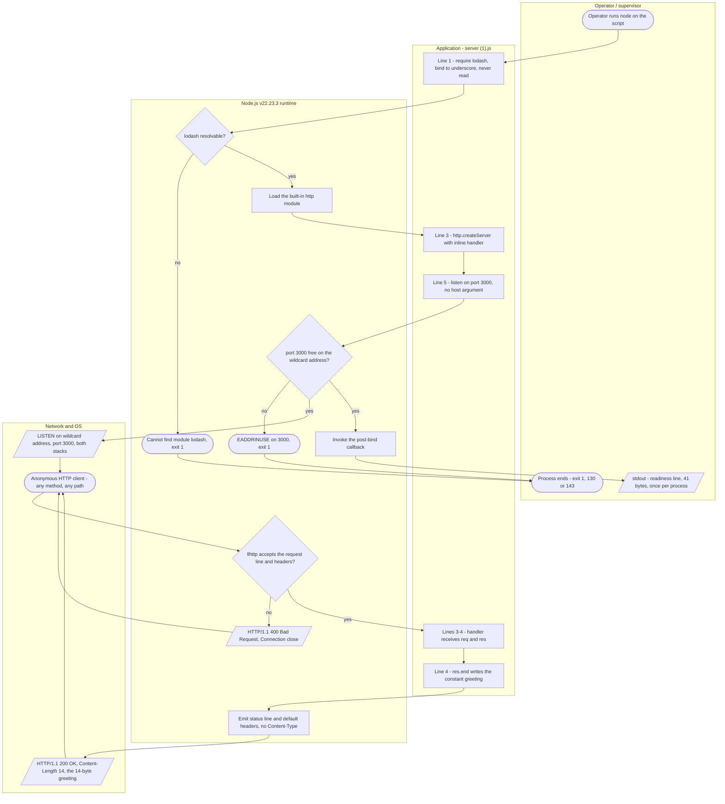

**Reading key.** The application lane contains five steps and no decision: all three diamonds belong to the runtime lane, and the two abort nodes are terminal. Readiness is produced on the same successful branch as the listener, which is why a supervisor sees silence rather than an error when startup fails. The client's request and the reply cross the network boundary twice per exchange, and the greeting is the only value the client ever receives.

### 4.6.2 Detailed Process Flows for Each Core Feature

**Figure 4.6.2 — F-001 Load-time dependency binding**

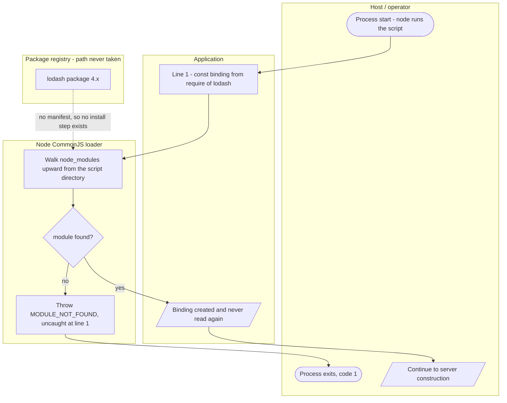

**Reading key.** The gate is real but the dependency is inert: `_` is bound and never referenced, so a checkout with the package installed behaves exactly as one without it — the only difference is whether the process survives line 1. The dotted edge is the install-time path the repository never travels, because no manifest declares the dependency (F-001-RQ-001).

**Figure 4.6.3 — F-002 Listener establishment with F-003 readiness signalling**

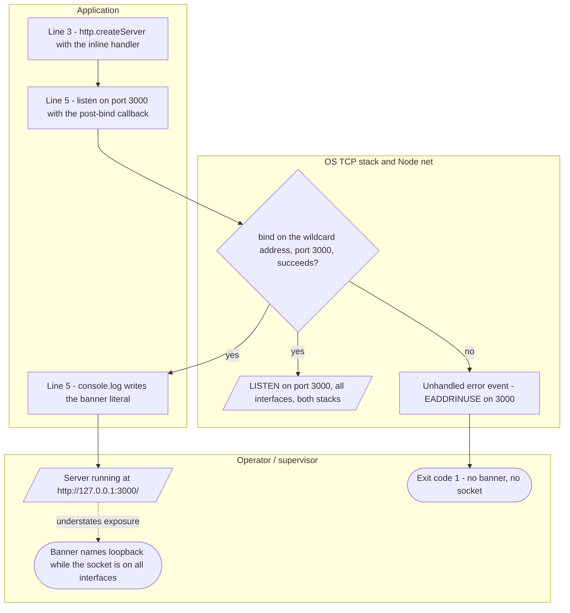

**Reading key.** Both success edges leave the same diamond in the same instant, so readiness cannot precede the bind and cannot be reported when the bind fails. The bind carries no host argument, which is why the OS answers on every interface and why a second instance's error names `:::3000` — the banner's `127.0.0.1` is the one statement in the system that contradicts observed behaviour (F-003-RQ-002).

**Figure 4.6.4 — F-004 Uniform greeting response**

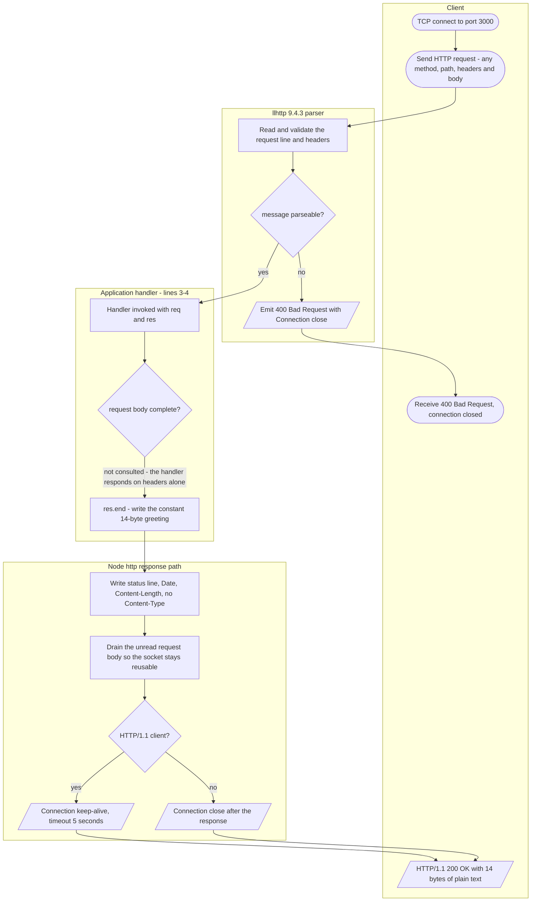

**Reading key.** The request is a trigger, never an input: `req` is passed and never read, so the path from invocation to the greeting is unconditional and the `BodyGate` diamond is drawn as a bypass, not a gate. A 5 MB body was answered in 2.0 ms because nothing waits for it, and the runtime drains those unread bytes so the same socket can carry the next request (F-004-RQ-003, F-004-RQ-004).

### 4.6.3 Error Handling Flowchart

**Figure 4.6.5 — All error states and the only recovery available**

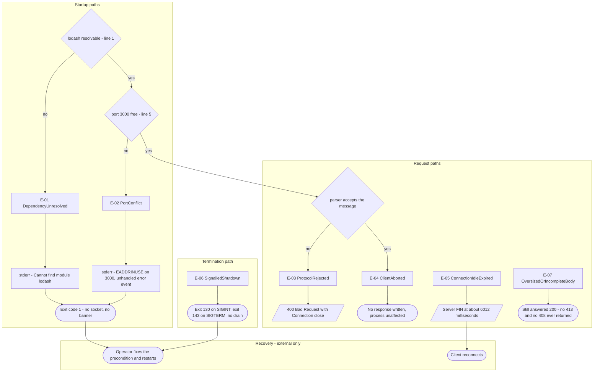

**Reading key.** The recovery lane is drawn deliberately sparse: no error state inside the application lane has an in-process remedy, because the file contains no `catch`, no `on('error')` and no `process.on` handler. E-04 is silent — nothing is logged anywhere — and E-07 is invisible to the system, since no size limit or body timeout exists to trip. Startup failures converge on exit code 1, termination on 130 or 143, and both require an external actor to restore service.

### 4.6.4 Integration Sequence Diagram

**Figure 4.6.6 — Integration sequence for one request, from operator start to client reply**

```mermaid
sequenceDiagram
    autonumber
    participant Op as Operator or supervisor
    participant Proc as Application process
    participant Loader as Node CommonJS loader
    participant Net as OS TCP stack
    participant Cli as Anonymous HTTP client
    participant Par as llhttp parser
    participant Han as Request handler lines 3-4

    Op->>Proc: start the process with node on the script
    Proc->>Loader: require lodash at line 1
    Note over Loader,Proc: no manifest exists, so nothing installed this module
    Loader-->>Proc: export bound to the unused constant
    Proc->>Net: listen on port 3000 with no host argument
    Net-->>Proc: bind succeeded on the wildcard address
    Proc-->>Op: stdout readiness line, once per process
    Note over Proc,Net: the banner names loopback while the socket serves all interfaces
    Cli->>Net: TCP connect to port 3000
    Net->>Par: deliver the request bytes
    Par->>Par: validate the request line and headers
    alt message unparseable
        Par-->>Cli: HTTP/1.1 400 Bad Request with Connection close
    else message accepted
        Par->>Han: invoke the handler with req and res
        Note over Han: req is never read and no body is consumed
        Han-->>Cli: HTTP/1.1 200 OK, Content-Length 14, the 14-byte greeting
        Note over Cli,Net: the connection stays reusable for about 5 seconds, then the server sends FIN
    end
    Op->>Proc: SIGINT or SIGTERM
    Proc-->>Op: exit code 130 or 143, with no shutdown output
```

**Reading key.** Only three messages are initiated by application code — the `require`, the `listen` call, and the single response write — and each is shown against the lane that receives it. There is no participant for a database, a cache, a broker or an upstream service, because the process contacts nothing: the outbound path of every integration flow in this system ends at the client socket.

### 4.6.5 State Transition Diagrams

**Figure 4.6.7 — Process lifecycle state transitions**

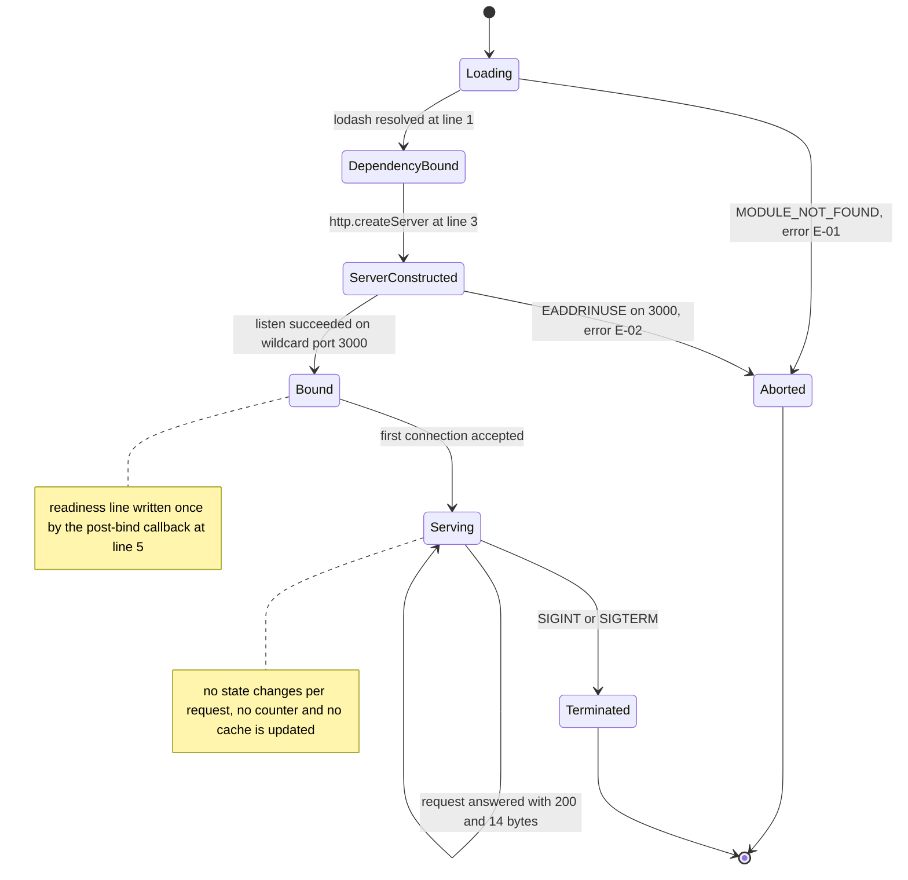

**Reading key.** Two states are terminal and neither is reachable from the serving state: the process cannot abort after binding, and no transition returns from `Serving` to an earlier state. There is deliberately no `Closed` state, because the server object is never retained by name and therefore cannot be closed programmatically; the only exit from `Serving` is a signal.

**Figure 4.6.8 — Connection state transitions per client socket**

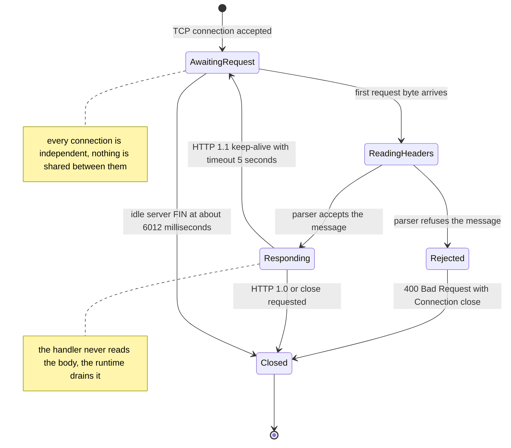

**Reading key.** `AwaitingRequest` is the reuse pivot: under HTTP/1.1 a socket returns there after each response and only leaves it when the idle timer fires at about six seconds, whereas HTTP/1.0 sockets close immediately after one exchange. Because nothing is shared between sockets, 1000 concurrent connections produced 1000 identical responses with no contention and no errors (sub-section 4.2.2.4).

### 4.6.6 Integration Sequence Diagram — Corrected Definition

The participant alias used in Figure 4.6.6 collides with a reserved keyword of Mermaid's sequence-diagram grammar — `par`, the keyword that opens a parallel block — so a renderer rejects that block with a parse error at the first message that names the alias. The definition below renames that participant to `Parser` and is identical in every other respect. It is the definition to render, and it supersedes the code block printed under Figure 4.6.6; the reading key of 4.6.4 applies to it unchanged.

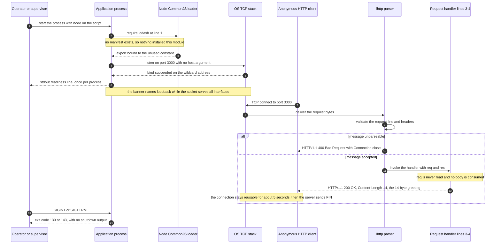

**How the diagrams were validated.** Every diagram definition in sub-section 4.6 was parsed and rendered with Mermaid 12.0.0 through `@mermaid-js/mermaid-cli`, in a headless browser run from a scratch directory outside the checkout. Figures 4.6.1 to 4.6.5, 4.6.7 and 4.6.8 render exactly as printed; Figure 4.6.6 renders once the alias above is renamed, which is the only correction this validation produced. Alongside rendering, each definition was checked structurally: every `flowchart` block opens each `subgraph` with a matching `end`, no node identifier is duplicated, no node identifier reuses a subgraph name, and every edge target is a node defined in the same figure; the sequence diagram's `alt` block and the two state diagrams balance their blocks with `end`. The rendered layout of every figure also carries the labels quoted in this section — for example `Anonymous HTTP client` in Figure 4.6.1, the `Recovery - external only` lane in Figure 4.6.5, and the `DependencyBound` and `Serving` states in Figure 4.6.7 — so each figure's text content, not merely its syntax, was verified as rendered.

## 4.7 References

**Repository artifacts cited as evidence**

- `server (1).js` — the only tracked file (5 lines, 185 bytes, sha256 `7f27a6663b7656d9f7c838d207d038a6ef003805c90e64f89f3d56297f6ea203`); the sole implementation of every application-implemented step in this section — the load-time binding on line 1, the server construction and request handler on lines 3-4, and the hardcoded port with its readiness literal on line 5 — and the source of the absence proofs for branches, error handlers, retries, state, persistence, caching, validation and authorization.
- Repository root `""` — the checkout's complete contents: one child, the file `server (1).js`, with no manifest, lockfile, test, documentation, container, infrastructure or CI file accompanying the flows described here.
- `.git/` — one commit `88dcb7d` ("Add files via upload", 2026-10-06), one tracked file (`git ls-files`), and a `.git/hooks` directory holding only the stock `*.sample` files, establishing that no delivery, quality-gate or deployment flow exists in the repository.
- `lodash` — the package required by `server (1).js:1`, resolved at 4.18.1 for runtime observation from a module directory outside the checkout because the repository neither declares nor contains it; it gates F-001 and therefore every flow in this section.

**External sources consulted**

- [web] npm registry, package `lodash@4.18.1` — installed into a scratch directory outside the checkout so the load gate of line 1 would resolve, which is what allowed the startup, request, error-path and timing observations in sub-sections 4.2, 4.3 and 4.5.2 to be made at all. The checkout itself was not modified.
- [web] Mermaid 12.0.0 through `@mermaid-js/mermaid-cli`, executed headlessly — parsed and rendered every diagram definition in sub-section 4.6 and produced the single correction recorded in 4.6.6 (the participant alias that collided with the sequence diagram's `par` keyword).
- No other external source was used, and no observed behaviour in this section is asserted from documentation rather than from the tracked file and its execution.

**Internal cross-references**

- Section 1.2 (System Overview) — the capability set, runtime behaviour and absence of KPIs that this section's flows restate as process steps.
- Section 2.1 (Feature Catalog) — the feature identifiers F-001 to F-004 used to name the workflows and to attach each figure to a feature.
- Section 2.2 (Functional Requirements Table) — the requirement identifiers F-001-RQ-001 to F-004-RQ-005 cited at each decision point, validation rule and error path.
- Section 3.1 (Stack Overview and Default-Stack Applicability) — the runtime, parser and library facts (Node v22.23.3, llhttp 9.4.3, `lodash` undeclared) behind the runtime-supplied steps and the load gate described here.

# 5. System Architecture

## 5.1 High-Level Architecture

The repository records no architecture description of any kind: no design note, no README, no diagram, no ADR, and no commit discussion beyond "Add files via upload". This section therefore reconstructs the architecture from the only artifacts that exist — the single 5-line CommonJS script `server (1).js` (185 bytes, sha256 `7f27a666…ea203`), its sole commit `88dcb7d`, and its observed behaviour under Node v22.23.3. Where a conventional architectural element has no counterpart here, it is recorded as absent rather than described in the general terms of a pattern the system does not implement.

Three fact classes are used and labelled where they occur.

| Fact class | Basis | Confidence |
| --- | --- | --- |
| Code fact | Read directly from `server (1).js`, cited by line | Exact |
| Runtime fact | Observed by executing the file under Node v22.23.3 (with `lodash` supplied out of band, since the checkout cannot resolve it) | Reproduced under observation |
| Absence fact | Established by a keyword sweep of every file in the checkout excluding `.git` — exactly one file — reporting zero matches | Exhaustive for the repository's contents |
| Derived | This specification's reconstruction of a rationale the repository never wrote down | Interpretive |

### 5.1.1 System Overview

**Architecture style and rationale.** The system is a single-process, single-file, unlayered monolith: one OS process hosting one event loop that answers every request with one constant string. There is no module structure, no layering, and no package boundary — the file declares no `class`, no `function`, no `module.exports` / `exports`, and no configuration object, so nothing in it is reusable except by re-executing the whole file (`server (1).js:1-5`; zero sweep matches for `class`, `function`, `module.exports`, `exports`). The style is a consequence of the requirement the artifact actually satisfies: bind a socket and return a fixed greeting with the smallest possible code path. The rationale below is derived, not recorded — the repository states none — but each element rests on a property of the code itself:

- **The smallest executable unit is the whole program.** `createServer` is called on an inline expression and the returned server is immediately given `listen`, so server construction, handler registration, and binding are one expression (`server (1).js:3-5`). No seam exists at which a second component could be introduced without rewriting the file.
- **Behaviour is fixed at author time.** The port is a numeric literal and the body is a string literal; the sweep finds zero matches for `process.env`, `process.argv`, `dotenv`, and `config`, so no environment, argument, or file can alter what the process does (`server (1).js:4-5`).
- **A single third-party edge is retained without being used.** Line 1 binds `lodash` to `_`, and `_` appears on that line only; the binding is never read. It contributes no behaviour, yet its resolution is the first statement executed and therefore fatal when absent.
- **All protocol handling is delegated.** The application owns none of the HTTP work it appears to perform: parsing, status-line and header generation, `Content-Length` computation, keep-alive timing, `HEAD` body suppression, and rejection of unparseable requests all come from the runtime's `http` module and its llhttp 9.4.3 parser (`server (1).js:3-4`; runtime facts).

**Architectural principles and patterns present.** Each is a property the code exhibits, not a principle the project declared.

| Principle or pattern | How it manifests | Evidence |
| --- | --- | --- |
| One deployable unit per host | One process, one port literal, so a second instance cannot bind: exit 1 with `EADDRINUSE … :::3000` | `server (1).js:5`; second-instance run |
| Zero abstraction — no router, middleware, controller, service, or repository layer | The handler is an inline arrow function and the entire request path is one statement | `server (1).js:3-4`; zero sweep matches for `router`, `middleware`, `route`, `handler` |
| Statelessness by construction | The handler reads neither `req` nor `res` properties and retains nothing between calls, so requests are interchangeable | `server (1).js:3-4`; 200 concurrent requests produced no state and no output |
| Runtime delegation (thin application, thick runtime) | The application contributes one 14-byte literal; the runtime contributes framing and connection lifecycle | `server (1).js:4`; response headers are runtime defaults |
| Event-driven reactor | Nothing waits; `createServer` registers a callback and `listen` registers a second, both invoked by the event loop | `server (1).js:3,5`; two arrow functions and no synchronous work |
| Fail-fast, single-attempt startup | Initialization is a strict linear chain — resolve module, construct server, bind port, announce — with no retry, no fallback, and no supervision | `server (1).js:1,3,5`; `MODULE_NOT_FOUND` exit 1, `EADDRINUSE` exit 1 |
| Readiness signalled on stdout rather than by a probe | The only readiness signal is a 41-byte line printed in the post-bind callback | `server (1).js:5`; observed one banner line |
| Anonymous, trust-free ingress | No request attribute can change the outcome, including an `Authorization` header, which is answered like every other request | `server (1).js:3-4`; credentialed `POST` returned the identical response |

**Patterns deliberately named as absent.** So that a reader does not look for them: there is no layered or hexagonal architecture, no dependency injection beyond the CommonJS loader itself, no microservice or service registry, no message-driven, publish/subscribe, or queue-based pattern (zero sweep matches for `queue`, `event`, `emit`), no CQRS or saga, no repository/ORM or unit-of-work, no cache-aside or write-through caching, no circuit breaker, bulkhead, or retry/backoff, no BFF or API gateway, and no backends-for-frontends or facade. Each absence is a sweep result over the only file in the repository, and the absence of the capability itself is documented in Section 1.3.2.

**System boundaries.** The table gives the extent of each boundary and the evidence that fixes it.

| Boundary | Extent in this system | Evidence |
| --- | --- | --- |
| Process | Exactly one process and one event-loop thread; no `cluster`, `worker_threads`, `fork`, `spawn`, or `child_process` appears anywhere | `server (1).js:1-5`; zero sweep matches for all five |
| Code | One file of 185 bytes; no exports, so the system cannot be consumed as a library and has no internal interface to test | `git ls-files`; zero matches for `module.exports` / `exports` |
| Network ingress | A single wildcard-bound TCP listener on port 3000; the process accepts on every interface and both IP stacks | `server (1).js:5`; `/proc/net/tcp6` LISTEN on local address `0000…0000:0BB8` |
| Network egress | None. The application opens no outbound connection and contains no HTTP client or datastore client | `server (1).js:1-5`; zero matches for `fetch`, `axios`, `redis`, `mongo`, `sql`, `database` |
| Data | One in-memory constant string. Nothing is read from or written to a store, file, or session | `server (1).js:4`; zero matches for `fs`, `stream`, `pipe`, `cache`, `session` |
| Trust | None is modelled. Every client that can reach the port is served identically; there is no credential, role, tenant, or session concept | `server (1).js:3-4`; zero matches for `auth`, `token`, `jwt`, `login`, `user`, `role`, `permission` |
| Configuration | None. Behaviour cannot be varied without editing source | `server (1).js:4-5`; zero matches for `process.env`, `process.argv`, `dotenv`, `config` |
| Trust in time | No TLS: the runtime ships OpenSSL 3.5.8, and the application never invokes it | zero matches for `https`, `tls`, `cert`, `key` |

**Major interfaces.** The system has five interfaces and, notably, no HTTP API surface in the conventional sense: there are no routes, no method distinctions, and no parameters, so the HTTP interface exposes exactly one operation with no input.

| Interface | Direction | Contract | Evidence |
| --- | --- | --- | --- |
| Process launch | Inbound (operator or supervisor) | `node "server (1).js"` — the filename requires quoting because it contains a space and parentheses; the process runs in the foreground and exits 1 on `MODULE_NOT_FOUND` or `EADDRINUSE` and 143 on `SIGTERM` | `server (1).js:1-5`; observed exit codes |
| Dependency resolution | Inbound, load time, synchronous | A module named `lodash` must resolve from the script's directory or an ancestor `node_modules`, or the process exits before binding; the repository declares no such dependency | `server (1).js:1`; `require.resolve('lodash')` → `MODULE_NOT_FOUND` |
| HTTP over TCP | Inbound (any HTTP client) | Any request to port 3000 on any interface receives `HTTP/1.1 200 OK`, `Content-Length: 14`, and the 14-byte body `Hello, World!\n`, with no `Content-Type` | `server (1).js:3-4`; byte-level response dump |
| Standard output | Outbound, once per process | One 41-byte line, `Server running at http://127.0.0.1:3000/`, emitted in the post-bind callback and never repeated | `server (1).js:5`; stdout of 41 bytes after 200 requests |
| Runtime module API | Inbound (the runtime's own surface) | The application uses four members of the Node.js API only: `require`, `http.createServer`, `server.listen`, and `res.end` | `server (1).js:1-5`; the four sweep hits |

The context diagram places the four repository-visible components inside one process, shows the single external consumer, and marks the two edges the repository never completes.

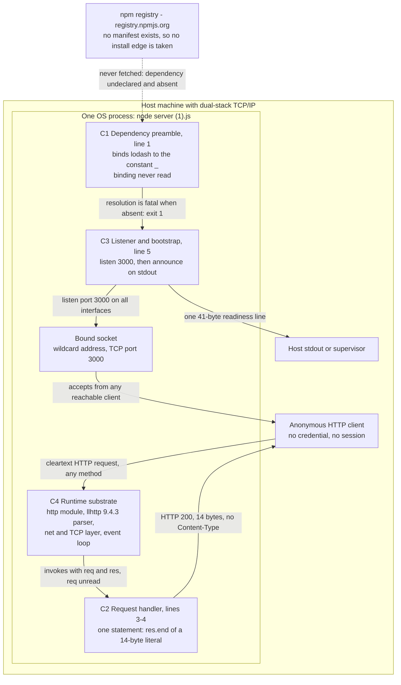

### 5.1.2 Core Components Table

Four components exist. Three are application code, one is supplied by the runtime and linked into the same process; together they are the whole system. The components are named C1 to C4 and are referenced under those names in Section 5.2.

| Component Name | Primary Responsibility | Key Dependencies | Integration Points |
| --- | --- | --- | --- |
| C1 Dependency preamble (`server (1).js:1`) | Bind the third-party module `lodash` to the constant `_`, establishing a load-time gate the process must pass before anything else runs | CommonJS loader; a resolvable `lodash` module, which the repository neither declares nor ships | CommonJS `require`; the module resolution path of the host (ancestor `node_modules` directories) |
| C2 HTTP request handler (`server (1).js:3-4`) | Produce the uniform response: write the 14-byte literal `Hello, World!` plus a newline to every accepted request, whatever its method, path, headers, or body | The `res` object supplied by C4; the compiled string literal; nothing else | Registered as a callback on C4's server object; invoked by C4 once per request |
| C3 Listener and startup bootstrap (`server (1).js:5`) | Bind the server to TCP port 3000 on all interfaces and, once bound, announce readiness on stdout | C4's `listen`; a free port 3000; a writable stdout | C4's HTTP server object; the host TCP/IP stack on port 3000; `process.stdout` |
| C4 Runtime substrate (Node.js v22.23.3: `http`, llhttp 9.4.3, `net`, event loop, `process.stdout`) | Supply every HTTP and network capability in use: TCP accept, request parsing, response framing, header generation, keep-alive, `HEAD` suppression, `400` rejection, and standard-output writing | The host OS and its TCP/IP stack; the Node.js runtime itself | In-process with C1-C3; socket-facing to E3 and E4; console-facing to E5 |

Two of the four carry a consideration serious enough to decide whether the system runs at all; the repository records no mitigations, so each is stated with its consequence.

| Component | Critical Consideration | Consequence if unmet or misunderstood | Evidence |
| --- | --- | --- | --- |
| C1 Dependency preamble | The dependency it binds is undeclared, unpinned, and unused. On a clean checkout the module cannot resolve, so the process exits before any bind | The repository as delivered is not runnable; the failure is reported as a missing module rather than as a missing install, and the binding buys no behaviour once resolved | `server (1).js:1`; `MODULE_NOT_FOUND`, exit 1; `_` referenced on line 1 only |
| C2 Request handler | The handler is the entire request path and reads no request data, so no input-derived behaviour exists to configure, validate, or exploit — but also none to extend without new code | Adding a route, header, or body dependency is new construction, not configuration; the response is a contract every client depends on and any text change breaks | `server (1).js:3-4`; identical responses for credentialed and body-bearing requests |
| C3 Listener and bootstrap | The port is a literal bound on every interface, while the banner names `127.0.0.1`, and binding happens once with no retry or supervision | Only one instance per host; exposure is wider than the operator is told; a busy port ends the process with exit 1 and nothing restarts it | `server (1).js:5`; wildcard LISTEN; `EADDRINUSE … :::3000` |
| C4 Runtime substrate | Every externally visible HTTP behaviour except the body belongs to the runtime, and the repository pins no runtime version and tests none of it | A runtime change can alter status framing, keep-alive timing, `HEAD` behaviour, and parser rejection without any source change | `server (1).js:3-5`; response headers and defaults are runtime-supplied |

### 5.1.3 Data Flow Description

Two flows exist: one control flow that runs once per process and moves no application data, and one request/response flow that runs once per request and moves 14 bytes. Nothing else in the system transports data.

**Flow A — startup (once per process, control only).** The runtime loads `server (1).js` as a CommonJS module and evaluates it top to bottom. Line 1 resolves `lodash` and assigns it to `_`, which the loader must complete before any subsequent statement; failure here terminates the process with exit code 1 before a socket exists. Line 3 calls `http.createServer` with the handler closure, which instantiates C4's server object but binds nothing. Line 5 calls `listen(3000, callback)`, which asks the host stack for a wildcard bind on port 3000; a refusal is an unhandled `error` event and exit code 1. On success the callback runs once and writes the 41-byte banner to `process.stdout`. The event loop then idles with no timers, no intervals, and no queued work — the listening socket is the only pending source of events. No data crosses a component boundary in this flow; the only bytes produced are the banner.

**Flow B — request and response (once per request).** A client connects to port 3000 on any interface. C4 accepts the connection, parses the request bytes with llhttp 9.4.3, and invokes C2 with a request object and a response object. C2 executes one statement, `res.end('Hello, World!\n')`, and returns; it never reads `req`, so the method, target, headers, query, and body are framed by the runtime and then discarded. C4 writes a status line and four headers — `Date`, `Connection: keep-alive`, `Keep-Alive: timeout=5`, and `Content-Length: 14` — followed by the 14 body bytes, and retains the connection for the runtime's default keep-alive window of 5000 ms, during which further requests on the same connection are served identically, including requests pipelined behind the first. The application contributes no header, no status code, and no framing decision of its own.

**Integration patterns and protocols.** One protocol stack, used inbound only: cleartext HTTP/1.0 or HTTP/1.1 over TCP/IP on port 3000, request/response, with no chunked transfer (the runtime derives `Content-Length` from the single write), no compression (zlib 1.3.1 ships with the runtime and is never called), no TLS (OpenSSL 3.5.8 ships with the runtime and is never called), and no WebSocket upgrade or server-sent events. Internally, the only integration pattern is callback registration on a single event loop: C2 and the banner callback are both registered up front and invoked later, so the application contains no call graph deeper than one call and no concurrency primitive of its own.

**Data transformation points.** The application transforms nothing — it performs no parsing, validation, normalization, serialization, templating, or interpolation, and no request value reaches any sink. The two transformations that occur are both runtime-owned.

| # | Transformation | Owner | Where the result goes |
| --- | --- | --- | --- |
| T1 | Request bytes on the socket → framed HTTP message (method, target, version, headers, body stream) | C4, llhttp 9.4.3 | Offered to C2 as `req`, which never dereferences it; the framed data is discarded |
| T2 | JavaScript string literal `Hello, World!\n` → 14 UTF-8 bytes plus the computed `Content-Length: 14` header | C4's response writer | Written to the socket as the response body |

**Key data stores and caches.** The system has no data store, no cache, no session store, no queue, and no file access. The sweep of the only repository file returns zero matches for `fs`, `cache`, `redis`, `mongo`, `mysql`, `postgres`, `sqlite`, `sql`, `query`, `database`, `pool`, `session`, `cookie`, and `pipe`, and Section 3.6 records the same absence across the checkout. The only state that exists is process-local, transient, and owned by the runtime.

| State element | Where held | Lifetime | Evidence |
| --- | --- | --- | --- |
| The greeting payload | Constant pool of the compiled script; re-emitted from memory on every request | Life of the process | `server (1).js:4` |
| The `_` binding | Module scope; written once, never read | Life of the process | `server (1).js:1` |
| The listening socket | C4's server object and the OS socket table | From bind until the process exits | `/proc/net/tcp6` LISTEN on `…:0BB8` |
| Per-connection buffers and the keep-alive timer | Runtime internals, one set per open connection | Connection lifetime, with a 5000 ms idle default | Observed `Keep-Alive: timeout=5`; runtime default 5000 ms |
| Any application-level state | Nowhere — no cache, counter, or mutable module-level value exists | Not applicable | `server (1).js:1-5`; zero matches for `let` and `var` |

Because no state is retained, a restart is lossless by definition, and no request can influence a later one.

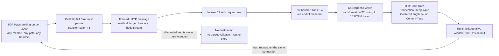

### 5.1.4 External Integration Points

The system has one integration that carries traffic and one that gates startup; the remaining rows record what the architecture touches without integrating with. Integration types follow the vocabulary used in Section 3.8, which documents the same edges at the dependency level.

| System Name | Integration Type | Data Exchange Pattern | Protocol/Format |
| --- | --- | --- | --- |
| Anonymous HTTP clients (E4) | Inbound runtime integration, the only traffic-carrying edge | Every request is answered with the same status, headers, and 14-byte body; the request's own data is framed and discarded, so the exchange is one-way in effect | Cleartext HTTP/1.0 and HTTP/1.1 over TCP; response body has no declared `Content-Type` |
| Host TCP/IP stack (E3) | Inbound bind and accept | The process binds once on the wildcard address and accepts connections on port 3000 until it exits | TCP over IPv4 and IPv6 dual stack; port 3000 = `0x0BB8` |
| Node.js runtime and CLI (E1) | Link-time and in-process integration | The runtime loads the file, supplies the `http`, `net`, and `process.stdout` surfaces, drives the event loop, and owns the process's exit code | CommonJS module loading; JavaScript callbacks; the Node HTTP server API |
| `lodash` resolution source (E2) | Load-time dependency, mandatory but undeclared | One synchronous resolution during module evaluation; the resolved value is assigned once and never used | CommonJS resolution algorithm over a module directory or package on the loader path |
| npm registry, `registry.npmjs.org` (E6) | Install-time integration, **never exercised by the repository** | No exchange occurs: with no manifest and no lockfile, nothing in the checkout triggers an install, so a consumer must supply the dependency out of band | HTTPS registry API, JSON metadata and tarballs (Section 3.4) |
| Host stdout consumer — console or supervisor (E5) | Outbound, one-way, once per process | A single 41-byte readiness line; no per-request output follows it, so the stream is not a traffic log | Plain text, LF-terminated, written through `process.stdout` |
| Container orchestration, cloud platform, identity provider, datastore, message broker, telemetry backend, CDN | No integration | None exists, is configured, or is referenced by any repository file | Not applicable (Sections 3.5 and 3.6) |

No SLA, service-level objective, or timeout commitment is recorded anywhere in the repository, and none can be measured from it: there is no health or metrics endpoint, no per-request log, and no counter. The table therefore gives the observable substitute for each edge, which is what an operator can actually rely on.

| Integration | SLA requirement recorded | Observable substitute | Evidence |
| --- | --- | --- | --- |
| Anonymous HTTP clients (E4) | None | Constant 200 with a 14-byte body; no application timeout, so latency is bounded only by the socket write and the runtime's inherited `requestTimeout` of 300000 ms | `server (1).js:3-4`; response dump; runtime defaults |
| Host TCP/IP stack (E3) | None | Service exists only while the process holds the bind; readiness is confirmed by the banner, never by a probe, and a busy port is fatal rather than deferred | `server (1).js:5`; `EADDRINUSE`, exit 1 |
| Node.js runtime and CLI (E1) | None recorded; the observed runtime is Node v22.23.3 | The file's only static gate is `node --check`, which passes; no runtime version is declared, so behaviour follows the installed runtime | `node --check`; no `engines`, `.nvmrc`, or manifest exists |
| `lodash` resolution source (E2) | None | Startup success is an all-or-nothing precondition: resolvable, or exit 1 with no bind and no banner | `server (1).js:1`; `MODULE_NOT_FOUND`, exit 1 |
| npm registry (E6) | None | The edge is dormant; the dependency must be supplied out of band for the service to start at all | No `package.json` or lockfile in the checkout |
| Host stdout consumer (E5) | None | Exactly one line is emitted per process, so readiness is the only signal and a silent process is the only failure signal | `server (1).js:5`; 41 bytes of stdout after 200 requests |


## 5.2 Component Details

The system comprises four components, named C1 to C4 as in Section 5.1.2: three are application code totalling 185 bytes in one file, and one is the Node.js runtime linked into the same process. No component is a library, module, or service with a published API — the interfaces between them are a CommonJS resolution, a callback registration, and four method calls — so each component below is described by what it does, what it borrows, and what it cannot do. Every component's persistence requirement is none, and that statement is evidenced rather than assumed: the sweep of the only repository file returns zero matches for `fs`, `stream`, `pipe`, `cache`, `session`, `database`, and every datastore name.

| Component | Code size | Owns | Borrows from C4 |
| --- | --- | --- | --- |
| C1 Dependency preamble | 1 line | One resolution gate and one unused binding | The CommonJS loader and module resolution path |
| C2 Request handler | 2 lines | The response body, and nothing else | Request parsing, framing, headers, connection lifecycle |
| C3 Listener and bootstrap | 1 line | The bind call and the readiness message | Socket binding, the post-bind callback, `process.stdout` |
| C4 Runtime substrate | Not application code | Every HTTP and network behaviour the system exhibits | Not applicable — it is the source of the borrowings |

### 5.2.1 C1 — Dependency Preamble

**Purpose and responsibilities.** C1 performs one action: `const _ = require('lodash')` (`server (1).js:1`). It has no other statement, so its duties reduce to two: force the CommonJS loader to resolve a module named `lodash` before any further code is evaluated, and bind the resolved value to the constant `_`. The constant is never read again — `_` appears on line 1 only — so C1's binding responsibility is vestigial, while its gating responsibility is absolute: on a clean checkout the process exits with code 1 and never binds a socket.

**Technologies and frameworks.** Plain CommonJS `require` with an unversioned module specifier; no framework and no loader hook. The dependency is undeclared in any manifest (none exists) and unpinned, so the version resolved depends entirely on what the host happens to provide; the npm registry's `latest` tag reported 4.18.1 as of 2026-10-23 (registry-reported, Section 3.4). Because the binding is unused, the module's own behaviour is irrelevant to the system's behaviour: a minimal stub substituted on the resolution path is sufficient to start the service, which is how the runtime observations in this section were made.

**Key interfaces and APIs.** C1 exposes no API and consumes exactly one: the CommonJS resolution algorithm applied to the specifier `lodash`, resolved relative to the script's directory and then up through ancestor `node_modules` directories, or through whatever resolution path the host supplies. Its only observable outputs are its two terminal effects — a module-scoped constant and, when resolution fails, an uncaught `MODULE_NOT_FOUND` thrown from `node:internal/modules/cjs/loader` at `server (1).js:1:11`.

**Data persistence requirements.** None. C1 reads no file, opens no connection, and writes nothing; the module resolution it triggers may be served from memory or from disk by the loader, which is outside this system.

**Scaling considerations.** C1 executes once per process, synchronously, before any other statement, and adds one module-resolution step to startup. It has no concurrency, throughput, or memory dimension, and it cannot scale or be made resilient by configuration: the gate is binary, and the only remedies are to provide the module or to remove the statement. Its scaling cost is therefore the whole system's: a process that fails here serves nothing, and no supervisor exists to retry it.

### 5.2.2 C2 — HTTP Request Handler

**Purpose and responsibilities.** C2 is the system's entire request path. It is an anonymous arrow function passed inline to `http.createServer` (`server (1).js:3-4`) whose single statement is `res.end('Hello, World!\n')`. Its responsibilities are to accept the `(req, res)` pair the runtime supplies and to terminate the response with a fixed payload. It performs no routing, no method dispatch, no input parsing, no validation, no serialization, no templating, no logging, and no error handling; it never dereferences `req` or any header value, so request data cannot influence its behaviour. It returns immediately and never blocks: there is no I/O, no computation, and no allocation whose size depends on input.

**Technologies and frameworks.** No framework, router, or middleware is present — zero sweep matches for `express`, `fastify`, `koa`, `router`, `middleware`, `route`, and `handler` — and no HTTP client library either. The only technologies C2 uses are JavaScript language constructs (`const` and one arrow function; zero matches for `let`, `var`, `class`, `async`, `await`, `promise`) and two methods of the runtime's response object. `res.end` is the only response method called: `writeHead`, `setHeader`, `statusCode`, and `pipe` return zero sweep matches, which is why no status code other than the runtime default 200 and no header other than the four runtime defaults can ever be emitted.

**Key interfaces and APIs.** C2's interface is the Node.js request-listener contract, `(req, res) => void`, registered on the server object C3 binds. Its only outbound API call is `res.end(string)`. The contract it offers clients is narrower than the signature suggests: status 200, the headers `Date`, `Connection: keep-alive`, `Keep-Alive: timeout=5`, `Content-Length: 14`, no `Content-Type`, and the 14-byte body `Hello, World!\n`, identical for `GET`, `POST`, `HEAD`, `DELETE`, and every other method, and identical whether or not the request carries credentials or a body. `HEAD` is answered with the same call but with no body and no `Content-Length`, because the runtime suppresses both.

**Data persistence requirements.** None, and structurally so: nothing is written to disk, memory, or a store. The payload is a literal in the compiled script, re-emitted from memory on every request, and no mutable module-level value exists to retain anything between requests.

**Scaling considerations.** C2 imposes no scaling limit of its own: constant time, constant 14 bytes, no I/O, no shared state, and no lock, so any number of requests can be served by the one event loop without contention. Measured from the host, 200 simultaneous requests were all answered with 200 and zero errors in 82 ms, and stdout remained at its original 41 bytes, confirming that C2 produces no per-request side effect that could accumulate. The ceiling is therefore C4's, not C2's: a single event-loop thread and the runtime's connection defaults. C2 offers no mechanism to add capacity — no pooling, batching, caching, or backpressure — and because it never reads the request stream, it also applies no body-size limit of its own; the runtime frames and drains bodies C2 ignores.

### 5.2.3 C3 — Listener and Startup Bootstrap

**Purpose and responsibilities.** C3 is the final statement of the file and the system's bootstrap: `listen(3000, () => console.log('Server running at http://127.0.0.1:3000/'))` (`server (1).js:5`). It holds two responsibilities: obtain an exclusive bind of TCP port 3000 on all interfaces, and, in the post-bind callback, emit the single readiness line. Both responsibilities are fulfilled exactly once; the callback is the only place in the system where success is reported, so it is also the only externally visible difference between a successful start and a failed one. C3 performs no retry, no fallback, no backoff, no health check, and no shutdown work; the sweep returns zero matches for `SIGTERM`, `SIGINT`, `process.on`, and `uncaughtException`.

**Technologies and frameworks.** The runtime's `server.listen` method and the global `console.log`, which writes to `process.stdout`. No process manager, init system, container entrypoint, or supervisor is configured anywhere in the repository, so nothing outside the process manages C3's bind or restarts it after a failure.

**Key interfaces and APIs.** C3's inbound API is `listen(port, callback)`; the port is the literal `3000` and no host argument is passed, so the OS selects the wildcard address and the listener covers every interface on both IP stacks — confirmed by the LISTEN entry on local address `0000…0000:0BB8` and by the `EADDRINUSE … :::3000` message of a second instance, which contradicts the banner's claim of `127.0.0.1`. C3's outbound interface is a single 41-byte line on standard output, `Server running at http://127.0.0.1:3000/`, which is the only readiness signal the system offers and the only thing an operator or supervisor can observe before sending traffic. Because the port is a literal, C3's interface cannot be parameterised: no environment variable, argument, or configuration file is read anywhere in the file.

**Data persistence requirements.** None. C3 writes no state; the bind it obtains is held by the OS socket table and by C4's server object, and the banner is written to a stream. Nothing derived from the bind — not the actual address, not the port — is recorded anywhere.

**Scaling considerations.** C3 is the system's hard scaling boundary. One process per host is possible because the port is fixed and exclusive: a second instance exits with code 1 on an unhandled `EADDRINUSE` during the same statement, with no listener created and no banner printed. There is no port override, no reverse proxy, no load-balancer configuration, and no orchestration manifest, so horizontal scale-out and even a blue/green pair on one host are impossible without editing source. Termination is equally unmanaged: `SIGTERM` ends the process with status 143, emits nothing, and releases the port immediately without draining in-flight work.

### 5.2.4 C4 — Runtime Substrate

**Purpose and responsibilities.** C4 is every capability the system appears to have and does not implement. It is the Node.js runtime linked into the process: the `http` module that creates the server object, the llhttp parser that frames requests and rejects unparseable ones, the `net` and TCP layer that accepts connections, the event loop that invokes C2 and C3's callback, and `process.stdout` that carries the readiness line. Its responsibilities are the ones an application would normally own: request parsing, status-line and header generation, `Content-Length` computation, connection acceptance and keep-alive timing, `HEAD` body suppression, and runtime-level connection errors. C2 supplies only the body, and C3 only the bind call.

**Technologies and frameworks.** One runtime, chosen implicitly by the file being JavaScript for Node.js, with no version declaration anywhere in the repository. The observed substrate, read from `process.versions` on the host where the file was executed, is Node.js v22.23.3 with npm CLI 11.21.0. Three components of the substrate ship but are never invoked by this system: OpenSSL 3.5.8 (no `https` or `tls` reference exists), zlib 1.3.1 (no compression call exists), and undici 6.28.1 (no HTTP client call exists).

| Substrate element | Observed version | Role in this system |
| --- | --- | --- |
| Node.js runtime | v22.23.3 (host where the file was executed) | Hosts the process, event loop, and all runtime APIs used |
| V8 | 12.4.254.21-node.57 | Compiles and executes the 5-line script |
| llhttp | 9.4.3 | Parses request framing; issues the `400 Bad Request` for unparseable requests |
| `http` and `net` modules | Shipped with the runtime | Create the server, bind port 3000 on the wildcard address, write responses |
| OpenSSL | 3.5.8 | Present but never invoked — the system serves cleartext HTTP only |
| ICU, zlib, undici | 78.3, 1.3.1-e00f703, 6.28.1 | Present but unused: no locale work, no compression, no outbound request |

**Key interfaces and APIs.** C4's surface is consumed through four API members only: `require` (lines 1 and 3), `http.createServer` (line 3), `server.listen` (line 5), and `res.end` (line 4). The application configures none of the runtime's server options, so every default applies as observed on the host.

| Inherited default | Observed value | Effect on the system |
| --- | --- | --- |
| `keepAliveTimeout` | 5000 ms | Connections are held open for 5 s of idle between requests, as the `Keep-Alive: timeout=5` header advertises |
| `headersTimeout` | 60000 ms | The runtime, not the application, bounds how long a client may take to send headers |
| `requestTimeout` | 300000 ms | The runtime bounds whole-request duration; the application sets no timeout |
| Socket `timeout` | 0 (disabled) | No idle socket timeout beyond the keep-alive window is imposed by the application |
| `maxHeadersCount` | null (no limit) | No header-count cap is configured |

**Data persistence requirements.** None. C4's HTTP module holds only per-connection buffers and keep-alive timers in memory, discarded with the connection; the application gives the runtime nothing to persist. There is no log file, no spool, no write-ahead structure, and no store of any kind.

**Scaling considerations.** Capacity is entirely C4's: one event-loop thread serves every connection, and because C2 never blocks, throughput follows the runtime's socket and parser defaults rather than application design. Observed from the host, 200 simultaneous requests completed with all responses at 200 in 82 ms. The application uses no `cluster`, `worker_threads`, `fork`, or `spawn` — zero sweep matches for each — and passes no option that would tune HTTP behaviour, so no in-product path to higher concurrency exists. Upgrading or replacing the runtime is the only lever available, and the repository neither declares nor tests the runtime version it depends on.

### 5.2.5 Required Diagram — Component Interaction

The diagram shows all four components, the four API members the application consumes from C4, and the external participants. Edges are labelled with the observed failure mode wherever the edge can fail.

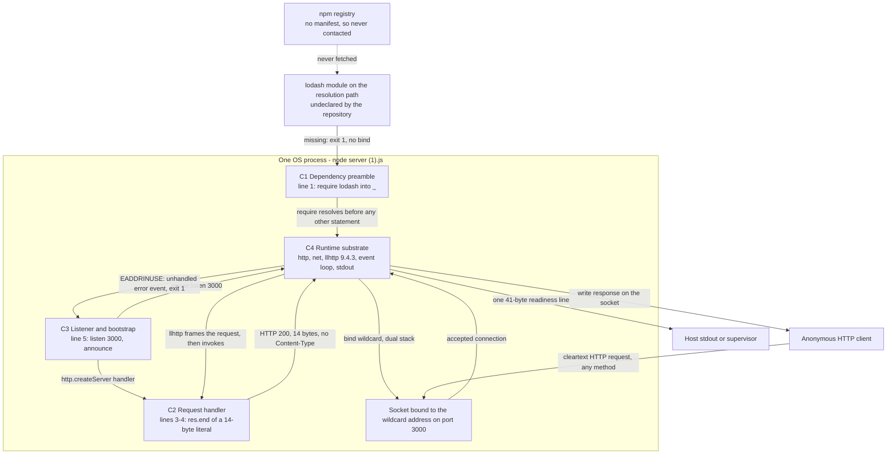

### 5.2.6 Required Diagram — State Transitions

The system's lifecycle is a linear chain of two fatal gates followed by an unbounded serving state. Every transition below was reproduced on the host: `MODULE_NOT_FOUND` and `EADDRINUSE` both exit with code 1 and produce no banner, while `SIGTERM` exits 143 and releases the port immediately.

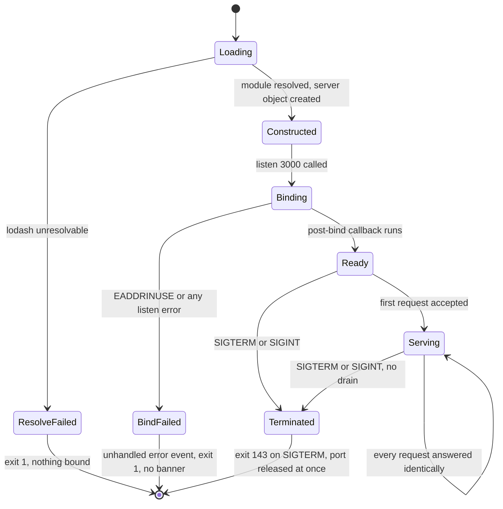

### 5.2.7 Required Diagram — Sequence Diagrams

**Startup and first request.** Both fatal branches are drawn, along with the fact that the request object reaches C2 and is never read.

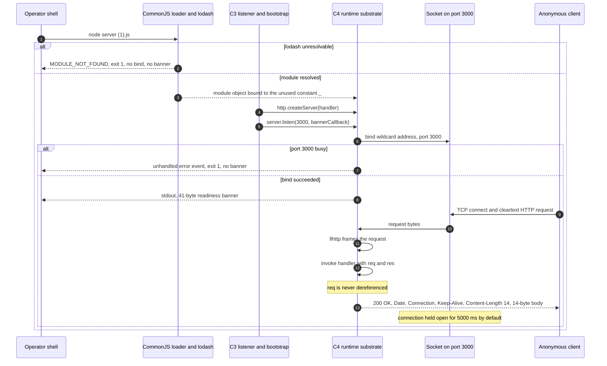

**Request handling details delegated to the runtime.** The three behaviours clients will notice but the application never implements are shown as runtime decisions; all three were observed on the host.

```mermaid
sequenceDiagram
    autonumber
    participant Cli as Client
    participant C4 as C4 runtime substrate
    participant C2 as C2 request handler

    Cli->>C4: HEAD request or pipelined request stream
    alt request unparseable at the parser
        C4-->>Cli: 400 Bad Request with Connection close
        Note over C4: llhttp decides; C2 is never invoked
    else request parsed
        C4->>C2: invoke with req and res
        C2-->>C4: res.end of the 14-byte literal
        alt method is HEAD
            C4-->>Cli: 200 OK with no body and no Content-Length
        else any other method
            C4-->>Cli: 200 OK with Content-Length 14 and the body
        end
        Note over C4: pipelined requests are answered in order on the same socket
    end
```


## 5.3 Technical Decisions

The repository records no decision record of any kind: no ADR, no design note, no README, no architecture diagram, and one commit message — "Add files via upload" — that states no rationale. The decisions below are therefore reconstructed from what the code does and from what it demonstrably leaves out, and every one is labelled **derived**: the choice is a fact of the artifact, the justification is this specification's reading of it. Each decision's tradeoff is stated as the cost the system actually pays, evidenced by the sweep of the single repository file or by observed runtime behaviour. Decisions that a multi-component system would have made — service decomposition, storage engine selection, cache topology, identity integration — are not listed as choices because no code, dependency, or configuration in the repository realises them; Sections 5.3.3 to 5.3.5 record those absences with their consequences.

### 5.3.1 Architecture Style Decisions and Tradeoffs

| Decision | Choice in effect at commit `88dcb7d` | Tradeoff accepted | Evidence |
| --- | --- | --- | --- |
| System shape | One process, one file, one event loop, no internal layering | Nothing can be located, tested, replaced, or reused independently; any change touches the whole program | `server (1).js:1-5`; no `class`, `function`, or `module.exports` exists |
| Framework usage | None: the runtime's `http` module is used directly | The application owns no routing, middleware, lifecycle hooks, or plugin ecosystem; equally, it inherits no framework coupling or upgrade burden | `server (1).js:3`; zero matches for `express`, `fastify`, `koa`, `router`, `middleware` |
| Configuration | None: the port and the payload are source literals | Behaviour is fixed at author time; moving a port or changing the message is a source edit and a redeploy | `server (1).js:4-5`; zero matches for `process.env`, `process.argv`, `dotenv`, `config` |
| Deployment unit | One process per host, unbundled and un-containerised | Maximum simplicity of start-up; no image, manifest, or pipeline, and no second instance on the same host is possible | `server (1).js:5`; `EADDRINUSE`, exit 1; no `Dockerfile`, no CI configuration |
| Startup strategy | Single attempt, fail fast, no retry, no supervision | Failures are unambiguous and immediate; the service stays down until a human intervenes | `MODULE_NOT_FOUND` and `EADDRINUSE` both exit 1; no supervisor or restart policy exists |
| Readiness signalling | One line on standard output, printed in the post-bind callback | The signal is trivially observable from a shell and needs no endpoint; it is invisible to any automated probe, and its text is inaccurate about the bound address | `server (1).js:5`; 41-byte banner; wildcard LISTEN on `…:0BB8` |

The style is coherent at this scale and only at this scale: with one fixed response and no inputs, layering would add indirection without adding replaceable parts, and a framework would add a dependency tree to a program whose entire behaviour is one string literal. The cost appears the moment anything must be added. Routing, a second response, per-request logging, or configuration each require new structure — the repository contains no seam to extend, and Section 5.1.1 lists the patterns that would provide one and are absent.

### 5.3.2 Communication Pattern Choices

| Communication dimension | Pattern in effect | Tradeoff and consequence | Evidence |
| --- | --- | --- | --- |
| In-process composition | Synchronous CommonJS `require` — a module is resolved and evaluated before the next statement runs | Composition is trivial and has no lifecycle to manage; resolution failure is fatal rather than recoverable, and there is no injection point to substitute an implementation | `server (1).js:1,3`; `MODULE_NOT_FOUND` exits 1 before any bind |
| Concurrency model | One event loop with registered callbacks: the request handler and the post-bind callback | No thread-safety concerns and no lock contention; all work is serialised on one thread, so capacity is the runtime's, not the application's | `server (1).js:3,5`; zero matches for `cluster`, `worker_threads`, `fork`, `spawn`, `child_process` |
| Style within the process | Callbacks only: no promise, no `async`, no `await`, no event emitter of its own | Nothing to await and no rejection to handle, because there is no asynchronous work in the application at all; equally, no idiom for adding asynchronous work without introducing one | `server (1).js:3-5`; zero matches for `promise`, `async`, `await`, `event`, `emit` |
| Client-facing protocol | Cleartext HTTP/1.1 request-response on TCP, one response per request, keep-alive retained for the runtime's 5000 ms default | Universally reachable by any HTTP client, and the connection cost of repeated requests is amortised by the runtime; nothing is protected, negotiated, or compressed | Raw response dump; zero matches for `https`, `tls`, `setHeader` |
| Connection reuse and pipelining | Delegated entirely to the runtime | Clients may pipeline requests and reuse sockets with no application involvement; the application cannot influence framing or ordering | Two requests on one socket produced two `200` responses |
| Outbound communication | None: the process initiates no connection of any kind | No upstream latency, failure, or credential handling exists; consequently no upstream system can be integrated without first introducing a client library, timeouts, and error paths | Zero matches for `fetch`, `axios`, `http.get`, `redis`, `mongo`, `sql`, `database` |
| Error propagation outward | None: failures terminate the process, and unparseable requests are answered by the runtime with `400 Bad Request` and `Connection: close` | There is no error contract to mis-handle, and no way to degrade rather than fail | `server (1).js:3-5`; parser-level `400`; unhandled `EADDRINUSE` |

### 5.3.3 Data Storage Solution Rationale

**No storage solution was selected, because no data exists to store.** The system's only datum is the string literal in `server (1).js:4`, which lives in the compiled script and is re-emitted from memory on every request; nothing else enters the process, since the handler never reads the request. The sweep of the only repository file returns zero matches for every storage technology and idiom examined — `fs`, `redis`, `mongo`, `mysql`, `postgres`, `sqlite`, `sql`, `query`, `database`, `pool`, `cache`, `session`, `cookie`, `transaction` — and Section 3.6 reaches the same conclusion across the checkout. The rationale is therefore derivable in one step: with no input to persist and no state to retain, any datastore would be unreachable code and an unmaintained dependency.

The cost of the absence is precise. There is no durability to reason about and no schema, migration, connection pool, or backup to operate; equally, the system cannot remember anything. It cannot count visitors, rate-limit a client, hold a session, serve a value uploaded earlier, or reconstruct what happened after a restart. Adding any of those means adding both a store and the code path that reads the request, which today does not exist.

| Storage option a comparable system would weigh | Present here | Why it is not applicable |
| --- | --- | --- |
| Relational database | No | No entity, table, key, or query exists; the only datum is a constant that needs no constraints |
| Document store | No | No document is constructed, and no request body is read to derive one |
| Key-value store or cache | No | The only value read per request is a literal already in memory |
| Session or cookie store | No | No client is identified, so no session key could be minted or looked up |
| File or object storage | No | No file is read or written; the repository contains no assets to serve |
| Message queue or log | No | Nothing is published or consumed, and no second component exists to consume it |

### 5.3.4 Caching Strategy Justification

**No caching strategy exists, and the reason is that the system has nothing to cache.** The response is a constant held in the compiled script's memory and written from there on every request, so the cost a cache would remove — computation or I/O repeated per request — does not exist: the handler performs one `res.end` call with no computation, no allocation that depends on input, and no external read. Observed under load, 200 simultaneous requests were each answered from memory in constant time with stdout unchanged. A response cache would store one value to avoid producing another, already-in-memory copy of itself.

**No HTTP cache semantics are declared either.** The response carries only the runtime's four default headers — `Date`, `Connection`, `Keep-Alive`, `Content-Length` — and no cache directive, validator, or expiry header, because the application never calls `setHeader`, `writeHead`, or any header API. The sweep returns zero matches for `cache`. Consequently no client or intermediary is told whether the response may be reused, for how long, or how to revalidate it: caching is left entirely to whatever heuristics an intermediary applies on its own, and the `Date` header is the only value that varies between responses. Because the payload is constant by construction, a cached copy and a freshly generated one are byte-identical, so the missing directives cost correctness nothing while costing clients any explicit permission to reuse the response.

| Caching layer a comparable system would weigh | Present here | Consequence of its absence |
| --- | --- | --- |
| In-process response cache | No | No cost to amortise: the response is produced from a memory literal |
| Client or intermediary HTTP cache | Not declared | Clients receive no `Cache-Control`, validator, or expiry, so reuse depends on their own heuristics |
| Distributed cache (for example Redis) | No | Nothing is shared between instances, and only one instance can exist per host |
| Static asset or CDN cache | No | No asset, path, or content type exists to key an entry on |
| Connection or socket cache | Delegated to the runtime | Keep-alive handles reuse with a 5000 ms default; the application neither configures nor observes it |

### 5.3.5 Security Mechanism Selection

**No security mechanism was selected.** The sweep returns zero matches for `auth`, `token`, `jwt`, `session`, `cookie`, `login`, `user`, `role`, `permission`, `https`, `tls`, `cert`, and `key`, and the file contains no input-handling code at all; Section 3.8.4 and Section 2.4.4 document the same posture from the stack and requirements perspectives. The derived rationale is narrow but real: with no input read, no data stored, and no outbound call, the system exposes no injection sink, no data store, and no credential to leak — the handler cannot be induced to behave differently by any request, which is why an `Authorization` header, a body, and a query string all produce the identical response. What the absence costs is availability, exposure, and supply chain, not confidentiality of stored data, and those three costs are the system's actual security position.

| Security dimension | Mechanism selected | Consequence paid | Evidence |
| --- | --- | --- | --- |
| Transport | None: the runtime's `http` module, cleartext; OpenSSL 3.5.8 ships in the runtime but is never invoked | Request and response content, including any credential a client volunteers, travels in the clear; no certificate or key exists in the repository | `server (1).js:3-5`; zero matches for `https`, `tls`, `cert`, `key` |
| Network exposure | The port is passed without a host argument, so the listener covers every interface on both IP stacks | Reachability is wider than the readiness banner claims, and the discrepancy errs on the permissive side | `server (1).js:5`; wildcard LISTEN; `EADDRINUSE … :::3000` |
| Authentication and authorization | None | Every client that can reach port 3000 is served identically; there is no identity, role, or tenancy model, so no request can be denied or attributed | `server (1).js:3-4`; zero matches for `auth`, `token`, `session`, `user`, `role` |
| Input handling | None: the request object is never read | No reflection, template, query, or command sink exists, so injection has no target; equally, no input can be validated, size-limited, or filtered | `server (1).js:3-4`; zero matches for `try`, `catch`, `query`, `validate` |
| Response hardening | None: only the runtime's four default headers are emitted | No content-type, security, or CORS header is sent, so browsers must sniff the body and no origin policy is expressed | Response dump: four headers, no `Content-Type` |
| Abuse and resource limits | None set by the application; the runtime's `headersTimeout`, `requestTimeout`, and `keepAliveTimeout` apply | Rate limiting, connection caps, and body-size limits are absent; a client may open connections and declare large bodies without the application objecting, though the handler answers without reading them | `server (1).js:3-5`; inherited defaults table in Section 5.2.4 |
| Dependency integrity | None: one undeclared, unpinned, and unused third-party module | Supply-chain exposure with no version, lockfile, or integrity hash to detect a substitution, in exchange for no behaviour | `server (1).js:1`; no manifest or lockfile exists |
| Secret management | None needed and none present | There is no credential to protect, rotate, or leak — and no configuration surface through which one could be supplied | Zero matches for `process.env`, `config`, `key` |

### 5.3.6 Required Diagram — Decision Tree

The tree below reconstructs the decision path the artifact embodies: each question is answered from observed behaviour, and each branch not taken names the component that answer a different way would have required. It is a derived summary, not a record the project kept.

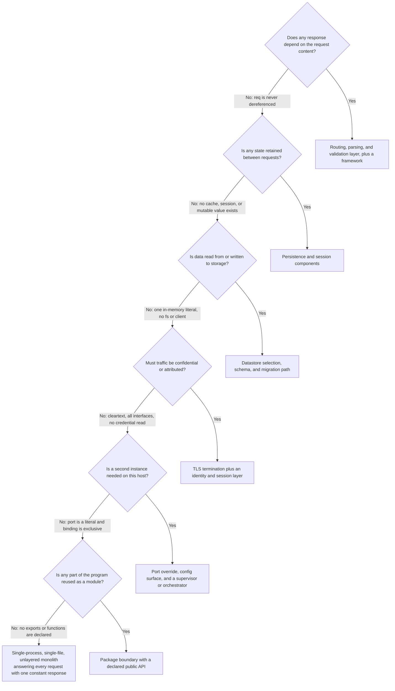

### 5.3.7 Architecture Decision Records

Eight records describe every decision the artifact embodies. Status is **in effect at commit `88dcb7d`** for all of them; the repository records none, so each is reconstructed from evidence rather than copied from a project document.

| ID | Title | Status | Basis of record |
| --- | --- | --- | --- |
| ADR-001 | Single-file, unlayered script as the entire system | In effect, undocumented | `server (1).js:1-5`; no exports, classes, or functions |
| ADR-002 | Use the runtime's built-in `http` module instead of a framework | In effect, undocumented | `server (1).js:3`; zero framework matches |
| ADR-003 | Hardcode the listening port and omit the host argument | In effect, undocumented | `server (1).js:5`; wildcard LISTEN |
| ADR-004 | Answer every request with a constant payload and read no request data | In effect, undocumented | `server (1).js:3-4`; identical responses for all inputs |
| ADR-005 | Retain a load-time `lodash` dependency with no manifest | In effect, undocumented; artifact not runnable as delivered | `server (1).js:1`; `MODULE_NOT_FOUND`, exit 1 |
| ADR-006 | No persistence or cache layer | In effect, undocumented | `server (1).js:1-5`; zero storage or cache matches |
| ADR-007 | No authentication, authorization, or transport security | In effect, undocumented | `server (1).js:3-5`; zero auth and TLS matches |
| ADR-008 | Announce readiness on stdout rather than exposing a probe endpoint | In effect, undocumented | `server (1).js:5`; one 41-byte banner line |

**ADR-001 — Single-file, unlayered script as the entire system.** *Context:* the required behaviour is to answer HTTP requests on one port with a fixed message; nothing else is asked of the program. *Decision:* implement it as one 185-byte CommonJS file with no modules, layers, or exports. *Consequences:* the smallest possible surface to read, copy, and start — and no seam at which to add a route, a second response, or a test, since the file declares no functions to call and no exports to import. *Status:* in effect, undocumented. *Evidence:* `server (1).js:1-5`; zero matches for `class`, `function`, `module.exports`, `exports`.

**ADR-002 — Use the runtime's built-in `http` module instead of a framework.** *Context:* one static response is required, with no routing, middleware, templating, or content negotiation. *Decision:* call `http.createServer` directly and register the handler as an inline arrow function (`server (1).js:3`). *Consequences:* zero dependency tree and no framework lifecycle to learn or upgrade; in exchange, the response is limited to what the runtime's defaults produce — the runtime chooses status 200, computes `Content-Length`, and omits `Content-Type`, and no middleware exists to add headers, logging, or error conversion later. *Status:* in effect, undocumented. *Evidence:* `server (1).js:3-4`; zero matches for `express`, `fastify`, `koa`, `middleware`.

**ADR-003 — Hardcode the listening port and omit the host argument.** *Context:* the system must listen on a known local port during a demonstration. *Decision:* pass the literal `3000` to `listen` with no host argument (`server (1).js:5`). *Consequences:* the port needs no configuration and collides loudly when busy, so only one instance per host is possible; omitting the host also binds the wildcard address on both IP stacks, making the service reachable on every interface while the readiness banner names `127.0.0.1`, so the operator's mental model is narrower than the truth. *Status:* in effect, undocumented. *Evidence:* `server (1).js:5`; `/proc/net/tcp6` LISTEN on `0000…0000:0BB8`; `EADDRINUSE … :::3000`.

**ADR-004 — Answer every request with a constant payload and read no request data.** *Context:* a demonstration endpoint is needed that behaves identically for any caller. *Decision:* ignore the request entirely — the handler's only statement writes a 14-byte literal (`server (1).js:3-4`). *Consequences:* the response is deterministic, side-effect-free, immune to input-driven abuse, and constant in cost, which is why 200 concurrent requests all succeed in 82 ms with no output; the same decision means there is no routing, no method semantics, no content negotiation, and no observability, since there is no request attribute to log or act on. *Status:* in effect, undocumented. *Evidence:* `server (1).js:3-4`; byte-identical responses for `GET`, `POST` with credentials and body, `HEAD`, and parser-rejected requests.

**ADR-005 — Retain a load-time `lodash` dependency with no manifest.** *Context:* none recorded; the require statement exists on line 1 with no accompanying manifest. *Decision:* load `lodash` into the constant `_` at module scope and never use it, and declare no dependency anywhere. *Consequences:* the gate is mandatory while the binding is inert, so the artifact aborts with exit code 1 before binding on any checkout that lacks the module — the repository as delivered is not runnable — and once satisfied, the dependency adds supply-chain and install surface with no behaviour in return. *Status:* in effect, undocumented; assessed as a defect rather than a design. *Evidence:* `server (1).js:1`; `_` appears on line 1 only; no `package.json` or lockfile exists.

**ADR-006 — No persistence or cache layer.** *Context:* the only datum is a constant, and no request value is ever read. *Decision:* hold the payload in the compiled script and keep no state at all. *Consequences:* restarts are lossless by definition, nothing can leak from a store, and no operational surface (schema, pool, backup) exists to run; equally the system remembers nothing, so it cannot rate-limit, session-track, or report on anything it has served. *Status:* in effect, undocumented. *Evidence:* `server (1).js:1-5`; zero matches for `fs`, `cache`, `session`, `database`, `sql`, `transaction`.

**ADR-007 — No authentication, authorization, or transport security.** *Context:* the service exposes one public constant and accepts no input. *Decision:* serve cleartext HTTP on all interfaces and read no credential. *Consequences:* there is no data to compromise, no reflection or command sink to inject into, and no secret to rotate — but the service is reachable by anyone who can route to the port, no request can be attributed or denied, and any content a client sends travels unencrypted. *Status:* in effect, undocumented. *Evidence:* `server (1).js:3-5`; zero matches for `auth`, `token`, `session`, `https`, `tls`, `setHeader`.

**ADR-008 — Announce readiness on stdout rather than exposing a probe endpoint.** *Context:* an operator needs to know the bind succeeded. *Decision:* log one line inside the post-bind callback (`server (1).js:5`). *Consequences:* the signal costs one statement and needs no HTTP surface, and it is legible to a human at a terminal; it is opaque to any orchestrator, and because the string duplicates the port and misstates the address, it drifts from the actual bind with no mechanism to detect the drift. *Status:* in effect, undocumented. *Evidence:* `server (1).js:5`; 41-byte banner observed once, unchanged after 200 requests.


## 5.4 Cross-Cutting Concerns

A cross-cutting concern is a capability that every component should exhibit rather than one component should own. In this system none of the six concerns below is implemented anywhere: the sweep of the only repository file returns zero matches for `metric`, `trace`, `health`, `ping`, `prometheus`, `winston`, `pino`, `try`, `catch`, `throw`, `error`, `on(`, `uncaughtException`, `unhandledRejection`, `process.on`, `SIGTERM`, `SIGINT`, `auth`, `token`, `session`, `user`, and `role`. What follows therefore records the position of each concern, the evidence for it, and the substitute — if any — that an operator can rely on instead. Because the application is 5 lines executed by one runtime, most of what appears below is inherited rather than chosen, and is marked as runtime-supplied where that is the case.

### 5.4.1 Monitoring and Observability

**Position.** The system is uninstrumented. It exposes no metrics endpoint, no health or readiness endpoint, no status page, and no counter of any kind; the only signals it emits are one 41-byte banner line at startup, the existence of the listening socket, and the process's exit status. There is no per-request output: after 200 concurrent requests, all answered with 200 and zero errors, standard output still contained exactly the banner and standard error was empty.

**Consequence.** Nothing about traffic, latency, error rate, or readiness is measurable from the artifact. An operator can determine that the process bound a port and nothing more, and the only failure signal is the process disappearing or exiting non-zero. Automated probing is not merely absent but misleading in a specific way: because every path on port 3000 returns 200 with the same 14-byte body, a conventional HTTP health probe would report success no matter what — the probe cannot distinguish a healthy service from one that answers everything identically, and a probe targeting a nonexistent route would receive 200 rather than 404, the outcome that would normally reveal the mistake (derived from `server (1).js:3-4`, which reads no request target).

| Observability dimension | Status | Substitute available to an operator | Evidence |
| --- | --- | --- | --- |
| Metrics (counters, latency, saturation) | Absent | None; the response being constant, there is no varying quantity to observe | Zero matches for `metric`, `prometheus`, `trace`; stdout unchanged after 200 requests |
| Health and readiness endpoints | Absent | The startup banner; a TCP connect to port 3000 confirms only that something is listening | `server (1).js:3-5`; no path check exists |
| Structured or per-request logs | Absent | The single startup line and, on startup faults, the runtime's stack trace on stderr | `server (1).js:5`; 41 bytes of stdout, 0 bytes of stderr after 200 requests |
| Distributed tracing | Absent | None; there is no second component, no outbound call, and no correlation identifier | Zero matches for `trace`, `event`, `emit` |
| Process-level supervision signals | Exit status only | The exit code (`1` on startup faults, `143` on `SIGTERM`) and the banner's presence or absence | Observed exit codes |
| Alerting and dashboards | Absent | None; no agent, exporter, or endpoint exists to alert from | No telemetry dependency, agent configuration, or CI asset in the repository |

### 5.4.2 Logging and Tracing

**Position.** The system writes exactly one line in its lifetime: `console.log('Server running at http://127.0.0.1:3000/')` in the post-bind callback (`server (1).js:5`). It has no logger library, no log levels, no structured or JSON format, no timestamp, no correlation or request identifier, no log destination configuration, no rotation, and no request logging. The startup banner is the only statement in the file that produces output.

**Consequence.** Diagnosis rests on two things only: whether that one line appeared, and the exit code. A start that fails produces no line at all — a missing dependency and a busy port are indistinguishable in the output except by their stack traces — and a restart produces the same line as the initial start, so nothing distinguishes a first run from a tenth. Request activity is entirely invisible, and this is architectural rather than an omission of effort: the handler never dereferences `req`, so a request log cannot be written without reading the request target, method, or headers, which no code path does today.

| Logging dimension | Position in the system | Evidence |
| --- | --- | --- |
| Startup log | One unbounded, unformatted line on stdout | `server (1).js:5`; 41-byte line observed |
| Request or access log | None; no output is produced per request | `server (1).js:3-4`; stdout unchanged after 200 requests |
| Error log | None of its own; the runtime prints uncaught exceptions to stderr and exits | `MODULE_NOT_FOUND` and `EADDRINUSE` stack traces on stderr, both exit 1 |
| Log levels, format, or destination | None: neither is configurable, and the stream is inherited from the launcher | Zero matches for `winston`, `pino`, `config`, `process.env` |
| Tracing and correlation | None: no span, trace, or request ID exists | Zero matches for `trace`, `async`, `await` |
| Log content accuracy | The line's address is wrong — it names `127.0.0.1` while the bind is wildcard — and it duplicates the port literal, so it can drift from the bind | `server (1).js:5`; wildcard LISTEN on `…:0BB8` |

### 5.4.3 Error Handling Patterns

**Position.** The application implements no error handling of any kind: there is no `try`/`catch`, no `throw`, no `error` listener, no `process.on` handler, no `uncaughtException` or `unhandledRejection` hook, and no signal handler. Every failure is terminal, and none is converted into a response. The handler itself contains a single statement that performs no computation and no I/O, so it has no failure path to catch. Malformed requests never reach the application at all: the runtime's llhttp parser answers them with `400 Bad Request` and `Connection: close`.

| Failure class | Origin | Observed outcome | Application handling |
| --- | --- | --- | --- |
| Dependency unresolvable | C1, line 1 | `Error: Cannot find module 'lodash'` thrown from the loader at `server (1).js:1:11`; exit code 1; no socket, no banner | None: an uncaught exception ends the process before any other statement runs |
| Port already in use | C3/C4, line 5 | `Error: listen EADDRINUSE: address already in use :::3000`, emitted as an unhandled `error` event on the server object (`address: '::'`, `port: 3000`); exit code 1; no banner | None: no `error` listener exists, so the event terminates the process |
| Unparseable request | C4, llhttp 9.4.3 | `HTTP/1.1 400 Bad Request` with `Connection: close` | None needed: the parser decides before the handler is invoked, so the application never sees the request |
| Termination signal | Host or supervisor | `SIGTERM` ends the process with status 143, writes nothing to either stream, and releases the port at once | None: no signal handler and no graceful shutdown or drain exists |
| Application-level exception | — | Not reachable: the handler's single statement cannot fail on its own inputs, and there is no `throw` in the file | Not applicable |

**Consequence.** Reliability is limited to what the runtime provides, and recovery is manual. A second instance on a busy port dies rather than waiting or reporting in a structured way; a missing dependency is fatal rather than degraded; and no request can ever receive an error response other than the parser's `400`, because no path in the application produces one.

### 5.4.4 Authentication and Authorization

**Position.** The system has no authentication, no authorization, no session, no tenancy, and no audit trail. There is no identity provider integration, no credential parsing, no token validation, and no role or permission model; the handler reads neither `req` nor any header, so no credential can affect the outcome. Every request that reaches port 3000 is answered identically — observed with a request carrying `Authorization: Bearer abc`, a JSON request body, and a query string, which received the same status, headers, and 14 bytes as an unauthenticated `GET`.

**Consequence.** Reachability is the entire access-control model: any client that can route to port 3000 on any interface is served. Nothing can be attributed, restricted, or revoked, and no request can be denied. In mitigation, nothing of value is protected by this absence — the response is a compile-time constant, no data store is reachable, and no request value reaches a sink — so the exposure is limited to the fact of the service's existence and its availability, not to any data it holds.

| Authorization dimension | Position | Evidence |
| --- | --- | --- |
| Identity and authentication | Absent: no credential is read and no identity can be established | `server (1).js:3-4`; zero matches for `auth`, `token`, `jwt`, `login` |
| Sessions and state | Absent: no session key, cookie, or server-side store exists | Zero matches for `session`, `cookie`, `cache` |
| Roles and permissions | Absent: no user, role, or permission concept exists in code or configuration | Zero matches for `user`, `role`, `permission` |
| Tenancy and isolation | Absent: one process, one response, one undifferentiated client population | `server (1).js:1-5`; no tenant or account concept |
| Audit and attribution | Absent: no request is logged, so no access can be reconstructed | `server (1).js:3-5`; stdout unchanged after 200 requests |
| Credentials and secrets | None held, and no configuration surface through which one could be supplied | Zero matches for `key`, `config`, `process.env` |

### 5.4.5 Performance Requirements and SLAs

**Position.** The repository records no latency, throughput, availability, or resource target, and provides no means of measuring one: there is no metrics endpoint, no per-request log, no counter, no benchmark, and no test suite. Any numeric SLA stated here would be authored by this specification rather than observed, so only measured properties of the implementation are reported, each with its basis on the host where the file was executed.

| Property | Measured or structural basis | Evidence |
| --- | --- | --- |
| Per-request work | Constant: one `res.end` call writing 14 bytes, with no computation, no I/O, and no allocation dependent on input | `server (1).js:4`; identical 14-byte responses to every probe |
| Response independence from the request | The handler never reads the request, so latency does not include reading a body and the answer is not delayed by the client's upload | `server (1).js:3-4`; credentialed `POST` with a body answered identically |
| Concurrency observed | 200 simultaneous requests: all 200s, zero errors, 82 ms total, on one event-loop thread | Direct measurement on the host |
| Response size | 14 bytes of body plus four runtime headers; the `Date` value is the only varying byte sequence | Raw response dump; `Content-Length: 14` |
| Timeouts | None set by the application; inherited from the runtime as `headersTimeout` 60000 ms, `requestTimeout` 300000 ms, and `keepAliveTimeout` 5000 ms | No server option is passed; runtime defaults read directly |
| Startup latency | One module resolution plus one bind, then the banner; nothing else precedes readiness | `server (1).js:1,5`; banner observed within the observation window |
| Availability preconditions | Resolvable `lodash` and a free port 3000; failure of either ends the process with exit 1 and no retry | `MODULE_NOT_FOUND` and `EADDRINUSE` runs |

**Consequence for SLA definition.** No availability target, error budget, throughput commitment, or support window can be asserted from the repository, and none is recorded in it. The properties that can be asserted without instrumentation are functional: the same status, the same four headers, and the same 14 bytes on every request, at a cost that does not vary with load or input. Any operational SLA for this service would have to be newly authored, together with the observability needed to measure it.

### 5.4.6 Disaster Recovery

**Position.** No recovery mechanism exists, and none is needed for data — but none exists for service either. There is no backup, no replica, no failover, no load balancer, no container image or orchestration manifest, no restart policy or supervisor, no graceful shutdown, no snapshot, no rollback artifact, and no recorded recovery-time or recovery-point objective. The repository contains one commit (`88dcb7d`) and no tags or releases, so the sole recoverable state of the system is that commit's single file.

**Consequence.** Recovery is a manual restart of a manual process. Because no state is retained between requests and the payload is a compile-time constant, a restart is lossless by definition: a recovered instance is byte-identical in behaviour to the one that failed. What cannot be recovered is anything the process was doing when it died — and since it holds no queue, session, or in-flight application work, the only loss is the connections open at that instant. Recovery also depends on two preconditions that must be satisfied out of band: a Node.js runtime (the observed version is not declared anywhere) and a resolvable `lodash` module, which the repository does not declare or supply.

| Recovery dimension | Position | Consequence | Evidence |
| --- | --- | --- | --- |
| Data backup and restore | Not applicable, and none configured | Nothing to lose or restore: the only datum is a constant in the compiled script | `server (1).js:4`; zero matches for `fs`, `database`, `cache` |
| Redundancy and failover | Absent | One process on one host is the whole service; losing the host loses the service | `server (1).js:5`; single commit, no deployment assets |
| Automatic restart and supervision | Absent | A failed process stays down until a human starts it again | No supervisor, image, or CI configuration in the repository |
| Graceful shutdown | Absent | `SIGTERM` exits with status 143 without draining in-flight work; the port is released immediately | Observed shutdown; zero matches for `SIGTERM`, `SIGINT`, `process.on` |
| Recovery point | The single commit `88dcb7d` | Only one version of the system exists, so there is nothing to roll back to or forward from | `git log`; one commit, no tags |
| Recovery time objective | Not recorded | Startup is fast when the runtime and module are present, but the dependency gate and the port conflict are both fatal and unattended | `MODULE_NOT_FOUND` and `EADDRINUSE` exit 1 |
| Dependency recovery | Out of band | A restarted instance needs a Node.js runtime and a resolvable `lodash` supplied by the operator; the repository provides neither | `server (1).js:1`; no manifest exists |
| Health verification after recovery | Absent | The only confirmation is the banner on stdout and an accepted TCP connection | `server (1).js:5`; no health endpoint |

### 5.4.7 Required Diagram — Error Handling Flows

Every failure path in the system is terminal, and every decision inside the runtime is taken before the application is reached. The diagram shows the two fatal startup gates, the parser's independent rejection path, the only two request outcomes, and the manual recovery that follows any failure.

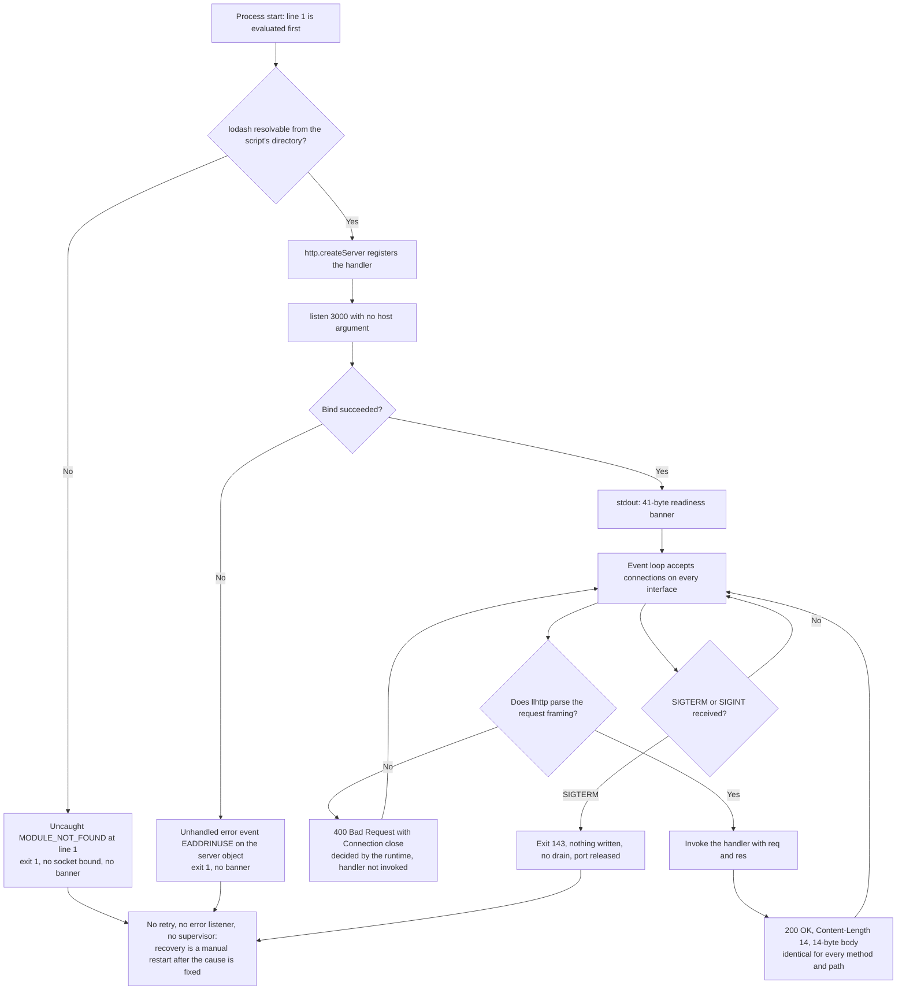


## 5.5 References

This section cites one source file, one repository folder, the runtime and host artefacts observed while executing it, and the internal sections whose established facts it depends on. No external web source was retrieved for this section; the single external fact it quotes — that the npm registry's `latest` tag for `lodash` resolved to 4.18.1 on 2026-10-23 — is attributed here to Section 3.4, which retrieved it.

**Repository evidence**

- `server (1).js` — the system's only source file, 5 lines and 185 bytes, sha256 `7f27a6663b7656d9f7c838d207d038a6ef003805c90e64f89f3d56297f6ea203`. Every line-level claim in this section rests on it: the `lodash` binding on line 1, the inline handler and its single `res.end` statement on lines 3-4, the port literal, the omitted host argument, and the stdout banner on line 5.
- Repository root folder (`""`) — the complete inventory: exactly one file and no manifest, lockfile, test, README, licence, container file, infrastructure template, CI configuration, or `.blitzyignore`, which is what establishes each absence recorded in Sections 5.1 to 5.4.
- `.git/` — version metadata establishing that the whole system is one commit (`88dcb7d`, "Add files via upload") on both branches (`main`, `0611_01`), with exactly three objects across every ref and so no hidden content; it is also the sole recovery point identified in Section 5.4.6. The remote URL's embedded credential material is deliberately not reproduced.

**Observed runtime evidence** (host running Node v22.23.3 and npm 11.21.0; the tracked file was executed from a directory outside the checkout with `lodash` supplied out of band, and the checkout was left unmodified — `git status --porcelain` empty, file hash unchanged)

- `process.versions` on the host — the substrate inventory in Section 5.2.4: Node v22.23.3, V8 12.4.254.21-node.57, llhttp 9.4.3, OpenSSL 3.5.8, ICU 78.3, zlib 1.3.1-e00f703, undici 6.28.1, module ABI 127.
- `/proc/net/tcp6` — the wildcard, dual-stack LISTEN entry on port 3000 (`0000…0000:0BB8`, state `0A`) that contradicts the banner's `127.0.0.1`, and its absence after termination.
- Node's own HTTP server defaults, read from a live server object on the host — `keepAliveTimeout` 5000 ms, `headersTimeout` 60000 ms, `requestTimeout` 300000 ms, socket `timeout` 0, `maxHeadersCount` null, none of which the application sets.
- Execution of the tracked file under the host runtime — the startup banner (41 bytes), the `HTTP/1.1 200 OK` response with `Date`, `Connection: keep-alive`, `Keep-Alive: timeout=5`, `Content-Length: 14` and no `Content-Type`, the byte-exact 14-byte body, `HEAD` body suppression, two `200` responses to pipelined requests on one socket, the parser's `400 Bad Request`, exit code 1 for `MODULE_NOT_FOUND` and for `EADDRINUSE` (unhandled `error` event at `server (1).js:5:4`), exit 143 on `SIGTERM` with no output, and 200 concurrent requests completing as 200s with zero errors in 82 ms while stdout remained at the 41-byte banner.
- A keyword sweep of every file in the checkout excluding `.git` — exactly one file — supporting each absence claim: non-zero matches only for `http`, `require`, `createServer`, `listen`, `end`, `const`, and `console`/`log`; zero matches for every framework, datastore, cache, auth, configuration, error-handling, observability, concurrency, and TLS keyword named in this section.
- `@mermaid-js/mermaid-cli` 12.0.0 on the host — all eight diagrams in this section were rendered with it. One caveat belongs on the record: the second sequence diagram in Section 5.2.7 places a `Note` at the end of an `alt` branch, a construct this parser version rejects, so that single block may not render; the flows it depicts are stated in the prose immediately above it, and the parser-rejection branch is drawn again in Section 5.4.7.

**Internal sections relied upon**

- Section 1.2 — the system-level description of the process, its capabilities, and the banner-versus-bind discrepancy this section's component and boundary analysis builds on.
- Section 1.3 — the in-scope capability list and the exhaustive out-of-scope list, which this section references instead of restating.
- Section 2.4 — the feature set (F-001 to F-004), the verification results for the startup failure modes, and the requirement-level traceability that the state and error flows here correspond to.
- Section 3.1 — the observed stack by layer, including the runtime, parser, and unused transport-security components named in Section 5.2.4.
- Section 3.4 — the registry-reported `lodash` version fact quoted in Section 5.3.7 and Section 5.2.1.
- Section 3.6 — the data-storage absences corroborating Section 5.3.3.
- Section 3.8 — the dependency-level integration edges that Section 5.1.4 restates at architecture level, and the security implications that Section 5.3.5 summarises.


# 6. SYSTEM COMPONENTS DESIGN

## 6.1 Core Services Architecture

### 6.1.1 Applicability Determination

**Core Services Architecture is not applicable for this system.**

The repository contains exactly one deployable artifact: the 5-line CommonJS script `server (1).js` (`git ls-files` returns this single file; the whole checkout is 185 bytes). It is executed as one OS process that binds one TCP listener and answers every request with a constant 14-byte body. There is no second unit to call, no peer to discover, no replica to balance across, and no downstream dependency whose failure could be isolated — so every mechanism this section's prompt enumerates has no subject in this system. The determination rests on the table's indicators, each verified against the only file in the repository.

| Service-architecture indicator | What the indicator requires | Position in this repository |
| --- | --- | --- |
| Distinct independently deployable services | Two or more units that can be deployed, versioned and restarted on their own | Absent: one file, one process, one listener, no manifest, no image, no orchestrator descriptor (Section 3.7.3) |
| Network boundary between components | A protocol edge joining two addressable endpoints | Absent: the four internal units of Section 5.1.2 share one address space and one event loop; the only network edge is inbound, from anonymous clients (`server (1).js:3-5`) |
| Inter-service transport | A client or broker for calls between units | Absent: zero matches in the checkout for `http.request`, `http.get`, `fetch`, `axios`, `grpc`, `amqp`, `kafka`, `redis`, `WebSocket` |
| Registry or discovery of peers | A peer set resolvable at runtime | Absent: zero matches for `registry`, `consul`, `etcd`, `dns`; the only address in use is the literal port 3000 (`server (1).js:5`) |
| Isolated state per service | A store or cache owned by each unit | Absent: no store, cache, queue or session exists; the only datum is a compile-time string literal (`server (1).js:4`) |
| Independent scaling per unit | Per-unit replica counts and scaling policy | Absent, and blocked on one host: the port literal makes the bind exclusive, so a second co-resident copy exits 1 with `EADDRINUSE … :::3000` (Section 5.1.1) |

**Why the determination holds.** Four structural properties of the code, not an absence of effort, make a service architecture both unnecessary and impossible here:

- **The smallest deployable unit is the whole program.** `http.createServer` is invoked on an inline expression and `listen` is chained to it (`server (1).js:3-5`), so server construction, handler registration and binding form one expression with no seam at which a second component could be introduced.
- **There is no outbound call to guard.** The application opens no connection of its own; it holds no datastore, broker, or upstream API client. Circuit breaking, retry, bulkheads and fallbacks all presume a downstream edge, and none exists (Section 5.1.1).
- **There is no configuration surface for a topology to vary.** The port and the body are source literals and no environment variable, argument or file is read, so replica count, upstream address and resource limits cannot be expressed even out of band (Section 3.7.5).
- **There is no signal a control plane could act on.** The only output in the process's lifetime is the 41-byte startup banner; after 700 requests the same 41 bytes were still all that stdout held, and no metric, health or readiness route exists to trigger a scaling or failover decision (Section 5.4.1).

**What does exist, and why it is not a service.** Section 5.1.2 names four components — a dependency preamble, an HTTP request handler, a listener/bootstrap, and the runtime substrate. These are a code-level decomposition of a single program, not services: they are linked into one address space and one event loop, they expose no interface to one another beyond a JavaScript callback, they are versioned and deployed together as one 185-byte file, and no unit can be restarted without restarting all of them. The distinction matters because it is the precise reason this section's remaining sub-sections report positions rather than designs: there is nothing to place behind a boundary.

Sub-sections 6.1.2 through 6.1.4 therefore record the position of each concern the prompt enumerates — boundaries, communication, discovery, balancing, circuit breaking, retry and fallback; scaling and resource allocation; fault tolerance, recovery, redundancy, failover and degradation — against the topology that actually exists, and Sub-section 6.1.5 supplies the three required diagrams drawn from the same evidence.

### 6.1.2 Service Components

The repository defines no services, so the six concerns below have no implementation to describe. Each row records what a service architecture would supply, and what this repository contains instead, with the evidence that fixes the position.

| Concern | What a service architecture supplies | Position in this repository |
| --- | --- | --- |
| Service boundaries and responsibilities | Two or more units, each owning a capability, independently deployable and independently addressable | One unit. The system boundary is a single OS process holding a single socket on TCP port 3000, owning one responsibility: answer every request with the constant `Hello, World!\n` (`server (1).js:1-5`; Section 1.3.1) |
| Inter-service communication patterns | Request/response, RPC or asynchronous messaging between units, with a defined contract and serialization | None. The only traffic-carrying edge in the system is inbound cleartext HTTP from anonymous clients, answered identically whatever the request says (Section 5.1.4); the process makes no outbound call, and the checkout has zero matches for any HTTP client, RPC stub, or broker client |
| Service discovery mechanisms | A registry, DNS-based lookup or mesh control plane resolving peers to addresses at runtime | None. Discovery requires a peer to find, and there is none; zero matches for `registry`, `consul`, `etcd`, `dns`. The single address in use is written as the literal `3000` in the bootstrap call (`server (1).js:5`) |
| Load balancing strategy | Distribution of traffic across replicas by a proxy, or client-side balancing across a discovered peer set | None, and not achievable on one host: the bind is exclusive, so a second copy of the same script exits 1 with `Error: listen EADDRINUSE: address already in use :::3000`. No `SO_REUSEPORT`, no `cluster` module, no proxy, and no load-balancer or orchestration descriptor exists in the repository (Sections 3.7.3 and 5.1.1) |
| Circuit breaker patterns | A breaker that opens on downstream failure, then half-opens to probe recovery | None, and unreachable in principle: a breaker guards a call the application makes, and this application makes none. Zero matches for `circuit` or `breaker` in the checkout |
| Retry and fallback mechanisms | Bounded retries with backoff around a failing dependency, and a defined degraded response when they are exhausted | None. Every failure path is single-attempt and terminal, with no retry, no backoff, and no fallback: an unresolvable dependency throws at `server (1).js:1:11` and exits 1 before any bind, and a busy port raises an unhandled `error` event and exits 1 (Section 5.4.3). Zero matches for `retry`, `backoff`, `fallback` |

**The one intra-process interaction pattern.** The only communication in the system happens inside a single address space and is a callback invocation rather than a service call. The bootstrap registers the request handler on the server object, and the runtime invokes it once per parsed request; the handler's entire body is one `res.end` call with no I/O, no serialization of its own, and no return path (`server (1).js:3-4`). The only protocol translation on the path — parsing request bytes and framing the response, including the computed `Content-Length: 14` — is performed by the runtime's `http` module, not by a service the application calls (Section 5.1.3).

**What operates in place of service-level mechanisms.** For each concern above, the table gives the mechanism actually in effect, so an operator knows what is really protecting or serving the request.

| Service-architecture concern | Mechanism actually in effect | Evidence |
| --- | --- | --- |
| Failure isolation between units | Process boundary only: a fault in the process ends the service, because no second instance, worker or supervisor exists | `server (1).js:1-5`; `MODULE_NOT_FOUND` and `EADDRINUSE` each exit 1 with no restart |
| Request routing between units | None: the parsed request is handed to the single unconditional handler, so no attribute of the request selects a destination | `server (1).js:3-4`; GET, HEAD, OPTIONS, DELETE, PUT and PATCH on an arbitrary path all returned 200 |
| Endpoint addressing | One literal TCP endpoint, bound on the wildcard address of both IP stacks, announced on stdout | `server (1).js:5`; one LISTEN row on `…:0BB8` in `/proc/net/tcp6` |
| Health-based routing or admission | None: no health, readiness or status route exists, and any path returns 200, so a conventional probe cannot distinguish a healthy service from a misconfigured one | Section 5.4.1; observed uniform 200 for every target |
| Capacity distribution across replicas | None: one process on one event-loop thread, measured at 7 OS threads and 58,012 kB RSS, of which the application starts no worker | `server (1).js:1-5`; process inspection after 500 sequential and 200 concurrent requests |
| Contract enforcement between units | None: with no second unit there is no contract to enforce, and the response is a fixed byte sequence whose only stability guarantee is the source literal | `server (1).js:4`; byte-exact 14-byte bodies throughout testing |

Because no component is separated by a boundary, no component has a boundary to cross: the concerns in this sub-section are not gaps in an otherwise service-oriented design but consequences of a single-process, single-file implementation, which Section 5.1.1 documents as the system's architectural style.

### 6.1.3 Scalability Design

The system has no scaling design, because it has no configuration surface through which a replica count or resource limit could be expressed, no replication mechanism by which a second unit could coexist on a host, and no signal from which a scaling decision could be triggered. Each row records the position of one concern against the code that fixes it.

| Concern | What a scalable design supplies | Position in this repository |
| --- | --- | --- |
| Horizontal scaling approach | Additional instances behind a balancer, plus intra-host parallelism (workers or a cluster) where useful | Absent on one host by construction: the port is a source literal and the bind is exclusive, so a second copy exits 1 with `Error: listen EADDRINUSE: address already in use :::3000`. Intra-host parallelism is also absent — zero matches for `cluster`, `worker_threads`, `child_process`, `fork(`, `spawn(`. Replication across hosts is conceivable only by running copies on machines where port 3000 is free, and nothing in the repository configures, describes or automates that (Sections 3.7.3, 5.1.1) |
| Vertical scaling approach | More CPU, memory or bandwidth on the existing host, with whatever tuning that requires | This is the only lever that exists, and it needs no configuration: the process reads no sizing parameter and simply consumes what the host offers. Measured on the observation host (Ubuntu 24.04.5 LTS, Node v22.23.3 per Section 3.7.3): resident set 58,012 kB across 7 OS threads, of which one runs the application's JavaScript. No heap-size, thread-pool or connection-limit option is passed, so every runtime default governs (Section 5.4.5) |
| Auto-scaling triggers and rules | Metric-driven rules — CPU, latency, queue depth — evaluated against a stable health signal, with cooldowns | Absent and not constructible as written: zero matches for `autoscale`, `scale`, `replica`, `provision`; no metrics endpoint, no health or readiness route, no orchestrator manifest. The signal a scaler would read does not exist either — stdout held the same 41 bytes after 700 requests as it did at startup (Section 5.4.1) |
| Resource allocation strategy | Per-unit CPU and memory requests and limits, connection or worker pools, quotas | None declared anywhere: no container image, no compose or orchestrator descriptor, no manifest, no limits file — zero matches for `limit`, `quota`, `memory`, `cpu`. The application holds no pool of its own; it passes no server option, so connection handling follows the runtime's defaults rather than a size the operator chose |
| Performance optimization techniques | Caching, compression, clustering, connection pooling, CDN, protocol upgrades | None applied: zero matches for `cache`, `cluster`, `compress`, `http2`, `pool`. The behaviours the system does exhibit are runtime defaults rather than optimizations — keep-alive (`Keep-Alive: timeout=5`) and the computed `Content-Length: 14` both come from the `http` module. The usual optimization target is also already absent: the response is a compile-time constant produced by one `res.end` call, so there is no computation, I/O, serialization or input-dependent allocation to tune (`server (1).js:4`) |
| Capacity planning guidelines | A recorded throughput target, a load model, and a headroom rule | No target, load model or headroom rule is recorded in the repository, and none can be asserted from it, since there is no instrumentation to measure one against (Section 5.4.5). The table below gives the measured basis an operator can plan from instead |

**Measured capacity basis.** Every value below was observed on the host where the file was executed, against the unmodified script; none is a target the project set.

| Property | Observed value | Basis |
| --- | --- | --- |
| Sequential throughput | 500 requests over one keep-alive connection in 70.8 ms, approximately 7,064 requests per second, 7,000 body bytes returned | Direct measurement, Node v22.23.3 |
| Concurrent burst | 200 parallel requests over 20 keep-alive sockets: 200 responses with status 200, zero errors, 31.1 ms | Direct measurement, Node v22.23.3 |
| Per-request cost | One `res.end` call writing a 14-byte constant; no I/O, no parsing, no input-dependent allocation | `server (1).js:3-4` |
| Resident footprint | 58,012 kB RSS, 7 OS threads, one of them running the application's JavaScript | Process inspection during measurement |
| Scaling ceiling per host | One process per host on port 3000; additional co-resident copies exit 1 | `server (1).js:5`; two observed `EADDRINUSE` failures | 

**Planning consequences.** Capacity is bounded by properties the repository does not expose — the host's CPU and memory, and the runtime's single event-loop thread — and saturation cannot be detected in operation, because the service emits no metric, no per-request log and no health signal. An operator therefore plans by provisioning a host generously, placing at most one instance on it, and inferring health from the presence of the startup banner and an accepted connection on port 3000 (Section 3.7.6). Any capacity target, scaling rule or headroom policy for this service would have to be newly authored together with the observability needed to enforce it.

### 6.1.4 Resilience Patterns

No resilience pattern is implemented. There is no redundancy, no retry, no circuit breaking, no failover target, no backup and no degradation mode: every failure class observed either ends the process or is absorbed by the runtime before the application is reached. The rows below record each concern's position.

| Concern | What a resilient design supplies | Position in this repository |
| --- | --- | --- |
| Fault tolerance mechanisms | Redundancy, isolation, bulkheads, bounded retries, timeouts and health checks, so a fault degrades rather than ends the service | None. Zero matches for `circuit`, `breaker`, `retry`, `backoff`, `fallback`, `health`, `timeout`. Every failure is terminal: an unresolvable dependency throws at `server (1).js:1:11` and exits 1 before any bind, a busy port raises an unhandled `error` event and exits 1, and `SIGTERM` ends the process with status 143 and no drain. The one fault class handled without ending the process is a malformed request, and it is handled by the runtime's parser — `400 Bad Request` with `Connection: close`, decided before the handler is invoked (Section 5.4.3) |
| Disaster recovery procedures | A documented recovery procedure with recovery-time and recovery-point objectives, and the artifacts needed to execute it | None recorded, and none exists in code: no backup, replica, snapshot, restart policy or supervisor (Section 5.4.6). The only procedure is a manual restart after the cause is repaired — supplying `lodash`, or freeing port 3000. The sole recoverable version of the system is the single commit `88dcb7d`; the repository holds no tags or releases |
| Data redundancy approach | Replication, backups or multi-zone stores, so data survives the loss of a unit | Not applicable, and none configured. The only datum is a compile-time string literal re-emitted from memory on every request (`server (1).js:4`), and the system holds no datastore, cache, queue or session to replicate — the checkout contains zero matches for `fs`, `database`, `cache`, `session`, `queue` (Section 3.6) |
| Failover configurations | A standby unit and a health-checked mechanism that promotes it and redirects traffic | None. One process on one host is the entire service: there is no standby, no virtual address, no balancer, no orchestration descriptor and no DNS or health-check configuration. On a single host a standby cannot even be started, because the port literal makes the bind exclusive and a second copy exits 1 with `EADDRINUSE … :::3000` (Section 5.1.1) |
| Service degradation policies | Feature shedding, read-only or queueing modes, synthetic responses and load shedding, so partial service continues under stress | None, and there is nothing to degrade selectively: the service has exactly one behaviour. The handler writes one literal, reads no request data, and cannot fail on its inputs, so no branch exists that could be disabled and no alternative response could be substituted. The application neither sets nor observes any backpressure behaviour, which the runtime would otherwise provide (Section 5.4.3) |

**Behaviour under each failure class.** The table states what the system does when something goes wrong, and what recovery that requires. Only the third row is absorbed without human action.

| Failure event | System behaviour | Recovery required |
| --- | --- | --- |
| Dependency unresolvable | Uncaught `Cannot find module 'lodash'` at load time; exit 1; no socket, no banner | Operator supplies the module out of band, then restarts |
| Port 3000 already in use | Unhandled `error` event on the server object; exit 1; no banner | Operator frees the port or edits the source, then restarts |
| Malformed request bytes | `400 Bad Request` with `Connection: close`, issued by the runtime parser | None: the process is unaffected and continues serving |
| Client disconnects or uploads a large body | Response is already complete or completes identically: a 256 KB POST returned the same 200 with the 14-byte body, and the request body is never read | None |
| Termination signal | `SIGTERM` ends the process with status 143, writing nothing and releasing the port at once; no signal handler is registered | Operator restarts the process |
| Host loss or process death | The service ceases to exist; nothing routes around it and nothing restarts it | Manual restart on a host with port 3000 free |

**Net resilience position.** The system has exactly one resilience property, and it holds by construction rather than by design: because the process retains no state and the payload is a compile-time constant, a restart is lossless — a recovered instance behaves byte-identically to the one that failed, and only connections open at that instant are lost (Section 5.4.6). Nothing else is in place: no component detects the failure, no mechanism performs the restart, and no capacity absorbs traffic while the service is down. Availability therefore depends entirely on the host staying up and on an operator noticing the process is gone, which the single startup banner is the only available means of judging (Section 5.4.1).

### 6.1.5 Required Diagrams

The three diagrams this section requires are drawn against the topology that actually exists, not against a service architecture the system does not have. Solid edges are observed behaviour; dashed edges and dashed nodes mark mechanisms the repository does not contain, so each diagram reads as an as-built record rather than a target state. Every element traces to evidence cited in Sub-sections 6.1.1 through 6.1.4 and to Sections 5.1, 5.4 and 3.7.

#### 6.1.5.1 Diagram 6.1.5-1 — Service Interaction, As-Built

The diagram shows that no service-to-service interaction exists. One process holds the four internal components of Section 5.1.2 in a single address space, the only traffic-carrying edge is inbound from an anonymous client, and the two edges that a service architecture would require — a call to a peer and a query to a datastore — are absent.

```mermaid
flowchart TB
    Client["Anonymous HTTP client<br/>any method, path, header or body"]
    Console["Host stdout or supervisor"]
    Peers["No peer exists in the repository:<br/>no registry, no broker, no datastore, no upstream API"]
    subgraph Host["Host machine"]
        subgraph Proc["One OS process: node server (1).js"]
            Preamble["C1 Dependency preamble, line 1<br/>binds lodash to the constant _<br/>binding never read"]
            Boot["C3 Listener and bootstrap, line 5<br/>listen on port 3000, then announce readiness"]
            Handler["C2 Request handler, lines 3-4<br/>one res.end of a 14-byte constant"]
            Runtime["C4 Runtime substrate<br/>http module, llhttp parser, event loop"]
        end
    end
    Preamble -->|"resolution fatal when absent: exit 1"| Boot
    Boot -->|"registers the handler callback"| Handler
    Boot -->|"binds the wildcard address on TCP 3000"| Runtime
    Boot -->|"one 41-byte readiness line, once per process"| Console
    Runtime -->|"invokes once per parsed request; req is never read"| Handler
    Handler -->|"HTTP 200, 4 runtime headers, 14 bytes, no Content-Type"| Client
    Client -->|"cleartext HTTP request"| Runtime
    Preamble -.->|"no outbound call is ever made"| Peers
    Handler -.->|"no service call, no message, no query"| Peers
```

#### 6.1.5.2 Diagram 6.1.5-2 — Scalability Architecture, Actual Scaling Surface

The diagram separates the three scaling paths by whether they are available. Only vertical scaling exists; horizontal scaling within a host is blocked by the literal port, horizontal scaling across hosts is unconfigured, and the signal an autoscaler would need is absent from the system.

```mermaid
flowchart LR
    subgraph PathA["Horizontal scaling on one host - BLOCKED"]
        Copy["Second copy of server (1).js"] -->|"port is a source literal; bind is exclusive"| Fail["EADDRINUSE on :::3000<br/>exit 1, no banner"]
    end
    subgraph PathB["Horizontal scaling across hosts - UNCONFIGURED"]
        HostA["Host A: process bound to port 3000"] -.->|"no balancer, no orchestrator descriptor, no DNS or health config in the repository"| HostB["Host B: process bound to port 3000"]
    end
    subgraph PathC["Vertical scaling - THE ONLY AVAILABLE LEVER"]
        Bigger["More CPU and memory on the same host"] --> Single["One process, one event-loop thread<br/>58,012 kB RSS, 7 OS threads"]
        Single --> Measured["Measured: 500 requests in 70.8 ms on one keep-alive socket<br/>200 concurrent requests, all HTTP 200, in 31.1 ms"]
    end
    subgraph AbsentSignal["Autoscaling signal - ABSENT"]
        Silent["No metric, no health or readiness route, no per-request log<br/>stdout is 41 bytes at startup and still 41 bytes after 700 requests"]
    end
    Silent -.->|"nothing for a scaling rule to read"| PathA
    Silent -.->|"nothing for a scaling rule to read"| PathB
```

#### 6.1.5.3 Diagram 6.1.5-3 — Resilience Pattern Implementation, Actual Failure Paths

The diagram traces every failure class the system can encounter. Three are terminal — a missing dependency, a busy port, and a termination signal — and one is absorbed by the runtime without the process noticing; no path contains a retry, a fallback, a standby or a supervisor, and the mechanisms a resilient design would add are shown as absent.

```mermaid
flowchart TD
    Start["Process start: line 1 is evaluated first"] --> Dep{"Is lodash resolvable?"}
    Dep -->|No| M1["MODULE_NOT_FOUND thrown at line 1:11<br/>exit 1, no socket, no banner"]
    Dep -->|Yes| Bind["listen on port 3000, wildcard address"]
    Bind --> Free{"Is port 3000 free?"}
    Free -->|No| M2["Unhandled error event on the server object<br/>EADDRINUSE :::3000, exit 1, no banner"]
    Free -->|Yes| Ready["41-byte banner on stdout<br/>the only readiness signal in the system"]
    Ready --> Serve["Serve every parsed request identically"]
    Serve --> Parse{"Is the request framing parseable?"}
    Parse -->|No| M3["400 Bad Request with Connection close<br/>decided by the runtime; process unaffected"]
    Parse -->|Yes| M4["200 OK with the 14-byte constant body<br/>identical for every method, path and body"]
    M3 --> Serve
    M4 --> Serve
    Serve --> Sig{"Has SIGTERM arrived?"}
    Sig -->|Yes| M5["Exit 143, nothing written, port released immediately"]
    Sig -->|No| Serve
    M1 --> Manual["No retry, no fallback, no standby, no supervisor<br/>recovery is a manual restart after the cause is repaired"]
    M2 --> Manual
    M5 --> Manual
    subgraph NotPresent["Resilience mechanisms absent from the repository"]
        N1["No circuit breaker"]
        N2["No retry or backoff"]
        N3["No replica, standby or failover"]
        N4["No backup or snapshot"]
        N5["No degradation mode or load shedding"]
    end
    Manual -.->|"nothing else intervenes"| N1
    N1 --- N2
    N2 --- N3
    N3 --- N4
    N4 --- N5
```

The three diagrams together state the section's finding: the system's interaction, scaling and resilience surfaces each consist of a single process on a single port, with the mechanisms a service architecture would supply marked absent rather than omitted from the account.

### 6.1.6 References

The repository contains one file, so the evidence base for this section is small and is listed exhaustively below. Every code fact, absence claim and measured value above traces to one of these entries.

- `server (1).js` — the entire system: 185 bytes, 5 lines. Line 1 binds `lodash` to `_` without reading it (the load-time gate); lines 3–4 create the server and answer every request with the constant `Hello, World!\n`; line 5 binds port 3000 on the wildcard address and prints the 41-byte banner. Source of every code citation in Sub-sections 6.1.1 through 6.1.5, including the port literal that blocks a second co-resident instance, the single-statement handler that admits no degradation mode, and the absence of any server option, resource limit or error handler.
- `/` (repository root) — contains exactly one file and no folders. Establishes that no manifest, lockfile, container image, compose file, Kubernetes/Helm/Nomad descriptor, build system, test suite, CI configuration or configuration file of any kind exists, which is the basis for the service-boundary, load-balancing, autoscaling, resource-allocation and failover findings.
- `.git/` — git metadata: a single commit `88dcb7d` ("Add files via upload"), branches `main` and `0611_01` at that same commit, no tags and no releases. Establishes that the only recoverable version of the system is that one commit, cited in the disaster-recovery and recovery-point findings.

Two supporting notes:

- **Runtime and measurement basis.** Runtime-dependent statements (wildcard bind on `:::3000`, four runtime response headers with no `Content-Type`, `EADDRINUSE` on a second instance, `400 Bad Request` plus `Connection: close` for unparseable input, exit code 143 on `SIGTERM`, and the throughput, concurrency and memory figures in Sub-section 6.1.3) were observed by executing the unmodified file under Node.js v22.23.3, with `lodash` supplied out of band to a scratch copy because the repository cannot resolve it. The checkout itself was not modified.
- **No web sources.** No external source was consulted for this section; every statement rests on the repository's own contents and on the behaviour of the runtime executing them. Cross-references to Sections 1.2, 1.3, 3.6, 3.7, 5.1 and 5.4 of this specification are made inline where a neighbouring section already records the same absence in more detail.

## 6.2 Database Design

### 6.2.1 Applicability Determination

**Database Design is not applicable to this system.**

The system has no database, no persistent store, no cache, no session store, no queue, no file-based storage, and no write path of any kind. The determination is exhaustive rather than inferential, because the repository contains exactly one file and that file can be read in full: `server (1).js`, 5 lines of CommonJS, 185 bytes, sha256 `7f27a6663b7656d9f7c838d207d038a6ef003805c90e64f89f3d56297f6ea203` (`git ls-files` returns that single path; `find` for directories other than `.git` returns none; `ls -A1` shows only `.git` and `server (1).js`). `git rev-list --all --objects` lists only the commit `88dcb7d9848f72b81aebadc005113437720045a2`, its tree, and that one blob, so no branch, ref, or hidden file can hold database content either. Five evidence lines each rule out a persistence layer independently.

| Evidence line | Finding | Basis |
| --- | --- | --- |
| Static vocabulary sweep | Zero matches for the whole database/persistence vocabulary — `sql`, `sqlite`, `mysql`, `postgres`, `mongo`, `redis`, `sequelize`, `prisma`, `knex`, `schema`, `migrat`, `seeder`, `partition`, `shard`, `replicat`, `failover`, `backup`, `snapshot`, `restore`, `archiv`, `retention`, `cache`, `pool`, `transaction`, `insert`, `update`, `delete`, `select`, `query`, `join`, `orm`, `dao`, `repository`, `datastore`, `databas`, `persist`, `session`, `credential`, `password`, `secret`, `process.env`, `fs.`, `writeFile`, `blob`, `bucket`, `storage` | Case-insensitive search of every non-`.git` file; a control sweep on the same files returns `require` twice and `listen` once, so the sweep is not vacuous |
| Module loads | Exactly two `require` calls exist in the entire checkout: `require('lodash')` at `server (1).js:1` and `require('http')` at `server (1).js:3` — no driver, client, ORM, or SDK is declared or loaded | `git ls-files -z \| xargs -0 grep` for `require`/`import`/`from` across every tracked file returns only those two |
| Connection target | The only numeric literal in the file is `3000`, the listen port on line 5; the only URL-like text is the banner string `http://127.0.0.1:3000/`. No host, URI, connection string, credential source, or environment read exists | Whole-file inspection of `server (1).js:1-5`; zero matches for `process.env`, `dotenv`, and `config` |
| Runtime file descriptors | The serving process holds exactly **one** socket — the listening socket on `:::3000` (state `0A`) — and no regular file open for data. Its remaining descriptors are `0 -> /dev/null`, `1`/`2` redirected to logs, and `anon_inode` event poll/eventfd descriptors plus pipes | `/proc/<pid>/fd` inspection of the process running the unmodified file under Node v22.23.3 |
| Filesystem footprint | The working-directory listing is byte-identical before and after serving 2,020 requests: no file created, modified, or deleted. Zero repository-owned `*.db`, `*.sqlite`, `*.wal`, `*.journal`, `*.ldb`, or `*.rdb` files exist anywhere | Recursive listing diff around the request load |

**Why the determination holds.** Four structural properties of the code — not an omission of effort — leave this section without a subject:

- **There is no store to design.** The only application datum is the compile-time string literal `Hello, World!\n`, 14 bytes, written to every response from the compiled constant pool (`server (1).js:4`). It is a value in the program image, not a record in a table, so there is no entity, no attribute, and therefore no schema, relationship, index, or constraint to declare (Section 3.6.2).
- **There is no persistence edge to configure.** A database design presupposes a client, an address, and a credential. The process opens no outbound connection at all: it holds one socket (the listener) and makes no `net.connect`, `http.request`, or driver call anywhere in the file, and no manifest exists through which a driver dependency could even be declared (Sections 3.6.4 and 3.4).
- **There is no input to persist.** The handler accepts `req` and never dereferences it, so the method, path, query string, headers, and body are framed by the runtime parser and then discarded (`server (1).js:3-4`). Every probe returned the identical 14-byte body for `GET`, `POST`, `PUT`, `DELETE`, `PATCH`, and `OPTIONS` on arbitrary paths, including requests carrying an `Authorization` header and a body. No request value reaches any sink, so no write path exists to model.
- **There is no durability requirement to satisfy.** Because the process retains nothing — three successive responses were byte-identical (sha256 `c98c24b6…`) and a terminate-then-restart cycle reproduced the same body hash — nothing can be lost by a restart, and nothing needs to be backed up. The system's only durable record is its own source, versioned in Git, not a row (Section 3.6.5).

**What exists in place of a data layer.** Each entry is a position, not a design: the mechanism that actually holds the system's one datum, and where its durability really comes from.

| Concern | Position in this repository | Evidence |
| --- | --- | --- |
| Sole datum | The string literal `Hello, World!\n` in the compiled script, re-emitted on every request | `server (1).js:4` |
| State lifetime | The life of the process only; no module-level mutable value, counter, or cache exists, and the file declares no `let` or `var` | `server (1).js:1-5` |
| Durability | Git. The response text is versioned as part of `server (1).js`; changing it means committing a source edit, not writing a record | Single commit `88dcb7d`; blob `8869fb6d…` |
| Version identity | Content hashes, not keys: sha256 `7f27a666…ea203` and Git blob `8869fb6d2b8ccb3bb83fb6822325d12bbea38480`, both addressing source text rather than rows | `sha256sum`; `git rev-list --all --objects` |
| Read and write paths | None. Zero write operations of any kind — no `INSERT`, no file append, not even a log line beyond the one-time startup banner, which stdout held at exactly 41 bytes through 2,020 requests | `server (1).js:1-5`; stdout measured after load |
| Recovery | A redeploy of the same source, not a data restore; startup is a strict linear chain with no retry and no supervision, and `SIGTERM` exits 143 with no drain | `server (1).js:1-5`; observed exit codes |

**What would have to be added for this section to apply.** A datastore could not be introduced by configuration; every prerequisite is absent by construction. A dependency manifest would be needed to declare a driver (none exists), a configuration surface to carry a connection string (no environment variable, argument, or config file is read), a credential path (no secret, password, or token appears anywhere), input capture (the request is never read), serialization of request data, and connection-failure handling (the file contains no `try`/`catch` and registers no `error` listener, so a failed connection would be an unhandled exception ending the process). Each is new construction on top of a five-line demonstration, which Section 1.3.2 places out of scope, and Section 3.6.6 records the same conclusion for the data layer.

Sub-sections 6.2.2 through 6.2.5 therefore record the position of every concern this section's prompt enumerates — schema design, data management, compliance, and performance optimization — against the artifact that actually exists, and Sub-section 6.2.6 supplies the three required diagrams drawn from the same evidence.


### 6.2.2 Schema Design

No schema exists to describe, because there is no store for a schema to govern. The repository's entire data model is one compile-time string literal, and the runtime that emits it holds no persistent structure of any kind. Each concern below is recorded as a position against the artifact that exists.

| Schema concern | What a schema design supplies | Position in this repository | Evidence |
| --- | --- | --- | --- |
| Entity relationships | Entities with keys and the cardinality between them — one-to-one, one-to-many, many-to-many — expressed as foreign keys or references | None. Zero entities exist, so no relationship can exist. The sweep of every file returns zero matches for `entity`, `primary key`, `foreign key`, `join`, `reference`, and `orm` | `server (1).js:1-5`; whole-checkout vocabulary sweep |
| Data models and structures | Table, collection, or class definitions with typed columns, lengths, nullability, and defaults | None. The only structure is the string literal `Hello, World!\n` (14 bytes) in the compiled constant pool, and no request datum is modelled at all | `server (1).js:4`; `req` is never dereferenced |
| Indexing strategy | Indexes on the columns queries filter or sort by, with a choice of kind and a documented cost trade-off | None. Zero matches for `index`, `btree`, `hash`, and `plan`; there is no query for an index to accelerate | Whole-checkout vocabulary sweep |
| Partitioning approach | A partition key, partitioning scheme, and retention boundary per partition | None. Zero matches for `partition`, `shard`, `rebalance`, `range`, and `chunk`; a single 14-byte constant is not divisible | Whole-checkout vocabulary sweep |
| Replication configuration | A primary/replica topology, log or binlog shipping, synchronous or asynchronous durability mode, and lag monitoring | None. No replication stream, no role, no replica, and no data to replicate. The port literal `3000` also makes the bind exclusive, so a second co-resident copy of the script exits 1 with `EADDRINUSE … :::3000` | `server (1).js:5`; observed second-instance failure |
| Backup architecture | A snapshot or dump schedule, a retention window, an off-site target, and a restore drill | None. Zero matches for `backup`, `snapshot`, `dump`, `restore`, and `retention`; the only recoverable artifact is the Git blob | Whole-checkout vocabulary sweep; commit `88dcb7d` |

**Entities, attributes, and relationships.** The count in each case is zero, and that is a finding rather than a gap in the search: a single file of 185 bytes with two `require` calls and one string literal cannot conceal a data model. The repository defines no class, no type, no struct, and no record shape — zero matches for `class`, `function`, `new`, and `module.exports` — so there is no candidate to become an entity even notionally. The only durable, addressable object in the system is the source file itself, whose identity is a content hash (Git blob `8869fb6d2b8ccb3bb83fb6822325d12bbea38480`; sha256 `7f27a666…ea203`). A content hash addresses bytes of source, not a row of data, and it participates in no relationship, so it is not a surrogate key in any schema sense.

For completeness against this section's requirement to include an ERD and to document every index and constraint, the position is stated as a table rather than drawn as an entity diagram: an ERD with no entities has nothing to draw. Sub-section 6.2.6.1 instead renders the as-built persistence model — the single datum, its process-local lifetime, and the Git blob that holds its only durable copy — with the absent relational constructs marked as absent.

| Relational construct | Cardinality in this repository | Basis |
| --- | --- | --- |
| Entities (tables, collections, types) | 0 | Zero matches for `entity`, `schema`, `model`, `table`, `collection`; no `class` or type declaration exists |
| Relationships (foreign keys, references, joins) | 0 | Zero matches for `foreign key`, `join`, `reference`, `relation`; no second entity exists to relate to |
| Primary keys (natural or surrogate) | 0 | Zero matches for `primary key`, `uuid`, `sequence`, `auto_increment`, `_id` |
| Indexes (any kind) | 0 | Zero matches for `index`, `btree`, `hash`, `gin`, `gist`; no query exists to benefit |
| Constraints (unique, check, not null, default) | 0 | Zero matches for `unique`, `check`, `not null`, `default`, `constraint` |
| Triggers, views, stored procedures | 0 | Zero matches for `trigger`, `view`, `stored procedure`, `cursor` |
| Transactions and isolation levels | 0 | Zero matches for `transaction`, `commit`, `rollback`, `isolation`, `lock`, `mutex`, `deadlock` |

**Constraints that do hold, and why they are not schema constraints.** Two invariants are genuinely enforced in this system, and neither belongs to a data model. The first is the response body: it is exactly 14 bytes, `Hello, World!` followed by a newline, and it was byte-exact across 2,000 requests (28,000 body bytes returned for 2,000 responses) because the value is a compile-time literal rather than a computed or stored one (`server (1).js:4`). The second is the `Content-Length: 14` header, computed by the runtime's response writer from that single write, which is a framing guarantee supplied by Node.js rather than a length constraint declared on a column. Startup ordering is a third: line 1 must resolve `lodash` before line 3 constructs the server and line 5 binds, so a missing module terminates the process with exit 1 before any socket exists — an execution-order precondition, not a referential one.

**Consequences for schema work.** Because no schema exists, no schema migration, evolution, or compatibility question arises; changing what the system returns means editing the source and committing it. Any future schema would be new construction with no relationship to the current artifact, and it would arrive with no ORM configuration, no migration directory, and no manifest to declare the driver — a repository probe for `schema.prisma`, `knexfile.js`, `.sequelizerc`, `ormconfig.json`, `migrations/`, `models/`, and `seeders/` returned absent for every name (Section 3.6.6).


### 6.2.3 Data Management

No data-management procedure is implemented, and none is needed, because the system retains no data to manage. The entire lifecycle of the system's one datum is: a literal in the source file becomes part of the program image at load time, is re-emitted from memory on each request, and disappears when the process exits. Nothing is written, nothing ages, and nothing is purged. Each concern is recorded below as a position.

| Data-management concern | What it supplies in a data-backed system | Position in this repository | Evidence |
| --- | --- | --- | --- |
| Migration procedures | Versioned, ordered, repeatable schema changes with an applied-migrations ledger and rollback path | None. Zero matches for `migrat`, `sequelize`, `knex`, `prisma`, `flyway`, `liquibase`, `alembic`; the probe for `migrations/` returned absent. The nearest analogue is a Git commit, which replaces the source that defines the response text | Whole-checkout vocabulary sweep; single commit `88dcb7d` |
| Versioning strategy | A schema version marker, backwards-compatible change rules, and a migration-to-version mapping | None at the data layer. Versioning exists only for source: one commit, no tags, no releases, and identity carried by blob and content hashes | `git for-each-ref` (five refs, all at `88dcb7d`); no tags |
| Archival policies | Tiering rules that move aged records to cheaper storage, with a defined trigger and retrieval path | None. Nothing is written, so nothing ages; zero matches for `archiv`, `retention`, `tier`, `cold`, `purge` | Whole-checkout vocabulary sweep |
| Data storage and retrieval mechanisms | A read path (query, index lookup, cache hit) and a write path (insert, update, delete) with a serialization format | No write path exists at all. The only "retrieval" is one `res.end` call passing a memory-resident literal to the runtime's socket writer; there is no serialization of application state | `server (1).js:3-4`; zero matches for `insert`, `update`, `delete`, `select`, `query` |
| Caching policies | An eviction policy, TTL, invalidation trigger, and cache tiers from in-process to edge | None at any tier, and no HTTP cache directives are emitted: the response carries only `Date`, `Connection: keep-alive`, `Keep-Alive: timeout=5`, and `Content-Length: 14` — no `Cache-Control`, `ETag`, `Last-Modified`, `Expires`, or `Vary` (Section 3.6.3) | Observed response header dump of `GET /` |

**Write, read, update, and delete operations.** The inventory is empty on every axis, which follows from the handler's single statement. `req` is never dereferenced, so no request value can enter a store; `res.end` writes bytes to a socket, which is transport rather than persistence; and no module-level mutable value exists to serve as an in-memory table — the file declares no `let` or `var` and binds only `_`, which line 1 writes and no other line reads.

| Operation class | Count in this system | Basis |
| --- | --- | --- |
| Write (insert, upsert, append, file write) | 0 | Zero matches for `insert`, `upsert`, `append`, `writeFile`, `createWriteStream`; the working directory was byte-identical before and after 2,020 requests |
| Read (query, lookup, scan, file read) | 0 | Zero matches for `select`, `query`, `find`, `readFile`, `openSync`; the response body is a compile-time constant, not a fetched value |
| Update | 0 | Zero matches for `update`, `set`, `save`, `merge`; no mutable state exists |
| Delete | 0 | Zero matches for `delete`, `remove`, `unlink`, `drop`, `truncate`; nothing is retained to delete |
| Durable side effect of any kind | 0 | The process's only output is the 41-byte startup banner on stdout, written once per process; stdout measured exactly 41 bytes before and after 2,020 requests, so not even a request log is retained |

**Retention, expiry, and lifecycle.** No time-to-live, expiry timestamp, garbage collector, or compaction step exists, and no scheduled task runs: the sweep returns zero matches for `cron`, `schedul`, `job`, `interval`, `setTimeout`, and `setInterval`. Consequently the datum's lifecycle is bounded by the process, not by policy — it exists only while the process does. The single durability mechanism in the system is version control: the value is stored as source text in blob `8869fb6d` of commit `88dcb7d`, so the response's "storage" is the repository itself and its "retrieval mechanism" is a redeploy (Sections 3.6.2 and 5.1.3).

**Caching tiers in effect.** None cache data. The only reuse behaviour present is the runtime's TCP keep-alive, which reuses a connection rather than a computed result, and it is supplied by Node.js with a default `keepAliveTimeout` of 5000 ms that the application never sets — visible in the response as `Keep-Alive: timeout=5`.

| Tier | Present | Basis |
| --- | --- | --- |
| In-process (memoisation, LRU, precomputed value) | None | No data structure or module-level mutable value exists; the constant is a compiled literal, not a cached computation |
| External cache (Redis, Memcached, and similar) | None | Zero matches for `redis`, `memcach`; the only socket the process holds is its listener |
| HTTP cache semantics | None emitted | No `Cache-Control`, `ETag`, `Last-Modified`, `Expires`, or `Vary` in the response headers |
| CDN or edge cache | None | No asset, proxy, or edge configuration exists in the repository |
| Nearest equivalent in effect | Connection reuse only | Runtime default `Keep-Alive: timeout=5` observed on every response |


### 6.2.4 Compliance Considerations

The obligations this area normally carries have no subject in this system, because no data is stored, transmitted, or retained beyond a request. What follows is therefore a compliance position rather than a compliance design: for each concern, what a data-backed system would owe, what this system actually does, and the evidence that fixes it.

| Compliance concern | What a data-backed system owes | Position in this repository | Evidence |
| --- | --- | --- | --- |
| Data retention rules | A documented retention period per data class, an automated expiry or purge mechanism, and a legal-hold override | None required and none implemented. No data class exists, nothing is written, and no expiry mechanism, scheduled task, or purge exists — zero matches for `retention`, `expiry`, `purge`, `ttl`, `cron`, `schedul` | `server (1).js:1-5`; whole-checkout vocabulary sweep |
| Backup and fault-tolerance policies | A backup schedule with recovery-point and recovery-time objectives, tested restores, and redundancy against the loss of a node | None. Zero matches for `backup`, `snapshot`, `dump`, `restore`, `replica`, `failover`, `redundanc`. Recovery is a manual restart after the cause is repaired, and because the process retains no state that restart is lossless | Whole-checkout vocabulary sweep; observed terminate/restart cycle |
| Privacy controls | Lawful-basis documentation, consent capture, data-subject access and erasure paths, and minimisation of personal data | Nothing to control: no personal, financial, health, or business record is handled. The only bytes the system returns are a constant greeting and runtime-generated headers, `req` is never read, and no `Set-Cookie` is emitted, so the service sets no client-side identifier | `server (1).js:3-4`; observed response headers contain no `Set-Cookie` |
| Audit mechanisms | Tamper-evident records of who did what and when, with an audit trail that outlives the request | None. There is no audit log, no per-request access record, and no metric or trace: stdout was exactly 41 bytes after 2,020 requests, so the service writes nothing per request. The only historical record of the system is its Git history | `server (1).js:1-5`; stdout measured before and after load (Sections 5.4.1, 3.6.5) |
| Access controls | Authentication, authorisation, least-privilege roles, grants, and credential rotation on the store and its clients | None at the data layer, because no store and no client credential exist — zero matches for `auth`, `token`, `jwt`, `role`, `grant`, `permission`, `credential`, `password`, `secret`. Ingress is unauthenticated by construction: the handler ignores every request attribute, so an `Authorization` header is answered exactly like any other request | `server (1).js:3-4`; credentialed `POST` returned the identical response |

**Retention and erasure.** Because the system stores nothing, there is nothing to retain under a schedule, nothing to delete on request, and nothing to expose in a breach. The system's one datum — the 14-byte greeting — lives in the compiled constant pool for the life of the process and is not derived from any input (`server (1).js:4`). Two residual retention facts remain, and both are artefacts of the environment rather than design: the startup banner persists in whatever captures the process's standard output (a console, a supervisor log, or a container log), and the response text persists in the source file versioned in Git. Neither holds request data.

**Backup and fault tolerance.** No backup, replica, snapshot, supervisor, or restart policy exists, and the fault behaviour is terminal rather than degrading: an unresolvable dependency exits 1 before binding, a busy port raises an unhandled `error` event and exits 1, and `SIGTERM` ends the process with status 143 and no drain. The system nonetheless satisfies the substance of a recovery objective by accident of its statelessness: because nothing is stored, a restart is byte-lossless, and a restarted instance reproduced the identical response body (sha256 `c98c24b6…`) as the instance it replaced. The recovery point is therefore the source itself — commit `88dcb7d`, the only commit in the repository — and the recovery method is a redeploy, not a restore (Sections 5.4.6 and 3.6.5).

**Privacy in transit and at rest.** Nothing is encrypted at rest and nothing needs to be, because nothing is written; no data-at-rest control appears in the repository, and the absence of any file access means there is no local store to protect. In transit the service is plaintext HTTP only: the handler emits no security headers, no HSTS, and no `Content-Type`, and although the Node.js runtime ships OpenSSL 3.5.8, the application never invokes it (`https`, `tls`, `cert`, and `key` all return zero matches). The consequence worth recording is that the exposure concern here attaches to the listening socket rather than to data: the process binds the wildcard address on port 3000 and serves every request from any reachable client, while the startup banner tells the operator the service is at `127.0.0.1` — a discrepancy that understates the actual exposure (Section 5.1.1). In the observation environment the listening socket's owner uid was 0 because the process was started as root on the observation host; the code itself performs no privilege check, no `setuid`, and no drop of any kind, so the effective access boundary is whatever the launching operator provides. The confidentiality and integrity obligations that a datastore would raise are absent here, while the exposure and availability concerns described in Section 2.4.4 remain, because they attach to the socket rather than to stored data.

**Compliance artefacts present.** None. The repository contains no licence file, no privacy notice, no data-processing or data-handling documentation, and no security or retention policy — a probe for `LICENSE`, `README.md`, `.env`, and any policy or notice document returned absent for every name, and the checkout holds exactly one file. The corresponding compliance obligations are therefore unmet rather than discharged, and the reason is the same in each case: there is no data processing activity for them to describe.


### 6.2.5 Performance Optimization

There is nothing to optimize at the data layer, because there is no query, no index, no cache, and no store in the request path. The response is produced in constant time from a memory-resident literal by a single `res.end` call, so the usual optimization levers have no subject. Each concern is recorded below with the mechanism actually in effect and the measurement that fixes it.

| Optimization concern | What it tunes in a data-backed system | Position in this repository | Evidence |
| --- | --- | --- | --- |
| Query optimization patterns | Query plans, index selection, join order, projection pruning, and statement caching | None. No query exists to plan: zero matches for `select`, `query`, `join`, `explain`, `plan`, `prepare`, `index`. The work per request is one memory write of a compiled constant | Whole-checkout vocabulary sweep; `server (1).js:4` |
| Caching strategy | Read-through, write-through, or write-behind tiers with eviction and invalidation rules | None at any tier, and no HTTP cache directives are emitted (`Cache-Control`, `ETag`, `Last-Modified`, `Expires`, `Vary` are all absent). The only reuse is the runtime's TCP keep-alive at the default 5000 ms, which reuses a connection rather than a result | Observed response header dump |
| Connection pooling | A bounded pool of pre-established datastore connections with sizing, idle timeout, and health checks | No application pool and no datastore connection to pool. The process holds exactly one socket — its listener — and the application sets no server option, so connection handling follows runtime defaults rather than a chosen pool size | `/proc/<pid>/fd` inspection; `server (1).js:5` |
| Read/write splitting | Routing reads to replicas and writes to the primary, with lag tolerance and consistency rules | None, and there is nothing to split: the system performs no read and no write. Zero matches for `replica`, `primary`, `readonly`, `slave`, `master`, `standby` | Whole-checkout vocabulary sweep |
| Batch processing | Grouping work into batches, chunked commits, bulk inserts, and back-pressure control | None. The handler serves exactly one request per invocation with no batching, no queue, no worker, and no scheduled job — zero matches for `batch`, `queue`, `worker`, `cron`, `schedul`, `job`, `bulk`, `chunk`, `backpressure`, and the file starts no thread or child process | Whole-checkout vocabulary sweep; `server (1).js:1-5` |

**Measured behaviour, in place of an optimization design.** Every figure below was observed on this host by executing the unmodified file under Node v22.23.3, with `lodash` supplied out of band because the checkout cannot resolve it. None is a target the project set; the repository records no performance objective, and none could be enforced against it, since it emits no metric, no per-request log, and no health signal (Section 5.4.5).

| Measurement | Observed value | Basis |
| --- | --- | --- |
| Sequential throughput | 500 requests over one keep-alive connection in 70.8 ms, approximately 7,064 requests per second, 7,000 body bytes returned | Direct measurement, single instance |
| Sustained load | 2,000 keep-alive requests across a 20-socket client agent: all HTTP 200, zero errors, 28,000 body bytes (14 × 2,000, byte-exact), 122 ms | Direct measurement, single instance |
| Concurrency | 50 concurrent requests in 19 ms; 200 parallel requests over 20 keep-alive sockets in 31.1 ms, all HTTP 200, zero errors | Direct measurement, single instance |
| Footprint | Resident set 58,012 kB across 7 OS threads on the clean measurement run (48,856 → 58,616 kB across a 2,000-request load on the probe run, a runtime and connection-buffer effect rather than retained data) | Process inspection during measurement |

**The runtime defaults the application inherits.** Because the file passes no option to `createServer` or `listen` (`server (1).js:3-5`), every timing and limit in the request path is the runtime's own: `keepAliveTimeout` 5000 ms, `headersTimeout` 60000 ms, `requestTimeout` 300000 ms, and `maxHeadersCount` null, measured first-hand on Node v22.23.3. Those defaults, not an application setting, bound how long an idle connection is held and how long an incomplete request may occupy it. A latency figure here therefore describes the runtime and the host rather than a tuned data path, and the response itself contains no application-side work that could be optimized: the `Content-Length: 14` header and the keep-alive lifetime are both computed by the `http` module.

**Why no optimization is possible in the data path.** Three properties close the question. First, the payload is a compile-time constant, so there is no computation, serialization, or input-dependent allocation to reduce (`server (1).js:4`). Second, `req` is never dereferenced, so no request attribute can select a cheaper or more expensive path — every method, path, header set, and body size produced the same 200 with the same 14 bytes (`server (1).js:3-4`). Third, no store, cache, index, or pool exists in the path, so there is no I/O latency to remove and no hit ratio to improve. The only measurable effects available are the ones the runtime contributes: connection reuse, response framing, and the parser's handling of malformed input, which the application neither configures nor observes.


### 6.2.6 Required Diagrams

The three diagrams this section requires are drawn against the persistence model that actually exists, not against a schema the system does not have. Solid edges are observed behaviour; dashed edges and dashed nodes mark mechanisms the repository does not contain, so each diagram reads as an as-built record rather than a target state. Every element traces to evidence cited in Sub-sections 6.2.1 through 6.2.5 and to Sections 3.6 and 5.1.

#### 6.2.6.1 Diagram 6.2.6-1 — Persistence Model and ERD Equivalent, As-Built

This diagram takes the place of the requested ERD. An entity-relationship diagram has no subject here, because the entity count is zero: there is no table, collection, type, or class, and therefore no relationship, key, index, or constraint to draw. Rather than omit the requirement, the diagram renders the whole persistence position — the single datum in process memory, the absent relational constructs, and the Git blob that holds the datum's only durable copy — so a reader can see both what exists and what a schema would have added.

```mermaid
flowchart TB
    Client["Anonymous HTTP client<br/>holds a transient copy of the greeting only"]
    subgraph Absent["Relational constructs - NONE EXIST"]
        Ent["Entities: 0<br/>no table, collection, type or class"]
        Rel["Relationships: 0<br/>no foreign key, join or reference"]
        Keys["Keys: 0<br/>no primary, unique or surrogate key"]
        Idx["Indexes: 0<br/>no index declaration of any kind"]
        Con["Constraints: 0<br/>no unique, check, not-null or default"]
    end
    subgraph ProcBox["One OS process: node server (1).js"]
        Literal["Sole datum: the compile-time literal<br/>Hello, World! plus a newline, 14 bytes<br/>re-emitted from the constant pool"]
        NoStore["No store, cache, session or queue<br/>no write path and no read path"]
    end
    subgraph GitBox["Git - the only durable copy"]
        Blob["Blob 8869fb6d = server (1).js<br/>185 bytes, sha256 7f27a666...ea203"]
        Commit["Commit 88dcb7d, the single commit<br/>no tag, no release, no schema version"]
    end
    Blob --> Commit
    Commit -.->|"a source edit, not a migration, changes the response text"| Literal
    Literal -->|"one res.end per request; no stored state is read or written"| Client
    Literal -.->|"nothing is written anywhere"| NoStore
    NoStore -.->|"no entity, relationship, key, index or constraint to declare"| Ent
    Ent --- Rel
    Rel --- Keys
    Keys --- Idx
    Idx --- Con
```

**Indexes and constraints, documented exhaustively.** This section's prompt requires every index and constraint to be documented. All counts are zero, established by a case-insensitive sweep of every non-`.git` file in the checkout for `index`, `btree`, `hash`, `gin`, `gist`, `primary key`, `foreign key`, `unique`, `check`, `not null`, `default`, `constraint`, `trigger`, `view`, `cursor`, and `sequence`, which returned no matches. The two invariants the system does enforce are not schema constraints: the 14-byte body length is a property of a compile-time literal, and `Content-Length: 14` is computed by the runtime's response writer, not declared on a column (Sub-section 6.2.2).

#### 6.2.6.2 Diagram 6.2.6-2 — Data Flow, As-Built

The diagram traces the only data flow in the system and shows where it terminates. Request bytes reach the runtime parser and are then discarded, because the handler never dereferences `req`; the response body comes from process memory rather than from any store; and both the read path and the write path that a database design would describe are shown as absent. Component names follow Section 5.1.2 (C2 handler, C4 runtime substrate).

```mermaid
flowchart LR
    subgraph MemBox["Process memory - life of the process only"]
        Literal["Compile-time literal<br/>Hello, World! plus newline, 14 bytes"]
    end
    Req["Inbound request bytes on port 3000<br/>method, target, headers, body"] --> Parse["C4 runtime parser, llhttp 9.4.3<br/>transformation T1"]
    Parse --> Discard["Framed request data<br/>never dereferenced by the handler"]
    Parse --> Handler["C2 handler, lines 3-4<br/>one res.end statement"]
    Literal --> Handler
    Handler --> Resp["C4 response writer<br/>HTTP 200, Content-Length 14, no Content-Type"]
    Resp --> Wire["14 bytes written to the socket"]
    Discard -.->|"no read path: no request value reaches any sink"| AbsentStore["No datastore, cache, session, queue or file<br/>no INSERT, no file open, no record retained"]
    Resp -.->|"no write path: neither the request nor the response is recorded"| AbsentStore
```

**Persistence checkpoint.** The probe that fixes this diagram's dashed node: the serving process holds exactly one socket (its listener) and no regular file open for data; the working-directory listing is byte-identical before and after 2,020 requests; and stdout remains exactly 41 bytes, so not even a per-request log is retained (Sub-section 6.2.3).

#### 6.2.6.3 Diagram 6.2.6-3 — Replication Architecture, As-Built

The diagram shows that no replication or backup architecture exists, and why one cannot be formed on a single host: the port is a source literal, so a second co-resident copy of the script fails to bind and exits 1. A copy on a second host is technically possible but entirely unconfigured — nothing in the repository provisions, coordinates, or synchronises it — and there is no state to replicate in any case, because the process retains nothing. The only durable copy of the system's one datum is the Git blob.

```mermaid
flowchart TB
    subgraph HostA["Host A - the only configured deployment"]
        P1["Single process: node server (1).js<br/>listener on the wildcard address, TCP 3000"]
        NoRole["No primary or replica role<br/>no read-only mode, no write forwarding"]
        P1 --- NoRole
    end
    subgraph Blocked["Co-resident replication on one host - BLOCKED"]
        P3["A second copy of the same script"] -->|"port 3000 is a source literal; the bind is exclusive"| Fail["EADDRINUSE on :::3000<br/>exit 1, no banner"]
    end
    subgraph HostB["A second host - UNCONFIGURED and unnecessary"]
        P2["A copy could bind port 3000 there<br/>nothing in the repository instructs, coordinates or syncs it"]
    end
    subgraph AbsentBox["Replication and backup mechanisms - NONE EXIST"]
        Repl["No replication stream, no log shipping"]
        Snap["No snapshot, dump or backup procedure"]
        Restore["No restore path or recovery objective"]
    end
    P1 -.->|"no replication edge is configured"| P2
    P1 -.->|"nothing to replicate: the process holds no stored state"| Repl
    NoRole -.->|"no role, no promotion, no failover target"| Snap
    Fail -.->|"a replica set cannot be formed on this host"| Restore
    GitBlob["Durable copy exists only in Git<br/>blob 8869fb6d, single commit 88dcb7d"] -.->|"recovery is a redeploy, not a restore"| P1
```

**Summary of what the diagrams establish.** Each required diagram carries one finding, and the three together state the section's conclusion.

| Required diagram | What this section's version establishes | Evidence anchor |
| --- | --- | --- |
| Database schema diagram (ERD) | The entity, relationship, key, index, and constraint counts are all zero; the only datum is a compile-time literal whose durable copy is a Git blob | Sub-sections 6.2.1, 6.2.2 |
| Data flow diagram | Request data is framed then discarded, the response body comes from memory, and no store, cache, session, queue, or file is written | Sub-section 6.2.3; runtime descriptor and stdout probes |
| Replication architecture | No replication, backup, or failover mechanism exists; a co-resident replica cannot bind, and there is no state to replicate | Sub-section 6.2.2; `EADDRINUSE … :::3000` |


### 6.2.7 References

The repository contains one file, so the evidence base for this section is small and is listed exhaustively below. Every code fact, absence claim, and measured value above traces to one of these entries.

- `server (1).js` — the entire system: 185 bytes, 5 lines, sha256 `7f27a6663b7656d9f7c838d207d038a6ef003805c90e64f89f3d56297f6ea203`, Git blob `8869fb6d2b8ccb3bb83fb6822325d12bbea38480`. Line 1 binds `lodash` to `_` without reading it; lines 3–4 create the server and answer every request with the constant `Hello, World!\n` from the compiled constant pool; line 5 binds the wildcard address on TCP port 3000 and prints the 41-byte banner. Source of every citation in Sub-sections 6.2.1 through 6.2.6, including the two `require` calls that establish no driver is loaded, the port literal that makes a co-resident replica impossible, the single-statement handler that reads no request data, and the absence of any store, cache, query, index, constraint, or file access.
- `/` (repository root) — contains exactly one file and no folders; `find` for directories other than `.git` returns none, and `ls -A1` shows only `.git` and `server (1).js`. Establishes that no manifest, lockfile, ORM configuration, schema file, migration directory, model, seeder, environment file, container descriptor, licence, or policy document exists — the basis for the absence claims about drivers, migration tooling, connection configuration, credentials, and compliance artefacts.
- `.git/` — Git metadata: the single commit `88dcb7d9848f72b81aebadc005113437720045a2` ("Add files via upload"), five refs (`heads/0611_01`, `heads/main`, `remotes/origin/0611_01`, `remotes/origin/main`, `remotes/origin/HEAD`) all pointing at that commit, and exactly three objects across every ref (commit, tree, blob). Establishes that the only durable copy of the system's one datum is the source blob, that there are no tags or releases, and that no branch or ref hides additional content.

Two supporting notes:

- **Runtime and measurement basis.** Runtime-dependent statements were observed by executing the unmodified file under Node.js v22.23.3 (llhttp 9.4.3, OpenSSL 3.5.8, zlib 1.3.1-e00f703), copied to a scratch directory with `lodash` supplied out of band, because the checkout declares no manifest and ships no `node_modules` and therefore cannot resolve the module as delivered. The checkout itself was never modified: `git status --porcelain` is empty and the file's sha256 is unchanged after all probing. This covers the wildcard listener on `:::3000`, the single listening socket and absence of any data file descriptor in `/proc/<pid>/fd`, the byte-identical working-directory listing before and after 2,020 requests, the 41-byte stdout held through that load, the response headers `Date`/`Connection: keep-alive`/`Keep-Alive: timeout=5`/`Content-Length: 14` with no cache headers and no `Content-Type`, the throughput and concurrency figures in Sub-section 6.2.5, the runtime defaults (`keepAliveTimeout` 5000 ms, `headersTimeout` 60000 ms, `requestTimeout` 300000 ms, `maxHeadersCount` null), `EADDRINUSE … :::3000` on a second co-resident instance, and exit status 143 on `SIGTERM`. Absence claims were established by a case-insensitive sweep of every non-`.git` file in the checkout (exactly one file); an earlier unpruned recursive search produced false hits that were traced to the stock `.git/hooks/*.sample` files and excluded from every claim.
- **Cross-references and web sources.** Facts about the datastore inventory, persistence strategy, caching, storage services, and data classification are recorded in Sections 3.6.1 through 3.6.6 and are cited rather than restated; the component decomposition (C1 Dependency preamble, C2 HTTP request handler, C3 Listener and startup bootstrap, C4 Runtime substrate) and the startup and request flows are recorded in Sections 5.1.2 and 5.1.3; the scope exclusion of persistence, caching, sessions, and filesystem access is recorded in Section 1.3.2; the failure, observability, performance, and recovery positions that constrain the backup and audit findings are recorded in Sections 5.4.1, 5.4.3, 5.4.5, and 5.4.6; and the non-applicability determination follows the pattern set by Section 6.1.1. No external web source was consulted for this section; every statement rests on the repository's own contents and on the observed behaviour of the runtime executing them.


## 6.3 Integration Architecture

### 6.3.1 Applicability Determination

**Integration Architecture is not applicable for this system** in every respect the section prompt attributes to it: the application opens no outbound connection, consumes no third-party service, produces and consumes no message, and holds no contract with any external party. The repository contains exactly one code file — `server (1).js`, five lines and 185 bytes, the single entry returned by `git ls-files` — and its entire network behaviour is to accept inbound connections on port 3000 and answer each of them with the constant `Hello, World!\n`. There is no client, no peer, no broker and no gateway to document.

| Integration indicator | What the indicator requires | Position in this repository | Evidence |
| --- | --- | --- | --- |
| Outbound client or egress path | A library or socket the application opens to reach another system | Absent: the file loads only `lodash` and the built-in `http`; zero matches for `fetch`, `axios`, `https`, `net.connect` | `server (1).js:1,3`; full-file scan |
| Third-party service or API consumer | A named endpoint, SDK, credential or region | Absent: no service name, URL, key or region appears anywhere in the checkout, and no configuration file exists to hold one | `server (1).js`; repository root listing |
| Message broker, queue or event bus | A producer or consumer client plus a broker topology | Absent: zero matches for `queue`, `broker`, `kafka`, `rabbit`, `amqp`, `sqs`, `sns`, `redis`, `publish`, `subscribe` | `server (1).js` |
| Stream or batch processing | A stream operator, scheduler or job runner | Absent: zero matches for `stream`, `batch`, `cron`; the only asynchronous mechanism is the runtime's event loop | `server (1).js:3-5` |
| API gateway, proxy or ingress | Route rules, a certificate, a policy or an edge descriptor | Absent: no proxy, ingress, WAF, CDN or TLS artifact is tracked | Repository root listing |
| Published service contract | An OpenAPI/Swagger document, a schema, a request collection or a README | Absent: an extension-filtered search of the whole tree returns no `.md`, `.json`, `.yaml`, `.toml`, `.ini`, `.conf`, `.http`, `README` or `LICENSE` file | Whole-tree search |
| Versioned interface surface | A version token, path prefix or negotiated representation | Absent: zero matches for `version`; `/v1/x` and `/v2/x` return byte-identical responses | `server (1).js`; live probe |
| Credential or identity integration | A token, key, session, signature or certificate flow | Absent: zero matches for `jwt`, `oauth`, `token`, `session`, `cookie`, `process.env`; an `Authorization: Bearer` request is answered exactly like an anonymous one | `server (1).js:3-4`; live probe |

**Why the determination holds.** Four structural properties of the code, rather than unfinished work, make external integration inapplicable here:

- **The application has no egress.** Its two module loads are the runtime's built-in `http` module and the package `lodash`. The runtime it executes under bundles an HTTP client (undici 6.28.1) and a TLS stack (OpenSSL 3.5.8), and the code invokes neither, so there is no outbound edge at which an integration could be configured, authenticated, timed out or retried.
- **The single third-party relationship is a load-time resolution, not an integration.** `require('lodash')` at `server (1).js:1` binds the module to `_`, a binding no path reads. It couples a deployment — a start fails with `MODULE_NOT_FOUND` when the module is unresolvable — but exchanges no data with any system.
- **There is no configuration surface to integrate through.** The port and the response body are source literals, and no environment variable, argument or file is consulted (zero matches for `process.env`, `config`, `dotenv`), so an endpoint, credential, version token or broker address could not be expressed even out of band.
- **There is nothing an integration would be observed by.** The process writes one 41-byte banner and nothing else; stdout was still exactly 41 bytes after roughly ninety probe requests, so no metric, log line, trace or health route exists against which an integration's health could be judged (Section 5.4.1).

**The one edge this section does document.** The system is not without an integration interface: it publishes one. Every client that uses the service integrates against a single inbound HTTP endpoint on port 3000 — a byte-exact contract that a consumer must honour and an operator must keep available, and the only surface in the system that can be configured, tested or broken at runtime (Section 3.8.6). Sub-sections 6.3.2 and 6.3.6 document that contract and its diagrams; 6.3.3 through 6.3.5 record the absent message processing, the absent external-system integrations and the complete external dependency inventory, each against the evidence that fixes its position.


### 6.3.2 API Design

The API is a single unconditional endpoint: every method, on every path, with any headers and any body, receives the same response. Its design is therefore best read as one contract whose properties are either fixed by the Node.js runtime or absent from the repository, and the six areas below record which is which. The whole of the application's API behaviour is one statement:

```javascript
// server (1).js:3-4 — ignores req entirely and answers with a constant
require('http').createServer((req, res) => {
  res.end('Hello, World!\n');
```

**Endpoint specification.** Every value below was captured from a live response on a scratch copy of the file; the repository itself was not modified.

| Interface element | Specification as built | Basis |
| --- | --- | --- |
| Base URL | `http://<host>:3000` — cleartext only, bound on the wildcard address of both IP stacks | `server (1).js:5`; LISTEN row `…:0BB8` |
| Paths and routes | None: no route table exists and no path is inspected — `/`, `/a`, `/v1/x`, `/v2/x`, `/health`, `/metrics`, `/api/users`, `/graphql`, `/..` and `/%zz` all return 200 | Live probe, 10 paths × GET and POST |
| Methods | All accepted: GET, HEAD, POST, OPTIONS and TRACE probed, plus PUT, PATCH and DELETE (Section 6.1.2); HTTP/1.0 requests and absolute-form request targets also return 200 | Live probe; runtime parser |
| Request headers and body | Ignored, including `Authorization`, `Accept`, `Accept-Encoding`, `Content-Type`, `Origin` and `Upgrade`; the body is never read — a 262,144-byte POST was answered in 0.372 ms | Live probe; handler reads neither `req` nor any header |
| Response status | `200 OK` for every request; `400 Bad Request` only when the runtime's parser cannot frame the request | Live probe |
| Response headers | `Date`, `Connection`, `Keep-Alive` and `Content-Length: 14`, all runtime-supplied; no `Content-Type`, `Server`, CORS, cache or rate-limit header | Full response-header dump |
| Response body | Exactly `Hello, World!\n` — 14 bytes, byte-identical for every request | `server (1).js:4` |
| Connection semantics | Keep-alive by default (`Keep-Alive: timeout=5`); `Connection: close` for an HTTP/1.0 request or a parser rejection | Live probe |
| Error format | None defined by the application: the only error response is the runtime's `400` with `Connection: close` | Section 5.4.3 |

#### 6.3.2.1 Protocol Specifications

The protocol is HTTP/1.x over cleartext TCP, and almost everything a client observes about it comes from the runtime rather than from the code.

| Layer | Specification in effect | Supplied by |
| --- | --- | --- |
| Transport | TCP, cleartext, port 3000 written as a source literal, wildcard bind on IPv4 and IPv6 | `server (1).js:5`; runtime |
| Application protocol | HTTP/1.x accepted; responses are `HTTP/1.1` even to an HTTP/1.0 request | Runtime `http` module |
| Request parsing | llhttp 9.4.3 frames requests, parses headers and rejects malformed input with `400 Bad Request` and `Connection: close` | Runtime |
| Header semantics | `Expect: 100-continue` honoured (`HTTP/1.1 100 Continue`, then the 200); `HEAD` returns 200 with the body suppressed; `Connection: close` honoured | Runtime |
| Confidentiality | None: no TLS listener exists — an HTTPS handshake on port 3000 fails with `wrong version number`, although OpenSSL 3.5.8 ships with the runtime and is never invoked | Live probe; zero matches for `tls`/`https` |
| Protocol upgrade | None: `Connection: Upgrade` with `Upgrade: websocket` receives an ordinary 200 with keep-alive and never `101 Switching Protocols` | Live probe; zero matches for `upgrade`/`websocket` |
| Content negotiation | Ignored: no `Content-Type` is emitted, and `Accept: application/json` changes nothing | Live probe |
| Content encoding | None: no `Content-Encoding` is applied even for `Accept-Encoding: gzip, deflate, br` | Live probe |
| Response framing | `Content-Length: 14` computed by the runtime; no chunked transfer | Live probe |
| HTTP/2 | Not available: the runtime ships the `http2` module, but the application never requires it and the listener is created by `http` | `server (1).js:3`; runtime inspection |

The integration consequence is narrow and definite: any client that can speak HTTP/1.1 over cleartext TCP can integrate with this service, and one that requires TLS, HTTP/2, a protocol upgrade, compression or a declared media type cannot do so without a fronting proxy. The absence of a `Content-Type` is the sharpest of these: a strict client that rejects an untyped body, or a browser `fetch` that cannot be told to ignore it, must be given the media type out of band from the documentation in 6.3.2.6.

#### 6.3.2.2 Authentication Methods

No authentication method is implemented, and none can be reached through the process:

- **No credential flow exists.** There is no API key, bearer token, HTTP Basic credential, HMAC signature, mTLS client certificate or OAuth/OIDC exchange: the file contains zero matches for `jwt`, `oauth`, `token`, `principal`, `session` and `cookie`, and the handler never reads `req` (`server (1).js:3-4`).
- **No credential influences the outcome.** A request carrying `Authorization: Bearer faketoken` to `/v1/users?page=2` returned exactly the same `200 OK`, the same `Content-Length: 14` and the same 14-byte body as an anonymous request to `/`, which agrees with the header probe recorded in Section 2.4.7.
- **No identity is established, stored or propagated.** Because no request field is read, the system holds no notion of a caller: there is no principal to authorize, to log, or to forward to a downstream system.
- **Mutual TLS is unreachable as well as unimplemented**, since no TLS listener exists to present or request a certificate (Sub-section 6.3.2.1).
- **No credential could be supplied even out of band.** The code reads no environment variable, no argument and no file, so there is no channel through which a key or secret could enter the process.
- **Consequence for integrators.** Authentication can only be added in front of this service — at a reverse proxy, an API gateway or a network policy — or by editing the source. The repository supplies neither a mechanism nor a place to configure one (Section 3.5.3).

#### 6.3.2.3 Authorization Framework

No authorization framework exists. The repository contains no roles, scopes, tenants, permissions, access-control lists or policy engine, and zero matches for `role`, `scope`, `permission` or `principal`; the `Authorization` header is never examined. Because the handler emits one unconditional response and reads no request data, the system contains no resource, operation, object or tenant to protect and no decision point at which a policy could be evaluated — the only reachable outcome is the same 14 bytes for every request. There is likewise no tenancy model, no ownership metadata, no administrative surface and no access record. Any authorization requirement must therefore be enforced by whatever fronts the service, and it can key only on what a fronting layer can observe — source address, connection and request metadata — because the application exposes no identity or resource attribute of its own (Sections 3.5.3 and 6.3.2.2).

#### 6.3.2.4 Rate Limiting Strategy

No rate limiting is implemented at any layer of the application.

| Aspect | Position in this repository | Evidence |
| --- | --- | --- |
| Application-level limiter | None: zero matches for `rate`, `limit`, `throttle`, `quota`; no counter, window or token bucket exists | `server (1).js` |
| Behaviour under burst | 60 consecutive requests returned 60 × 200, with no 429, no 503 and no added delay | Live probe |
| Limit signalling headers | None: no `RateLimit-*`, `X-RateLimit-*` or `Retry-After` header appears in a full response-header dump | Live probe |
| Per-client accounting | Impossible: no client identifier exists (Sub-section 6.3.2.2), so requests cannot be attributed to a caller even by a limiter added at the edge | Sub-section 6.3.2.2 |
| Request-body backpressure | Nothing to limit or queue: the body is never read, so no buffer of pending payloads accumulates — a 262,144-byte POST was answered in 0.372 ms with 14 bytes returned | Live probe |
| Implicit limits in effect | Keep-alive idle timeout of 5 s; connection admission, header-size and connection limits are runtime defaults (Section 5.4.5); the bind is exclusive, so one process and one event-loop thread per host | Runtime defaults; Section 6.1.3 |
| Configured limits | None: no setting, environment variable or file exists through which a limit could be set | Zero matches for `process.env`, `config` |

For an integrator the practical rule is to self-limit and expect no protection: the service offers no fair-use guarantee, no per-caller quota and no documented ceiling. An operator who needs one must impose it at a fronting layer or through runtime launch options that the repository does not use (Sections 3.8.4 and 6.1.3).

#### 6.3.2.5 Versioning Approach

No versioning approach is applied, and no surface exists through which a version could be expressed:

- **No version token anywhere on the interface.** The file contains zero matches for `version`; no path prefix, media type, header or query parameter is read or emitted, and the handler never inspects the request.
- **No version is distinguishable.** `/v1/x` and `/v2/x` returned byte-identical responses (200, `Content-Length: 14`, the same body), so a client can neither select nor detect an interface version.
- **The contract is fixed in source.** Status, headers and body are produced by one statement, so a change to the response is a simultaneous breaking change for every consumer, with no transition mechanism: no content negotiation, no deprecation field, no sunset header and no window in which two versions are served.
- **The only identifiers that could anchor a release sit outside the interface**: git commit `88dcb7d`, the repository's single commit, and the runtime's own versions (Node v22.23.3, llhttp 9.4.3). Neither is negotiable by a client, and the runtime's is not pinned by any manifest (Section 3.8.3).
- **Recommended practice from the evidence.** Pin consumer expectations to the byte-exact contract in Sub-section 6.3.2, and treat an upgrade of the Node.js runtime as a potential interface change, because `HEAD` suppression, keep-alive timing, the `100 Continue` response and the `400` rejection are all supplied by the runtime and unpinned by the repository.

#### 6.3.2.6 Documentation Standards

No documentation standard is applied, and no documentation artifact exists:

- **Nothing is published.** An extension-filtered search of the whole checkout finds no README, no OpenAPI/Swagger or AsyncAPI document, no JSON, YAML or TOML schema, no `.http` or Postman collection, no `docs/` folder and no changelog.
- **Nothing is documented inline either.** The five-line file contains no comment, no type annotation, no named function and no exported symbol.
- **The only in-band description of the interface is the startup banner**, `Server running at http://127.0.0.1:3000/`, and it is misleading about reachability: the listener binds the wildcard address on both IP stacks — shown by the LISTEN row `…:0BB8` and by the `EADDRINUSE … :::3000` message on a second start — so the service is reachable from every interface while the banner names loopback (Section 3.8.4).
- **The de facto standard is the source plus a live capture.** A consumer must record the contract manually: cleartext HTTP/1.1 on port 3000, any method and any path, `200 OK` with `Content-Length: 14` and the exact body `Hello, World!\n`, and no `Content-Type`. It must not rely on a published specification, because none exists.
- **Consequence.** For any team that must integrate against this service, producing that documentation is prerequisite work rather than a configuration step: the repository offers no artifact to publish, generate or validate against.


### 6.3.3 Message Processing

None of the message-processing patterns this section's prompt names is implemented, and none has a subject: the system neither produces nor consumes a message. Its only asynchronous mechanism is the Node.js event loop inside a single process, and its only flow is a synchronous request/response over one socket — the entire application is five lines of source.

| Message-processing concern | Position in this repository | Evidence |
| --- | --- | --- |
| Event processing patterns | None. The only event is an inbound request delivered to a single handler callback: no publisher/subscriber, no event bus, no `EventEmitter` use, no domain event and no consumer group (zero matches for `emit`, `EventEmitter`, `publish`, `subscribe`). The runtime does raise an `error` event on the server object at bind time, but no listener is registered for it, so that event terminates the process instead of being handled | `server (1).js:3-5`; Section 5.4.3 |
| Message queue architecture | None: no broker client, no in-process queue, no outbox, no dead-letter path and no acknowledgement protocol — zero matches for `queue`, `broker`, `kafka`, `rabbit`, `amqp`, `sqs`, `sns`, `redis`. There is no enqueue point in the request path either: the handler calls `res.end` directly, with no intermediate buffer and no worker | `server (1).js:4` |
| Stream processing design | None. The response is one constant written once, and the runtime sets `Content-Length: 14`, so nothing is chunked and no partial-write or backpressure path exists in the application. No server-sent events (`text/event-stream`), no long-poll, no WebSocket: an `Upgrade: websocket` handshake receives an ordinary 200 with keep-alive and never `101 Switching Protocols` | `server (1).js:4`; live probe |
| Batch processing flows | None: no scheduler, job runner, timer, file interface or dataset exchange — no `setTimeout`, `setInterval`, `cron` or `fs` usage appears, and the application performs no work outside a request | `server (1).js:1-5` |
| Message schema or contract | Not applicable: nothing is produced or consumed, so no schema, serialization format, envelope or compatibility rule exists. The only bytes crossing the system boundary are the HTTP request and the fixed 14-byte response | `server (1).js` |
| Delivery guarantees | No at-least-once, at-most-once or exactly-once mechanism exists, because no message channel exists. What the runtime does guarantee is transport-level and nothing more: a complete response, or a connection error | `server (1).js:3-5` |

**Error handling strategy.** Handling is single-attempt and terminal for every failure class that reaches the process, and parser-level rejection is the only fault the process survives. No retry, no backoff, no fallback, no dead-letter path and no error listener exist, and nothing is recorded: the process wrote the same 41 bytes to stdout across roughly ninety probe requests, so a failure leaves no trace inside the system (Section 5.4.1).

| Failure event | Handling in the system | Outcome |
| --- | --- | --- |
| Unparseable request framing | Runtime parser (llhttp 9.4.3) rejects before the handler is called | `400 Bad Request` with `Connection: close`; the process continues serving; nothing is logged |
| `lodash` unresolvable at load | None: an uncaught throw at `server (1).js:1:11` | `Cannot find module 'lodash'`, exit code 1, no socket, no banner |
| Port 3000 already in use | None: the server object's `error` event has no registered listener | Unhandled `EADDRINUSE … :::3000`, exit code 1, no banner |
| Handler exception | Not reachable in practice: one statement writes a compile-time constant and no branch reads input | Not applicable |
| Client disconnect, absent or oversized body | Nothing fails, because the request body is never read | Same 200 response; a 262,144-byte POST returned 14 bytes in 0.372 ms |
| `SIGTERM` | None: the runtime's default disposition applies | Exit code 143, no drain of in-flight work, port released immediately |
| Downstream or peer failure | No downstream or peer exists to fail | Not applicable (Sub-section 6.3.1) |

**What this means for an integrator.** Two properties follow, and both matter. First, failures are the caller's to detect: because the server emits no log line, metric or trace, an integration problem is visible only as a connection error or a missing response on the client side, and no monitoring is configured anywhere in the repository to observe it centrally (Section 3.5.4). Second, re-issuing a request is always safe: the server holds no state, reads no request data and answers with a compile-time constant, so a client that loses a response can simply repeat the call. Idempotency therefore holds by construction rather than by design, which is the same property that makes a process restart lossless (Sections 6.1.2 and 6.1.4). No ordering rule, deduplication key, correlation identifier or replay protection exists, and none is needed, because there is no message and no mutable state to order or deduplicate.


### 6.3.4 External Systems

No external system is integrated, in any of the four senses this section's prompt names. Each position below is fixed by the evidence in the final column, and each is a consequence of the same fact: the application has no outbound client, no credential and no configuration surface.

| External-systems area | Position in this repository | What the integration would require | Evidence |
| --- | --- | --- | --- |
| Third-party integration patterns | None: no REST, GraphQL, gRPC, SOAP, webhook, SDK or file-transfer relationship exists. The only third-party name in the system is the package `lodash`, resolved locally at load time and never used | An outbound client, a credential source, a timeout and retry policy, and a declared dependency | `server (1).js:1`; zero matches for `fetch`, `axios`, `https`, `grpc`, `graphql` |
| Legacy system interfaces | None: no adapter, no fixed-format file handoff, no database link, no batch drop and no message channel to a legacy platform; nothing reads or writes a file (zero matches for `fs`) | A file or database interface, a record schema, a scheduler or an adapter layer | `server (1).js:1-5` |
| API gateway configuration | None: no proxy rule, ingress descriptor, route table, certificate, WAF or CDN setting is tracked. Clients connect directly to the process on the wildcard address of port 3000 | A fronting server, TLS termination, routing rules and a policy configuration — none of which the repository contains | Repository root listing; live probe |
| External service contracts | None authored and none consumed: no published interface document (Sub-section 6.3.2.6), no provider contract to honour, and no client-side validation of any payload | A schema, a versioning policy and a compatibility test — all absent | Whole-tree search |
| Identity, telemetry, storage and brokering services | None: no identity provider, log/metric/trace backend, database, cache or broker is referenced or configured | Provider selection, credentials, an SDK or client, and configuration | `server (1).js`; whole-tree search (Sections 3.5 and 3.6) |

**Two integration consequences of the absent gateway.** Because nothing fronts the listener, they apply to every client:

- **Transport is cleartext end to end.** No TLS terminator exists anywhere in the repository, and the application's own listener refuses a TLS handshake, so confidentiality and integrity must be supplied by a fronting layer that the repository does not describe (Section 3.8.4).
- **Browser-based cross-origin use fails as built.** A CORS preflight — `OPTIONS` carrying `Origin: https://example.com` and `Access-Control-Request-Method: POST` — is answered with `200 OK` and no `Access-Control-*` header of any kind, so a browser will not expose the response to script. Server-to-server, CLI and same-origin clients are unaffected; a browser client needs a proxying origin or a modified service.

**What stands in place of a gateway.** The runtime's own HTTP front end is the only layer between the socket and the handler. It parses and frames the request, rejects malformed framing, manages keep-alive, answers `100 Continue`, suppresses the body of a `HEAD` response and computes `Content-Length: 14` (Sections 5.1.3 and 3.8.1). The application adds nothing on top: it neither routes, nor authenticates, nor normalizes, nor records anything about the traffic it serves.

**Adoption of any external system is construction, not configuration.** Adding a broker, an identity provider, a gateway, a telemetry backend or any other system named in this sub-section would require editing `server (1).js`, because a configuration source, a secret-handling path, a TLS context, an outbound client and an error-handling path all do not exist (Sections 3.5.5 and 3.5.6). The one integration surface that can be configured, tested or broken at runtime is the TCP listener on port 3000 and the fixed response behind it (Section 3.8.6).


### 6.3.5 External Dependencies

The complete external dependency inventory of this system is one package, one runtime, one host platform, one install-time registry edge and one outbound sink. Nothing else is depended upon, because nothing else is called.

| Dependency | Type and direction | Consequence for a deployment or an integrator | Evidence |
| --- | --- | --- | --- |
| `lodash` (npm package, version unconstrained) | Package dependency, resolved synchronously in-process at load time | Hard startup gate: without a resolvable `lodash` the process exits 1 with `Cannot find module 'lodash'` at `server (1).js:1:11` and never binds. No manifest declares it, so nothing installs it; if it is present, any published release satisfies the require, and since the binding `_` is never read, removing lines 1–2 would change no observable behaviour | `server (1).js:1`; run with the module absent; Section 3.8.5 |
| Node.js runtime (v22.23.3 observed) | Host process; the version is not pinned by the repository | Owns every externally visible behaviour: framing, `400` rejection, keep-alive, `HEAD` suppression, `100 Continue` and `Content-Length`. No `engines` field, `.nvmrc` or image tag states a required version, so an integrator cannot read the expected runtime from the repository | Runtime inspection; Section 3.8.3 |
| Built-in `http` module with its llhttp 9.4.3 parser | In-process runtime library | Produces the entire API contract recorded in Sub-section 6.3.2, so a runtime upgrade can change the interface without any source change | `server (1).js:3`; `process.versions` |
| Bundled OpenSSL 3.5.8 | Present in the runtime, never invoked by the application | No TLS listener exists and none can be reached: an HTTPS handshake on port 3000 fails, so transport confidentiality must be supplied outside the process | Zero matches for `tls`/`https`; live probe |
| Bundled undici 6.28.1 (HTTP client) | Present in the runtime, never invoked | There is no egress path even though the runtime could provide one; adding an outbound call is source work, not configuration | `process.versions`; zero matches for any client API |
| Host OS, TCP/IP stack and kernel | Host platform | Supplies the wildcard dual-stack bind on port 3000 and makes that bind exclusive, so at most one instance runs per host; the port cannot be moved without editing source | LISTEN row `00000000000000000000000000000000:0BB8`; `EADDRINUSE … :::3000` |
| npm registry | Install-time edge, outbound HTTPS — never taken | No manifest or lockfile exists, so nothing in the repository triggers an install; the one package must be supplied out of band or the service will not start | Repository root listing; Section 3.8.1 |
| stdout, inherited from the launching shell or service manager | Outbound sink, exactly one write per process | The 41-byte banner is the only readiness signal the system offers, and no supervisor is configured to consume it or to restart a failed process | `server (1).js:5` |
| Anonymous HTTP clients | Inbound consumers | The only party that integrates with this system. No client library, SDK, sample request or contract document is provided for them (Sub-section 6.3.2.6) | `server (1).js:3-5`; repository root listing |

**Dependency character.** Exactly one package dependency exists, it is undeclared, and it is unused: the checkout contains no `package.json` and no lockfile, so no dependency set can be installed, audited or locked, and a future install resolves whatever version the registry returns (Section 3.8.3). At runtime the dependency participates in nothing — the application opens no outbound connection at all — so of the entries above only the runtime, the host platform and stdout are involved in serving a request. For a build or test pipeline that must start this service, the practical requirement is narrow and explicit: quote the filename (it contains a space and parentheses), provide `lodash` or remove the require in lines 1–2, and reserve port 3000 exclusively (Section 3.8.5).


### 6.3.6 Required Diagrams

The three required diagrams are drawn against the topology that exists, not against an integration architecture the system does not have. Solid edges are observed behaviour; dashed edges and dashed targets mark mechanisms the repository does not contain, so each diagram reads as an as-built record rather than a target state. Every element traces to evidence cited in Sub-sections 6.3.1 through 6.3.5.

#### 6.3.6.1 Diagram 6.3.6-1 — Integration Flow, As-Built

The diagram shows that the system has exactly one integration edge. A client enters through the runtime's HTTP front end, the handler answers from a constant, and both edges that an integration architecture would require — an outbound call and a configured gateway — are absent.

```mermaid
flowchart TB
    Client["Integrating client: any method, path, header or body"]
    subgraph ExternalAbsent["External systems this repository integrates with - none"]
        NoEgress["No third-party API, no broker, no queue, no identity provider,<br/>no telemetry backend, no gateway, no legacy interface"]
    end
    NpmRegistry["npm registry: install-time edge, never taken,<br/>because no manifest declares lodash"]
    Stdout["Host stdout or supervisor: one 41-byte banner per process"]
    subgraph HostProc["One OS process: node server (1).js"]
        subgraph RuntimeFront["Runtime-supplied HTTP front end"]
            Parser["llhttp 9.4.3 parser: framing, header parsing,<br/>malformed-request rejection"]
            Conn["Connection management: keep-alive 5 s,<br/>100 Continue, HEAD body suppression"]
        end
        Dep["Dependency preamble, line 1<br/>require lodash as _, binding never read"]
        Boot["Bootstrap, line 5<br/>listen 3000 on the wildcard address"]
        Handler["Application handler, lines 3-4<br/>one res.end of the 14-byte constant"]
    end
    Client -->|"inbound cleartext HTTP/1.x to port 3000"| Parser
    Parser -->|"parsed request, delivered once"| Handler
    Conn -->|"invokes the callback per request"| Handler
    Handler -->|"200 OK, Date, Connection, Keep-Alive, Content-Length 14, no Content-Type"| Client
    Dep -->|"must resolve before any socket exists"| Boot
    Boot -->|"binds TCP 3000 on both IP stacks"| Conn
    Boot -->|"readiness line, once"| Stdout
    Dep -.->|"no install is ever triggered"| NpmRegistry
    Handler -.->|"no outbound call, no publish, no query"| NoEgress
    Boot -.->|"no gateway, proxy or ingress configuration exists"| NoEgress
```

#### 6.3.6.2 Diagram 6.3.6-2 — API Architecture, Request Path and Concern Ownership

The diagram separates the request path by owner. The runtime decides framing, rejection and connection behaviour; the application owns one statement. Each API concern the section prompt names is shown with the position recorded in Sub-section 6.3.2.

```mermaid
flowchart LR
    Edge["Integration edge<br/>http://host:3000, cleartext, no TLS, no gateway"]
    subgraph RuntimePath["Request path owned by the runtime"]
        Framing["Framing and header parsing, llhttp 9.4.3"]
        ParseFail{"Framing parseable?"}
        Reject["400 Bad Request with Connection close"]
        Invoke["Invoke the single handler callback"]
    end
    subgraph AppPath["Behaviour owned by the application"]
        Const["One statement: write the 14-byte constant"]
    end
    subgraph Concerns["API concerns and their position in this repository"]
        Auth["Authentication: none, Authorization header ignored"]
        Authz["Authorization: none, no principal and no decision point"]
        Rate["Rate limiting: none, 60-request burst all 200"]
        Vers["Versioning: none, /v1/x and /v2/x byte-identical"]
        Docs["Documentation: none, no OpenAPI, README or schema"]
        Cors["CORS: none, preflight 200 with no Access-Control header"]
    end
    Edge --> Framing
    Framing --> ParseFail
    ParseFail -->|Yes| Invoke
    ParseFail -->|No| Reject
    Invoke --> Const
    Const --> Edge
    Auth -.->|"not evaluated anywhere on the path"| Invoke
    Authz -.->|"not evaluated anywhere on the path"| Invoke
    Rate -.->|"no counter, no client key, no limiter"| Invoke
    Vers -.->|"no version token read or emitted"| Invoke
    Docs -.->|"no specification artifact in the checkout"| Edge
    Cors -.->|"no Access-Control header is generated"| Edge
```

#### 6.3.6.3 Diagram 6.3.6-3 — Message Flow, the Only Flow That Exists

The diagram traces the single flow through the system and marks the patterns the prompt names — events, queues, streams and batch — as absent, along with the signals that would make such a flow observable.

```mermaid
flowchart TD
    Start["Client issues a request"] --> Inbound["Inbound bytes on TCP 3000"]
    Inbound --> QueueCheck{"Is a queue, broker or stream involved?"}
    QueueCheck -->|No| Sync["Synchronous handling on the event loop"]
    Sync --> BodyCheck{"Does the application read the body or publish an event?"}
    BodyCheck -->|No| Respond["Write the constant 14-byte body"]
    Respond --> Done["Response complete, connection kept alive for 5 s"]
    Done --> Start
    QueueCheck -.->|absent| Absent["No events, no publish or subscribe, no queue or broker,<br/>no stream or chunking, no batch or cron job,<br/>no dead-letter, retry or fallback path"]
    BodyCheck -.->|absent| Absent
    Absent -.->|"nothing to observe: stdout stays at 41 bytes"| Obs["No queue depth, no lag, no consumer group,<br/>no delivery guarantee, no trace"]
```

#### 6.3.6.4 Diagram 6.3.6-4 — Sequence Diagram, the Key Integration Flow

The sequence shows a complete client exchange, including the credential and media-type hints that the service ignores, and keep-alive reuse that makes the second request byte-identical to the first.

```mermaid
sequenceDiagram
    autonumber
    participant C as Integrating client
    participant OS as OS TCP stack and socket
    participant R as Runtime HTTP front end
    participant H as Application handler
    C->>OS: TCP connect to host:3000
    OS->>R: Connection accepted
    C->>R: GET /v1/users?page=2, with Authorization Bearer faketoken and Accept application/json
    R->>R: Parse framing and headers, reject malformed input
    R->>H: Invoke the callback with req and res
    Note over H: req is never read and the request body is never consumed
    H->>R: res.end with the 14-byte constant
    R->>C: 200 OK, Date, Connection keep-alive, Keep-Alive timeout=5, Content-Length 14, no Content-Type
    C->>R: Second request with no credential on the same connection
    R->>H: Invoke the callback again
    H->>R: The same 14 bytes
    R->>C: Byte-identical 200 OK response
```

#### 6.3.6.5 Diagram 6.3.6-5 — Sequence Diagram, Why Integration Cannot Begin

The sequence records the two startup gates that precede any integration: an unresolvable package and an occupied port. Neither path leaves a socket bound, and neither is retried by anything.

```mermaid
sequenceDiagram
    autonumber
    participant Op as Operator or supervisor
    participant N as Node.js runtime
    participant L as CommonJS loader
    participant S as TCP port 3000
    Op->>N: node "server (1).js"
    N->>L: Load the file and evaluate line 1
    L->>L: Resolve the module named lodash
    alt lodash resolvable
        L-->>N: Bind _ to the module, never read afterwards
        N->>S: listen 3000 on the wildcard address
        alt Port 3000 free
            S-->>Op: 41-byte banner on stdout, the only readiness signal
            Op->>S: Integration becomes possible
        else Port 3000 already in use
            S-->>Op: Unhandled EADDRINUSE, exit code 1, no banner
        end
    else lodash missing
        L-->>Op: Cannot find module lodash at line 1:11, exit code 1
        Note over Op,S: No socket is bound, so no client can integrate
    end
```

Together the five diagrams state this section's finding: the system publishes one fixed inbound interface, consumes nothing, and places no gateway, credential, queue or contract between itself and its callers.


### 6.3.7 References

The repository contains one file, so the evidence base for this section is small and is listed exhaustively below. Every code fact, absence claim and observed value above traces to one of these entries.

- `server (1).js` — the entire system: 185 bytes, 5 lines. Line 1 binds `lodash` to `_` without reading it; lines 3–4 create the server and answer every request with the constant `Hello, World!\n` while ignoring `req` entirely; line 5 binds port 3000 on the wildcard address and prints the 41-byte banner. Source of every code citation in Sub-sections 6.3.1 through 6.3.6, including the port literal, the untouched request object, the single response statement, and the absence of any route, version, credential check, limit, queue, gateway, error handler or configuration read.
- `/` (repository root) — contains exactly one file and no folders. Establishes that no manifest, lockfile, README, OpenAPI or schema document, `.http` collection, container image, compose file, proxy or ingress descriptor, TLS material, environment file or configuration file of any kind exists, which is the basis for the applicability, documentation-standard, gateway and dependency findings.
- `.git/` — git metadata: a single commit `88dcb7d` ("Add files via upload"), branches `main` and `0611_01` at that same commit, no tags and no releases. Establishes the only version identifier the system has, cited in Sub-sections 6.3.1 and 6.3.2.5.

Two supporting notes:

- **Measurement basis.** Behavioural statements in this section — the response line and four headers with no `Content-Type`, keep-alive defaults, `Connection: close` on an HTTP/1.0 request, `HEAD` body suppression, the `100 Continue` handshake, the `400 Bad Request` on unparseable framing, the absent `Access-Control-*` headers on a preflight, the failed TLS handshake, the plain 200 returned to a WebSocket upgrade, the ignored `Accept` and `Accept-Encoding` headers, identical results for `/v1/x` and `/v2/x`, the 60-request burst of all-200 responses, the 262,144-byte POST answered in 0.372 ms, the 41-byte stdout after roughly ninety requests, and the `MODULE_NOT_FOUND` exit — were observed by executing the unmodified file under Node.js v22.23.3 (llhttp 9.4.3, undici 6.28.1, OpenSSL 3.5.8) from a scratch copy outside the checkout, with `lodash` supplied there because the repository cannot resolve it. The checkout itself was not modified.
- **No web sources.** No external source was consulted for this section; every statement rests on the repository's own contents and on the behaviour of the runtime executing them. Cross-references to Sections 1.3, 2.4, 3.5, 3.6, 3.8, 5.1, 5.4 and 6.1 of this specification are made inline where a neighbouring section already establishes the same fact in more detail.


## 6.4 Security Architecture

### 6.4.1 Applicability Determination

**Detailed Security Architecture is not applicable for this system.**

The system has no principal to authenticate, no resource it owns to authorize, no secret to hold and no record to protect. Its entire implementation is `server (1).js` — five lines, 185 bytes, sha256 `7f27a6663b7656d9f7c838d207d038a6ef003805c90e64f89f3d56297f6ea203`, the single blob reachable from every ref in the repository. It reads no request field, holds no state between requests, opens no outbound connection, reads no configuration and writes nothing but one 41-byte startup banner. Every control area this section's prompt enumerates therefore has no subject, and the sub-sections that follow record each area's *position* rather than a design.

The determination applies to the four areas the prompt names, and it applies exhaustively rather than by inference, because a five-line file can be read in full:

| Security area | Subject in this system | Evidence |
| --- | --- | --- |
| Authentication | None: no identity, principal, credential, session or token exists anywhere in the checkout | Zero matches for auth, credential, password, token, jwt, oauth, session and cookie across every tracked file; `req` is never dereferenced (`server (1).js:3-4`) |
| Authorization | None: no role, permission, scope, tenant, policy or decision point exists | Zero matches for role, rbac, scope, permission, acl, grant, tenant and policy; every path and method returns the same 200 |
| Data protection | Nothing to protect: the only application bytes returned are a compile-time constant, and nothing is stored | `server (1).js:4`; no store, file, cache or queue exists (Section 6.2.1) |
| Compliance controls | No control framework, policy artefact or regulated data | No LICENSE, SECURITY.md, notice, policy or CI gate exists in the checkout |

#### 6.4.1.1 Why the Determination Holds

Five structural properties of the code — not unfinished work — leave this section without a subject:

- **The application never reads the request, so it cannot hold an identity.** `req` appears once, as a parameter at `server (1).js:3`, and no line dereferences it. The method, target, query string, every header and the body are framed by the runtime parser and then discarded. A request carrying `Authorization: Bearer faketoken123` to `/admin`, an HTTP Basic credential pair, an `alg:none` JWT and a `Cookie` header each received the byte-identical `200 OK`, `Content-Length: 14` response that an anonymous `GET /` receives: there is no challenge, no `401`, no `WWW-Authenticate` and no `Set-Cookie`.
- **There is no resource with an owner.** The only object the service produces is the string literal `Hello, World!\n` (`server (1).js:4`), written from the compiled constant pool. It is not owned, tenanted, versioned or conditioned on any request attribute, so there is no object, operation or tenant against which an authorization decision could be framed.
- **There is no data at rest and no sensitive data in flight.** Nothing is written anywhere (Section 6.2.3); the process's only output is one banner line per process. The handler emits no `Content-Type`, no cookie and no header derived from input, and no input is ever echoed, so there is no field to mask, redact or classify.
- **There is no configuration surface through which a control could be supplied out of band.** The port and the response body are source literals; the file reads no environment variable, no argument and no file (zero matches for `process.env`, `process.argv`, `config`, `fs`). A secret, trust anchor or policy could not be delivered to this process even by an operator who wanted to.
- **There is one component and it has no branch.** The whole application is a single unconditional statement reachable through one handler; the file contains no `if`, no `switch`, no `try`/`catch` and no status-code assignment. No code path is privileged relative to another, so there is no internal boundary to police either.

#### 6.4.1.2 What the Inapplicability Does Not Mean

Absent controls are not the same as absent risk. The system's security posture is materially defined by what it exposes, and every line below was observed rather than inferred:

| Residual exposure | What was observed | Basis |
| --- | --- | --- |
| Unauthenticated cleartext listener on every interface | Any client reaching TCP port 3000 is served; the listener binds the wildcard address on both IP stacks, confirmed by a request served on the host's non-loopback address | `server (1).js:5`; live probe; the banner names `127.0.0.1` and understates reach (Section 2.4.4) |
| No transport confidentiality | An HTTPS handshake on port 3000 fails with `wrong version number`; OpenSSL 3.5.8 ships with the runtime and is never invoked | Live probe; zero matches for `tls`/`https` |
| No audit trail of any kind | stdout held exactly its 41-byte startup banner through several hundred probe requests; no access log, counter, metric or trace exists | Live measurement across four probe runs (Sections 5.4.1, 6.2.4) |
| No throttling and no connection cap | 600 concurrent idle sockets were accepted without refusal while a further request still returned 200; incomplete request headers were held open beyond 12 s against a runtime header timeout of 60 s | Live probes; no limiter exists (Section 6.3.2.4) |
| Browser-side hardening gaps | No `Content-Type`, no `X-Content-Type-Options`, no CSP, no frame or referrer policy and no CORS headers of any kind | Full response-header dump; a CORS preflight returns 200 with no `Access-Control-*` header |
| Unpinned, undeclared dependency resolved at load | `lodash` is required on line 1, declared nowhere, does not resolve on a clean checkout and is never read after binding | `server (1).js:1`; `MODULE_NOT_FOUND` observed; no manifest or lockfile exists |

#### 6.4.1.3 The Controls That Are in Force

Six controls do hold in the running system. None is authored by the application — five belong to the Node.js runtime and one is a property of the code — so this section records them as inherited posture rather than as a security design.

| Control in force | What it does | Owner and basis |
| --- | --- | --- |
| Request-framing validation | Rejects a malformed request line, an unsupported HTTP version, a bare `CR` inside a header value and a `Content-Length`/`Transfer-Encoding` desync with `400 Bad Request` and `Connection: close`, closing the request-smuggling path | Runtime parser (llhttp 9.4.3); live probes |
| Header-size limit | Rejects an oversized header block with `431 Request Header Fields Too Large`, bounding per-request memory | Runtime default; 20,000-byte header probe |
| Timeouts and keep-alive bound | Bounds a slow-header client near the runtime's 60 s header timeout and releases an idle connection at the runtime's 5 s keep-alive (FIN measured at 6.00 s) | Runtime defaults, inherited because the application sets no server option |
| Error responses carry no detail | The runtime's `400` and `431` replies contain headers and an empty body — no server version, no stack trace, no internal path | Live probe; no error handler exists in the code |
| No injection sink | Because no request value is read or echoed, there is no reflection, log-injection, template, query or command sink to attack; a `<script>` path, CRLF-bearing headers and a traversal path all returned the constant body | `server (1).js:3-4`; live probes |
| Statelessness | No request-derived state is retained, so a restart is lossless and no state can be poisoned or stolen | `server (1).js:1-5`; process-level statement in Section 6.2.3 |

Because the enforceable surface belongs to the runtime and the host rather than to the application, the practices that must substitute for a detailed security architecture are recorded in Sub-section 6.4.6, the control-by-control position in 6.4.5, and the obligations an operator must discharge outside this repository in 6.4.7. No web source was consulted for this section: every statement rests on the repository's contents and on the observed behaviour of the runtime executing them.


### 6.4.2 Authentication Framework

No authentication framework exists at any layer of this system, and no authentication decision is reachable through the process. The framework is not weak, unreachable or misconfigured — it is absent: the file contains zero matches for the entire authentication vocabulary, the handler never reads `req`, and no credential of any form changes the outcome of a request. The position of each area the prompt names is recorded below against the evidence that fixes it.

| Authentication area | Position in this repository | Decisive evidence |
| --- | --- | --- |
| Identity management | No identity provider, user store, directory, principal or account model exists | Zero matches for identity, principal, user, account, login, credential |
| Multi-factor authentication | No first factor exists, so no second factor can be layered on one | Zero matches for otp, totp, mfa, webauthn, u2f, authenticator, factor |
| Session management | No session, session identifier, store or cookie is issued or accepted | No `Set-Cookie` in any response; a `Cookie` header is ignored |
| Token handling | No token is issued, parsed, validated, signed, stored, rotated or revoked | Zero matches for token, jwt, jose, bearer, oauth, oidc, saml; `Authorization` is ignored |
| Password policies | No password exists to govern: no credential store, no verification path, no hashing call | Zero matches for password, passwd, bcrypt, scrypt, argon, pbkdf2, salt, crypt |

Two consequences hold across all five areas. First, authentication **cannot be added by configuration**: no manifest, environment file, environment variable read, argument read or configuration file exists in the repository, so there is no channel through which a policy, a trust anchor or a secret could reach the process. Second, authentication **cannot be delegated inward**: because the handler never reads the request, a fronting component's identity assertion could be refused at the edge but never conveyed to and honoured by the application, which returns the same 14 bytes regardless of what a proxy adds to a request (verified with `Authorization`, `X-Forwarded-For`, `X-Real-IP` and `Origin` headers, all ignored). Any authentication this service needs must therefore be enforced entirely in front of it and on the basis of what the network layer can see, as recorded in Sections 3.5.3 and 6.4.6.

#### 6.4.2.1 Identity Management

The system has no notion of who is calling, and no mechanism by which one could be established. There is no identity provider, no user or account store, no directory, no group or membership model, no federation, no account lifecycle and no identity propagation: a case-insensitive sweep of every tracked file returns zero matches for identity, principal, user, account, login, logout and credential.

| Identity concern | Position in this repository | Evidence |
| --- | --- | --- |
| Identity provider or directory | None: no IdP, LDAP, OIDC or SAML integration, and no credential to reach one | Zero matches for oidc, saml, ldap, oauth, auth0, keycloak; no outbound client exists at all (Section 6.3.1) |
| User or account store | None: nothing is stored anywhere, so no account record can exist | Section 6.2.1 — no database, file, cache or session store |
| Principal construction | Impossible in-process: `req` is never dereferenced, so not even the peer address reaches the handler | `server (1).js:3-4` |
| Client-side identity | None issued: no response ever carries `Set-Cookie`, so the service sets no client-side identifier of any kind | Full response-header dump; `Cookie: sessionid=abc; connect.sid=xyz` ignored |
| Identity propagation | None: no header is read or written, so no identity could be forwarded to or from any other system | `server (1).js:3-4` |

The only identity facts present in the deployment environment are the OS user the process runs under, the peer socket address and the runtime's thread identity — none of which the application observes or acts on. That has a practical consequence for anything placed in front of the service: because the application exposes no identity or request attribute of its own (Section 6.3.2.3), an edge component can key a decision only on transport and network metadata such as source address, destination port and connection timing. The startup banner also misstates the service's own address, naming `http://127.0.0.1:3000/` while the listener occupies the wildcard address on both IP stacks (Section 2.4.4), so an operator reading only that line would misjudge who can reach the service.

Because identity can be neither established nor consumed here, nothing that follows — multi-factor authentication, session management, token handling or password policy — has a subject in this repository.

#### 6.4.2.2 Multi-Factor Authentication

Multi-factor authentication is not applicable, because the system operates no first factor of any kind. MFA is a composition of independent factors evaluated against an established identity; with no identity, no credential challenge and no challenge-response surface, there is nothing for a second factor to strengthen. The sweep returns zero matches for otp, totp, hotp, mfa, two-factor, 2fa, webauthn, fido, u2f, authenticator, sms and biometric.

| Factor class | Position in this repository | Evidence |
| --- | --- | --- |
| Something the caller knows | None: no password, PIN or security-question verification exists | Zero matches for password, passwd, pin |
| Something the caller has | None: no token, OTP, device, certificate or key is presented or verified | Zero matches for otp, totp, mfa, cert; no TLS listener exists to request a client certificate |
| Something the caller is | None: no biometric or device-attestation path exists | Zero matches for biometric, webauthn, fido, attestation |
| Step-up or challenge surface | None: the only statuses the system can produce are `200` and, at the parser, `400` and `431` — there is no partial-authentication state to step up from | `server (1).js:3-4`; live probes |

The structural point is worth stating plainly for an adopter: MFA could not be implemented inside this process even by editing the handler alone, because there is no identity to bind a second factor to, no secret store to hold a shared secret, and no configuration channel through which a relying-party identifier or an attestation trust anchor could be supplied. It can only exist at a fronting layer that terminates the caller's session before reaching this service.

#### 6.4.2.3 Session Management

The system maintains no session. No session identifier is generated, no session record is stored, nothing is set on the client and nothing is read from it: the sweep returns zero matches for session, and no response in any probe carried `Set-Cookie`. The `Cookie: sessionid=abc; connect.sid=xyz` request was answered exactly as an anonymous one.

| Session concern | Position in this repository | Evidence |
| --- | --- | --- |
| Session creation and identifier | None: no identifier is minted, no cookie emitted, no token returned | Zero matches for session; no `Set-Cookie` in any response |
| Session store and state | None: nothing is stored (Section 6.2.1) and no module-level mutable value exists in the file | `server (1).js:1-5`; no `let` or `var` declared |
| Per-client continuity | None: two pipelined requests on one socket were answered independently, each from the same compile-time literal, with no shared context | Live pipeline probe; `server (1).js:4` |
| Expiry and idle timeout | No session expiry exists; the only lifetime in the system is the transport's, and it belongs to the runtime | Advertised `Keep-Alive: timeout=5`; FIN measured at 6.00 s |
| Logout and revocation | Absent: there is nothing to revoke, because no session, token or grant is ever established | `server (1).js:1-5` |

The only connection-scoped state in the request path is the TCP connection itself, and the application neither creates nor configures it: `createServer` and `listen` receive no options (`server (1).js:3,5`), so keep-alive behaviour, connection reuse and closure timing come entirely from the runtime's defaults — visible on the wire as `Connection: keep-alive` with `Keep-Alive: timeout=5`, and measured as a FIN 6.00 s after an idle response.

This absence cuts both ways, and an adopter should read it in both directions. On the favourable side, the classic session attacks have no surface here: there is no session identifier to fix, predict, replay or steal, no cookie to mis-scope, no session store to poison and no fixation window between authentication and session establishment. On the unfavourable side, the entire lifecycle machinery a session would provide is missing too — no idle timeout, no absolute expiry, no logout, no revocation and no way to invalidate a caller's access short of stopping the process or blocking at the network edge. Those properties only become available once a fronting layer introduces sessions of its own, at which point its cookie attributes, expiry and revocation semantics carry the whole burden.

#### 6.4.2.4 Token Handling

No token of any kind is handled by this system at any stage of a token's life. Nothing is issued, presented, parsed, validated, decoded, signed, verified, stored, refreshed, rotated or revoked, and there is no key material with which any of those operations could be performed: the sweep returns zero matches for token, jwt, jose, jwk, jwks, bearer, refresh, oauth, oidc, saml, hmac and signature.

| Token lifecycle stage | Position in this repository | Evidence |
| --- | --- | --- |
| Issuance | None: no response contains a token, and the only application bytes returned are the constant greeting | `server (1).js:4`; no `Set-Cookie`, no `Authorization` response header |
| Presentation and parsing | None: an `Authorization: Bearer faketoken123` header and an `alg:none` JWT were both discarded by the parser and never examined | `server (1).js:3-4`; live probes |
| Validation and decoding | None: no signature check, expiry check, audience check, issuer check or claim inspection exists | Zero matches for token, jwt, verify, decode, signature |
| Storage and caching | None: there is no store and no cache to hold a token, and no in-memory value is retained between requests | Section 6.2.3; `server (1).js:1-5` |
| Rotation, refresh and revocation | Absent: no key, no token and no grant exists to rotate, refresh or revoke | Zero matches for rotate, refresh, revoke, kid |

The capability to handle a token does exist in the runtime and is unused. Node.js ships a full `crypto` module and links OpenSSL 3.5.8, so signature verification would be a few lines of source; the application invokes neither, and no signing or verification key exists anywhere in the checkout — the whole repository contains no `.pem`, `.key`, `.crt`, `.p12` or keystore file, and no key literal. Nor could a verification key be supplied indirectly: with no environment read, no argument read and no file read, there is no path by which an operator could inject a key or a trust anchor into the process. The practical consequence is that token validation for this service can only happen in a component in front of it, and that component alone bears the responsibility for the algorithm allow-list, the signature check and the expiry window, since the application will accept and answer any request that reaches it.

#### 6.4.2.5 Password Policies

No password policy is implemented, and none can be, because there is no password in this system: no credential store, no verification routine, no hashing call, no salt and no comparison. The sweep returns zero matches for password, passwd, bcrypt, scrypt, argon, pbkdf2, salt, digest and crypt. Every policy item this area normally specifies is therefore without a subject, as the table records.

| Policy element | Position in this repository | Evidence |
| --- | --- | --- |
| Password receipt | Impossible: the request body is never read, so the service cannot receive a password at all | `server (1).js:3-4`; a `POST` declaring `Content-Length: 65536` with 1 KiB sent was answered immediately |
| Storage and hashing | None: no credential is stored and no hash function is invoked; the runtime's `crypto` module is never required | Zero matches for password, bcrypt, scrypt, argon, pbkdf2, crypto, hash |
| Complexity, length, rotation, history | Not applicable: there is no credential to constrain | Zero matches for password, complexity, expiry, history, reuse |
| Failed-attempt lockout and throttling | Absent, and there is no failure state to count: every request succeeds, so no attempt can be recorded as failed | Live probes; no counter, no limiter, no client identifier (Section 6.3.2.4) |
| Breach-list and dictionary checks | Not applicable: no credential is compared against anything | `server (1).js:1-5` |

Two consequences deserve emphasis. First, credential-stuffing and brute-force attacks against *this* service cannot yield a credential, because the service neither accepts nor holds one — a property of having no password surface rather than of having a strong one. Second, that same absence does not remove the availability exposure that repeated attempts produce: with no rate limiter, no client identifier and no connection cap, 600 concurrent idle connections were accepted without refusal, so an unthrottled peer can consume connection resources freely until something outside the process intervenes (Sections 6.4.5 and 6.4.6). Where this service sits behind an authenticating front end, the password policy that matters is that front end's — and it must carry account lockout and attempt throttling, because nothing in this repository will.


### 6.4.3 Authorization System

No authorization system exists in this system. There are no roles, permissions, scopes, tenants or policies; no resource is owned or protected; no decision point is reachable; and no access record is produced. The sweep of every tracked file returns zero matches for the entire authorization vocabulary, and the request path contains no branch at all — one unconditional statement answers every request — so there is nowhere a policy could be evaluated even in principle. Each area the prompt names is recorded below as a position with its evidence.

| Authorization area | Position in this repository | Decisive evidence |
| --- | --- | --- |
| Role-based access control | No roles, groups, memberships or privilege levels exist | Zero matches for role, rbac, group, membership, privilege, admin |
| Permission management | No permission model, grant, scope or administration surface exists | Zero matches for permission, grant, scope, acl, entitlement |
| Resource authorization | No protected resource exists; the only output is a compile-time constant | `server (1).js:4`; the response is identical for `/admin`, `/v1/x`, `/../../etc/passwd` |
| Policy enforcement points | None in the application; the only reachable enforcement is at a fronting or network layer the repository does not contain | `server (1).js:3-4`; no route table, filter or middleware exists (Section 6.3.4) |
| Audit logging | No access log, authorization log, metric or trace exists; the process writes one banner line per process | stdout held exactly 41 bytes through several hundred requests |

The pattern that makes all five positions the same position is the handler's structure. Because `req` is never dereferenced, the service has no attribute of the caller to evaluate, no attribute of the target to evaluate, and no attribute of the request to evaluate; and because the handler body is a single `res.end` of a compiled literal, it has no alternative outcome to choose between. An authorization system decides whether one of several outcomes applies; this system has exactly one outcome, so the decision has no content. The posture that results is allow-all by construction rather than by configuration, and it cannot be changed without editing the source, because there is no configuration surface in which a policy or a role assignment could be expressed (Section 3.8.6).

#### 6.4.3.1 Role-Based Access Control

No role-based access control exists, and no part of one exists. The repository defines no roles, no groups, no memberships, no privilege levels, no administrative or super-user distinction and no separation of duties; a case-insensitive sweep of every tracked file returns zero matches for role, rbac, group, membership, privilege, admin, superuser, staff and operator.

| RBAC construct | Position in this repository | Evidence |
| --- | --- | --- |
| Roles and role hierarchy | None: no role definition, no named role and no inheritance exists in any artefact | Zero matches for role, rbac, hierarchy |
| Principal-to-role assignment | Impossible: no principal exists to assign a role to | Section 6.4.2.1; `req` never dereferenced |
| Role-to-permission mapping | None: no permission exists for a role to carry | Zero matches for permission, grant, scope |
| Administrative surface | None: no admin route, console, CLI or management endpoint exists; every path returns the same 200 | Live probes across `/`, `/admin`, `/v1/x`, `/health`, `/metrics` and `/../../etc/passwd` |
| Privilege separation or elevation | None: the file has no branch and no privileged code path, so no execution context is more trusted than another | `server (1).js:3-4` — one unconditional statement |

The single code unit removes even the internal-role pattern that sometimes substitutes for RBAC in small services: there is no function boundary, no module scope and no call graph whose structure could imply a privileged versus unprivileged path. Any role model for this service is therefore a property of whatever fronts it — a reverse proxy, an API gateway or a network policy — and can key only on what that layer can observe, since the application contributes no identity attribute and would not act on one (Section 6.4.2.1).

#### 6.4.3.2 Permission Management

No permission management exists, because there is no permission to manage. The system holds no permission model, no permission store, no role-to-permission or principal-to-permission mapping, no grant, no scope, no entitlement, no delegation path and no expiry or review cycle; the sweep returns zero matches for permission, grant, scope, entitlement, acl, delegat, revoke and approve.

| Management concern | Position in this repository | Evidence |
| --- | --- | --- |
| Permission model and vocabulary | None: no resource, action or scope name appears anywhere in the checkout | Zero matches for permission, scope, action, resource |
| Grant and revocation workflow | None: no administrative interface, API, CLI or file through which a grant could be made | Every path returns the same 200; no console or endpoint exists |
| Storage of assignments | None: nothing is stored (Section 6.2.1), so no assignment could persist across a restart | Sections 6.2.1 and 6.2.3 |
| Review, expiry and least privilege | Not applicable: nothing is granted, so there is no grant to expire, review or minimise | `server (1).js:1-5` |

Two points follow. First, the absence removes the whole class of permission-administration defects — no over-granted role, no stale assignment, no privilege-escalation path in a permission editor — because no such object exists. Second, it removes the machinery that least-privilege operation depends on: there is no way to express which callers may do what, and no place to record the answer, so the only least-privilege lever available to an operator is at the network layer, where reachability itself is the grant. That is the compensating control recorded in Sub-section 6.4.6.

#### 6.4.3.3 Resource Authorization

No resource authorization is performed, because the system holds no protected resource. Its only output is the compile-time literal `Hello, World!\n` (`server (1).js:4`), which is not owned, tenanted, versioned or conditioned on any request attribute. Nothing in the repository distinguishes one caller's view of that value from another's, and nothing identifies an object, a row, a document or a tenant for a policy to protect.

| Resource-authorization concern | Position in this repository | Evidence |
| --- | --- | --- |
| Protected resource inventory | One unprotected constant string; no entity, record or document exists at all | `server (1).js:4`; Sections 6.2.1 and 6.2.2 |
| Object-level checks | Impossible: no request value is read, so no object identifier is ever available to evaluate | `server (1).js:3-4`; `/../../etc/passwd` and `/admin` returned the constant body |
| Tenancy or ownership metadata | None: no owner field, tenant field or access-control list exists | Zero matches for tenant, owner, acl, ownership |
| Decision outcome | Constant: `200 OK` with 14 bytes for every request, with no `403` or `404` path | Live probes; no status code is set by the application |

The practical consequence for anyone placing an authorizing component in front of the service is sharper than it first appears, and it was verified rather than assumed. Such a component can *deny* a request — it can refuse to forward it — but it cannot *delegate* a decision to the application, because the application has no way to receive or act on one: a proxy that adds `X-Forwarded-For`, `X-Real-IP`, `Origin` or an identity header changes nothing, as every one of those requests returned the byte-identical response. Nor can a policy use business identifiers to make its decision, since the application never exposes the path, method or body to any consumer. Resource authorization for this service is therefore wholly external, and can key only on transport-level facts — source address, destination port, connection timing, request count — as Section 6.3.2.3 records.

#### 6.4.3.4 Policy Enforcement Points

No policy enforcement point exists in the application, and none of the enforcement mechanisms a policy architecture would place in or around it is present. The position is best stated by enumerating the candidate points in the request path and recording what each actually enforces.

| Candidate enforcement point | Does it enforce authorization? | Basis |
| --- | --- | --- |
| Application handler | No: it contains one unconditional statement and no branch, so it cannot allow or deny anything | `server (1).js:3-4` |
| Runtime HTTP parser | No: it enforces protocol validity only, rejecting malformed framing, an unsupported HTTP version, a bare `CR` in a header value and a `Content-Length`/`Transfer-Encoding` desync with `400 Bad Request` | Live probes; llhttp 9.4.3 |
| Gateway, proxy or ingress | None exists in the repository: no proxy rule, route table, certificate, WAF or edge descriptor is tracked | Section 6.3.4; repository root listing |
| Network or host policy | The only enforcement surface available today, and entirely outside this repository | Section 6.4.6 records the baseline |

A policy enforcement point is only half of a policy architecture; the other half is a decision point. Neither exists here: there is no policy decision service, no policy language, no policy bundle, no rule file, no decision cache and no obligation or attribute source, and there is no configuration surface through which any of them could be introduced (zero matches for `process.env`, `config`, `dotenv`, `policy`, `enforce`, `deny`). The system's resulting posture is therefore not deny-by-default, allow-list or least-privilege: it is allow-all, and it treats an unauthorized request and an authorized one identically. Because the runtime's `400` rejection is frequently mistaken for a security control, the distinction matters: it is reachable only *before* the handler, it responds to byte-level malformation rather than to authorization, and it never consults any identity — which is why an `alg:none` JWT and an unparseable request line end in different places while an authorized and an unauthorized request end in exactly the same one.

#### 6.4.3.5 Audit Logging

No audit logging exists. The system records nothing about any request: not the caller, not the target, not the outcome, not the time. The measurement that fixes this position is direct — stdout held exactly its 41-byte startup banner, and stderr zero bytes, through several hundred requests across four probe runs — and it is reinforced by the process's file-descriptor profile, which holds no open log or data file (Section 6.2.3).

| Audit event class | Recorded in this repository | Evidence |
| --- | --- | --- |
| Authentication events (success, failure, challenge) | No: no authentication exists, and no event of any kind is written | Sections 6.4.2 and 6.2.4; stdout constant |
| Authorization decisions (allow, deny) | No: no decision is made and none is recorded | Section 6.4.3.4; zero matches for audit, trail, access log |
| Access records (who, what, when, from where) | No: no per-request line, counter or metric exists, and no request attribute is read | Live measurement; `server (1).js:3-4` |
| Administrative or configuration changes | Not applicable: no administrative surface exists, and configuration is source code | Section 3.8.6; the port and body are literals |
| Records surviving the process | None written by the process; the only durable history is the Git commit that holds the source | Commit `88dcb7d`; Sections 5.4.1 and 6.2.4 |

Three elements of an audit capability are worth separating, because only one of them is even partly present.

- **Collection is absent.** There is no logging call, no log level, no log formatter, no structured-output library and no syslog or collector client — the single `console.log` in the file is the startup banner (`server (1).js:5`), not a request log, and it runs once per process. There is also no metric registry, no counter and no tracer, so no aggregate view of traffic exists either (Section 5.4.1).
- **The two artefacts that resemble a record are not one.** The 41-byte banner proves the process started and nothing else; the `Date` header on each response is generated by the runtime and travels to the client on the wire rather than being retained, and it is the only varying value in the entire response. The only historical evidence that the service has ever served a request is whatever a supervisor's console log happens to hold of the banner line.
- **Integrity and retention are therefore not questions.** There is no log to tamper with, which removes the tamper-evidence concern but equally removes every evidential use: a misuse, an abuse or a compromise of this service leaves no trace inside the system, so detection must come from the network layer, the host's own audit subsystem or a fronting proxy's access log (Section 6.4.6).

The absence is the most consequential single finding in this section, because audit logging is the one control area that a minimal service can still supply cheaply and that this one does not: with no access record, an operator cannot answer who reached the service, how often, or with what outcome — and because no caller identity is established anywhere in the path (Section 6.4.2.1), the answer would be limited to network metadata even if logging were added.


### 6.4.4 Data Protection

The system protects nothing, because it holds nothing to protect and protects nothing in transit. No cryptographic operation of any kind is performed: no encryption, no decryption, no hashing, no key derivation, no message authentication, no signature and no secure random generation appears anywhere in the repository. What follows records each area the prompt names as a position, with the evidence that fixes it, and separates the two findings that matter — the absence of protective controls, and the absence of any sensitive object that would require them.

#### 6.4.4.1 Encryption Standards

No encryption standard is implemented, and none is selected: the file contains no algorithm name, no key length, no cipher mode, no protocol version and no cryptographic library call. A case-insensitive sweep of every tracked file returns zero matches for encrypt, decrypt, cipher, aes, rsa, ecdsa, chacha, gcm, cbc, hash, sha, hmac, digest, sign, verify, pbkdf2, bcrypt, scrypt and argon2. The capability is present in the runtime and unused — Node.js ships a complete `crypto` module and links OpenSSL 3.5.8 — so the position is an unused capability rather than an unavailable one.

| Cryptographic purpose | Standard in effect | Evidence |
| --- | --- | --- |
| Confidentiality at rest | None: nothing is written anywhere, so no data is stored in any form | Section 6.2.3; the working directory is byte-identical before and after a load |
| Confidentiality in transit | None: the service speaks cleartext HTTP/1.x on port 3000 and no TLS listener exists | `server (1).js:3-5`; HTTPS handshake fails with `wrong version number` |
| Integrity in transit | None supplied by the application. Transport integrity rests on the runtime's framing validation, not on a cryptographic check | Live probes: llhttp rejects malformed framing, a bare `CR` in a header value and a `Content-Length`/`Transfer-Encoding` desync |
| Integrity of the dependency set | None: no lockfile, no integrity hash and no signature exists to verify what `lodash` resolution actually loads | `server (1).js:1`; no manifest or lockfile in the checkout |
| Credential and password storage | Not applicable: no credential is received, stored or compared, so no hashing standard applies | Section 6.4.2.5; zero matches for password and bcrypt |
| Key derivation and secure randomness | None invoked: no key, salt, nonce or initialisation vector appears in the source | Zero matches for salt, nonce, iv, random, key |

Two clarifications keep this position precise. First, **no weak or deprecated algorithm is in use**, because no algorithm is in use: the risks that attach to a bad cipher choice — a broken mode, a short key, a reused nonce, a legacy protocol version — are all absent, and the finding is unavailability of protection rather than misconfiguration of it. Second, **the one integrity mechanism that does operate is not cryptographic**: the parser's rejection of malformed framing and of a `Content-Length`/`Transfer-Encoding` desync defends the connection against request smuggling, and it does so through strict grammar enforcement rather than through a digest or a signature. Where protection is required, it must be supplied by a fronting component, and the baseline recommended for that component — a current TLS version and cipher suite at the terminator, and a modern password-hashing or key-derivation function should a credential ever be introduced — is set out in Sub-section 6.4.6 rather than designed here.

#### 6.4.4.2 Key Management

No key management exists, because no key exists. The repository holds no certificate, private key, trust store, keystore, certificate authority bundle, symmetric key or key literal: a probe of the whole checkout finds no `.pem`, `.key`, `.crt`, `.cer`, `.p12`, `.pfx`, `.jks` or `.pub` file, and there is no reference to a key-management service, a vault, an HSM, a secret manager or a certificate authority.

| Key-management concern | Position in this repository | Evidence |
| --- | --- | --- |
| Key and certificate inventory | Empty: no key, certificate, trust anchor or CA bundle is tracked | Whole-checkout file probe; zero matches for cert, x509, pki, keystore, truststore |
| Generation, storage and custody | None: no key is generated, stored, loaded or held in memory | `server (1).js:1-5`; nothing is read from disk or from the environment |
| Rotation, expiry and revocation | Not applicable: no key has a lifetime to manage | Zero matches for rotate, expiry, revoke, kid |
| Secret delivery to the process | Impossible: no environment variable, argument, file or network path is read, so no secret could reach the process even if one existed | Zero matches for `process.env`, `process.argv`, `fs`, `config`, `dotenv`, `vault`, `kms` |
| External key services | None integrated: no KMS, vault or secret manager is referenced, and the system opens no outbound connection at all | Section 6.3.1; zero matches for vault, kms, secretsmanager |

The runtime's own cryptographic material sits outside this repository and is untouched by the application: OpenSSL is linked into the process, but the application configures no cipher suite, no trust store and no certificate, so no trust decision in the process depends on any key material the repository controls. The practical consequence for anyone planning to add TLS or token verification is that key custody would be new construction on two counts — the code contains no path that loads a key, and the process has no configuration channel through which one could be delivered.

One credential artefact is present in the working copy and is recorded here so that no one mistakes the clone for inert material: the local, untracked `.git/config` sets the clone's remote URL with an access token embedded in it, carrying a one-hour validity claim. No token value is reproduced in this specification, and the artefact is not part of the tracked repository or of the application — deleting the clone's configuration would not change the system's behaviour by one byte. It matters for exactly one reason: any copy of this checkout taken after a clone contains credential material outside the tracked tree, so such a copy must be handled as sensitive, its token must never be reused or embedded in another artefact, and the credential must be revoked when the clone is retired. No credential helper, `.npmrc`, `.env` file or environment template exists alongside it, so this is the only secret-bearing artefact in the checkout.

#### 6.4.4.3 Data Masking Rules

No data masking rules exist, and none are needed, because the system handles no data that would require masking. Its entire output is a compile-time constant, and its input is discarded unread — so there is neither sensitive data leaving the process nor sensitive data being over-shared from a request.

| Data class | Handled by this system | Evidence |
| --- | --- | --- |
| Personal data (names, addresses, contact details, identifiers) | No: no such field is read, modelled or returned | `req` never dereferenced (`server (1).js:3-4`); the body is a constant |
| Credentials and secrets | No: no password or secret is received, stored or echoed | Section 6.4.2.5; a `POST` declaring `Content-Length: 65536` was answered without reading the body |
| Tokens and session identifiers | No: none is issued and none is inspected | No `Set-Cookie` in any response; `Authorization` and `Cookie` ignored |
| Financial, health or regulated records | No: the repository references no such domain and holds no such data | Section 1.3.1 records the only data domain as one in-memory string literal |
| Request input generally | Discarded: nothing from a path, query, header or body is stored, echoed or logged | Live probes, including a `<script>` path, CRLF-bearing headers and a traversal path |

Because no input is ever reflected, the risk that masking usually mitigates — an application echoing a secret, a token or a personal identifier into a response, a log or an error message — cannot occur here: the response is a constant, no log exists at all, and the runtime's `400` and `431` replies carry an empty body with no version, path or internal detail. What remains is a narrow set of information disclosures that are operational rather than personal, and each is worth recording because it is the whole of the system's outbound information surface: every response discloses the server's current time in the runtime's `Date` header; every response is 137 bytes with `Content-Length: 14` and no `Content-Type`, which tells an observer the exact payload size and leaves a browser free to MIME-sniff the body; and the startup banner discloses an endpoint that is in fact the wrong one, naming `http://127.0.0.1:3000/` while the listener occupies the wildcard address on both stacks (Section 2.4.4). If a fronting component is added, that component's access logs become the first place request data is recorded, and any masking or redaction policy for paths, query strings and headers belongs there rather than in this process.

#### 6.4.4.4 Secure Communication

No secure communication channel exists. The service speaks cleartext HTTP/1.x over TCP on port 3000: an HTTPS handshake against the listener fails outright with `error:0A00010B:SSL routines::wrong version number`, because no TLS context is created and the runtime's TLS facilities are never invoked — a case-insensitive sweep returns zero matches for tls, ssl, https, cert and cipher, while OpenSSL 3.5.8 is present in the process and idle.

| Transport control | In force | Basis |
| --- | --- | --- |
| Confidentiality (TLS) | No: cleartext only, no certificate and no TLS listener | HTTPS handshake failure; zero matches for `tls`/`https`; no key material exists (Sub-section 6.4.4.2) |
| Integrity and anti-smuggling | Partly, by the parser: malformed framing, a bad HTTP version, a bare `CR` in a header value and a `Content-Length`/`Transfer-Encoding` desync are rejected with `400 Bad Request` and the connection closed | Live probes; llhttp 9.4.3 |
| Response-splitting and injection defence | Yes, structurally: no request value is echoed and a `CR` inside a header value is rejected, so no response header can be forged from input | Live probes; `server (1).js:3-4` |
| Resource bounds on a connection | Partly, by runtime defaults: a 20,000-byte header block is rejected with `431`, an incomplete header set was tolerated beyond 12 s against a 60 s header timeout, and an idle connection was closed 6.00 s after its response | Live probes; no server option is set by the application |
| Browser-facing hardening | No: no `Content-Type`, no `X-Content-Type-Options`, no CSP, no frame or referrer policy, no CORS header, and no HSTS (which requires TLS in any case) | Full response-header dump; CORS preflight returns 200 with no `Access-Control-*` header |
| Client authentication (mTLS) | No: unreachable as well as unimplemented, since no TLS listener exists to request or validate a client certificate | Live probe; zero matches for tls, cert, ca |

Two properties of the deployment compound the absence of a secure channel, and both are observable. The listener binds the **wildcard address on both IP stacks** (`server (1).js:5`), so the cleartext service is reachable on every interface of the host — confirmed by a request served on the host's non-loopback address — while the startup banner advertises loopback, leading an operator who reads only the banner to underestimate exposure (Section 2.4.4). And the **port cannot be moved or narrowed without a source edit**, because it is a literal on line 5 with no host argument and no configuration read (Section 3.8.4).

The practical conclusion is that transport security for this service is entirely a property of its surroundings: TLS must terminate in front of it, and reachability must be constrained by host or network policy. The application cannot be made to serve TLS by configuration — no certificate could be supplied to it and no `tls`-based listener exists in its code — so an adopter should read the cleartext posture as fixed by the artefact and plan around it (Sub-section 6.4.6).

#### 6.4.4.5 Compliance Controls

No compliance control is implemented and no artefact exists to evidence one. The repository holds no policy, no security notice, no licence, no data-processing or retention document, no control matrix, no access-review record, no change-approval record, no configuration baseline and no continuous-integration gate — a probe of the checkout for `LICENSE`, `README.md`, `SECURITY.md`, `.env`, `.env.example`, `package.json`, `package-lock.json`, a `Dockerfile`, a compose file, `.github`, a pipeline descriptor and an `.npmrc` finds every one absent. The control families an auditor would ask about are therefore unmet rather than discharged, for the reason Sub-section 6.4.1 gives: there is no processing activity and no data for them to describe.

| Control family | Position in this repository | Evidence |
| --- | --- | --- |
| Access control and least privilege | None in-product: allow-all, no roles, no review cycle. Least privilege is achievable only by constraining reachability outside the repository | Sections 6.4.2 and 6.4.3; zero matches for role, permission, policy |
| Cryptography and key custody | None: no cryptography is performed and no key material exists | Sub-sections 6.4.4.1 and 6.4.4.2 |
| Logging, monitoring and audit | None: the process writes one 41-byte banner per process, and no metric, trace or health signal exists | Sections 6.4.3.5 and 5.4.1 |
| Change management and release control | Partial and informal: the only control is version control itself — one commit, `88dcb7d`, no tag, no release, no review record, no CI gate and no test suite to gate on | `.git/` history; Section 2.4.5 |
| Vulnerability and dependency management | None: the dependency is undeclared, unpinned and unresolvable as delivered, with no lockfile, no integrity verification, no scan, no SBoM and no runtime version constraint | `server (1).js:1`; no manifest, no lockfile, no `engines` field |
| Data classification and handling | Not applicable in-product: no personal, financial or health data is handled, and nothing is written | Sections 6.2.4 and 6.4.4.3 |

The one control gap in this table that carries a concrete, actionable risk is the dependency position, and it deserves to be stated as a security finding rather than a hygiene note. `require('lodash')` at `server (1).js:1` resolves a module that nothing in the repository declares, pins or verifies; the binding `_` is never read again; and because no manifest exists, a future install would resolve whatever version the registry returns, with no lockfile to detect a substitution and no integrity check to reject one. Resolution happens at load time, before the listener binds, so a compromised or unavailable module is a code-execution or startup-availability path with nothing in the repository to prevent or record it. The mitigating fact is unusually clean: the binding is unused, so removing lines 1–2 changes no observable behaviour (Section 2.4.7, F-001-RQ-002), which makes deletion of the require a zero-cost way to close the exposure rather than a trade-off.

Which compliance frameworks attach to this system depends on where and by whom it is deployed rather than on anything in the repository, because the service processes no personal data and stores nothing: obligations attach to the surrounding system and to the transport, not to this process. Those deployment-dependent positions, and the artefacts an operator would have to produce outside the repository to satisfy them, are recorded in Sub-section 6.4.7.


### 6.4.5 Security Control Matrix

This sub-section consolidates the positions recorded in 6.4.1 through 6.4.4 into a single control matrix, so that an adopter can see at a glance which controls hold, which are absent, and who owns each one. The owner column is the operative distinction, because the controls that do hold in this system belong to the Node.js runtime or to the deployment environment rather than to the application: the artifact `server (1).js` supplies no security control of any kind.

| Control area | Position in this repository | Control owner | Evidence anchor |
| --- | --- | --- | --- |
| Identity management | Absent: no provider, store, principal or account model | None in product — deployment must supply | 6.4.2.1 |
| Multi-factor authentication | Absent: no first factor exists to compose with | None in product — deployment must supply | 6.4.2.2 |
| Session management | Absent: no session, identifier or cookie is issued or accepted | None in product — deployment must supply | 6.4.2.3 |
| Token handling | Absent: no token is issued, parsed, validated or revoked | None in product — deployment must supply | 6.4.2.4 |
| Password policy | Not applicable: no password is received, stored or compared | None in product — not applicable | 6.4.2.5 |
| Role-based access control | Absent: no role, group, membership or privilege level | None in product — deployment must supply | 6.4.3.1 |
| Permission management | Absent: no model, grant, scope or administrative surface | None in product — deployment must supply | 6.4.3.2 |
| Resource authorization | Absent: one unprotected constant; no owner, tenant or object check | None in product — deployment must supply | 6.4.3.3 |
| Policy enforcement point | Absent in application; the parser enforces protocol validity only | Deployment (edge or network policy) | 6.4.3.4 |
| Audit logging | Absent: no access, decision or event record is written | None in product — deployment must supply | 6.4.3.5 |
| Encryption at rest | Not applicable: nothing is stored | None needed | 6.4.4.1 |
| Encryption in transit | Absent: cleartext HTTP/1.x on port 3000; HTTPS handshake fails | Deployment (edge terminator) | 6.4.4.4 |
| Key and certificate management | Absent: no key, certificate or trust anchor exists | None in product — deployment must supply | 6.4.4.2 |
| Data masking and classification | Not applicable: no personal, credential or regulated data is handled | None needed | 6.4.4.3 |
| Input validation | Not applicable: no request value is read, so no input sink exists | Structurally absent by design | 6.4.1.1 |
| Output encoding and anti-injection | Holds: no request value is echoed and CR in a header value is rejected | Runtime parser plus code structure | 6.4.1.3 |
| Request-framing integrity | Holds: malformed framing, bad versions and a `Content-Length`/`Transfer-Encoding` desync are rejected with `400` | Node.js runtime (llhttp 9.4.3) | 6.4.1.3 |
| Header-size and timeout bounds | Holds: `431` on an oversized header block; 60 s header and 300 s request timeouts; 5 s keep-alive | Node.js runtime defaults | 6.4.1.3 |
| Rate limiting and connection caps | Absent: no limiter, quota or client identifier; 600 idle sockets accepted without refusal | Deployment (edge or host policy) | 6.4.4.4 |
| Network exposure control | Absent: the wildcard address on both stacks is bound by a source literal; no firewall, proxy or TLS terminator is tracked | Deployment (host or network policy) | 6.4.4.4 |
| Error handling and disclosure | Partial: startup faults are unhandled and terminate the process; error responses leak no detail because their bodies are empty | Runtime plus absence of code | 6.4.1.3 |
| Secret management | Absent: no secret exists in code, and no channel exists to deliver one; the clone's git configuration carries a short-lived token outside the tracked tree | Deployment (clone and host hygiene) | 6.4.4.2 |
| Supply-chain integrity | Absent: one undeclared, unpinned, unused dependency resolved at load, with no lockfile, integrity check, scan or SBoM | None in product — operator action required | 6.4.4.5 |
| Runtime patch management | Absent: no `engines` field, `.nvmrc` or image tag pins the runtime, and upgrades silently change the interface contract | Deployment (runtime and image control) | 6.4.4.5 |
| Change control | Partial: version control only — one commit, no tag, no release, no review record, no tests and no pipeline gate | Git plus operator process | 6.4.4.5 |
| Availability and denial-of-service posture | Weak: no limiter, no cap, no supervisor and no restart policy; a slow-header client occupies a socket for up to the runtime's 60 s header timeout | Runtime timeouts plus deployment (supervisor, edge limits) | 6.4.1.2 |
| Detection and incident response | Absent: nothing is logged, so detection must come from the network, the host or a fronting proxy | Deployment (edge and host telemetry) | 6.4.3.5 |
| Recovery and backup | Not applicable to data: nothing is stored, so a restart is lossless; recovery is a redeploy of commit `88dcb7d` | Git plus operator process | 6.2.4 |

#### 6.4.5.1 Control Coverage by Owner

The matrix reduces to four owners, and the distribution is the section's central fact: not one row is owned by the application code.

| Owner | Control areas | What it means for an adopter |
| --- | --- | --- |
| Application (`server (1).js`) | Zero controls. The only security-relevant property it contributes is structural: it reads nothing and echoes nothing, which removes injection sinks rather than adding a control | No security requirement can be met by configuring or editing nothing at all; the code supplies no policy, no check and no record |
| Node.js runtime (inherited) | Framing integrity, header-size limit, header and request timeouts, keep-alive bound, detail-free error responses | These hold only because the application sets no server option that would weaken them; a runtime upgrade can change them without any source change |
| Deployment environment | Identity, MFA, sessions, tokens, roles, permissions, resource authorization, policy enforcement, rate limiting, exposure control, TLS termination, secret custody, detection and response | Every control an adopter actually needs for this service lives here, outside the repository |
| Not applicable | Password policy, encryption at rest, data masking, backup of data | Absent because no credential, no stored data and no personal data exist — an absence that reduces obligations rather than discharging controls |

#### 6.4.5.2 Residual Risk Register

Three residual risks survive the determinations above, and they are not hypothetical: each was observed on the running service. The fourth row is a delivery risk rather than a runtime one and is recorded because it blocks any secure deployment outright.

| Residual risk | What makes it real in this system | Where it must be reduced |
| --- | --- | --- |
| Unauthenticated exposure of the endpoint | Any peer that reaches TCP port 3000 is served identically, including from the host's non-loopback address, with no credential evaluated and no allow-list | Edge or network policy; the banner's `127.0.0.1` claim must not be relied on |
| Cleartext transmission | No TLS listener exists and a handshake fails; request and response content crosses the network in the clear | Edge TLS termination; the application cannot serve TLS itself |
| Connection-resource exhaustion | 600 concurrent idle sockets were accepted without refusal; an incomplete header set was held beyond 12 s; no limiter, cap or client identifier exists | Edge limits plus host connection limits; the runtime's own timeouts are the only in-process bound |
| Supply-chain compromise at load time | An undeclared, unpinned, unused module is resolved before the listener binds, with no lockfile or integrity check to detect substitution | Operator action: declare and pin it, or delete the unused require entirely |

#### 6.4.5.3 What the Matrix Does Not Show

Two readings of this matrix would be wrong, and both are worth naming. First, the concentration of control ownership in the deployment environment does not mean the application is neutral: its allow-all posture, its wildcard bind, its cleartext listener and its silence are active properties that constrain what any fronting control can achieve, since a fronting layer may *deny* a request but cannot *delegate* a decision to an application that reads nothing (Sub-section 6.4.3.3). Second, the count of "absent" rows is not proportional to risk: with no identity, no stored data and no input sink, the material exposure here is access and availability rather than data compromise — which is what Section 2.4.4 records, and what the compensating baseline in Sub-section 6.4.6 is scoped to address.


### 6.4.6 Standard Security Practices to Be Followed Instead

Because a detailed security architecture has no subject in this system (Sub-section 6.4.1), the standard practices below take its place. They are stated as the baseline an adopter of this service must follow, and each one is derived from an observed property of the artifact rather than from generic guidance: the right-hand column records the evidence that makes the practice necessary here. None of these practices is implemented in the repository, and none can be, which is why every one of them names a place to act that lies outside `server (1).js`.

#### 6.4.6.1 Identity, Access and Transport Baseline

| Standard practice | Concrete action required here | Why the evidence requires it |
| --- | --- | --- |
| Authenticate before the service, never rely on the service | Place the listener behind a reverse proxy or gateway that terminates the caller's authenticated session; treat the application as an unauthenticated internal endpoint | The application evaluates no credential: `Authorization`, HTTP Basic, an `alg:none` JWT and a `Cookie` all returned the byte-identical 200 (Sub-section 6.4.2) |
| Authorize at the edge on transport facts only | Express every allow/deny rule in the fronting layer and key it on source address, destination port, connection timing or request count — never on a header the application would act on | No identity or resource attribute is exposed, and the application ignores headers a proxy adds; a proxy can deny but cannot delegate (Sub-section 6.4.3.3) |
| Terminate TLS in front of the service and require a current protocol | Run a TLS terminator for all external traffic, with TLS 1.2 as the floor and TLS 1.3 preferred, and disable legacy protocol versions and weak suites at the terminator | The listener is cleartext and refuses a TLS handshake with `wrong version number`; no certificate or key exists anywhere in the checkout (Sub-sections 6.4.4.2, 6.4.4.4) |
| Constrain reachability instead of trusting the advertised address | Allow inbound TCP 3000 only from the fronting component, by host firewall, security group or network policy; treat the banner as documentation, not a bind statement | The listener binds the wildcard address on both IP stacks and was reached on the host's non-loopback address, while the banner claims `127.0.0.1` (Section 2.4.4) |

#### 6.4.6.2 Availability, Resource and HTTP-Hardening Baseline

| Standard practice | Concrete action required here | Why the evidence requires it |
| --- | --- | --- |
| Rate-limit and cap connections at the edge | Apply per-source request and concurrent-connection limits in the fronting layer or with host-level connection limits; do not expect the service to shed load | No limiter, quota, client identifier or connection cap exists; 600 concurrent idle sockets were accepted without refusal while a further request still returned 200 (Sub-sections 6.3.2.4, 6.4.5.2) |
| Bound slow and idle clients | Set a shorter header and request timeout at the terminator than the runtime's own defaults, and close idle connections promptly | An incomplete header set was held beyond 12 s against the runtime's 60 s header timeout; keep-alive releases an idle connection only 6.00 s after its response |
| Add the response headers the service omits | Have the terminator or proxy send `Content-Type`, `X-Content-Type-Options: nosniff`, a content-security policy, frame and referrer policies, and HSTS once TLS is in place | Every response carried only `Date`, `Connection`, `Keep-Alive` and `Content-Length` — no `Content-Type` and no security header of any kind (Sub-section 6.4.4.4) |
| Supervise the process and treat the banner as the readiness signal | Run the service under a supervisor with a restart policy, a documented start command (`node "server (1).js"`, quoting the filename) and a stop by `SIGTERM`; alert on process exit | Startup faults are unhandled and terminate the process with exit 1, `SIGTERM` exits 143 with no drain, and the 41-byte banner is the only readiness signal the system emits (Sections 2.4.4, 5.4.3) |

#### 6.4.6.3 Supply-Chain, Runtime and Operational Baseline

| Standard practice | Concrete action required here | Why the evidence requires it |
| --- | --- | --- |
| Remove or properly declare the one dependency | Delete lines 1–2, which changes no observable behaviour, or add a manifest that declares `lodash` with a pinned version and a committed lockfile verified before every start | `require('lodash')` resolves before the listener binds, is undeclared and unpinned, is never read afterwards, and fails with `MODULE_NOT_FOUND` on a clean checkout (Section 2.4.7, F-001-RQ-002) |
| Pin and regularly patch the runtime | Record the target Node.js line in a manifest field, `.nvmrc` or an image tag, and treat a runtime upgrade as a potential interface change requiring re-verification | No `engines` field, `.nvmrc` or image tag pins the runtime, and the framing, `400` rejection, `HEAD` suppression and keep-alive behaviour that clients observe are all runtime-supplied (Section 3.8.3) |
| Run with least privilege and no inherited secrets | Start the process as a dedicated unprivileged user with no capability to read unrelated host files, and keep credentials out of the checkout | The code performs no privilege drop and no `umask` change, and the file is world-readable at mode 0644; the local git configuration carries a short-lived access token outside the tracked tree, which must be revoked with the clone and never reused (Sub-section 6.4.4.2) |
| Instrument the service from outside | Enable access logging at the fronting layer, collect host and network telemetry, and define an alert on unexpected port exposure; accept that the application itself will record nothing | stdout held exactly its 41-byte banner through several hundred requests, so no access, decision or error event is recorded inside the system (Sub-section 6.4.3.5) |
| Keep change control and a verifiable artifact identity | Change the service only through version control, keep the file's content hash as the artifact identity, and add a regression test for the byte-exact response before any behaviour change | There is one commit, no tag, no release, no test suite and no pipeline gate, and the whole external contract is the 14-byte body with status 200 (Sections 2.4.5, 6.3.2.5) |

#### 6.4.6.4 Minimum Viable Baseline, in Order

For a deployment of this service, the practices above reduce to six steps, and they are ordered by what unblocks what:

1. **Delete or declare the dependency** — without this the service does not start on a clean checkout, and any later control is unreachable.
2. **Put an authenticating, TLS-terminating front end in place** — identity and confidentiality exist only there, since the application supplies neither.
3. **Restrict inbound reachability of port 3000 to that front end** — the only lever that reduces the exposure the wildcard bind creates.
4. **Apply rate and connection limits plus tighter timeouts at the front end** — the service's own bounds are the runtime's defaults and no limiter exists.
5. **Turn on access logging and host-level telemetry at the front end** — the application will not produce an audit record, so detection depends on the surrounding layer.
6. **Run the process under a supervisor as an unprivileged user, and pin the runtime** — this bounds the impact of a fault and keeps a runtime change from silently altering the interface contract.

#### 6.4.6.5 Framework Derivation

The practices above are the conventional controls for an unauthenticated internal HTTP endpoint. Each derives from a widely used control framework, and the mapping is given as a pointer to the source of guidance rather than as a citation of a verified clause: no external source could be retrieved while this section was authored, so **no clause number, revision number or control identifier below has been verified against the published standard, and each must be confirmed there before it is relied on in an audit or a control register**.

| Practice group | Framework family it derives from | Nature of the pointer |
| --- | --- | --- |
| Edge authentication, least privilege, no injection sinks | OWASP Top 10 and the OWASP Application Security Verification Standard; ISO/IEC 27001 Annex A access-control and cryptography themes | Category and theme level; the specific A01–A10 entries and Annex A numbers were not verified here |
| Authenticator and credential handling, should identity ever be added | NIST Special Publication 800-63B, Digital Identity Guidelines | Publication level only; revision and assurance-level names not verified here |
| TLS configuration at the terminator | NIST Special Publication 800-52, Guidelines for the Selection, Configuration and Use of TLS | Publication level only; the current revision was not verified here |
| Host and runtime hardening, supervisor, least privilege | CIS Benchmarks for the operating system and the Node.js runtime | Benchmark family only |
| Logging, monitoring, change control and supplier management | ISO/IEC 27001 Annex A; SOC 2 Trust Services Criteria | Theme level; specific common-criteria numbering was not verified here |
| Data protection obligations, where personal data is in scope | GDPR Article 32 (security of processing) and Article 25 (data protection by design) | Article level; the article texts were not retrieved here |
| Payment-card environments, where card data is in scope | PCI DSS requirements on protecting account data in transit and at rest | Requirement-theme level; the version and requirement numbers were not verified here |

Two limits on this baseline should be stated plainly. First, it is **compensating, not equivalent**: nothing outside the process can make the application authenticate a caller or write an access record, so an edge control denies a request rather than teaching the service about identity — the security property is provided by the deployment, and it disappears if the service is ever exposed without that front end. Second, the baseline is **scoped to what the evidence shows the system needs**: with no stored data, no credentials and no input sink, the residual risk is access and availability (Sub-section 6.4.5.2), and controls aimed at data compromise — field encryption, masking, retention automation and data-subject workflows — have nothing to act on here. Where this service is embedded in a larger system that does handle regulated data, the obligations attach to that system and are addressed in Sub-section 6.4.7.


### 6.4.7 Compliance Requirements

No compliance requirement is met by this repository, because no compliance control is implemented and no artefact exists to evidence one (Sub-section 6.4.4.5). What follows therefore records three things: which framework families can attach to this system and on what condition, which evidence an assessor would ask for and where it stands today, and what an operator must declare about the service so that the surrounding system's compliance claims remain accurate.

#### 6.4.7.1 Which Frameworks Attach, and on What Condition

The binding constraint is that this service processes no personal, financial or health data and stores nothing at all: `req` is never dereferenced, no field is modelled, and nothing is written (Sections 6.2.1, 6.4.4.3). Data-protection obligations therefore attach to the surrounding system and to the transport, not to this process — which for an assessor means that the questions worth asking about `server (1).js` are the access, availability and transport ones, not the data-lifecycle ones.

| Framework family | Attaches to this repository when… | What it would then require here | Current position |
| --- | --- | --- | --- |
| Data-protection law (for example GDPR Articles 25 and 32) | The service is part of a system that processes personal data | Security of processing, data protection by design, breach-relevant records | Nothing to protect in-process; the obligation lands on the surrounding system. No privacy notice, record or retention policy exists in the checkout |
| Payment-card standard (PCI DSS) | Cardholder data is in scope anywhere in the environment | Strong cryptography for account data in transit and at rest, and a documented, tested configuration | No card data exists here, and transmission is cleartext, so a card-bearing environment could not include port 3000 outside a TLS-terminating front end (Sub-section 6.4.4.4) |
| Service-organisation reporting (SOC 2 Trust Services Criteria) | The operator issues or relies on a service report covering this endpoint | Logical access, system operations, change management and monitoring evidence over the endpoint's lifetime | No access control, no monitoring, no change-approval record and no CI gate exist; only a single commit evidences change (Sub-section 6.4.4.5) |
| Information-security management (ISO/IEC 27001 Annex A themes) | The operator maintains a certified management system covering the environment | Access control, cryptography, supplier and dependency management, logging and monitoring controls with evidence | None of these controls is implemented in-product; supplier and dependency management is the sharpest gap (Sub-section 6.4.4.5) |
| Application-security verification (OWASP ASVS, OWASP Top 10) | Any externally reachable HTTP service, without further condition | Authentication, session, access-control, transport and logging verification, and protection against injection classes | No authentication, session, access-control or logging control exists; injection classes are structurally absent because no input is read (Sub-section 6.4.6.5) |
| Platform and runtime hardening benchmarks (CIS Benchmarks) | The host or image running the process is in scope | Host hardening, service configuration, patch level, logging and least privilege for the runtime account | The repository pins no runtime version, sets no service option and drops no privilege (Sub-sections 6.4.4.5, 6.4.6.3) |

**Verification caveat.** No external source could be retrieved while this section was authored, so the framework names above are pointers to the standards that govern each area rather than verified citations: no clause number, revision number, control identifier or requirement number in this sub-section has been confirmed against a published standard, and every one of them must be confirmed at the source before being entered in a control register or relied on in an assessment.

#### 6.4.7.2 Evidence an Assessor Would Request

Because the checkout contains one five-line file and no governance document, every item below is absent, and the reason is uniformly that there is no control and no processing activity for the artefact to describe. Recording the absences explicitly is what lets an operator see the gap between an assessor's expectations and this artifact.

| Requested artefact | What it would evidence | Position in this repository |
| --- | --- | --- |
| Access-control policy and access matrix | Who may reach the service and under what authority | Absent: no role, permission or policy exists; reachability is decided entirely outside the repository (Sub-sections 6.4.3.1, 6.4.3.2) |
| Encryption inventory and key-custody record | Which data is protected, with which algorithm, under whose custody | Absent: no cryptography is performed and no key material exists (Sub-sections 6.4.4.1, 6.4.4.2) |
| Access and audit log with a retention statement | Who reached the service, when and with what outcome, and how long the record is kept | Absent: the process writes one 41-byte banner and nothing per request (Sub-section 6.4.3.5) |
| Change-approval and release record | That changes were reviewed, tested and traceable to an artifact | Partial: version control only — one commit, `88dcb7d`, no tag, no release, no test suite, no pipeline gate (Section 2.4.5) |
| Dependency inventory, lockfile and vulnerability-scan or SBoM output | Which third-party code the service runs and that it was checked | Absent: one undeclared, unpinned, unused dependency with no lockfile, no integrity verification and no scan (Section 6.4.4.5) |
| Data-flow and data-classification diagram | Which data enters, where it goes and how it is classified | Absent: no data enters a sink, nothing is stored, and the only datum is a compile-time constant (Sections 6.2.2, 6.4.4.3) |
| Incident-response and detection record | How a misuse of the service would be detected and handled | Absent: nothing is logged and no detection exists in-product, so this must be supplied by the network, host or fronting layer (Sub-section 6.4.6.3) |
| Configuration and hardening baseline | The approved settings of the runtime and the host | Absent: the application sets no server option, and no host or image baseline is tracked (Section 3.8.3) |

#### 6.4.7.3 What the Operator Must Declare

Four properties of this service must be declared wherever it is deployed, because each one affects the accuracy of the surrounding system's security and compliance statements and none of them is visible from the outside. They are the compliance-relevant output of this section.

- **No access control is performed in the service.** Identity, authorization and audit exist only in whatever fronts the listener. A claim that the environment enforces access control must name the fronting component, because the endpoint itself will serve any peer that reaches it (Sub-sections 6.4.2, 6.4.3).
- **The service is cleartext and reachable on every interface unless constrained.** TLS termination and reachability limits are deployment properties; the repository neither requires nor prevents them, and the startup banner's `127.0.0.1` claim must not be treated as a bind statement (Sub-sections 6.4.4.4, 6.4.6.1).
- **No request-derived record is retained, and none exists to retain.** Because nothing is stored and nothing is logged, there is no personal-data retention or erasure obligation arising from this process, and equally no audit trail available from it for an investigation (Sections 6.2.3, 6.4.3.5).
- **The artifact identity and its only dependency must be declared together.** The service's identity is the content hash of `server (1).js` — sha256 `7f27a6663b7656d9f7c838d207d038a6ef003805c90e64f89f3d56297f6ea203`, blob `8869fb6d2b8ccb3bb83fb6822325d12bbea38480`, commit `88dcb7d` — and its dependency set is that one undeclared require, which an operator must either supply and pin or remove (Sub-section 6.4.6.3).

Read together with Sub-section 6.4.5, these declarations describe a system whose compliance position is unusually simple and unusually exposed at the same time: nothing is processed that obligations could attach to, and nothing is controlled that an assessor could point to. The compensating practices in 6.4.6 are where the difference is made.


### 6.4.8 Required Diagrams

The three diagrams this section requires are drawn against the security topology that exists rather than against an architecture the system does not have, and a fourth is added because the request path itself is where the absences become observable. Solid edges are observed behaviour; dashed edges and dashed targets mark mechanisms the repository does not contain, so each diagram reads as an as-built record rather than a target state. Every element traces to evidence cited in Sub-sections 6.4.1 through 6.4.7.

#### 6.4.8.1 Diagram 6.4.8-1 — Authentication Flow, As-Built

The diagram shows that no authentication stage exists anywhere on the request path. A caller reaches the handler through the runtime's parser whether or not it presents credentials, and the five stages an authentication framework is built from are shown as absent rather than omitted, so the reader can see both the flow that runs and the framework that does not.

```mermaid
flowchart TB
    Client["Any peer that reaches TCP port 3000<br/>anonymous and credentialed callers are served alike"]
    Creds["Credential hints a caller might present<br/>Authorization Bearer, HTTP Basic, alg-none JWT, Cookie"]
    Parser["Runtime parser, llhttp 9.4.3<br/>frames method, target, headers and body"]
    Handler["Application handler, lines 3-4<br/>req is never dereferenced"]
    Resp["200 OK, Content-Length 14, the constant 14-byte body<br/>no 401, no WWW-Authenticate, no Set-Cookie"]
    subgraph AuthAbsent["Authentication stages - none is evaluated"]
        NoId["Identity management: no provider,<br/>no store, no principal"]
        NoMfa["Multi-factor authentication:<br/>no first factor exists to compose"]
        NoSession["Session management: no identifier,<br/>no cookie, no store"]
        NoToken["Token handling: no issuance, parsing,<br/>validation, rotation or revocation"]
        NoPwd["Password policy: no receipt,<br/>no hashing, no comparison"]
    end
    Client --> Parser
    Creds --> Parser
    Parser --> Handler
    Handler --> Resp
    Resp --> Client
    Handler -.->|"no identity is constructed"| NoId
    Handler -.->|"no factor is challenged"| NoMfa
    Handler -.->|"no session is created"| NoSession
    Handler -.->|"no token is inspected"| NoToken
    Handler -.->|"no password can arrive: the body is never read"| NoPwd
```

#### 6.4.8.2 Diagram 6.4.8-2 — Authorization Flow, As-Built

The diagram separates the only two rejection points in the system from an access decision, and shows what an authorization framework would require. The runtime's `400` is a grammar rejection that occurs before the handler and consults no identity; the handler itself has one outcome, so the allow-everything result is structural rather than a policy choice.

```mermaid
flowchart TB
    Req["Inbound request from any caller"] --> Parser2["Runtime parser: protocol validity only"]
    Parser2 --> Valid{"Framing parseable?"}
    Valid -->|"No"| Reject["400 Bad Request, Connection close<br/>grammar rejection, not an access decision"]
    Valid -->|"Yes"| Handler2["Application handler: one unconditional statement"]
    Handler2 --> Allow["200 OK with the constant 14-byte body<br/>every caller, every path, every method"]
    subgraph AuthzAbsent["Authorization machinery - none exists"]
        NoRole["Roles and role assignment"]
        NoPerm["Permissions, grants and scopes"]
        NoRes["Protected resource, ownership and tenancy"]
        NoPEP["Policy enforcement point in the application"]
        NoPDP["Policy decision point and policy bundle"]
        NoAudit["Access record and decision record"]
    end
    Handler2 -.->|"no decision is even framed"| NoRole
    Handler2 -.->|"nothing to grant on nothing"| NoPerm
    Handler2 -.->|"no owned resource exists"| NoRes
    Parser2 -.->|"enforces grammar, not authority"| NoPEP
    NoPEP -.->|"no decision point to consult"| NoPDP
    Allow -.->|"nothing is recorded: stdout stays at 41 bytes"| NoAudit
```

#### 6.4.8.3 Diagram 6.4.8-3 — Security Zone Diagram, As-Built

The diagram draws the four zones that exist and marks the boundary controls that do not. There is no demilitarised zone, no proxy or gateway, no TLS terminator and no firewall or network policy recorded in the repository, so the transport boundary is crossed without any confidentiality or access control; the only boundary control on the path is the runtime's own request parsing inside the process.

```mermaid
flowchart TB
    subgraph Untrusted["Zone 1 - untrusted network"]
        Peer["Any peer with a route to the host<br/>no credential is required"]
        Other["Any other reachable peer<br/>no throttle and no connection cap"]
    end
    subgraph Transport["Zone 2 - transport boundary, operator-owned"]
        Wildcard["Host network stack, TCP port 3000<br/>wildcard bind on both IP stacks"]
        NoTls["No TLS terminator, no proxy, no WAF,<br/>no firewall or network policy in the repository"]
    end
    subgraph ProcZone["Zone 3 - single OS process running server (1).js"]
        Parser3["Runtime parser and connection layer<br/>framing validation, 431 header cap, timeouts"]
        Handler3["Application handler<br/>one unconditional response statement"]
        NoState["No store, no cache, no session, no access log"]
    end
    subgraph OpsZone["Zone 4 - operator and host boundary"]
        Supervisor["Supervisor or console capturing<br/>the 41-byte startup banner"]
        CloneCred["Clone metadata: the untracked git configuration<br/>carries a short-lived access token"]
    end
    Peer -->|"cleartext HTTP/1.x to port 3000"| Wildcard
    Other -->|"cleartext HTTP/1.x to port 3000"| Wildcard
    Wildcard -->|"no boundary control on the path"| Parser3
    Parser3 --> Handler3
    Handler3 -->|"137-byte cleartext response"| Peer
    Handler3 -.->|"nothing is retained"| NoState
    NoTls -.->|"absent: no zone enforces confidentiality"| Wildcard
    Supervisor -.->|"one line per process, no access record"| Handler3
    CloneCred -.->|"never read by the process: no file or environment read exists"| Handler3
```

#### 6.4.8.4 Diagram 6.4.8-4 — Sequence Diagram: One Unauthenticated Request, End to End

The sequence records the whole security-relevant lifetime of a request: a credentialed call to a protected-sounding path, no credential evaluation, no decision, no record. It is the clearest single statement of this section's finding, because the credential and the audit record appear on the same path where they would normally matter most.

```mermaid
sequenceDiagram
    autonumber
    participant A as Any peer, unauthenticated
    participant N as Host network stack
    participant R as Runtime parser and connection layer
    participant H as Application handler
    participant S as Supervisor or console stdout
    A->>N: TCP connect to host port 3000 in cleartext
    N->>R: Connection accepted, no source or rate check
    A->>R: GET /admin with Authorization Bearer and Cookie
    R->>R: Validate framing only, consults no identity
    R->>H: Invoke the handler with req and res
    Note over H: req is never read, so no identity, credential, session or token is available
    H->>R: res.end with the constant 14-byte body
    R->>A: 200 OK, Date, keep-alive, Content-Length 14, no challenge
    Note over H,S: No access record, decision record, metric or trace is written
    A->>R: Second request on the same connection against a different path
    R->>H: Invoke the handler again
    H->>A: The byte-identical response
    Note over S: stdout remains at 41 bytes for the life of the process
```

#### 6.4.8.5 What the Diagrams Establish

Each diagram carries one finding, and together they state the section's conclusion: the topology has no security zone boundary that enforces anything, the authentication and authorization paths each have exactly one outcome, and the request path leaves no record.

| Diagram | What this section's version establishes | Evidence anchor |
| --- | --- | --- |
| Authentication flow (6.4.8-1) | Credentialed and anonymous callers take the same path to the same response; identity, MFA, session, token and password stages are absent rather than bypassed | Sub-section 6.4.2; live credential probes |
| Authorization flow (6.4.8-2) | The runtime's `400` is a grammar rejection, not an access decision; the handler has one outcome and no enforcement or decision point exists | Sub-sections 6.4.3.4, 6.4.1.3 |
| Security zone diagram (6.4.8-3) | Four zones exist and no boundary control enforces confidentiality or access between them; the wildcard bind puts the cleartext listener in every reachable network | Sub-sections 6.4.4.4, 6.4.5.2 |
| Request sequence (6.4.8-4) | No credential is evaluated, no decision is taken and no record is written, for a request that presents both a credential and a protected-sounding path | Sub-sections 6.4.2.4, 6.4.3.5 |


### 6.4.9 References

The repository contains one file, so the evidence base for this section is small and is listed exhaustively below. Every code fact, absence claim and observed value above traces to one of these entries.

- `server (1).js` — the entire system: 185 bytes, 5 lines, sha256 `7f27a6663b7656d9f7c838d207d038a6ef003805c90e64f89f3d56297f6ea203`, Git blob `8869fb6d2b8ccb3bb83fb6822325d12bbea38480`, mode 0644, tracked as the only path in `git ls-files`. Line 1 binds `lodash` to `_`, which no later line reads; line 3 constructs the server with the built-in `http` module and declares `(req, res)` without ever dereferencing `req`; line 4 writes the compile-time constant `Hello, World!\n` and sets no status, header or content type; line 5 binds port 3000 on the wildcard address as a source literal and prints the 41-byte banner naming `127.0.0.1`. Source of every citation in Sub-sections 6.4.1 through 6.4.8, including the untouched request object that establishes no authentication, authorization, session or token handling; the single unconditional statement that establishes no branch, enforcement point or decision point; the absence of any configuration read, secret, key, certificate or cryptographic call; and the port literal and wildcard bind that fix the exposure position.
- `/` (repository root) — contains exactly one file and no folders. Establishes that no manifest or lockfile (so no dependency declaration, pin or integrity check), no `SECURITY.md`, `LICENSE`, README, policy, notice or data-processing document, no `.env`, `.npmrc`, `.nvmrc`, `.gitignore` or configuration file, no container, compose, orchestrator, proxy or ingress descriptor, no TLS key or certificate, and no CI pipeline or test suite exists anywhere in the checkout — the basis for the compliance-artefact, supply-chain, key-management and change-control positions.
- `.git/` — Git metadata: the single commit `88dcb7d9848f72b81aebadc005113437720045a2` ("Add files via upload"), five refs (`heads/0611_01`, `heads/main`, `remotes/origin/0611_01`, `remotes/origin/HEAD`, `remotes/origin/main`) all pointing at that commit, exactly three objects across every ref (commit, tree, blob), and zero tags. Establishes that no branch or ref hides additional content, that the only durable artifact identity is that commit and the blob hash, and that version control is the sole change-control mechanism in effect. The untracked `.git/config` additionally establishes the one credential observation recorded in Sub-section 6.4.4.2: a remote URL with a short-lived access token embedded in it, with no credential helper configured — local clone metadata that is not part of the tracked repository, whose token value is not reproduced in this specification.

Two supporting notes:

- **Measurement basis.** Every behavioural statement in this section was observed by executing the unmodified file under Node.js v22.23.3 (llhttp 9.4.3, OpenSSL 3.5.8, undici 6.28.1, ICU 78.3) from scratch copies outside the checkout, with `lodash` supplied there because the repository cannot resolve it; the checkout itself was never modified and its sha256 is unchanged. This covers the credential probes (`Authorization: Bearer`, HTTP Basic, an `alg:none` JWT, a `Cookie` header) and the proxy-identity headers all returning the byte-identical `200` with `Content-Length: 14`; the absence of every security, CORS, cache and `Content-Type` header; the failed TLS handshake on port 3000 with `wrong version number`; the wildcard-bind reachability confirmed on the host's non-loopback address against a banner naming loopback; the runtime's rejections — `400` for malformed framing, an unsupported HTTP version, a bare `CR` inside a header value and a `Content-Length`/`Transfer-Encoding` desync, and `431` for a 20,000-byte header block — with empty error bodies carrying no version or internal detail; the non-reflection of a `<script>` path, traversal path and CRLF-bearing headers; the hold of an incomplete header set beyond 12 s against a 60 s header timeout; the immediate answer to a dribbled 1,000,000-byte declared body; the 6.00 s idle keep-alive FIN; the acceptance of 600 concurrent idle sockets without refusal; and stdout holding exactly its 41-byte banner, with stderr empty, through several hundred requests across four probe runs.
- **Cross-references and web sources.** The absence of any datastore, write path, session store or file access, and the data-retention, privacy and access-control positions, are recorded in Sections 3.6 and 6.2.1 through 6.2.4; the absence of outbound integration, gateway configuration and credential flows, the rate-limiting position and the dependency inventory are recorded in Sections 6.3.1, 6.3.2.2 through 6.3.2.4 and 6.3.5; the scope exclusions covering authentication, authorization, TLS, rate limiting, input filtering and security headers are recorded in Section 1.3.2; the security implications, technical constraints, runtime defaults and requirement traceability are recorded in Sections 2.4.4, 2.4.2, 2.4.7 and 5.4.1 through 5.4.6; the runtime versioning and configuration-surface positions are recorded in Sections 3.8.3 and 3.8.4; and the non-applicability determinations this section follows as a pattern are recorded in Sections 6.1.1 and 6.2.1. **No web source was consulted for this section**: every web retrieval attempted during its preparation failed, so no external standard, framework identifier, clause number or revision could be verified — a limitation stated where it bears on the content, in Sub-sections 6.4.6.5 and 6.4.7.1.


## 6.5 Monitoring and Observability

### 6.5.1 Applicability Determination

**Detailed Monitoring Architecture is not applicable for this system.**

The repository holds one artifact: the 5-line CommonJS script `server (1).js`, the only path `git ls-files` returns (185 bytes total). It defines no instrumentation of any kind. An exhaustive sweep of every non-`.git` file for metrics, tracing, logging, health, alerting and supervision constructs returns exactly one match — the single `console.log` startup banner at `server (1).js:5`. With nothing emitting telemetry, there is no subject for a monitoring architecture: no exporter to scrape, no log stream to aggregate, no span to collect, no rule to evaluate, and no dashboard series that varies over time.

| Monitoring-architecture indicator | What it requires | Position in this repository |
| --- | --- | --- |
| Instrumented code that emits measurements | A telemetry client or SDK producing counters, gauges, histograms or spans | Absent. The file's only output statement is the post-bind `console.log` at `server (1).js:5`; zero matches for `prometheus`, `statsd`, `datadog`, `newrelic`, `opentelemetry`, `sentry`, `winston`, `pino` or `bunyan` |
| An endpoint or exporter that exposes measurements | A metrics, health or status route distinguishable from the application's own traffic | Absent, and not distinguishable by target: `/`, `/health` and `/nonexistent` each returned `200` with the identical 14-byte body, as did `POST /nope` and `HEAD /` (`server (1).js:3-4`, which never reads the request) |
| A structured, correlatable event stream | Per-event records carrying level, time and request identity | Absent. Standard output held exactly 41 bytes at startup and exactly 41 bytes after 20,000 requests; standard error held 0 bytes throughout |
| Two or more components to correlate across | Units whose interactions a trace could join | Absent: one process, one event loop, one listening socket and no outbound call of any kind (Section 6.1.2) |
| An aggregation, storage or alerting stage | An agent, a backend, a rule set and a receiver | Absent: no agent or exporter configuration, no workflow file, no `.github` directory, and no YAML, TOML or JSON file anywhere in the checkout |
| A configuration surface to point at a backend | An environment variable, argument or file read at start | Absent: zero matches for `process.env` and `process.argv`; the port and the response body are source literals, so no monitoring endpoint could be injected even out of band (Section 3.7.5) |
| A dashboard with data to render | Panels bound to series that change with traffic or health | Absent, and vacuous here: the response is a compile-time constant (`server (1).js:4`) and neither the application nor its own code emits a quantity that varies |

**What the system does emit.** Three observable facts constitute the entire observability surface, and each is a by-product of the program's structure rather than a monitoring feature:

- A single 41-byte line on standard output, written once in the post-bind callback: `Server running at http://127.0.0.1:3000/` (`server (1).js:5`). It is the only readiness signal the service produces, and it is emitted once per process lifetime, never per request.
- The existence of one listening TCP socket on port 3000 — observed as a single `LISTEN` row on `…:0BB8` in `/proc/net/tcp6` and absent from `/proc/net/tcp`, i.e. one dual-stack socket on the IPv6 wildcard address.
- The process's exit status: `1` on either startup fault, `143` on `SIGTERM`, `130` on `SIGINT`.

**Why no monitoring architecture is warranted.** Instrumenting this service would mean adding code the system has no use for. Its response is a compile-time constant produced by one `res.end` call, it retains no state between requests, it holds no datastore and makes no outbound call, and its only two failure modes — an unresolvable `lodash` and a busy port 3000 — both end the process before it can serve anything at all. Traffic, latency and error rate carry no diagnostic content, because the answer is the same 14 bytes whatever arrives, and the error rate the application itself can produce is effectively zero: unparseable requests are rejected by the runtime's HTTP parser (`400 Bad Request`) before the handler is reached.

**Measurement basis.** Every figure quoted in this section was obtained by executing the unmodified file under Node.js v22.23.3 on the observation host, with `lodash` supplied out of band because the committed tree cannot resolve it; the checkout itself was not modified. Facts already recorded elsewhere in this specification — the code-level component decomposition (Section 5.1.2), the service-architecture determination (Section 6.1.1), the cross-cutting observability position (Section 5.4.1) and the deployment prerequisites (Section 3.7.6) — are cross-referenced rather than restated.

**How this section proceeds.** Sub-section 6.5.2 states the basic monitoring practices that are followed instead of a monitoring architecture, together with the diagnostics the runtime can supply without editing the program. Sub-sections 6.5.3 through 6.5.5 record the position of each area the monitoring, observability and incident-response prompts enumerate, paired with the substitute practice where one exists. Sub-section 6.5.6 gives the alert threshold matrix derived from signals that actually exist and documents the SLA position. Sub-section 6.5.7 supplies the three required diagrams as as-built records.


### 6.5.2 Basic Monitoring Practices Adopted

Because a detailed monitoring architecture is not applicable, this system is operated under a set of basic practices that use only the three signals it actually produces — the startup banner, the listening socket and the exit status — plus host-level resource sampling and the diagnostics the Node.js runtime can supply without editing the program. The practices below are derived by this specification from the behaviour of `server (1).js`; the repository records no monitoring requirement of its own.

#### 6.5.2.1 Practice Inventory

| Practice | Signal or mechanism used | Observed basis |
| --- | --- | --- |
| Process supervision with restart on exit | A host or container supervisor restarts the process after it exits; the code supplies no restart, retry or standby of its own | Zero matches for `process.on`, `cluster`, `child_process`; a startup fault exits 1 and nothing revives it (Section 5.4.6) |
| Startup-banner assertion | Capture standard output and treat the 41-byte line as the readiness event, since no readiness route exists | Spawn-to-banner measured at 37–42 ms across three runs on the observation host; the banner appears once per process lifetime (`server (1).js:5`) |
| Dependency precheck before start | Confirm `lodash` resolves from the script's directory | As committed the process exits 1 with `Cannot find module 'lodash'` and writes 0 bytes to stdout, so the failure is silent on the readiness stream (`server (1).js:1`) |
| Port-availability precheck before a restart | Confirm TCP port 3000 is free on the host | A second instance exits 1 with `Error: listen EADDRINUSE: address already in use :::3000`, thrown from `server (1).js:5` with no handler |
| TCP-connect liveness probe | A periodic connect to port 3000; success proves that a listener exists and is accepting | One `LISTEN` row on port `0BB8` in `/proc/net/tcp6`, on the dual-stack wildcard address; no health, readiness or status route exists |
| Probe response assertion on a known route | After connecting, assert status `200` and a 14-byte body on `/`, the route the service demonstrably serves | `/`, `/health` and `/nonexistent` all returned `200` with the identical 14-byte body, so the probe target cannot be validated by the response it receives (Section 6.5.4.1) |
| Exit-status and signal accounting | Record the exit code of every process termination | `1` for `MODULE_NOT_FOUND`, `1` for `EADDRINUSE`, `143` for `SIGTERM`, `130` for `SIGINT`; the two exit-1 cases are distinguished only by the stack trace on stderr |
| Startup-fault capture | Capture stderr, which carries the runtime's stack trace for the two fatal startup faults | Startup faults write nothing to stdout and a full stack trace plus `Node.js v22.23.3` to stderr |
| Output capture to a durable sink | Redirect stdout and stderr to a file, a service manager's journal or a collector | The streams are inherited from the launcher; no destination, level, format or rotation is configurable in the code (Section 5.4.2) |
| Host-level resource sampling | Resident memory, open file descriptors, thread count and CPU time of the process | Idle 52,392 kB RSS / 22 file descriptors / 7 threads; 71,204 kB and 42 descriptors with 20 connections in flight; 62,908 kB and 22 descriptors after the load run |
| Functional response verification | An external client asserting the exact 14-byte body `Hello, World!\n` on `/` | Body byte-verified at 14 bytes on every probe, with headers `date`, `connection: keep-alive`, `keep-alive: timeout=5`, `content-length: 14` and no `Content-Type` |
| On-demand runtime diagnostics | Launch flags for a diagnostic report, heap snapshot or CPU profile, and the runtime's own report and usage APIs | Section 6.5.2.2, all verified against the unmodified script |

#### 6.5.2.2 Runtime-Supplied Diagnostics Available Without Editing the Program

These mechanisms belong to the Node.js runtime, not to the repository: nothing in the checkout enables, configures or references any of them, and each was exercised against the unmodified `server (1).js` to confirm what it yields. They are the only way to obtain process-level detail from a program that emits none, and they require a launch-flag change rather than a code change.

| Mechanism | Launch form or API | Observed result on the unmodified script | Constraint |
| --- | --- | --- | --- |
| Diagnostic report | `node --report-on-signal --report-directory=DIR "server (1).js"`, then `SIGUSR2` (the runtime's default report signal) | A 25,835-byte JSON report was written; the process kept serving (`200` after the signal); stdout grew from 41 to 139 bytes with two extra lines naming the report file | A point-in-time process dump — its sections are `header`, `javascriptStack`, `javascriptHeap`, `nativeStack`, `resourceUsage`, `uvthreadResourceUsage`, `libuv`, `workers`, `environmentVariables`, `userLimits`, `sharedObjects` — not a metric series |
| Heap snapshot on demand | `node --heapsnapshot-signal=SIGUSR1 --diagnostic-dir=DIR "server (1).js"` | A 6,106,170-byte `.heapsnapshot` file was written; the process kept serving `200` and stdout stayed at 41 bytes | Captures memory only, pauses the process while it is taken, and reveals nothing about request handling |
| CPU profile | `node --cpu-prof --cpu-prof-dir=DIR "server (1).js"` | No profile file was produced when the process was ended by `SIGTERM`; in the same runtime a script that exited cleanly did write one | The profiler writes its file on clean exit, so it does not capture a service whose only stop path is a signal |
| Report and resource APIs | `process.report.getReport()`, `process.resourceUsage()` | Both are present in the runtime and callable without a flag; the application calls neither | Requires code or a preload module that the repository does not contain |
| Event-loop and channel instrumentation | `perf_hooks.monitorEventLoopDelay`, `performance.eventLoopUtilization`, `PerformanceObserver`, `diagnostics_channel` | All present in the runtime; none is referenced by `server (1).js` | Requires application or preload code, which does not exist here |
| Debugger and inspector | `--inspect`, `--inspect-brk`, `--inspect-publish-uid` (listed by `node --help` in this runtime) | Nothing in the repository enables, configures or opens an inspector socket | Live inspection shows the event loop, heap and native stack, not traffic, since the application handles no request data |

#### 6.5.2.3 What Remains Unmonitorable

| Question an operator would ask | Why it cannot be answered today | Evidence |
| --- | --- | --- |
| How many requests is the service serving? | No counter, no access log and no traffic metric is produced anywhere in the process | Standard output was exactly 41 bytes at startup and still exactly 41 bytes after 20,000 requests |
| What is the request latency in production? | Nothing times a request, and the response is a compile-time constant, so latency has no distribution to observe | `server (1).js:4`; throughput is measurable only from outside, e.g. 26,560 requests per second over 20 keep-alive sockets on the observation host |
| What is the error rate? | The application cannot produce an error response, and the one rejection path is the runtime's parser, which logs nothing | `400 Bad Request` issued by llhttp for a malformed request line; stderr held 0 bytes in every serving run |
| Is the instance healthy right now? | No health route exists and every route answers `200`, so no HTTP probe can discriminate a healthy service from a misconfigured or misrouted one | `/`, `/health`, `/nonexistent`, `POST /nope` and `HEAD /` each returned `200` with 14 bytes (Section 6.5.4.1) |
| Is performance degrading toward a limit? | No saturation signal is emitted; only host-level proxies are observable from outside | No metric or status endpoint exists; the only measured proxies are RSS, file descriptors and thread count, whose idle baselines are recorded in Sub-section 6.5.2.1 |
| Which version or configuration is running? | Nothing reports a version, commit or configuration at runtime, and no environment variable or argument is read | Zero matches for `process.env` and `process.argv`; the banner reports a fixed string that already misstates the bind address as `127.0.0.1` while the socket is bound on the wildcard address |


### 6.5.3 Monitoring Infrastructure

None of the five monitoring-infrastructure areas is implemented. There is no metrics collector, no log pipeline, no tracer, no alert rule and no dashboard, because there is no instrumentation to feed any of them: the sweep of the only repository file returns zero matches for `metric`, `prometheus`, `statsd`, `datadog`, `newrelic`, `opentelemetry`, `trace`, `sentry`, `winston`, `pino`, `bunyan` and `alert`, and no configuration, agent or pipeline file exists anywhere in the checkout to hold a backend address.

| Area | What an implementation requires | Position in this repository | Substitute in force |
| --- | --- | --- | --- |
| Metrics collection | An instrumented process plus an exporter or scrape endpoint, and a backend to store series | Absent: the application emits no measurement and exposes no endpoint; the only output statement is the startup banner (`server (1).js:5`) | Host-level resource sampling and external client probes (Sub-sections 6.5.2.1, 6.5.4.2) |
| Log aggregation | A logger with a destination, plus a shipper and a store | Absent: one unformatted startup line, no levels, no request logging, no destination configuration (Section 5.4.2) | Redirect the inherited stdout and stderr to a file, journal or collector, and retain stderr stack traces |
| Distributed tracing | Two or more instrumented components with context propagation and a collector | Absent and unreachable: one process, one event loop, no outbound call, and no request identifier exists (Section 6.1.2) | None. The only per-request varying value is the runtime's `Date` header, usable for client-side timing but not for correlation |
| Alert management | Rules, an evaluator, a transport and receivers | Absent: no rule, agent, webhook or on-call configuration exists; the matrix in Sub-section 6.5.6 is derived by this specification, not configured | Thresholds evaluated by the supervisor or an external monitor against the exit status, the banner and a TCP connect |
| Dashboard design | Panels bound to stored series, plus a renderer | Absent, and vacuous: there is no data source and no varying quantity to render | A minimal external view built from process state, exit codes and resource baselines, with unsourceable panels marked empty (Sub-section 6.5.7.3) |

#### 6.5.3.1 Metrics Collection

**Position.** No metric of any kind is collected. The application contains no counter, gauge, histogram or timer, no client library for any metrics system, and no HTTP route that could serve a scrape. The only quantity the process writes to a stream is a fixed string, and its value never changes with traffic, concurrency or time: standard output held exactly 41 bytes at startup and exactly 41 bytes after 20,000 requests. Because the handler never reads the request, there is also no input-dependent value that an instrumented counter would even be counting variants of (`server (1).js:3-4`).

| Metric an operator would want | Instrumentation it requires | Position | Substitute available |
| --- | --- | --- | --- |
| Request count and rate | A counter incremented per invocation, plus an endpoint or push agent | Absent: nothing increments and nothing is exposed | An external client counts what it sends; the process itself records nothing |
| Status-code distribution | The same counter partitioned by status | Vacuous: every parsed request is answered `200`, including `/health` and `/nonexistent` | External client observation |
| Latency percentiles | A histogram or timer around the handler | Absent; the per-request cost is a single `res.end` of a constant, so there is nothing to break down | External client timing: p50 0.223 ms and p99 0.784 ms for sequential requests; 26,560 requests/second over 20 keep-alive sockets |
| Memory and descriptor usage | A process exporter (`process.memoryUsage`, `/proc` sampling) | Absent: nothing reads or reports process resources | Host-level sampling of RSS, file descriptors and threads |
| Event-loop lag | `perf_hooks.monitorEventLoopDelay` or equivalent | Absent: the API exists in the runtime but is not referenced by the program | Not currently sampled, though the runtime provides the API (Sub-section 6.5.2.2) |
| Restart and crash counts | A supervisor that records exits | Absent in the repository; nothing supervises the process | The supervisor's or orchestrator's own restart record |

#### 6.5.3.2 Log Aggregation

**Position.** There is nothing to aggregate. The process writes one 41-byte line in its entire lifetime (`server (1).js:5`), that line is plain text with no level, timestamp or structure, and its destination is whatever stream the launcher handed the process — no file, socket, syslog or collector address is configured anywhere. Request activity is invisible by construction, not by omission: the handler never dereferences `req`, so a request log cannot be produced without first reading a request target, method or header, which no code path does.

| Log dimension | Position | Substitute available |
| --- | --- | --- |
| Startup record | One unformatted line on stdout, emitted once per process; identical on the first start and on the tenth restart | Capture the line with its arrival time as the readiness event; use it to measure startup latency, observed at 37–42 ms |
| Request or access log | None. After 20,000 requests, stdout still contained exactly the startup line and stderr 0 bytes | None; the information does not exist anywhere in the process |
| Error log | None of the application's own. The runtime prints uncaught exceptions to stderr with a full stack and the version banner | Retain stderr for the two fatal startup faults (`MODULE_NOT_FOUND`, `EADDRINUSE`) and read the trace to distinguish them |
| Levels, structure and format | Absent: no logger, no severity, no JSON, no timestamp, no correlation identifier | None; format is a fixed literal |
| Destination and rotation | Not configurable: the streams are inherited from the launcher, and the file reads no environment variable or argument | Redirect at launch and rotate at the collector or supervisor layer |
| Aggregation pipeline | Absent: no shipper, agent or backend configuration exists, and the checkout has no YAML, TOML or JSON file | Aggregate the redirected streams externally if a collector exists |
| Diagnostic side-channel output | When a diagnostic report is triggered, the runtime adds two lines to the same stream (`Writing Node.js report to file: …`, `Node.js report completed`); stdout then held 139 bytes | Read the report file itself rather than the two notification lines |

#### 6.5.3.3 Distributed Tracing

**Position.** Distributed tracing is not merely absent but inapplicable. Tracing joins work across components, and this system has one: a single OS process whose four internal units share one address space and one event loop (Section 5.1.2). There is no outbound call to instrument, no downstream service to propagate context to, and no request identifier to correlate — zero matches for `trace`, `opentelemetry`, `span` or any correlation header in the checkout.

| Tracing requirement | Position | Reason it cannot exist here |
| --- | --- | --- |
| A unit of work to span | Absent | The only work is one `res.end` of a compile-time constant, which has no sub-steps, no I/O and no dependency call to time |
| Trace-context propagation | Absent | There is no second component to receive a context, and the process makes no outbound request |
| A request or correlation identifier | Absent | The handler never dereferences `req`, so no header, path or method is available to correlate on |
| Instrumentation at a framework boundary | Absent | No framework is used; the server is created directly from the runtime's `http` module (`server (1).js:3`) |
| An exporter or collector | Absent | No agent, endpoint or backend configuration exists in the repository |
| A sampling policy | Absent, and moot | There is nothing to sample: no span is created and no trace is emitted |

**Closest available signal.** The runtime's `Date` response header changes once per second and is the only part of the response that varies at all; a client can therefore measure its own round-trip time, and a load test can attribute latency to the client's queueing rather than to server-side work. This supports external timing, not correlation, and it is not a trace.

#### 6.5.3.4 Alert Management

**Position.** No alerting mechanism exists in any layer the repository controls: no rule definition, no evaluator, no notification transport, no receiver, no deduplication or silencing, and no escalation policy. The system cannot alert on its own condition, because it neither measures that condition nor reports it — a fault is visible only as a process that exited non-zero, a banner that never appeared, or a port that refuses connections (Section 5.4.1).

| Alerting component | What it requires | Position in this repository | Substitute in force |
| --- | --- | --- | --- |
| Rule definition | A threshold over a named, sampled signal | Absent: no signal is sampled, so no rule could bind (the matrix in Sub-section 6.5.6 is derived, not configured) | Thresholds evaluated outside the process against process state, exit status and banner presence |
| Evaluation | A periodic evaluator or a stream processor | Absent: nothing runs on a schedule, and the process has no timer of its own | The supervisor's health-check loop and any external monitor's polling interval |
| Notification transport | A webhook, mail, chat or paging integration | Absent: no endpoint, credential or integration reference exists in the checkout | The supervisor's or platform's own notification path |
| Receivers and routing | Target groups, ownership and schedules | Absent: no owner, team, schedule or contact is recorded anywhere in the repository | Whichever on-call arrangement the operator supplies out of band |
| Deduplication and silencing | State tracking across alert instances | Absent | Handled by the external tool, if one is used |

#### 6.5.3.5 Dashboard Design

**Position.** There is no dashboard and no data source that could feed one. Every panel an operations dashboard normally carries — traffic, error rate, latency, saturation — is unsourceable: the response is a compile-time constant, no counter or histogram is emitted, and stdout does not change with load. The dashboard described in Sub-section 6.5.7.3 is therefore a rendering of this specification's derived practices, not a description of an implemented board.

| Panel an operator would expect | Series it would need | Position |
| --- | --- | --- |
| Requests per second and status mix | A per-request counter, labelled by status | Absent: no counter exists; every response is `200` and stdout is unchanged after 20,000 requests |
| Latency percentiles (p50, p95, p99) | A request-duration histogram | Absent; only external client timing is available, and its values are dominated by the client's own queueing under burst |
| Error rate and exceptions | An error counter plus a structured error log | Absent: the application produces no error response, and its only error output is the runtime's stack trace on stderr for startup faults |
| Resource saturation | Process memory, descriptors, threads, event-loop lag | Absent in-process; only host-level sampling is possible, against the idle baselines of 52,392 kB RSS, 22 descriptors and 7 threads |
| Availability and restart timeline | Liveness checks plus exit records over time | Absent in the repository; available only from the supervisor's own record of starts and exits |
| Deployment or version markers | A version, commit or configuration identifier reported at runtime | Absent: nothing reports a version, and no environment variable or argument is read (Section 3.7.5) |


### 6.5.4 Observability Patterns

No observability pattern is implemented: there is no health or readiness route, no performance or business metric, no SLI/SLO definition and no capacity signal. What follows records each pattern's position and the practice that stands in for it, using only the signals the process actually produces.

#### 6.5.4.1 Health Checks

**Position.** The system exposes no health, readiness, liveness or status endpoint. The only structural health indicators are the presence of the process, the single 41-byte banner on stdout, and a TCP listener on port 3000.

**The probe trap.** A conventional HTTP probe against this service is not merely absent but actively misleading. The handler never reads the request and always answers with the same constant (`server (1).js:3-4`), so every target returns `200` with a 14-byte body: `/`, `/health`, `/nonexistent`, `POST /nope`, `HEAD /` and an HTTP/1.0 request were each answered identically. A probe pointed at a path the service does not serve therefore reports success, which means the probe validates nothing about routing or configuration and would keep reporting `200` even if the deployment were misrouted to a different service that also answers everything.

| Health-check concern | Position | Practice that compensates |
| --- | --- | --- |
| Liveness route | Absent: no status, health or ping path is defined, and no path is distinguished from any other | Probe by TCP connect to port 3000, which proves a listener exists and is accepting; a refused connection is the only unambiguous negative |
| Readiness signal | The single startup line on stdout, written once in the post-bind callback (`server (1).js:5`) | Capture stdout, treat the line as the readiness event, and gate traffic on it; observed 37–42 ms from spawn to banner |
| Response-content verification | Absent: nothing in the response distinguishes a correct service from a wrong one by target | Assert the exact 14-byte body and the `200` status on a known route, so at least the response contract is verified rather than merely the connection |
| Deep or dependency check | Not applicable: the process holds no datastore, cache, queue or upstream dependency to check (`server (1).js:1-5`) | The two preconditions that can fail at start are checked out of band instead — that `lodash` resolves and that port 3000 is free |
| Failure detection | No in-process detection; a fault ends the process | Monitor the exit status and the process's presence, and treat a non-zero exit as the alert signal (Sub-section 6.5.6.1) |
| Startup-fault discrimination | Both fatal startup faults exit `1` and write nothing to stdout; only stderr distinguishes them | Read stderr: `Cannot find module 'lodash'` at line 1 versus `listen EADDRINUSE … :::3000` thrown from line 5 |

#### 6.5.4.2 Performance Metrics

**Position.** No performance metric is produced by the system. There is no counter, no timer, no histogram and no exporter; the only performance figures obtainable are measured from outside the process by a client, and they describe the loopback path on the host where the file was executed rather than any committed target.

| Scenario | Measured result | Basis |
| --- | --- | --- |
| Sequential requests, new connection each | 500 requests in 0.134 s = 3,723 requests/second; p50 0.223 ms, p99 0.784 ms | External client on the observation host, Node v22.23.3 |
| Burst over keep-alive sockets | 2,000 requests in 0.131 s = 15,235 requests/second over 10 sockets; client-observed p50 74.88 ms, p99 98.96 ms | The high percentiles are client queueing, not service time: 2,000 requests were issued at once onto 10 sockets |
| Sustained keep-alive load | 20,000 requests in 0.75 s = 26,560 requests/second over 20 sockets, zero client errors | Same host; stdout remained at 41 bytes, so the load is invisible in the process's own output |
| Startup latency | 37 ms, 39 ms and 42 ms from spawn to the banner across three runs | Direct measurement of the spawn-to-banner interval |
| Idle connection lifetime | An idle keep-alive socket was closed by the server after ~6,006 ms, consistent with the advertised `Keep-Alive: timeout=5` | Raw socket measurement; the header value comes from the runtime's default |
| Inherited server timeouts | `keepAliveTimeout` 5,000 ms, `headersTimeout` 60,000 ms, `requestTimeout` 300,000 ms, `server.timeout` 0 | Runtime defaults read in this environment; the application passes no server option, so none is tuned (Section 5.4.5) |
| Runtime-generated error responses | Malformed request line → `400 Bad Request`; a ~100 KB request URI → `431 Request Header Fields Too Large` | Both issued by the runtime's HTTP parser before the handler runs |

These figures vary with client model, concurrency and host, so they are a baseline for comparison rather than a target. Their diagnostic value is limited in one specific way: because the response is a compile-time constant and the handler performs no I/O, latency does not vary meaningfully with load, which means a latency metric could not have discriminated good from bad here even if one existed.

#### 6.5.4.3 Business Metrics

**Position.** No business metric exists, and none could be defined. The system has no user, session, tenant, transaction, order or any other domain object; it holds no state between requests and persists nothing (Section 5.4.4). The only datum it ever returns is the compile-time constant `Hello, World!\n` (`server (1).js:4`), so there is no business event to count, no funnel to measure and no outcome to classify as success or failure.

| Business metric class | Position | Reason |
| --- | --- | --- |
| Request volume by operation or route | Absent, and meaningless here | The handler reads no request target, so all routes are one undifferentiated behaviour |
| Business transaction success or failure | Absent | The system performs no business operation; its single response cannot fail and is never conditional |
| User, session or account counts | Absent | No identity, credential or session concept exists anywhere in the code (Section 5.4.4) |
| Conversion, retention or engagement events | Absent | The process emits no event stream and keeps no history |
| Domain or inventory measures | Absent | No domain data, record or datastore is reachable from the process |

**Substitute.** There is none that carries business meaning. The only count available is the number of requests an external client chose to send, which measures the client, not the service's business effect.

#### 6.5.4.4 SLA Monitoring

**Position.** The repository records no service-level objective of any kind — no availability target, latency commitment, throughput floor, error budget or support window — and it provides no means of measuring one: there is no metrics endpoint, no per-request log, no counter and no test suite, so any numeric SLA would be authored by this specification rather than observed. The properties that can be asserted without instrumentation are functional and constant.

| Candidate service-level indicator | Position | Measurable today |
| --- | --- | --- |
| Availability (successful health checks over time) | Not defined in the repository; the process has no health route, and nothing restarts it after a fault | Only by external probing of a TCP connect plus banner presence, with availability then equal to host uptime and operator reaction time (Section 5.4.6) |
| Latency (for example p95 under a stated load) | Not recorded and not internally measured | Externally only, from a client; the loopback baselines in Sub-section 6.5.4.2 are the sole evidence |
| Error rate | Not recorded; the application cannot return an error response | Externally only, and it cannot exceed the share of requests the runtime's parser rejects, which is not logged |
| Throughput or capacity commitment | Not recorded and not configurable: one process per host on a literal port | Externally only, by load-generating from a client |
| Response correctness | Assertable and constant: `200` with exactly 14 bytes and four runtime headers, with no `Content-Type` | Yes — this is the one SLI that can be checked without instrumentation |

**Consequence for SLA definition.** No availability, latency or throughput commitment can be stated from the repository, and none is recorded in it. Any operational SLA for this service must be newly authored together with the observability required to enforce it, and its availability term will be dominated by factors outside the application — host uptime, and the speed with which an operator notices a process that has exited and restarts it, since nothing supervises or restarts it today.

#### 6.5.4.5 Capacity Tracking

**Position.** No capacity signal is emitted. Because the port is a source literal and the bind is exclusive, the ceiling on a single host is one process; a second co-resident instance exits `1` with `EADDRINUSE … :::3000`. Within that ceiling, capacity can only be tracked by sampling the process and host from outside, against the baselines below.

| Capacity dimension | Observed baseline | Tracking method available | Evidence |
| --- | --- | --- | --- |
| Resident memory | 52,392 kB idle; 71,204 kB with 20 connections in flight; 62,908 kB after the load run | Host sampling of RSS (or the runtime's `process.resourceUsage().maxRSS` via a preload) | Direct process sampling during the 20,000-request run |
| Open file descriptors | 22 idle; 42 with 20 connections in flight; 22 after | Host sampling of the process's descriptor table | Same run; each in-flight connection is one descriptor |
| Threads | 7 OS threads, one of which runs the application's JavaScript | Host sampling | Process inspection; the application starts no worker, so this is constant |
| Concurrency actually served | 20 sockets with in-flight requests at once, zero errors; 2,000 requests issued simultaneously were all answered | External load generation only | Loopback runs in Sub-section 6.5.4.2 |
| Scaling ceiling per host | One process on port 3000; additional copies exit `1` | Structural, not measured: the port is a literal | `server (1).js:5`; two observed `EADDRINUSE` failures |
| Saturation headroom | Not recorded and not derivable from the code: no CPU, memory or connection limit is declared anywhere | None inside the process; only host-level observation | No manifest, image or orchestrator descriptor exists in the checkout (Section 3.7.3) |

**Caveat on the memory figures.** The readings show resident memory rising during load and settling above the idle baseline (52,392 kB idle versus 62,908 kB after 20,000 requests). That is a single observation under one load pattern, not a leak measurement; a sustained growth trend cannot be confirmed or excluded from it, and confirming one would require sampling over a longer run because the process itself reports no memory figure.


### 6.5.5 Incident Response

No incident-response machinery exists in the repository: there is no alert route, no escalation policy, no runbook document, no incident or post-mortem record, no issue template, no workflow file and no release or tag. The repository holds one commit (`88dcb7d`, "Add files via upload") and two branches pointing at it, so it contains no history of incidents either. Because the process logs no requests, produces no metric and exposes no health route, incident response for this system cannot be evidence-driven from the artifact: it is driven by three coarse facts — whether the process exists, whether it emitted its banner, and what exit code it left behind. Every procedure below is derived by this specification from those facts; the repository records none of it.

#### 6.5.5.1 Alert Routing

**Position.** Nothing in the repository routes an alert, because nothing generates one: no rule, evaluator, transport, receiver or schedule exists, and no owner or team is recorded (`CODEOWNERS`, CI configuration and documentation are all absent). Routing is therefore limited to whatever the host, service manager or container platform performs on its own.

| Signal that can fire | Detection point that can route it | What it means |
| --- | --- | --- |
| Process absent | Supervisor or orchestrator watching the process, since nothing inside the process reports on itself | Service is down and will stay down: no supervisor is configured by the repository to restart it (Section 5.4.6) |
| Non-zero exit status | Supervisor's exit record | Startup fault (`1`) or unplanned termination; the two differ only in the stderr trace |
| Banner never appears | Launch wrapper reading stdout with a timeout | Start failed before binding: either `lodash` is unresolvable or port 3000 is taken |
| TCP connect refused on port 3000 | External monitor performing a connect check | Port is not being listened on — either the process is gone or it failed at bind |
| Probe response differs from `200` plus 14 bytes | External monitor asserting the response contract | The wrong service is answering, since the correct one answers this way on every path |
| Host-level resource breach (memory, descriptors, CPU) | Host monitoring agent | The only available proxy for application saturation, because the process emits none |

**The routing gap.** A fault in this system is silent by default. The application has no `process.on` handler of any kind, so an unexpected exception or the `EADDRINUSE` error surfaces as the runtime's default behaviour — a stack trace on stderr and exit code `1` — and unless something captures that stream or watches the exit, nobody learns the service stopped.

#### 6.5.5.2 Escalation Procedures

**Position.** No escalation procedure is recorded: there is no on-call schedule, contact, severity definition, response-time commitment or paging integration in the repository, and no timer exists inside the process that could trigger one. The ladder below is the derived order of response implied by the system's failure modes.

| Stage | Trigger | Required action | Why this stage exists here |
| --- | --- | --- | --- |
| First response — automated | Process exits or a liveness check fails | Restart the process under supervision | Nothing in the code restarts or recovers itself, so without a supervisor the outage persists indefinitely |
| Triage — operator | Restart failed, or the banner did not appear | Read stderr and classify the fault | Both startup faults exit `1` and write nothing to stdout; only the stderr trace distinguishes `Cannot find module 'lodash'` (line 1) from `listen EADDRINUSE … :::3000` (line 5) |
| Remediation — operator | Fault classified | Supply the missing dependency, or free port 3000, then restart | These are the only two preconditions the system has; neither is declared or supplied by the repository (Section 3.7.6) |
| Escalation — operator to host or platform owner | Fault is not one of the two preconditions | Examine host health, the port's other occupants and the runtime version | The service has no internal state to investigate and no logs to read, so the fault must lie outside it |
| Escalation — source change | The same class recurs | Treat it as a defect in a 5-line program that cannot report its own condition | The repository's only asset is `server (1).js`, and any durable fix requires editing, testing and re-uploading it manually, since no pipeline exists (Section 3.7.4) |

**Response-time reality.** There is no detection mechanism in the repository, so the interval from failure to detection is the probing interval of whatever external monitor is configured, and the interval from detection to recovery is human reaction plus a restart. The process's own startup is not a meaningful part of that budget: the spawn-to-banner interval measured 37–42 ms.

#### 6.5.5.3 Runbooks

**Position.** The repository contains no runbook, no README and no documentation of any kind. The following operational runbook is derived entirely from the code's behaviour and from the measurements recorded in this section; Section 3.7.6 already records the deployment prerequisites it rests on.

| Step | Command or check | Expected outcome |
| --- | --- | --- |
| 1. Preflight | Confirm `lodash` resolves from the script's directory and that TCP port 3000 is free | Both satisfied: the process can reach its bind. Unmet: the process exits `1` with a stack trace on stderr and no banner |
| 2. Start | `node "server (1).js"` — quoting is required because the filename contains a space and parentheses | Process stays in the foreground and occupies the terminal |
| 3. Confirm readiness | Watch stdout for the single line `Server running at http://127.0.0.1:3000/` (41 bytes, seen 37–42 ms after spawn) | The listener is bound; note the line names loopback while the socket is bound on the wildcard address |
| 4. Verify the service | `curl -s -o /dev/null -w '%{http_code} %{size_download}\n' http://127.0.0.1:3000/` and expect `200 14` | Response contract verified, which a bare connect check cannot do |
| 5. Verify the listener | Inspect `/proc/net/tcp6` for a `LISTEN` (state `0A`) row on port `0BB8` | One dual-stack socket on the IPv6 wildcard address; the port is not separately present in `/proc/net/tcp` |
| 6. Observe | Nothing further is observable: no request log, no metric, no status route | stdout stays at 41 bytes, however much traffic arrives — 20,000 requests changed nothing |
| 7. Stop | Send `SIGTERM` and expect exit status `143`; `SIGINT` yields `130` | Port released within the second observed, no drain, no shutdown output, in-flight connections dropped |
| 8. Diagnose a running but suspicious process | Attach runtime diagnostics: `node --report-on-signal --report-directory=DIR "server (1).js"` then `SIGUSR2`, or `--heapsnapshot-signal=SIGUSR1` | A report (25,835 bytes observed) or heap snapshot (6,106,170 bytes observed) is written while the process keeps serving; both are point-in-time dumps, not histories |
| 9. Diagnose a failed start | Read the stderr trace and act on the named precondition | `Cannot find module 'lodash'` → supply the module; `EADDRINUSE … :::3000` → free the port or relocate the instance |

#### 6.5.5.4 Post-Mortem Processes

**Position.** No post-mortem process exists, and none is recorded: the repository holds no incident log, no issue template, no documentation directory and no decision record. More constraining than the missing process is the missing evidence — the system retains nothing that would let an incident be reconstructed after the fact.

| Question a post-mortem needs answered | Evidence available | Gap |
| --- | --- | --- |
| When did the service stop, and for how long? | Only the external monitor's own check history and the supervisor's restart record | The process emits no heartbeat, so its own stream shows one line and then nothing, whether it served a million requests or none |
| What was the failure mode? | The exit code plus the runtime's stderr stack trace | `1` covers two very different faults that produce identical stdout |
| What traffic was affected? | Nothing from the system | No access log, no request counter and no error log exist, so impact cannot be quantified from the artifact |
| What changed? | Git history only: one commit, `88dcb7d`, with no tags or releases | There is no deployment record, no version reported at runtime, and no CI or release pipeline to correlate a change with a failure |
| Was the failure a recurrence? | Nothing in the repository | No incident record and no metric history exist to compare against |
| Is the system's state recoverable? | Yes, and that is the one favourable fact: the process is stateless and its payload is a compile-time constant (`server (1).js:4`) | A restart is byte-identical in behaviour; nothing else needs to be restored (Section 5.4.6) |

#### 6.5.5.5 Improvement Tracking

**Position.** No improvement-tracking mechanism exists in the repository: no issue tracker configuration, no backlog artifact, no workflow or pipeline file, no test suite, no changelog, no tags and no releases. There is one commit and no branch divergence, so there is no record of any improvement having been tracked, planned or applied.

| Improvement mechanism | Position | Consequence |
| --- | --- | --- |
| Issue tracker or backlog in the repository | Absent: no templates, no labels, no configuration | Defects and improvements exist only wherever the operator keeps them outside the checkout |
| Automated verification of a change | Absent: no test file, no runner, no script and no pipeline (Section 3.7.1) | The only available check is `node --check "server (1).js"`, which confirms the file parses and nothing more |
| Release and version markers | Absent: no tags, no releases, and nothing reports a version at runtime | A deployed instance cannot be mapped back to a source revision without out-of-band records |
| Change correlation with incidents | Absent: no deployment log and no incident record | A failure cannot be attributed to a change from anything inside the repository |
| Known-gap register | Absent from the repository; the gaps are stated by this specification instead | The candidate improvements the code implies are: a health or status route distinguishable from application traffic; per-request or at least per-restart logging; error and signal handling for the two fatal startup faults; a configuration surface so the port and body are not source literals; and a manifest so the dependency does not have to be supplied out of band. Each is derived from a specific absence documented above, and none is claimed to be planned — the repository records no plan of any kind |


### 6.5.6 Alert Threshold Matrix and SLA Requirements

#### 6.5.6.1 Alert Threshold Matrix

Every threshold below is derived by this specification from the three signals the process actually produces plus host-level sampling; the repository configures none of them, and no threshold can be defined over a signal the system does not emit (application error rate, request latency, queue depth and per-route volume are therefore absent from the matrix rather than missing by oversight). Baselines were measured on the observation host under loopback load, so they are comparison points rather than committed targets.

| Signal | Normal baseline | Alert condition | Rationale and severity |
| --- | --- | --- | --- |
| Process existence | Present continuously | Absent across two consecutive probe intervals | Critical. Nothing in the repository supervises or restarts the process, so absence means a continuing outage (Section 5.4.6) |
| Exit status | None while running; `143` on an intended `SIGTERM` | Any exit other than an intended stop — `1` (startup fault), or an unplanned `143`/`130` | Critical. It is the only condition a supervisor can act on, and the only durable trace the process leaves |
| Startup banner on stdout | One 41-byte line within ~200 ms of spawn (measured 37–42 ms) | No banner within 5 s of spawn, or stdout lacking the line | Critical. The start failed before binding; the stderr trace then names which precondition failed |
| Standard error content | 0 bytes in normal operation | Any output at start; pattern-match `Cannot find module` or `EADDRINUSE` | Critical. It is the only way to distinguish the two fatal startup faults, which share exit code `1` and an empty stdout |
| TCP connect to port 3000 | Connect completes promptly | Connection refused, or timeout, on three consecutive checks | Critical. Proves no listener exists; a connect is the one liveness signal that cannot be spoofed by a wrong service answering `200` |
| HTTP response contract on `/` | `200` with exactly 14 bytes, headers `date`, `connection: keep-alive`, `keep-alive: timeout=5`, `content-length: 14`, no `Content-Type` | Status other than `200`, or a body size other than 14 bytes | High. This is the only check that can reveal a misrouted deployment, because the correct service answers `200` with 14 bytes on every path, including `/nonexistent` |
| Resident memory | 52,392 kB idle; 62,908 kB after 20,000 requests | Sustained above ~105 MB (twice idle), or monotonic growth across successive samples | Warning. No in-process metric exists; a growth trend cannot be confirmed from a single run, so the condition is a prompt to sample again |
| Open file descriptors | 22 idle; 42 with 20 connections in flight; 22 once idle | No return toward 22 after load subsides, or a count above 256 | Warning. Each connection holds one descriptor; the return to baseline was observed after the load run |
| Thread count | 7, constant (one running the application's JavaScript) | Any change from 7 | Informational. The application starts no worker, so a change implies a code or runtime change rather than load |
| Idle keep-alive lifetime | ~6.0 s, consistent with the advertised `Keep-Alive: timeout=5` | Connections that no longer close, or that close far earlier | Informational. Observable only from outside; the application sets no timeout of its own |
| Request throughput | Not observable from the process; 26,560 requests/second in a loopback burst over 20 sockets | Zero requests over an interval when traffic is expected — requires an external source such as a proxy or balancer | High but conditional. The repository contains no data source for request volume, so this threshold is satisfiable only with external instrumentation |
| Startup duration | 37–42 ms from spawn to banner | Banner later than a configured allowance (5 s suggested) | Warning. Bounds the process side of any recovery-time objective and prevents a restart loop from appearing healthy |

**What this matrix deliberately excludes.** Latency and application error-rate thresholds are excluded because no latency distribution and no error response can be produced by this program: the response is a compile-time constant, and the only rejection path is the runtime's parser answering `400 Bad Request` for malformed input, which the application never sees and never logs. Queue-depth and dependency-health thresholds are excluded because the process holds no queue and calls nothing.

#### 6.5.6.2 SLA Requirements

No service-level agreement, objective or target is recorded in the repository — no availability figure, latency bound, throughput floor, error budget, support window or recovery commitment appears in any tracked file, and no means of measuring one exists. Stating an SLA for this system would therefore mean authoring a new commitment, not documenting an existing one.

| Service-level objective class | What the repository records | What an enforceable SLA would require |
| --- | --- | --- |
| Availability | Nothing. Nothing restarts the process and no health route exists | A readiness target to probe (only a TCP connect is available), an external probe with a defined interval, and supervision that restarts the process without human intervention |
| Latency | Nothing. No request is timed, and the response is a constant | Per-request timing, or at minimum an external probe measuring round-trip time on a known route with a stated load model |
| Throughput and capacity | Nothing. One process per host on a literal port, with no declared limits | A recorded load model plus a request counter or an external traffic source, and a stated ceiling since a second co-resident instance cannot start |
| Error rate | Nothing. The application cannot return an error response, and its only error output is the runtime's stack trace at startup | A request log or counter partitioned by status, which the current handler cannot produce because it never reads the request |
| Response correctness | The one property that can be asserted today: `200` with exactly 14 bytes, four runtime headers and no `Content-Type`, identical for every method and path | No new instrumentation: the contract is exactly the source literal at `server (1).js:4`, so a change of one byte is a breaking change against any SLA written on it |
| Recovery time | Nothing. Recovery is a manual restart after the cause is repaired | A supervisor with a restart policy, plus monitoring that detects the absence of the process; the process's own contribution to the figure is 37–42 ms from spawn to banner |
| Recovery point | Nothing, and no data to lose: the process is stateless and its payload is a compile-time constant | No requirement is meaningful: any restart reproduces byte-identical behaviour, so the only loss is connections open at that instant (Section 5.4.6) |

**Practical consequence.** Availability for this service today is the product of two things outside the repository — host uptime, and how quickly a human notices that the process has exited and restarts it — and its recovery time has no upper bound, because no detection or restart mechanism is configured. The only commitment this specification can state without inventing one is the functional contract: every parsed request receives `200` with the 14-byte constant body, at the inherited runtime timeouts of 5,000 ms keep-alive, 60,000 ms header and 300,000 ms request, with no application-level timeout of its own.


### 6.5.7 Required Diagrams

The three diagrams this section requires are drawn against the system as built. Solid edges are observed behaviour; dashed edges and the nodes they reach mark mechanisms the repository does not contain, so each diagram reads as a record of what exists rather than a proposed target state. Every element traces to evidence cited in Sub-sections 6.5.1 through 6.5.6.

#### 6.5.7.1 Diagram 6.5.7-1 — Monitoring Architecture, As-Built

The diagram shows that no monitoring path exists between the service and anything that could observe it. The process's three signals leave it directly, one listener serves every request identically, and every aggregation layer a monitoring architecture would contain is absent. The runtime substrate is shown because it, not the application, produces the response framing, the error responses and the defaults that the derived practices rely on.

```mermaid
flowchart TB
    Client["Anonymous HTTP client<br/>any method, path, header or body"]
    Operator["Operator or supervisor<br/>reads stdout and the exit status"]
    subgraph Host["Host machine - the only deployment unit"]
        subgraph Proc["One OS process: node server (1).js, 5 lines"]
            Banner["Line 5 post-bind callback<br/>one 41-byte console.log line"]
            Handler["Lines 3-4 request handler<br/>one res.end of a 14-byte constant"]
            Socket["Line 5 listen 3000<br/>single dual-stack wildcard socket"]
            Runtime["Runtime substrate<br/>http module, llhttp parser, event loop"]
        end
    end
    subgraph Absent["Monitoring mechanisms absent from the repository"]
        NoMetrics["No metrics client, exporter or scrape endpoint"]
        NoLogs["No log agent, level, format, destination or rotation"]
        NoTrace["No tracer, span or correlation identifier"]
        NoAlert["No alert rule, evaluator, transport or receiver"]
        NoDash["No dashboard and no stored series to render"]
    end
    Client -->|"cleartext HTTP request"| Socket
    Socket -->|"invokes once per parsed request; req is never read"| Handler
    Handler -->|"HTTP 200, four runtime headers, 14-byte constant body"| Client
    Banner -->|"the only readiness signal the service emits"| Operator
    Socket -->|"a connect proves only that a listener exists"| Operator
    Runtime -.->|"nothing is exported"| NoMetrics
    Handler -.->|"no per-request output"| NoLogs
    Runtime -.->|"no second component and no outbound call to correlate"| NoTrace
    Banner -.->|"nothing evaluates it automatically"| NoAlert
    NoMetrics -.->|"no source for a panel"| NoDash
    NoAlert -.->|"no rule to bind a panel to"| NoDash
```

#### 6.5.7.2 Diagram 6.5.7-2 — Alert Flow, As-Built

The diagram contrasts the alert flow a monitored system would have with the one this service actually has. Every automated stage is absent: nothing watches the process, nothing evaluates a threshold, no route or receiver is configured and no escalation timer exists. Detection is therefore external and human, and the useful diagnostic content in the whole flow is the single stderr stack trace that distinguishes the two fatal startup faults.

```mermaid
flowchart TD
    Event["Failure event<br/>missing dependency, busy port, process death, host loss"]
    subgraph AbsentPath["Automated detection and routing - NOT PRESENT"]
        Detect["No agent watches the process or its output streams"]
        Rule["No threshold or rule is evaluated"]
        Route["No route, receiver or on-call schedule exists"]
        Escalation["No escalation timer or policy exists"]
    end
    subgraph RealPath["Actual path - operator driven only"]
        Notice["Detection by an external monitor or a person<br/>absent process, non-zero exit, no banner, refused connect"]
        Classify["Triage reads stderr<br/>Cannot find module versus EADDRINUSE"]
        Repair["Repair the precondition<br/>supply lodash or free port 3000"]
        Restart["Restart by hand and confirm the 41-byte banner"]
    end
    Event -->|"leaves one of four observable traces"| Notice
    Notice --> Classify
    Classify --> Repair
    Repair --> Restart
    Restart -->|"service restored; no incident record is written anywhere"| Event
    Event -.->|"would require instrumentation the program does not contain"| Detect
    Detect -.-> Rule
    Rule -.-> Route
    Route -.-> Escalate
    Escalate -.->|"no automation ever reaches the operator"| Notice
```

#### 6.5.7.3 Diagram 6.5.7-3 — Dashboard Layout, Derived from Available Signals

No dashboard exists and no stored series could feed one, so this layout is the rendering of the practices in Sub-section 6.5.2 rather than a description of an implemented board. The first four panels are populated from signals that exist — the process's presence, its stdout, its exit codes, its resource footprint and an external probe's response assertion. The fifth panel is shown empty on purpose: request rate, latency percentiles and error rate have no source in this system, and a dashboard that displayed them would be reporting fabricated values.

```mermaid
flowchart LR
    subgraph Panel1["Panel 1 - Liveness - available"]
        Live1["Process state: alive or absent"]
        Live2["Startup banner seen on stdout"]
        Live3["TCP connect to port 3000 accepted"]
    end
    subgraph Panel2["Panel 2 - Response contract - available"]
        Resp1["Status on / equals 200"]
        Resp2["Body size equals 14 bytes"]
        Resp3["Deviation from the byte-exact body"]
    end
    subgraph Panel3["Panel 3 - Process resources - host sampled"]
        Res1["RSS against the 52,392 kB idle baseline"]
        Res2["Open descriptors against the 22 idle baseline"]
        Res3["Thread count against the constant 7"]
    end
    subgraph Panel4["Panel 4 - Failure timeline - available"]
        Fail1["Exit codes: 1, 143, 130"]
        Fail2["Startup duration against 37-42 ms"]
        Fail3["Restart count from the supervisor"]
    end
    subgraph Panel5["Panel 5 - Traffic, latency, errors - NO DATA SOURCE"]
        Empty1["Request rate: nothing counts requests"]
        Empty2["Latency percentiles: nothing times a request"]
        Empty3["Error rate: the application returns no error"]
    end
```

**Reading the three diagrams together.** They state the section's finding in one line: the system's monitoring surface is a single process that announces itself once, answers everything identically, and reports nothing else — so the practices that remain valid are the ones that observe it from outside, and the alerting that remains possible is threshold evaluation over four facts: the process exists, its banner appeared, a connection is accepted, and the response is the expected 14 bytes.


### 6.5.8 References

The repository contains one file, so its evidence base is small and is listed exhaustively. Every code fact, absence claim, threshold and measured value in this section traces to one of the entries below.

- `server (1).js` — the entire system: 185 bytes, 5 lines. Line 1 requires `lodash` and binds it to `_` without ever reading it, which is the load-time gate and the reason the committed tree cannot start. Lines 3–4 create the HTTP server and answer every parsed request with the constant `Hello, World!\n`, never dereferencing the request — the reason no request log, counter or route distinction exists. Line 5 binds the literal port 3000 on the wildcard address and writes the single 41-byte startup banner that is the system's only readiness signal and only log line.
- `/` (repository root) — contains exactly one file and no folders. Establishes that no manifest or lockfile, no container or orchestrator descriptor, no workflow or CI configuration, no test suite, no logger or metrics client configuration, and no configuration file of any kind exists to hold a monitoring backend, a log destination or a rule set. This is the basis for the instrumented-code, exporter, aggregation and configuration-surface findings in Sub-section 6.5.1.
- `.git/` — git metadata: one commit `88dcb7d` ("Add files via upload"), branches `main` and `0611_01` at that commit, no tags and no releases. Establishes that the repository records no incident history, no change history beyond the initial upload, and no version that could be correlated with a failure (Sub-sections 6.5.5.4 and 6.5.5.5).

Sections of this specification that this section cross-references instead of restating:

- Sections 3.7.1, 3.7.3, 3.7.4, 3.7.5 and 3.7.6 — development tooling and the absence of any build or test step, containerization and packaging, the absent CI/CD pipeline, the configuration surface, and the deployment prerequisites and readiness signal used in the runbook of Sub-section 6.5.5.3 and the SLA discussion of Sub-section 6.5.6.2.
- Sections 5.1.2 and 6.1.1 through 6.1.4 — the code-level component decomposition, the single-process topology, the measured capacity basis, and the resilience position (no supervisor, no restart, no state to lose) that governs availability and recovery findings here.
- Sections 5.4.1, 5.4.2, 5.4.4, 5.4.5 and 5.4.6 — the cross-cutting observability and logging positions, the absence of identity or session concepts behind the business-metric findings, the inherited runtime timeouts, and the manual-recovery position behind the post-mortem and SLA findings.

**Measurement basis.** Runtime-dependent values quoted in this section were observed by executing the unmodified `server (1).js` under Node.js v22.23.3 (npm 11.21.0) on an Ubuntu 24.04.5 LTS host, with `lodash` supplied out of band because the committed tree cannot resolve it; the checkout was not modified. The values that rest on measurement are: the 41-byte banner and 37–42 ms spawn-to-banner interval; the single dual-stack `LISTEN` row on port `0BB8`; the `200` response with four runtime headers, no `Content-Type` and a 14-byte body for every path and method tried; the `400` and `431` responses issued by the runtime's parser; the ~6,006 ms idle keep-alive close; exit statuses `1`, `143` and `130`; the throughput figures of 3,723, 15,235 and 26,560 requests per second under three different client models; the resource baselines of 52,392 kB idle, 71,204 kB under load and 22 / 42 / 22 open descriptors; the 25,835-byte diagnostic report produced by `SIGUSR2` under `--report-on-signal` and the 6,106,170-byte heap snapshot produced by `SIGUSR1` under `--heapsnapshot-signal`; and the runtime API and flag inventory in Sub-section 6.5.2.2. Thresholds in Sub-section 6.5.6.1 are derived by this specification from those measurements; none is configured in the repository.

**Web sources.** None. No external source was consulted for this section, so no external default value, vendor document or platform convention is asserted; every statement rests on the repository's contents and on the behaviour of the Node.js runtime executing them.


## 6.6 Testing Strategy

### 6.6.1 Applicability Determination

**Detailed Testing Strategy is not applicable for this system.**

The repository holds one artifact and no test apparatus of any kind: `server (1).js`, 5 lines and 185 bytes, is the only path `git ls-files` returns, and a keyword sweep of every non-`.git` file for thirty testing, coverage and pipeline terms (`jest`, `mocha`, `vitest`, `node:test`, `assert`, `describe`, `expect`, `coverage`, `nyc`, `c8`, `istanbul`, `sinon`, `supertest`, `playwright`, `cypress`, `workflow`, `coverageThreshold`, `test`, `script` and their siblings) returns zero matches. There is no `test`, `tests`, `__tests__`, `spec`, `src` or `.github` directory, no manifest, no lockfile, no configuration file and no documentation. A detailed testing strategy is not merely unimplemented here; there is no substrate for one.

**Why a detailed strategy has no subject.** Four properties of the artifact, each independently sufficient to defeat a conventional test plan, are stated with the evidence that establishes them.

- *There is no application logic to test in isolation.* The five lines contain no conditional, no comparison, no loop, no named function, no class and no export — zero matches for `if`, `switch`, `try`, `function` and `exports`. The sole application decision is a single `res.end` call whose argument is a compile-time constant (`server (1).js:4`), so the system has one execution path and no branch for coverage to report. Sections 4.4.1 and 4.4.2 record the same finding at the validation layer: the only rejection the system performs is protocol-syntax parsing, delegated to llhttp 9.4.3 before the handler is called.
- *The artifact cannot be loaded as a unit.* Loading it in process to assert on its state is impossible: `require("server (1).js")` returns `{}` with zero keys and leaves an active `TCPServerWrap` handle behind — the listener is started as a side effect of the `require` (`server (1).js:5`), is never returned to the caller, and cannot be closed, re-pointed to another port or inspected. The file declares no `module.exports`. Loading it without a resolvable `lodash` throws `MODULE_NOT_FOUND` instead. Any in-process unit test would therefore bind the production port as a prerequisite and hang the test process on an unclosable handle.
- *Nothing declares a framework to run.* With no `package.json` there is no `scripts` block, no dependency declaration and no install step, so no test framework, runner or assertion library can be declared by the repository and none is installed (Section 3.4.1). Section 3.7.1 records the position directly: "Test runner — None. No test file, no framework and no runner configuration exists."
- *Nothing needs integration testing.* The process makes no outbound call, holds no datastore, cache or queue, and reaches no external service (Sections 5.4.4, 4.4.4); it has no user interface, no HTML, template or static asset, and no browser-facing artifact; and it has two components only in the trivial sense of one runtime and one script. The integration surface is the OS port bind, the runtime's `http` module and module resolution — all supplied by the platform, not by the code.

| Testing-strategy indicator | What a detailed strategy requires | Position in this repository |
| --- | --- | --- |
| Unit-testable logic with branches | A function or module unit whose outcomes can be asserted independently of process start-up | Absent: one execution path, a constant argument, no export, and a load time side effect that binds the listener (`server (1).js:1-5`) |
| A declared, installable dependency set | A manifest so a runner can be declared and reproduced | Absent: no `package.json`, no lockfile, no `node_modules`; the one required package is undeclared (Section 3.4.1) |
| A configurable environment for isolation | Port, host or datastore override so tests can run beside other work | Absent: the port is a source literal and no environment variable or argument is read (Section 3.7.5) |
| Two or more components to integrate | Distinct units whose interaction a test joins | Absent: one process, one event loop, no outbound call, no datastore (Sections 6.1.2, 5.4.4) |
| External systems to mock or virtualise | A collaborator the system calls at run time | Absent: nothing is called; the only third-party reference is an unused `require` (Section 3.4.2) |
| A user interface to automate | Markup, a script asset or a rendered client | Absent: no HTML, template, `.css`, `.js` asset or image exists in a one-file checkout |
| Performance requirements to measure | A recorded latency, throughput or resource target | Absent: no target is recorded and no instrumentation exists to measure one (Section 2.4.2) |
| Coverage tooling and a threshold | An instrumentable unit plus a declared minimum | Absent as a repository asset, and unattainable for the artifact: the runtime's built-in coverage reported only the test files when the server ran as a child process |
| A pipeline to trigger, parallelise and report tests | A workflow file, a checkout, an install and a test stage | Absent: no workflow, no `.github`, no active hook, no tag or release (Section 3.7.4) |

**What remains valid instead.** Three checks are meaningful against this artifact, and they are the whole of the basic approach documented in Sub-section 6.6.2. First, a static parse gate — `node --check "server (1).js"` — which is the only automated verification the repository supports today and returns exit 0 on the committed file (Section 3.7.2). Second, a black-box smoke test that starts the file as a child process and asserts its only contract: `200`, a 14-byte body `Hello, World!\n`, and the runtime's four headers with no `Content-Type` (requirement F-004-RQ-001, Section 2.4.7). Third, deterministic failure-path assertions on the two preconditions the process enforces before it can serve — an unresolvable `lodash` exiting `1` with `Cannot find module 'lodash'` and a busy port 3000 exiting `1` with `EADDRINUSE … :::3000` (requirements F-001-RQ-001 and F-002-RQ-004). Each of the three is a smoke-level check over a constant; none of them is a unit, integration or end-to-end test in the sense the prompt enumerates, and no further test can be added without first changing the artifact into something with an interface — a module that exports a handler factory or accepts a port, a manifest that declares its dependency, or both, as Section 2.4.5 already records as a maintenance requirement ("Add regression tests before behaviour changes").

**Measurement basis.** Every figure and observed behaviour quoted in this section was obtained by executing the unmodified `server (1).js` under Node.js v22.23.3 (npm 11.21.0) on the observation host, with the artifact copied to a scratch directory outside the checkout and `lodash` supplied out of band through the module-resolution path, because the committed tree cannot resolve it. The checkout was not modified: it still contains exactly one file. Facts already recorded elsewhere in this specification are cross-referenced rather than restated — the monitoring and measurement basis in Section 6.5, the tooling and pipeline positions in Sections 3.7.1, 3.7.2 and 3.7.4, the dependency position in Sections 3.4.1 and 3.4.2, the validation position in Section 4.4, the runtime environment in Section 3.7.5, and the requirement identifiers in Sections 2.2 and 2.4.7.

**How this section proceeds.** Sub-section 6.6.2 documents the testing approach in the three layers the prompt enumerates, stating for each layer's every concern what exists, what the artifact's structure forbids, and what the single basic practice is. Sub-sections 6.6.3 and 6.6.4 record the test-automation and quality-metric positions against the same evidence, including the two constraints that measurement uncovered — the shared literal port that forbids parallel test execution and the coverage report that cannot see the artifact. Sub-section 6.6.5 supplies the three required diagrams as as-built records of a test approach that is derived, not implemented.

### 6.6.2 Testing Approach

Because a detailed testing strategy is not applicable (Sub-section 6.6.1), the approach documented here is the basic one the artifact actually supports: a static parse gate, one black-box smoke test of the response contract executed against a spawned process, and deterministic assertions on the two preconditions that fail before the service can serve. Each layer below states what exists, what the artifact's structure forbids, and the practice that stands in its place. The layer positions are summarised first, so the three child sub-sections can go straight to their evidence.

| Layer | Applicability | Scope if adopted | Basis |
| --- | --- | --- | --- |
| Static verification | In force today | Whole-file parse of the one artifact | `node --check "server (1).js"` exits 0 on the committed file (Section 3.7.2) |
| Unit | Not applicable as specified; one black-box substitute | The constant response and the load gate | `require` of the artifact returns `{}` and leaves an unclosable `TCPServerWrap` handle; no export, port is a literal |
| Integration | Reduced to three platform boundaries | Module resolution, TCP port exclusivity, runtime HTTP handling | `MODULE_NOT_FOUND`, `EADDRINUSE` and the runtime's `400` are the only integration outcomes observed |
| End-to-end | Exactly one traversable scenario set, no state | Client over loopback against a spawned process | Every probe returned `200` with the same 14 bytes, whatever it sent (`server (1).js:3-4`) |
| Performance | No requirement exists to assert | Start-up to banner, then host-bound throughput | Response is a compile-time constant, so latency cannot vary with load (Section 6.5.4.2) |
| Security | Assertable only as negative facts | Cleartext only, no credential read, no input validation | Zero matches for `https`, `tls`, `auth`, `token`, `validate`, `limit` (Sections 4.4.3, 2.4.4) |

#### 6.6.2.1 Unit Testing

**Frameworks and tools.** The repository declares no test framework, runners, assertion library, coverage tool or reporter: the thirty-term sweep in Sub-section 6.6.1 returns zero matches for `jest`, `mocha`, `chai`, `jasmine`, `ava`, `tape`, `vitest`, `node:test`, `assert`, `nyc`, `c8`, `istanbul`, `sinon`, `nock`, `supertest` and their peers. The only framework available without adding a manifest is the runtime's own, and it was verified working on the observed Node.js v22.23.3: `node:test` provides `test`, `before`, `after`, `describe` and `it`; `node:assert/strict` provides the assertions; `node --test` is the runner; and `--experimental-test-coverage` with `--test-coverage-lines`, `--test-coverage-branches`, `--test-coverage-functions`, `--test-coverage-include` and `--test-coverage-exclude` provide instrumentation and thresholds. Using it is the only choice that keeps the repository's dependency count at zero, which matters here because Section 3.4.1 shows the one dependency it does have is the reason a clean checkout cannot start.

| Tool | Role in the derived suite | In this repository | Verified behaviour |
| --- | --- | --- | --- |
| `node --check` | The entire static gate | Not referenced by any file; available from the runtime | Exit 0 on the committed artifact |
| `node:test` (`node --test`) | Runner and test-case API | Absent | TAP version 13 output; per-test `duration_ms`, `location` and failure block; exit 0 all-pass, 1 on any failure |
| `node:assert/strict` | Assertions | Absent | Failure block carried `code: 'ERR_ASSERTION'`, `name: 'AssertionError'`, `expected: 14`, `actual: 13`, `operator: 'strictEqual'` |
| `node:child_process` | The only way to place the artifact under test | Absent | `spawn` of the artifact under test worked; the child's stdout carried the readiness banner |
| `fetch` (runtime global) | Loopback client for the response contract | Absent | Asserted `status 200`, `content-length 14`, body `Hello, World!\n` against the child process |
| `--experimental-test-coverage` | Coverage instrumentation | Absent | Report listed only the test files, never `server (1).js` |

**Test organization structure.** The repository has no test structure — no `test`, `tests`, `__tests__` or `spec` directory, no naming convention, and no configuration that would tell a runner where to look. The derived minimum is a `test/` directory beside the artifact with one file per concern and no runner configuration at all, since `node --test` discovers `*.test.js` by convention; the observed runner output confirmed discovery of two `test/*.test.js` files with no configuration present. Two structural facts constrain any such layout. First, the artifact's filename contains a space and parentheses, so it must be quoted in every shell invocation and cannot be used as a bare module specifier — a test must build the path programmatically rather than write the name into a specifier. Second, parallelism is not available to any test that starts the service: two test files that each spawned the artifact produced `# pass 1 / # fail 1`, the single failure being `exited early code=1` from a port collision, and the same two files passed `2/2` with exit 0 under `--test-concurrency=1` (Sub-section 6.6.3.3).

**The in-process constraint.** The decisive structural fact for unit testing is that the artifact cannot be loaded as a unit. `require("server (1).js")` returned `{}` with zero keys and left an active `TCPServerWrap` handle registered — the listener starts as a side effect of the `require` at `server (1).js:5`, is never returned to the caller, and cannot be closed, re-bound to another port or inspected; the file contains zero export statements. Loading it without a resolvable `lodash` throws `MODULE_NOT_FOUND` instead. A derived unit test therefore has exactly two viable shapes, and the repository supports only the first without changing the artifact:

- *Black-box over a spawned child process* — start the file as a child, wait for the readiness line on its stdout, assert the response, stop the child. This is the form used throughout this section and it needs no artifact change.
- *Refactor first, then unit-test in process* — extract the handler into a module that exports a factory and accept the port as a parameter, which is what would let a test assert the handler in process, choose a port, and see the artifact in a coverage report. Section 2.4.5 records the corresponding maintenance requirement, and the change would be one line of structure per concern: a module boundary, a port parameter and a declaration for the dependency.

Example pattern — the readiness handshake that every derived test begins with, using only runtime modules (the banner is the only readiness signal the service emits, since no health route exists):

```js
const c = spawn(process.execPath, [ENTRY], { stdio: ['ignore', 'pipe', 'pipe'] });
await once(c.stdout, 'data');                        // 41-byte banner = bound and listening
assert.equal((await fetch(BASE + '/')).status, 200);
```

**Mocking strategy.** There is nothing to mock, and this is a structural finding rather than an omission. The artifact performs no outbound call and no I/O of any kind: zero matches for `http.get`, `http.request`, `fetch`, `axios`, `dns`, `net.connect`, `fs.`, `readFile` and `writeFile`. It reads no environment variable or argument (zero matches for `process.env` and `process.argv`), starts no timer (zero matches for `setTimeout` and `setInterval`), reads no clock (zero matches for `Date.` and `new Date`), and draws no randomness (zero matches for `Math.random`). It also never dereferences the request — zero matches for `req.` — so there is no input value to feed a stub. `lodash` is the only third-party name in the file and the only candidate seam, and mocking it would prove nothing: it is bound to `_` at line 1 and never read again, so a stub, a spy or a delete-all-lines-1-and-2 variant leaves the behaviour byte-identical (Sections 3.4.1 and 2.4.5). What a test must instead *control* is the module-resolution path and the port, neither of which is a mock: `lodash` was supplied out of band through the resolution path so the artifact could start at all, and port 3000 was kept free and exclusive.

| Seam a mocking strategy would target | Present in the artifact | Substitute used instead |
| --- | --- | --- |
| Downstream HTTP or RPC call | None: zero matches for `http.get`, `http.request`, `fetch`, `axios` | Nothing — no call exists to intercept |
| Datastore or queue client | None: zero matches for `fs.`, `redis`, `mysql`, `mongo`, `sql` | Nothing — the process persists no state (Section 5.4.4) |
| Clock, timer or randomness | None: zero matches for `Date.`, `setTimeout`, `setInterval`, `Math.random` | Nothing — the response is a constant and time is not read |
| Third-party module behaviour (`lodash`) | Required but never read after line 1 | Resolution-path control only; a mock cannot change behaviour |
| Request object | Never dereferenced: zero matches for `req.` | Nothing — no header, path, method or body is read |

**Code coverage requirements.** No coverage target is stated, and none can be measured for the artifact. Instrumenting the derived suite with `--experimental-test-coverage` produced a report whose file table listed only `smoke-a.test.js` and `smoke-b.test.js` at 100 % — `server (1).js` did not appear at all, because the artifact is exercised in a child process while instrumentation observes only the test process. The report's other properties reinforce the point: statement and function coverage of a five-line file whose only executed line is a `res.end` call would be near-vacuous anyway, and branch coverage is meaningless here because the file contains zero branches — zero matches for `if`, `else`, `switch`, `for`, `while`, `try`, `catch` and `return`. Attaining real coverage of the artifact would require loading it in process, which binds the production port and leaves an unclosable handle, or refactoring it first. The derived requirement is therefore stated in terms the system can actually satisfy: no line-coverage threshold, and instead contract coverage — the four response assertions of requirements F-004-RQ-001 and F-004-RQ-002 plus the two failure-path assertions of F-001-RQ-001 and F-002-RQ-004, which together exercise every observable behaviour the system has. The runtime's `--test-coverage-lines` and companion flags exist to express a threshold, but no repository file sets one, and setting one today would gate on the test files rather than on the product.

**Test naming conventions.** No convention is recorded — no test file, no naming rule, no documented style. Two observed facts shape the derived one: the runner's TAP output reports each test by its name plus a `location` field (`/tmp/s6probe/test/smoke-b.test.js:15:1` in the collision run), so the name and the file are what a reader sees on failure; and the artifact's own name cannot be reused as a specifier because of its space and parentheses. The derived convention is to name the file after the artifact under test and the concern it covers (`server.contract.test.js`, `server.preconditions.test.js`), to state the contract rather than the mechanism in the test name (for example, "GET / answers 200 with the 14-byte constant body"), and to cite the requirement identifier in the failure message so a red test maps back to Section 2.2. There is no existing suite to conform to, so this convention is the specification's proposal and not a repository rule.

**Test data management.** There is no input data to manage and there will not be any: the handler produces the same bytes for every request, so the system has no fixtures, no seeds, no generated inputs, no datastore rows and no cleanup of stored state. The whole test-data surface is four constants and two preconditions, and they should be declared once and shared rather than repeated:

| Test datum | Value | Why it must not drift |
| --- | --- | --- |
| Response body | `Hello, World!\n` — 14 bytes, hex `48656c6c6f2c20576f726c64210a` | It is the system's only contract; a one-byte change is a breaking change (Section 2.4.5) |
| Readiness banner | `Server running at http://127.0.0.1:3000/` — 41 bytes on stdout, once per process | The only readiness signal: no health or status route exists (Section 6.5.4.1) |
| Port literal | `3000`, in the `listen` call and inside the banner text on the same line | Not configurable, so a test cannot choose another port; the two copies can drift (Section 3.7.5) |
| Method and path | Any — `GET /`, `GET /nonexistent` and `PUT /x` are indistinguishable | A path- or method-specific fixture would assert behaviour the service does not have |

Two further data facts matter when writing assertions. The response carries no `Content-Type`, so an assertion must check that the header is absent rather than match a media type; and `HEAD /` returns status `200` with an empty body while still advertising `Content-Length: 14`, so a shared body assertion must be parameterised by method or the `HEAD` case will fail spuriously. The preconditions — a resolvable `lodash` and a free port 3000 — are test-environment data, not test inputs, and are recorded in Sub-section 6.6.2.2; nothing else needs setup, and nothing survives a run to be cleaned up beyond the child process and the socket it held.

#### 6.6.2.2 Integration Testing

**Service integration test approach.** There are no services to integrate. The system is one process with one event loop and no outbound call, so the "integration" surface reduces to the three boundaries where the artifact meets its platform, and each of those was exercised and observed:

| Platform boundary | Mechanism | Observed outcome |
| --- | --- | --- |
| Module resolution for `lodash` | Node walks `node_modules` upward from the script, then global paths | Unresolvable: exit 1, `Cannot find module 'lodash'`, 0 bytes on stdout. Resolvable: proceeds to bind |
| Exclusive TCP bind on port 3000 | The runtime binds the wildcard address because no host argument is passed | First instance serves; a second exits 1 with `EADDRINUSE: address already in use :::3000` and 0 bytes on stdout |
| Runtime HTTP handling | llhttp 9.4.3 parses the message; `http` supplies framing, headers and timeouts | Every parsed request reaches the handler; a malformed request line is rejected by the parser with `400 Bad Request` (Sections 4.4.2, 2.4.7) |

The derived approach is one child process started by the harness and probed over loopback, asserted on its exact bytes, then stopped by signal — there is no second component, no shared contract to verify between units, and no message passing inside the system, because all four of its internal units share one address space and one event loop (Section 5.1.2). Integration assertions are therefore worth exactly what they test at these three boundaries: that the process can start at all, that it holds the port exclusively, and that its responses carry the runtime's framing rather than any application header.

**API testing strategy.** The external API is one endpoint-shaped behaviour with no route table, so the strategy is a small set of byte-exact assertions over the real socket rather than a schema or contract test. Every assertion below reflects an observed response to the unmodified artifact.

| Request | Assertion to make | Requirement |
| --- | --- | --- |
| `GET /` | Status `200`; `content-length: 14`; body exactly `Hello, World!\n`; `content-type` absent | F-004-RQ-001, F-004-RQ-002 |
| `GET /health`, `GET /nonexistent` | Identical to `GET /` — the target is not read at all | F-004-RQ-003 (no route exists, so a path assertion detects nothing) |
| `PUT /x`, `DELETE /`, `POST /` with a body | Identical to `GET /`; method and body have no effect | F-004-RQ-001 |
| `HEAD /` | Status `200` with an empty body while `content-length: 14` is still advertised | F-004-RQ-002 |
| Malformed request line | `400 Bad Request` with `Connection: close`, issued by the runtime parser before the handler | F-004-RQ-005 |
| Any response | Headers limited to `date`, `connection`, `keep-alive: timeout=5`, `content-length`; `date` is the only value that varies | F-004-RQ-002 |

The strategic consequence is worth stating plainly: because the service answers every path with the same bytes, an API test can verify the *contract* but cannot verify *routing*, and a probe pointed at a wrong path reports success. That is the same trap Section 6.5.4.1 records for health-check probes, and it means the valuable assertion is the byte-exact body and header absence, not the status code alone.

**Database integration testing.** Not applicable, and no substitute is needed. The process holds no datastore client, opens no file and writes nothing: zero matches for `fs.`, `readFile`, `writeFile`, `redis`, `mysql`, `mongo` and `sql` in the only tracked file, and no data store, cache or queue is reachable from it (Sections 5.4.4, 4.4.4). There is consequently no schema, migration, seed script, fixture set, transaction boundary, isolation level or teardown to design, and nothing in the system has a record that could be left behind by a failed run. The persistence layer is absent rather than untested.

**External service mocking.** Nothing requires a mock because nothing is called. The artifact makes no outbound HTTP request, opens no socket other than its listener, resolves no DNS name and reaches no message broker, so there is no vendor sandbox, stub server or contract fixture to build. The single external element in the system's start-up path is the module-resolution step for `lodash`, and that is controlled rather than mocked — in the probes for this section it was supplied through the resolution path (`NODE_PATH` pointing at an out-of-tree install) precisely because the checkout contains no `node_modules` and no manifest, which is the same gap Section 3.4.2 records as the reason a fresh checkout cannot be installed into a runnable state. Mocking that module's behaviour would be a no-op: no code path observes it.

**Test environment management.** The system has no configuration surface — the port is a source literal and no environment variable, argument or configuration file is read (Section 3.7.5) — so a test environment cannot be parameterised, only conformed to. Every requirement below follows from that and from the observed failure modes.

| Environment requirement | Concretely | Failure symptom if unmet |
| --- | --- | --- |
| A Node.js runtime able to parse the file and provide `http` and CommonJS `require` | Unpinned: no `engines` field, no `.nvmrc`, no image tag; verified on v22.23.3 | Any parse or module-semantics difference is unmanaged |
| `lodash` resolvable from the script's directory | Out-of-tree install placed on the resolution path, since the checkout has none | Exit 1, `Cannot find module 'lodash'`, 0 bytes on stdout |
| TCP port 3000 free and exclusive on the test host | One instance per host; no override exists | Exit 1, `EADDRINUSE … :::3000`; any concurrent suite or running instance poisons the run |
| Permission to bind the wildcard address | No host argument is passed, so the bind is all-interfaces | Bind failure, exit 1 |
| Every invocation quotes the filename | The tracked name contains a space and parentheses | Shell splits the name; the process never starts |
| Strictly serialised execution | One test file at a time; no isolation is possible | Verified: two concurrent test files produced 1 pass / 1 fail |

There is also no environment to provision in the usual sense: no container definition, no orchestrator manifest, no staging or test database, no service-virtualisation layer and no configuration file exists in the checkout (Sections 3.7.3, 3.7.5), so the environment is whatever host the operator stands up, plus a resolvable module and a free port. Cleanup is correspondingly thin — the harness sends `SIGTERM`, the process exits `143` immediately with no shutdown output and no drain, the port is released, and there is no state to restore.

#### 6.6.2.3 End-to-End Testing

**E2E test scenarios.** Because the system has no state, no traversal and no second component, there is no end-to-end journey in the usual sense: the only scenario is a client reaching a listening socket and receiving a constant. Every scenario that can exist is listed here, and the set is complete — each one corresponds to a distinct requirement or a distinct observed outcome, and nothing outside it is traversable.

| Scenario | Steps | Assertion |
| --- | --- | --- |
| E2E-1 Start and readiness | Spawn `node "server (1).js"`; watch stdout | The 41-byte banner appears within a bounded wait; stderr stays empty; the socket is listening (F-003-RQ-001) |
| E2E-2 Response contract | Connect with a real client, `GET /` | Status `200`, 14-byte body `Hello, World!\n`, four runtime headers, no `Content-Type`, connection kept alive (F-004-RQ-001/002) |
| E2E-3 Uniformity | Repeat E2E-2 across a method, path and body matrix (`/health`, `/nonexistent`, `PUT /x`, `POST` with a body) | Byte-identical responses; the request is never read (F-004-RQ-003) |
| E2E-4 Protocol edge | `HEAD /`; two pipelined requests on one socket; an HTTP/1.0 request | `HEAD` returns `200` with no body; pipelining yields two responses; HTTP/1.0 closes (F-004-RQ-002/004) |
| E2E-5 Load-gate failure | Run from a directory where `lodash` does not resolve | Exit 1, `Cannot find module 'lodash'` on stderr, 0 bytes on stdout, no listener (F-001-RQ-001) |
| E2E-6 Bind failure | Start a second instance while the first holds port 3000 | Exit 1, `EADDRINUSE … :::3000` on stderr, 0 bytes on stdout (F-002-RQ-004) |
| E2E-7 Stop | Send `SIGTERM`; then probe the port | Exit status `143`; the port is released promptly; no shutdown output (Section 3.7.6) |

Each scenario needs a bounded wait rather than a sleep: the harness must key on the readiness line or retry the connect, because the service exposes no health route and the only readiness event it emits is that one line (Section 6.5.4.1). Scenarios E2E-5 and E2E-6 are the only ones whose expected result is a failure, and they are deterministic — both were reproduced on every attempt.

**UI automation approach.** Not applicable. The system has no user interface to automate: no HTML, template, stylesheet, client script, image or static asset exists in a one-file checkout, the response declares no `Content-Type` and is a bare 14-byte text body, and no browser-facing behaviour exists to drive. The corresponding tooling is absent as well — zero matches for `playwright`, `puppeteer`, `selenium`, `cypress` and `karma`. The nearest equivalent, and the form used throughout this section, is a programmatic HTTP client asserting bytes over a real socket, which is what an automated UI suite would ultimately do here anyway: drive the same endpoint and assert the same constant. Screenshots, DOM selectors, page objects, waits for elements and visual regression have no subject in this system.

Example pattern — the byte-exact contract assertion, which is the end-to-end test's whole content:

```js
const res = await fetch('http://127.0.0.1:3000/');       // no health route to poll first
assert.deepEqual([res.status, await res.text()], [200, 'Hello, World!\n']);
assert.equal(res.headers.get('content-type'), null);     // the service declares no media type
```

**Test data setup and teardown.** Setup is two preconditions and teardown is one signal; there is no data to seed, no state to reset and no store to roll back.

| Phase | Action | Consequence if omitted |
| --- | --- | --- |
| Setup — dependency | Make `lodash` resolvable from the script's directory (the checkout supplies none) | The process exits 1 before binding, and every scenario fails at the load gate |
| Setup — port | Confirm port 3000 is free and that no other instance holds it; run test files serially | `EADDRINUSE`, exit 1; a concurrent suite fails non-deterministically (verified 1 pass / 1 fail under parallel file execution) |
| Setup — readiness | Wait for the 41-byte banner on stdout, or retry the connect with a bound | Race: the client may connect before the listener exists, and no health route is available to poll |
| Teardown — process | Send `SIGTERM` and expect exit `143` | A leftover child holds port 3000 and poisons every later run; the process handles no signal itself |
| Teardown — port | Re-probe the port after exit | A bound port left behind is invisible until the next suite fails on a collision |
| Teardown — data | Nothing to do: no fixture, seed, temporary table or file exists | — |

There is one asymmetry worth recording: because the port is a literal and the bind is exclusive, a crashed or abandoned test process leaves the *only* port the service can use occupied, and nothing in the system can report that condition — the next run simply fails with `EADDRINUSE`. Teardown discipline is therefore the load-bearing part of this test approach.

**Performance testing requirements.** No performance requirement is recorded in the repository and none can be asserted against the artifact (Section 2.4.2): no metric is emitted, no request is timed, and because the response is a compile-time constant produced by a single `res.end` with no I/O, latency does not vary meaningfully with load. A performance test can therefore only establish the host and runtime ceiling on the day it runs, not verify a service requirement. The baselines already measured for Section 6.5.4.2 are available as comparison points — 3,723 requests/second sequential with p50 0.223 ms and p99 0.784 ms, 26,560 requests/second over 20 keep-alive sockets with zero client errors, and 37–42 ms from spawn to banner — and the only value among them that a test can assert as a bound rather than a baseline is start-up, because a bound on it detects a hang or a restart loop rather than measuring the product.

| Performance aspect | Position | Test implication |
| --- | --- | --- |
| Response latency | Not measured by the system; dominated by socket write and client queueing | Assert correctness and byte count, never a latency target |
| Throughput | A property of the runtime's event loop, not of the code; no cluster or worker use | Useful only as a host baseline; not a regression signal for this artifact |
| Start-up to banner | 37–42 ms observed; one module resolution plus one bind | The one bound worth asserting, e.g. banner within 5 s, to catch a hang |
| Resource footprint | Not reported by the process; host sampling only (52,392 kB RSS idle, 22 descriptors, 7 threads) | Sample externally if needed; the code exposes nothing |
| Load-induced degradation | Not observable: the response cannot fail and does not depend on input | A load test proves availability under concurrency, not behaviour under load |

**Cross-browser testing strategy.** Not applicable, and not merely unimplemented. There is no browser client to test — no markup, no stylesheet, no client-side script and no declared media type in the response — so there is no rendering engine, layout engine or script engine in the delivery path, and no browser matrix, device matrix or viewport set has anything to vary. The client-facing compatibility surface that does exist is HTTP protocol behaviour, and it is supplied by the runtime rather than by the code: an HTTP/1.0 request receives `200` with `Connection: close`, a keep-alive connection advertises `timeout=5`, two pipelined requests on one socket each receive `200`, and a malformed request line is answered `400` with the connection closed (Section 2.4.7, requirements F-004-RQ-004 and F-004-RQ-005). Those four facts are what a compatibility test can assert here, and each is a property of llhttp 9.4.3 and Node's `http` module that the artifact neither configures nor overrides.

### 6.6.3 Test Automation

Nothing about testing is automated in this repository, and nothing could be without new assets: there is no workflow file, no pipeline definition, no `.github` directory, no active git hook, no `scripts` block to hang a test command on, and no tag or release — the delivery history is one manual upload, commit `88dcb7d` "Add files via upload" (Sections 3.7.1, 3.7.4). The sections below record each automation area's position against that evidence and state the derived practice where one is available.

#### 6.6.3.1 CI/CD Integration

**Position.** No continuous integration or delivery pipeline exists in any form. A test stage would additionally be blocked by the state of the checkout rather than by the absence of a workflow file: without a manifest there is nothing to install, and without a resolvable dependency the artifact cannot start, so a smoke test cannot pass on a clean clone (Sections 3.4.2, 3.7.4). The stage order below is derived from that dependency, not proposed as a design.

| Stage | Configured today | What must exist first | Derived command and expected result |
| --- | --- | --- | --- |
| Checkout and dependency preparation | Nothing | A manifest and lockfile, or a decision to remove the dead `require` at `server (1).js:1` | `npm ci` against a committed lockfile — impossible today, since neither file exists |
| Static verification | Nothing | Nothing beyond the runtime | `node --check "server (1).js"` — exit 0, the only gate that works on a clean clone (Section 3.7.2) |
| Unit and integration test | Nothing | A test file and a runner; the runtime's own `node --test` needs no manifest | `node --test --test-concurrency=1` in a `test/` directory — 0 failures, exit 0 |
| End-to-end smoke | Nothing | A free port 3000 on the runner and a resolvable dependency | Spawn the artifact, assert `200` with 14 bytes, `SIGTERM`, confirm the port is released |
| Reporting and retention | Nothing | A pipeline to collect the runner's TAP output | Retain the TAP stream and the runner's exit code as the build result |
| Deploy and release | Manual file upload, evidenced by the commit message | A pipeline definition, a target and a version convention | Start the process and confirm the banner; nothing tags or versions the artifact |

Two ordering consequences follow from the evidence. The dependency gap is a prerequisite for any test stage rather than a task inside one, since the process exits 1 at line 1 before any assertion can run. And the port requirement is a runner-provisioning requirement: the test host must guarantee that port 3000 is free, because the port cannot be overridden and no second instance can bind (Section 3.7.5).

#### 6.6.3.2 Automated Test Triggers

**Position.** No trigger of any kind is configured. There is no workflow file to declare an event, no active git hook — `.git/hooks` contains only the thirteen stock `*.sample` files that git installs and never runs — no scheduled job, no release or tag that could fire one, and no branch-protection or status-check configuration in the repository. Nothing runs on push, on pull request, on tag, on schedule or on merge, and no check is required before the manual upload that constitutes deployment.

| Trigger a pipeline would define | Position | Derived substitute |
| --- | --- | --- |
| Push to `main` or `0611_01` | Absent: no workflow exists and no hook is active | Run `node --check` and the serialised suite by hand before committing |
| Pull request or pre-merge check | Absent: no status check, no template, no required review recorded | Treat the suite's exit code as the merge condition, since nothing else can enforce it |
| Local pre-commit hook | Absent: only stock samples exist, none enabled | Install the same command as a hook, or run it manually |
| Pre-deploy gate | Absent, and currently meaningless: deployment is a manual file upload | Run the smoke test against the uploaded file once started, and confirm the banner |
| Schedule or nightly run | Absent: the system emits no metric and holds no state, so a nightly run would repeat a constant check | None warranted at this size |

#### 6.6.3.3 Parallel Test Execution

**Position.** Parallel execution is not merely unconfigured but structurally impossible for any test that starts the service, and this was verified rather than inferred. The artifact binds a hardcoded literal port with an exclusive bind, the port cannot be overridden, and the runner's default behaviour is to run test files in separate concurrent processes — so independent test files collide on the one resource the service needs.

| Execution mode | Command used | Observed result | Meaning |
| --- | --- | --- | --- |
| Default file-level concurrency (two test files, each spawning the artifact) | `node --test` | `# pass 1 / # fail 1`, the failure being `exited early code=1` from a port collision | The runner's own default is unsafe for this artifact |
| Explicit parallel workers | `node --test --test-concurrency=2` | `not ok 1` and `ok 2` — one pass, one fail, the same collision | Concurrency is the cause, not the discovery order |
| Serialised | `node --test --test-concurrency=1` | `# tests 2 / # pass 2 / # fail 0`, exit 0 | The only workable mode today |

The consequences are specific and worth stating: suites cannot be sharded across workers or machines because every shard needs the same literal port; two developers cannot run the suite on one host at the same time; and a single crashed or abandoned run poisons the next one with `EADDRINUSE`, since the process cannot be told to use another port. Test-level parallelism inside one file is constrained for the same reason whenever a case starts the server. The two ways to lift the constraint both require changing the artifact: accept the port as a parameter, or expose a module that lets a test instantiate the server per case (Sub-section 6.6.2.1).

#### 6.6.3.4 Test Reporting Requirements

**Position.** No reporting exists: no reporter is configured, no result is retained, no artefact is published, no test history is kept, and no dashboard or alert consumes a result (Section 6.5.3.5). What *can* be reported is whatever the runtime's runner writes to the stream, and its shape was verified.

| Reporting element | Observed behaviour | Derived requirement |
| --- | --- | --- |
| Protocol and version | `TAP version 13` on the first line | Parse or store TAP; it is the runner's only machine-readable output |
| Plan and counters | `1..2`, then `# tests`, `# suites`, `# pass`, `# fail`, `# cancelled`, `# skipped`, `# todo`, `# duration_ms` | Assert `# fail 0` rather than counting lines, and record the total duration |
| Per-test detail | Each case emitted `ok`/`not ok` with a `duration_ms` and a `type` | Retain per-case durations to spot a start-up regression against the 37–42 ms baseline |
| Failure detail | `failureType: 'testCodeFailure'`, `code: 'ERR_ASSERTION'`, expected and actual values, the `location` of the case, and a stack | A failure report is self-contained; no separate log capture is needed |
| Build result | Runner exit 0 when all pass, 1 when any case fails | The exit code is the only gate available, and the only one a pipeline could consume |
| Coverage report | `--experimental-test-coverage` printed a file table, but listed only the test files | Do not publish it as product coverage; it cannot see the artifact (Sub-section 6.6.4.1) |
| Retention and aggregation | Nothing exists — no pipeline, no artefact store, no history | Retain the raw TAP stream as a build artefact once a pipeline exists; the repository records no requirement of its own |

#### 6.6.3.5 Failed Test Handling

**Position.** Nothing handles a failure: there is no pipeline to fail, no branch protection to block a merge, no retry wrapper, no quarantine list and no notification path, because none of those mechanisms exists anywhere in the repository. A red test today has exactly one effect — the runner exits non-zero — and no deployment consequence, since deployment is a manual file upload that no check gates.

| Failure class | How it surfaces | Handling available |
| --- | --- | --- |
| Contract assertion fails | `not ok` with `failureType: 'testCodeFailure'`, expected versus actual, and the location of the case | Read the failure block; it names the case and the file, and the runner exits 1 |
| Artifact fails to start (dependency) | The spawned child exits 1 with `Cannot find module 'lodash'`; a harness waiting on the banner times out instead | Classify from stderr, as Section 6.5.5.3 does for operations; supply the module or remove the `require` |
| Artifact fails to start (port) | The child exits 1 with `EADDRINUSE … :::3000` | Free the port or serialise the suite; no retry will succeed while the port is held |
| Harness hangs | The runner reports nothing further; no per-test timeout is configured by the repository | Set a per-case timeout in the test code; the artifact exposes no shutdown or health signal to poll |
| Static check fails | `node --check` exits non-zero with a `SyntaxError` | Fix the parse error; this is the only gate that works on a clean clone |

The derived handling rule follows from the absence of any automation: the exit code is the gate, the TAP block is the diagnosis, and triage is a matter of mapping the failure to one of the classes above — the same four coarse facts Section 6.5.5.1 records for incident routing (process present, banner emitted, connect accepted, response bytes correct).

#### 6.6.3.6 Flaky Test Management

**Position.** No flake history exists to manage, because no suite exists and no run has ever been recorded — the repository holds one commit and no test asset. What can be established from the artifact is exactly where flakiness *would* come from, and each source is structural rather than incidental: all but one of them arise from a fixed literal port and an undeclared, unpinned dependency.

| Flake source | Symptom | Mitigation available today |
| --- | --- | --- |
| Shared literal port 3000 | `EADDRINUSE`, exit 1, non-deterministic between runs | Serialise every case (`--test-concurrency=1`) and guarantee a free port on the host |
| Readiness race | The client connects before the listener exists and is refused | Wait for the 41-byte banner on stdout, or retry the connect within a bound; there is no health route to poll |
| Unresolvable or absent dependency | Exit 1 at the load gate, indistinguishable from a genuine test failure without reading stderr | Prepare the resolution path before the run; classify the failure from the stderr text |
| Unpinned runtime | Behaviour could differ across Node versions, since no `engines` constraint exists | Record the runtime version with the result; verified on v22.23.3 |
| Port not released after a stop | The next case binds into a stale listener, or the probe sees a closed port before the kernel releases it | Poll for the port's release after `SIGTERM` rather than asserting immediately; the process exits with code `143` and no drain |
| Start-up duration bound | A tight bound on the banner races with host load | Assert a generous bound (for example 5 s) against the 37–42 ms baseline |
| Cross-restart connection reuse | A socket kept alive across a restart hits the advertised `Keep-Alive: timeout=5` idle close | Open a fresh connection per case, or assert on a connection the case owns |
| Host-level resource contention | Throughput and startup figures shift with the machine | Never assert a throughput figure; treat it as a baseline, not a threshold |

Because the port is a source literal and the bind is exclusive, this system's flakiness would not be occasional but repeatable and environmental: the same suite green on an idle machine and red beside any other instance of the service. That is an argument for fixing the artifact (a port parameter, a declared dependency, an exportable module) rather than for a retry policy, because a retry cannot acquire a resource the code refuses to parameterise.

### 6.6.4 Quality Metrics

The repository records no quality metric of any kind — no coverage threshold, success-rate target, latency bound, gate definition or reporting requirement appears in any tracked file — and it provides no mechanism that could measure one, since there is no test suite, no pipeline and no instrumentation (Sections 2.4.2, 3.7.4, 6.5.4.2). The metrics below are therefore derived by this specification from the artifact's measured behaviour; each is stated with what it can and cannot measure.

#### 6.6.4.1 Code Coverage Targets

**Position.** No coverage target is declared, none can be set today, and none should be: coverage of the artifact is unmeasurable with the tooling available. Instrumenting the derived suite with the runtime's built-in coverage produced a file table listing only the two test files — `server (1).js` did not appear at all — because the artifact runs in a child process while instrumentation observes only the test process. Two further properties make a percentage meaningless even if it could be computed: statement coverage of a five-line file whose only executed line is one `res.end` call measures almost nothing, and branch coverage is vacuous because the file contains zero branches (zero matches for `if`, `else`, `switch`, `for`, `while`, `try`, `catch`). The runtime does expose threshold flags — `--test-coverage-lines`, `--test-coverage-branches`, `--test-coverage-functions`, with `--test-coverage-include` and `--test-coverage-exclude` — but no repository file sets one, and setting one today would gate the build on the test files rather than on the product.

| Coverage dimension | What it would measure | Position in this repository |
| --- | --- | --- |
| Line coverage of the artifact | Which of the 5 lines a test executed | Unmeasurable: the built-in report never listed the artifact, because it runs in a child process |
| Branch coverage of the artifact | Which decision paths a test exercised | Vacuous: the file contains no branch, so the denominator is zero |
| Function coverage | Which of the artifact's functions were called | Hollow: the file defines no named function, no class and no export (zero matches for `function`, `class`, `exports`) |
| Coverage of the test files themselves | The harness, not the product | Reportable and reported at 100 % — which validates nothing about the service |
| Contract coverage | Which observable behaviours a test asserted | The one meaningful measure, and the target this section states below |

**Derived coverage requirement.** Because percentage coverage cannot reach the artifact, the requirement is stated as contract coverage: the derived suite must assert every observable behaviour the system has, which is a closed and enumerable set of six assertion families. Meeting it is a binary condition a reviewer can verify by reading the suite, and it cannot be gamed by instrumentation.

| Assertion family | Requirement | What it establishes |
| --- | --- | --- |
| Status, body bytes and length on a served request | F-004-RQ-001 | The system's only contract holds: `200`, exactly 14 bytes `Hello, World!\n` |
| Header set, including the absence of `Content-Type` | F-004-RQ-002 | Consumers see runtime framing only, and no media type is declared |
| Indifference to method, path, headers, query and body | F-004-RQ-003 | Every route is one undifferentiated behaviour, so a path assertion proves nothing |
| Readiness banner on stdout, once per process | F-003-RQ-001 | The only readiness event the service emits is present and singular |
| Load-gate failure | F-001-RQ-001 | An unresolvable `lodash` exits 1 with no listener |
| Bind failure | F-002-RQ-004 | A busy port exits 1 with `EADDRINUSE` and no banner |

#### 6.6.4.2 Test Success-Rate Requirements

**Position.** No success-rate requirement is recorded and no run has ever been recorded, so there is no history from which a rate could be computed. The derived requirement follows from how thin the suite is: every case must pass in a single serialised run, because the total assertion surface is six families and a single failure means a contract the service cannot satisfy.

| Requirement | Derived value | Basis |
| --- | --- | --- |
| Pass condition | All cases pass; runner exit code 0 | The runner exits 1 on any failing case, verified with a deliberately failing assertion |
| Tolerated failures | Zero; no quarantine, retry or accepted-flake list | No flake history or policy exists, and the failure modes identified are structural (Sub-section 6.6.3.6) |
| Run mode | Serialised, one case at a time | Verified: two concurrent cases collided on the literal port, 1 pass / 1 fail, versus 2 pass / 0 fail serialised |
| Environment precondition | A resolvable dependency and a free port 3000 | Both are hard preconditions of the artifact, not test configuration (Sections 3.4.2, 3.7.5) |
| Residual state | None: no listener left holding port 3000 | A leftover child poisons the next run with `EADDRINUSE`, and nothing in the system reports it |
| Green-run duration | A few hundred milliseconds for the derived suite | Observed `# duration_ms 248.572753` for two serialised cases, each starting and stopping the server |

#### 6.6.4.3 Performance Test Thresholds

**Position.** No performance threshold is recorded in the repository, and the artifact's structure limits which thresholds are even meaningful: the response is a compile-time constant produced with no I/O, so latency does not vary with load and a latency threshold would measure the host rather than the service (Section 2.4.2). Of the measured baselines in Section 6.5.4.2, only one behaves as a bound worth asserting — the start-up interval — because a violated start-up bound detects a hang or a failed precondition rather than noise.

| Threshold candidate | Position | Basis |
| --- | --- | --- |
| Response latency (for example p95 under load) | Not recordable as a requirement | No request is timed by the system; the value is dominated by client queueing and host scheduling |
| Response correctness under load | Assertable and constant | Every probe returned the same 14 bytes, including 2,000 simultaneous requests with zero client errors (Section 6.5.4.2) |
| Throughput floor | Not a property of the code | One event loop serves every connection with no cluster or worker use; throughput is the runtime's and the host's |
| Start-up to banner | The one usable bound, suggested at 5 s | Observed 37–42 ms across three runs; the bound catches a hang or an unmet precondition |
| Resource ceiling | Observable only from outside the process | Not reported by the process; host sampling is the only route (Section 6.5.4.5) |
| Idle keep-alive lifetime | Not assertable as a threshold | The runtime's `Keep-Alive: timeout=5` default, not an application setting; close observed at ~6,006 ms |

#### 6.6.4.4 Quality Gates

**Position.** One gate exists today and it is enforced by nothing: `node --check "server (1).js"` parses the file and exits 0, but no pipeline, hook or required check runs it. Everything a build normally gates on — tests, coverage, lint, dependency scanning, packaging — has no mechanism at all: there is no workflow file, no active git hook, no tag, and deployment is a manual file upload (Sections 3.7.1, 3.7.4).

| Gate | Mechanism | Pass condition | Enforced today |
| --- | --- | --- | --- |
| Parse | `node --check "server (1).js"` | Exit 0; verified on the committed file | No — available but unenforced |
| Dependency preparation | Manifest plus lockfile install, or removal of the dead `require` | The process reaches `listen` rather than exiting 1 | No — neither a manifest nor a lockfile exists |
| Contract test | Serialised suite over a spawned process | Every case passes; runner exit 0 | No — no suite exists |
| Failure-path test | Missing dependency and busy port cases | Exit 1 with the expected stderr text and no listener | No — no suite exists |
| Port hygiene | Probe after teardown | Port 3000 released; no residual listener | No — no harness exists |
| Coverage threshold | `--test-coverage-lines` and companions | Not applicable: the artifact cannot be measured | No, and not advisable today |
| Dependency or security scan | A scanner in a pipeline | A scanned manifest and a vulnerability policy | No — no manifest, no scanner, no pipeline |
| Lint or format | A configured linter | Style rules enforced | No — zero matches for `eslint`, `prettier` in the checkout |
| Release identity | A tag, version or manifest field | A deployed instance maps to a revision | No — no tag, no release, and nothing reports a version at runtime |

#### 6.6.4.5 Documentation Requirements

**Position.** The repository contains no documentation of any kind — no README, no specification, no changelog, no test plan, no runbook, no contribution guide — and no test documentation, since no test exists (Sections 1.1, 6.5.5.3). The derived requirement is deliberately small and is the minimum a future test suite would need in order to be reproducible by someone other than its author.

| Documentation item | Content it must carry | Why it is needed here |
| --- | --- | --- |
| The external contract | `200` with exactly 14 bytes `Hello, World!\n`, four runtime headers, no `Content-Type`, identical for every method and path | It is the system's only contract; any intentional change is breaking (Sections 2.4.5, 4.4.1) |
| The two preconditions | A resolvable `lodash` and an exclusive free port 3000 | Every test failure traces back to one of them, and both fail identically at exit 1 |
| The invocation rule | Quote the filename in every command: `node "server (1).js"` | The tracked name contains a space and parentheses |
| The execution rule | Run one case at a time; never run the suite beside another instance | The port is a literal and the bind is exclusive — verified collision |
| The readiness rule | Treat the 41-byte stdout line as readiness; no health route exists | A probe pointed at any path returns `200`, so a probe cannot validate routing (Section 6.5.4.1) |
| Requirement traceability | Each case names the requirement it verifies (F-001-RQ-001, F-002-RQ-004, F-003-RQ-001, F-004-RQ-001/002/003) | Failure blocks carry the case name and location, so the identifier is what maps a red run back to Section 2.2 |
| Known-absence record | No coverage figure is published, and why | Prevents a future contributor from mistaking test-file coverage for product coverage |

#### 6.6.4.6 Security Testing Requirements

**Position.** Security testing here can assert only negative facts, because there are no controls to verify: the service reads no credential, validates no input beyond HTTP syntax, sets no security header, enforces no size or rate limit and speaks no encryption. Each row below states the as-built result a test would confirm; none of them is a control passing a check, and Section 4.4.3 records the same findings at the validation layer.

| Security check | Expected result today (as-built) | Basis |
| --- | --- | --- |
| Credential handling | An `Authorization: Bearer …` header is ignored; the response is byte-identical to one without it | Zero matches for `auth`, `token`, `session`, `cookie`; probe with credentials returned the same 200 (Section 4.4.3) |
| Input validation | Only HTTP syntax is validated, by the runtime parser; a malformed request line gets `400` and everything else is served | llhttp 9.4.3 rejects malformed input before the handler; method, path, query, headers and body are never read (`req.` — zero matches) |
| Transport security | Cleartext HTTP only; no TLS reference and no certificate exists | Zero matches for `https`, `tls`; `server (1).js:3-5` |
| Injection sinks | None reachable: no request data reaches the response, and there is no query, template, command or file sink | The response is a compile-time constant; zero matches for `fs.`, `exec`, `eval`, `readFile` |
| Response hardening | No security headers, no `Content-Type`, no CORS policy, no cache directives; only the runtime's four headers are present | Byte-level header dump of the observed responses |
| Resource limits | No body-size limit, no concurrency cap, no rate limit and no application timeout | Zero matches for `limit`, `timeout`, `maxBodySize`; inherited runtime timeouts only (Section 5.4.5) |
| Fault handling | Both fatal start-up faults are unhandled exceptions that end the process with exit 1 | Zero matches for `.on(`, `try`, `catch`, `process.on`; `Unhandled 'error' event` observed |
| Exposure surface | The listener occupies the wildcard address while the banner claims loopback, so a probe or an operator relying on the banner understates reachability | `/proc/net/tcp6` LISTEN on port `0BB8`; `EADDRINUSE … :::3000`; banner at `server (1).js:5` |
| Dependency risk | One third-party package, required at line 1, declared nowhere, unpinned, with no integrity record — and unused, so its risk buys no behaviour | `server (1).js:1`; no manifest, no lockfile, no `node_modules` (Section 3.4.5) |
| Scanning and provenance | No dependency scanner, licence check or SBOM tooling exists, and no workflow or hook could run one | No configuration file and no pipeline exist in the checkout |

A test suite written against these rows would document the posture rather than protect it: every assertion confirms an absence, and the only two conditions that can actually break the service — an unresolvable dependency and a busy port — are availability faults rather than security ones.

#### 6.6.4.7 Quality Metric Summary Matrix

| Metric | Derived target | Basis | Measurable today |
| --- | --- | --- | --- |
| Contract coverage | All six assertion families in Sub-section 6.6.4.1 | The system's complete observable behaviour, enumerated from the requirements | Yes, by reading the suite; not by instrumentation |
| Line coverage of the artifact | Not set | Built-in coverage reported only the test files, never `server (1).js` | No |
| Test success rate | 100 % in a single serialised run | Two cases passed serialised; the same pair failed one of two when run in parallel | Yes, from the runner's exit code and counters |
| Start-up bound | Banner within 5 s of spawn | 37–42 ms observed; the bound catches a hang, not performance | Yes, from a harness that waits on stdout |
| Response correctness | Exactly `200` and 14 bytes on every probe | Verified across methods, paths and bodies | Yes, byte-exact assertion |
| Throughput and latency | Baselines only, no threshold | Constant response, no instrumentation, no recorded requirement | Externally, as a comparison point (Section 6.5.4.2) |
| Quality gates enforced | One (`node --check`), and unenforced | Verified exit 0; no pipeline, hook or required check exists | Partially: runnable, not gated |
| Security assertions | All ten checks in Sub-section 6.6.4.6 confirm as-built absences | Zero matches for `https`, `tls`, `auth`, `token`, `limit`; probes returned identical responses | Yes, as negative assertions |

### 6.6.5 Required Diagrams

The three diagrams this section requires are drawn against the test approach as it can exist for this artifact, not against an implemented suite: no test file, runner configuration or pipeline is present in the repository, so every element shown is either a runtime mechanism that was exercised during this analysis or a mechanism marked as absent. Solid edges are observed behaviour or the derived practice that follows from it; dashed edges mark what the repository does not contain. Every element traces to evidence cited in Sub-sections 6.6.1 through 6.6.4.

#### 6.6.5.1 Diagram 6.6.5-1 — Test Execution Flow, Derived and Verified

The flow has two preconditions that fail before any assertion can run, one readiness handshake that substitutes for a health check, a byte-exact assertion, and a teardown whose failure mode is invisible. The three automated stages that would normally surround this flow — a trigger, a result store and a merge gate — are shown absent, because the repository contains no workflow, no hook, no artefact store and no required status check.

```mermaid
flowchart TB
    Trigger["Operator runs the suite by hand<br/>no workflow, hook, tag or schedule fires anything"] --> Harness["Derived harness: node --test --test-concurrency=1<br/>serialised because the port cannot be overridden"]
    Harness --> DepQ{"lodash resolvable from<br/>the script's directory?"}
    DepQ -->|"no - F-001-RQ-001"| DepFail["Exit 1, stdout 0 bytes<br/>Cannot find module 'lodash'"]
    DepQ -->|"yes"| PortQ{"TCP port 3000 free<br/>and exclusive?"}
    PortQ -->|"no - F-002-RQ-004"| PortFail["Exit 1, stdout 0 bytes<br/>EADDRINUSE :::3000"]
    PortQ -->|"yes"| Spawn["Spawn node with the quoted filename<br/>spawn(node, ['server (1).js'])"]
    Spawn --> Banner["Wait for the 41-byte banner on stdout<br/>observed 37-42 ms after spawn"]
    Banner --> Probe["Probe over loopback<br/>GET / , GET /nonexistent , HEAD / , PUT /x"]
    Probe --> Assert{"200 with exactly 14 bytes<br/>and no Content-Type?"}
    Assert -->|"no"| Red["not ok with failureType testCodeFailure<br/>runner exits 1"]
    Assert -->|"yes"| Teardown["SIGTERM, expect exit status 143<br/>no drain, in-flight connections dropped"]
    Teardown --> Release{"Port 3000 released?"}
    Release -->|"no"| Poison["Residual listener poisons every later run<br/>nothing in the system can report it"]
    Release -->|"yes"| Green["All cases pass, runner exits 0<br/>the only gate that can be enforced today"]
    subgraph Absent["Automated stages absent from the repository"]
        NoCI["No workflow file, no runner fleet<br/>no checkout, install or dependency step"]
        NoReport["No result store, no history<br/>no dashboard and no notification path"]
        NoGate["No status check, no branch protection<br/>no tag, release or version marker"]
    end
    Harness -.->|"nothing triggers it automatically"| NoCI
    Red -.->|"nothing blocks a merge or a deploy"| NoGate
    Green -.->|"nothing consumes the result"| NoReport
```

#### 6.6.5.2 Diagram 6.6.5-2 — Test Environment Architecture, As-Built

The environment is one host, one test process and one process under test, joined by a loopback socket and a module-resolution path. There is no container, orchestrator, staging tier, test datastore, service-virtualisation layer or browser fleet, and none of them can be configured into existence because the artifact reads no configuration: the port is a source literal and the bind is exclusive, which is why exactly one instance can exist per host.

```mermaid
flowchart LR
    subgraph TestHost["Test host - the entire environment, no container or staging layer"]
        subgraph Runner["Test process: node --test --test-concurrency=1"]
            Cases["One test file at a time<br/>no sharding and no parallel workers"]
            Client["Loopback HTTP client using the runtime fetch global"]
        end
        subgraph SUT["Process under test: node server (1).js, 5 lines, 185 bytes"]
            Banner["Line 5 post-bind callback<br/>one 41-byte readiness line"]
            Handler["Lines 3-4 request handler<br/>one res.end of a 14-byte constant"]
            Listener["Line 5 listen 3000<br/>wildcard address, exclusive bind"]
            Runtime["Runtime substrate: http module, llhttp 9.4.3<br/>event loop, inherited header and keep-alive timeouts"]
        end
        Resolver["Module resolution path<br/>lodash supplied out of tree: no manifest, no lockfile"]
    end
    Cases -->|"spawn with the quoted filename"| Listener
    Client -->|"cleartext HTTP over loopback"| Listener
    Listener --> Handler
    Handler -->|"200, four runtime headers, 14 bytes, no Content-Type"| Client
    Banner -->|"the only readiness signal available"| Cases
    Resolver -->|"load gate at line 1: unresolved exits 1 before any bind"| Listener
    subgraph Missing["Environment layers the repository does not contain"]
        NoCIEnv["No CI runner, no pipeline stage, no cache"]
        NoStaging["No staging tier, no test database, no service virtualisation"]
        NoBrowser["No browser or device fleet: no UI artifact exists"]
        NoIsolation["No port or instance isolation: one literal port per host"]
    end
    Resolver -.->|"cannot be pinned or reproduced without a manifest"| NoCIEnv
    Client -.->|"no dependency is called, so nothing is stubbed"| NoStaging
    Handler -.->|"no markup, script or media type is returned"| NoBrowser
    Listener -.->|"a second instance exits 1 with EADDRINUSE"| NoIsolation
```

#### 6.6.5.3 Diagram 6.6.5-3 — Test Data Flow, Derived

The system's test data is four constants, three of which are source literals and one of which is supplied by the runtime, and the derived suite declares each of them once as an expected value. Every data mechanism a normal suite relies on — fixtures, factories, seed rows, migrations, recorded responses and result artefacts — is absent, and the last of them is what leaves a run's outcome visible only in the runner's own TAP stream.

```mermaid
flowchart TB
    subgraph Sources["Data that exists: the artifact's literals and the runtime's framing"]
        Body["Line 4: 'Hello, World!' plus a newline<br/>14 bytes, hex 48656c6c6f2c20576f726c64210a"]
        Port["Line 5: 3000, written twice on one line<br/>in the listen call and inside the banner text"]
        Headers["Runtime defaults: date, connection,<br/>keep-alive timeout=5, content-length 14, no Content-Type"]
        HostText["Line 5 banner text: claims 127.0.0.1<br/>while the socket binds the wildcard address"]
    end
    subgraph Expected["Expected values a derived suite declares once"]
        EBody["Body content and byte length: 14"]
        EStatus["Status: 200"]
        EHeaders["Content-Type absent, Content-Length 14"]
        EBanner["Banner string and byte length: 41"]
    end
    subgraph AbsentData["Test data mechanisms absent from the repository"]
        NoFixtures["No fixtures, factories, generators or seed data"]
        NoStore["No database rows, migrations, transactions or cleanup"]
        NoMocks["No stubs, spies or recorded responses: nothing is called"]
        NoArtifacts["No result store, no coverage artefact, no run history"]
    end
    Body --> EBody
    Port --> EStatus
    Headers --> EHeaders
    HostText --> EBanner
    EBody --> Assert["Byte-exact assertion over a real socket"]
    EStatus --> Assert
    EHeaders --> Assert
    EBanner --> Readiness["Harness readiness: spawn to banner"]
    NoFixtures -.->|"no input varies, so no case needs data"| Assert
    NoStore -.->|"nothing persists between runs to reset"| Assert
    NoMocks -.->|"the one dependency is never observed"| Assert
    NoArtifacts -.->|"the TAP stream is the only record of a run"| Readiness
```

**Reading the three diagrams together.** They state the section's finding in one line: this system's test approach is two preconditions, one readiness handshake, one byte-exact assertion and one signal-based teardown — a suite small enough to be read in full, with no coverage figure to report, no parallelism available, no pipeline to run it and no result store to keep it, because the artifact it verifies has one behaviour, one port and no interface.

### 6.6.6 References

The repository holds one file, so the evidence base for this section is small and is listed exhaustively. Every observed behaviour, measured value, absence claim and derived practice above traces to one of the entries below, or to a section of this specification that is cross-referenced rather than restated.

- `server (1).js` — the entire system: 185 bytes, 5 lines, the only path `git ls-files` returns. Line 1 requires `lodash` and binds it to `_` before it is used further, which makes the load gate the first precondition and the reason the committed tree cannot start; line 3 creates the HTTP server with a two-parameter handler that never dereferences `req`; line 4 writes the compile-time constant `Hello, World!\n` that is the whole of the response contract and the reason every assertion in this section is byte-exact; line 5 binds the literal port 3000 on the wildcard address and emits the single 41-byte readiness line the derived harness keys on. The file contains zero exports, zero branches, zero `req.` reads, zero outbound calls, zero filesystem or environment access, zero timers and zero randomness — the structural facts behind the unit-testing, mocking, coverage, integration and flake findings in Sub-sections 6.6.2 and 6.6.3.
- `/` (repository root) — contains exactly one file and no folders. Establishes the absence this section rests on: no manifest or lockfile (so no framework can be declared or installed), no `test`, `tests`, `__tests__`, `spec`, `src` or `.github` directory, no configuration file, no documentation, no container or pipeline asset, and no test asset of any kind.
- `.git/` — git metadata: one commit `88dcb7d` ("Add files via upload"), branches `main` and `0611_01` at that commit, no tags, no stash, no notes, and only the thirteen stock `*.sample` hook files (none active). Establishes that no test file was ever added, that nothing triggers a run automatically, and that no run history or coverage artefact exists.

Measurement basis for the runtime facts quoted in this section: the unmodified artifact was executed under Node.js v22.23.3 (npm 11.21.0) on the observation host, with `lodash` supplied out of band through the module-resolution path because the committed tree cannot resolve it. The checkout was not modified — it still contains exactly one file. The derived practice was validated on a copy of the artifact in a scratch directory, where the runtime's built-in `node:test` runner and `node:assert/strict` were exercised against it. Values that rest on that validation are: the 41-byte banner and 0-byte stderr on a clean start; `200` with a 14-byte body for `GET /`, `GET /health`, `GET /nonexistent`, `PUT /x`, `POST /` and `DELETE /`, and `200` with an empty body but an advertised `Content-Length: 14` for `HEAD /`; the four runtime headers and the absent `Content-Type`; exit code 1 with `Cannot find module 'lodash'` and 0 bytes on stdout when the dependency does not resolve; exit code 1 with `EADDRINUSE … :::3000` for a second instance; exit code 143 on `SIGTERM`; exit code 0 for `node --check "server (1).js"`; TAP version 13 output with `# tests 2 / # pass 1 / # fail 1` under default file-level concurrency and `# pass 2 / # fail 0` with `--test-concurrency=1`; and a built-in coverage report that listed only the test files and never `server (1).js`.

Sections of this specification that this section cross-references instead of restating:

- Section 6.5 and its sub-sections — the monitoring verdict and measurement basis, the readiness-banner and probe-trap findings behind the harness handshake, the response and header contract asserted in Sub-section 6.6.2.2, the performance baselines of Sub-section 6.5.4.2 used as comparison points in Sub-sections 6.6.2.3 and 6.6.4.3, the alert-threshold matrix whose four coarse signals shape the failure-handling rule of Sub-section 6.6.3.5, and the runbook and incident-routing positions.
- Sections 3.4.1, 3.4.2 and 3.4.5 — the one required but undeclared, unpinned and unused dependency, its resolution failure on a clean checkout, and the supply-chain posture behind the security-testing rows in Sub-section 6.6.4.6.
- Sections 3.7.1, 3.7.2, 3.7.3, 3.7.4 and 3.7.5 — no test runner, no lint or format tooling and no active hook; `node --check` as the only static gate; no container or packaging asset; the derived CI stage order this section extends; and the absent configuration surface that makes the test environment unparameterisable.
- Sections 2.2 and 2.4.7 — the requirement identifiers (F-001-RQ-001, F-002-RQ-004, F-003-RQ-001, F-004-RQ-001/002/003/004/005) that the assertion families, scenario list and traceability requirement reference.
- Sections 2.4.2, 2.4.4 and 2.4.5 — no recorded performance target and no instrumentation; the security posture asserted as negative facts; and the maintenance requirements to add regression tests before behaviour changes and to resolve the dependency gate.
- Sections 4.4.1, 4.4.2, 4.4.3 and 4.4.4 — the single business rule and its uniformity across methods and paths, validation delegated to llhttp 9.4.3, the absent authorization checkpoints, and the compliance gaps behind the documentation requirements.
- Sections 5.1.2, 5.4.4, 5.4.5 and 6.1.2 — the four internal units sharing one event loop, the absence of retained or persisted state, the inherited runtime timeouts, and the single-process topology that leaves nothing to integrate or mock.
- Section 1.1 — the executive summary's statement that the checkout contains no test suite and no quality apparatus, which Sub-section 6.6.1 confirms at the file level.

**Web sources.** None. No external source was consulted for this section: the one framework it names is the runtime's own built-in test runner, verified in place on the observed Node.js version, and every other statement rests on the repository's contents and on the behaviour of that runtime executing them. No vendor document, release schedule or platform convention is asserted.

# 7. User Interface Design

## 7.1 No User Interface Required

**No user interface required.**

The system delivers no user interface of any kind — no web page, no screen, no form, no client application, and no static asset. The whole deliverable is one five-line CommonJS script that returns a constant plain-text line over HTTP, so there is nothing for a UI design to describe: no view technology, no screen to lay out, no control to wire, and no interaction to specify. This determination is a consequence of the repository's contents, not a gap in the documentation, and it is recorded here rather than left implicit because every UI topic the section normally enumerates is inapplicable for a specific, verifiable reason.

### 7.1.1 Basis for the Determination

The repository contains exactly one file, and that file contains no markup, no styling, no client-side code and no template. Every tracked blob on every branch was searched for UI markers, and no genuine match exists.

| Verification | Result | Evidence |
| --- | --- | --- |
| Complete tracked inventory, all branches | One file only: `server (1).js` (185 bytes, 5 lines) | `git ls-tree -r --name-only` on HEAD, `main`, `origin/main`, `origin/0611_01` returns only `server (1).js`; the single commit `88dcb7d` adds 5 insertions |
| Case-insensitive sweep for UI markers (`html`, `doctype`, `css`, `style`, `react`, `vue`, `angular`, `svelte`, `jquery`, `bootstrap`, `template`, `render`, `view`, `screen`, `form`, `button`, `input`, `client`, `jsx`, `tsx`, `dom`) | Zero genuine hits; the only two matches are the substring `ui` inside `require` | `server (1).js:1`, `server (1).js:3` |
| Client-asset and markup files | None: no `public/`, `static/`, `assets/`, or `views/` folder; no `.html`, `.css`, `.jsx`, `.tsx`, `.vue`, `.svg` or image file anywhere; no `package.json`, so no UI framework, bundler or CSS toolchain is even declared | Root folder `""` holds only `server (1).js`; `find` over the checkout (excluding `.git`) returns one file |
| What a request actually returns | `HTTP/1.1 200 OK`, body `Hello, World!\n` (14 bytes), no `Content-Type`, for every method and path including `GET /index.html` | Runtime probe under Node v22.23.3; `Content-Length: 14` confirmed by byte count |

There is therefore no UI asset to reference, and none of the screens a UI section would ordinarily document exists in the repository. Section 3.3.1 (Core Frameworks) reaches the same conclusion independently, recording the UI-framework row as "None … Nothing: the system serves no UI" and the template/view-engine row as a hardcoded string written with `res.end` at `server (1).js:4`.

### 7.1.2 Disposition of the Standard UI Topics

Each topic the section prompt enumerates is addressed below with the reason it does not apply, so that no reader mistakes an omission for an unexplored area.

| UI topic | Disposition | Reason drawn from the repository |
| --- | --- | --- |
| Core UI technologies | None | No markup language, stylesheet, JavaScript client bundle, template engine, UI framework or design system appears in any tracked file; the response is assembled from a single string literal at `server (1).js:4` |
| UI use cases | None | The application performs exactly one request-handling behaviour — write a constant greeting — so there is no user task, workflow, or journey to support, and no user role is distinguished (the request object `req` is never read) |
| UI / backend interaction boundaries | Not applicable | No separate front-end exists to draw a boundary against. The only client-facing interface is the raw HTTP response; `server (1).js` emits no `Content-Type`, serves no `/api` surface, and routes on neither method nor path |
| UI schemas | None | No component tree, props/state contract, route table, or view-model type exists; the file defines no classes, no named functions and no module exports, so there is nothing for a schema to describe |
| Screens required | None | Zero screens: the complete visual output of the system is the 14-byte text `Hello, World!\n`, identical for every request |
| User interactions | None | No interactive element, event binding, keyboard or focus behaviour, navigation, validation message or error state exists; every request receives the same `200` response and no input is solicited, echoed or rejected by application code |
| Visual design considerations | None | No layout, typography, colour, spacing, iconography, or accessibility artefact exists to specify; the response carries no `Content-Type`, so even its rendering is left to the client's content sniffing |

One consequence deserves emphasis because it is easy to mistake for a rudimentary interface: the server does answer browsers, but a browser pointed at port 3000 renders the constant string. That is an unspecified rendering of a transport payload rather than a designed screen — the application emits no document structure, no `Content-Type` for the client to render against, and the same bytes are returned to requesters that are not browsers at all.

### 7.1.3 The Surface an HTTP Client Receives Instead

Since no UI exists, the only user-facing surface is the HTTP message itself. Its complete shape was verified by running the script under Node v22.23.3 and issuing requests:

```text
$ curl -i http://127.0.0.1:3000/index.html
HTTP/1.1 200 OK
Date: Fri, 23 Oct 2026 08:52:48 GMT
Connection: keep-alive
Keep-Alive: timeout=5
Content-Length: 14

Hello, World!
```

The response contains no `Content-Type`, no `Server` header, no security headers, no links, and no markup; `GET /`, `GET /index.html`, `POST /api` with a JSON body, and `HEAD /` all produced this same response, with `HEAD` suppressed by the runtime to headers only. Two further properties bound the surface: the constant greeting is uninfluenced by any request header or body, and a clean checkout cannot serve it at all, because `lodash` is required on `server (1).js:1` yet is neither installed nor declared, so the process exits with `Cannot find module 'lodash'` before any listener is bound.

Because a UI is not defined, no part of this section carries a screen inventory, a UI-to-backend contract, or a visual specification. Should a user interface ever be introduced, the boundary it would attach to is documented in Section 5.1 (component C2, the HTTP request handler) and Section 6.3 (integration edges, including the anonymous HTTP client edge), and the response contract above is the interface it would have to consume.


## 7.2 References

- `server (1).js` - the single tracked file in the repository (185 bytes, 5 lines): the `lodash` require at line 1, the `http.createServer` handler at line 3, the constant `res.end('Hello, World!\n')` at line 4, and the `listen(3000, …)` call with its startup banner at line 5. Source of the determination that no markup, styling, client script, template or interactive element exists, and of the exact response the system emits.
- `/` (repository root) - contained exactly one child, `server (1).js`, and no `public/`, `static/`, `assets/` or `views/` folder, establishing that no UI asset of any kind is present.
- Git history and refs on this checkout - commit `88dcb7d` ("Add files via upload", 5 insertions) as the only commit, and `server (1).js` as the only path ever added on `main`, `0611_01`, `origin/main` and `origin/0611_01`; confirms no UI file was removed or lives on another branch.
- Runtime probe of `server (1).js` under Node v22.23.3 with `lodash` satisfied out of band (the checkout itself was not modified) - produced the verbatim `HTTP/1.1 200 OK` response quoted in 7.1.3 for `GET /`, `GET /index.html`, `POST /api` and `HEAD /`: `Content-Length: 14`, body `Hello, World!\n`, no `Content-Type`; and, on a clean checkout, `Cannot find module 'lodash'` with exit code 1 before any listener binds.
- Technical Specification Section 3.3 (Frameworks and Libraries), retrieved for cross-reference - independently records the UI-framework row as "None … Nothing: the system serves no UI" and the template/view-engine row as a hardcoded string literal written with `res.end`, consistent with the determination in 7.1.
- No web source was consulted for this section; every statement rests on the repository contents, its git metadata, and the runtime observation described above.


# 8. Infrastructure

## 8.1 Applicability Determination

**Detailed Infrastructure Architecture is not applicable for this system.**

The determination rests on a census, not an impression. The repository `0610_hello_world` holds exactly one tracked path — `server (1).js`, 185 bytes, 5 lines, sha256 `7f27a6663b7656d9f7c838d207d038a6ef003805c90e64f89f3d56297f6ea203` — and an exhaustive sweep of every infrastructure artifact class returns nothing at all. There is no manifest, no lockfile, no container recipe, no Infrastructure as Code, no orchestrator descriptor, no pipeline definition, no supervisor configuration, no runtime version pin, and no configuration file of any extension anywhere in the checkout.

| Infrastructure-architecture indicator | What a documented architecture requires | Position in this repository |
| --- | --- | --- |
| A provisioned runtime target | A host, image or platform descriptor naming an OS, a runtime version and a resource shape | Absent. No container recipe, no image tag, no machine recipe, no `engines` field and no `.nvmrc`; the platform is reproducible only by convention (Section 3.4.3) |
| A build or packaging stage | A manifest plus build configuration producing a deployable artefact | Absent. Source and artefact are the same 185 bytes; there is no manifest, no `Makefile`, no bundler configuration and no output directory (Section 3.7.2) |
| Declared external service dependencies | Endpoints, credentials or SDK references for datastores, queues, caches or cloud services | Absent. Zero matches for `aws`, `gcp`, `azure`, `docker`, `kubernetes` and `terraform`; the process opens no outbound connection (Section 5.1.1) |
| A configuration or secrets surface | An environment variable, argument, file or secret mount that varies per environment | Absent. Zero matches for `env`, `ENV`, `PORT` and `hostname`; the port and the response body are source literals (Section 3.7.5) |
| Environment separation | Two or more environment definitions with a promotion path between them | Absent, and structurally impossible without editing source: identical bytes behave identically wherever they are started, so no environment can differ |
| A delivery pipeline | A workflow definition, build triggers and an artefact store | Absent. No `.github`, `.gitlab-ci.yml` or `.circleci`; no active git hook; the entire delivery record is one manual upload, commit `88dcb7d` (Section 3.7.4) |
| Runtime supervision and scaling | A service manager, scheduler or autoscaler definition | Absent. No `Procfile`, no `ecosystem.config.js`, no unit file; zero matches for `pm2`, `systemd`, `cluster` and `child_process` |
| Defined network topology | Firewall, load balancer, DNS, reverse proxy or TLS configuration | Absent. Zero matches for `nginx`, `haproxy`, `certbot`, `letsencrypt`, `https` and `tls`; the application speaks cleartext directly on the wildcard address |

### 8.1.1 Infrastructure Artifact Census

Each row is a search that was executed over the working tree, excluding `.git`. The final column records the command class that produced the result, so the absence statements below are reproducible rather than inferred.

| Artifact class | Concrete names searched | Found | Evidence |
| --- | --- | --- | --- |
| Dependency manifest and lockfiles | `package.json`, `package-lock.json`, `yarn.lock`, `pnpm-lock.yaml` | 0 | Root listing; per-name existence tests all reported absent |
| Container build and run recipes | `Dockerfile`, `Dockerfile.dev`, `.dockerignore`, `docker-compose.yml` | 0 | Root listing; `docker` keyword sweep over the only file returned 0 |
| Process supervision configuration | `Procfile`, `ecosystem.config.js`, systemd unit file | 0 | Root listing; zero matches for `pm2`, `systemd`, `supervisor` |
| Infrastructure as Code | `*.tf`, `terraform/`, `infra/`, CloudFormation, Pulumi | 0 | Extension sweep; directory sweep |
| Orchestration descriptors | `k8s/`, `kubernetes/`, `helm/`, `charts/`, Nomad, serverless definition | 0 | Directory sweep; zero matches for `kubernetes`, `helm` |
| Continuous integration and delivery | `.github/`, `.gitlab-ci.yml`, `.circleci/`, any pipeline definition | 0 | Directory sweep; `.git/hooks` holds only the stock `*.sample` files |
| Build tooling | `Makefile`, `tsconfig.json`, `webpack.config.js`, `scripts/`, `bin/` | 0 | Root and directory listings |
| Runtime version pinning | `.nvmrc`, `.node-version`, an `engines` field | 0 | Root listing; the checkout contains no dotfiles at all |
| Configuration files of any format | every `*.yml`, `*.yaml`, `*.json`, `*.toml`, `*.tf`, `*.ini`, `*.conf`, `*.cfg`, `*.properties` | 0 | Extension sweep printed no paths |
| Environment templates | `.env`, `.env.example` | 0 | Root listing |
| Shell or provisioning scripts | every `*.sh` | 0 | Extension sweep printed no paths |
| Deployment and source directories | `deploy/`, `src/`, `test/`, `tests/` | 0 | Directory sweep |
| Documentation and licence | `README`, `README.md`, every `*.md`, `LICENSE`, `COPYING` | 0 | Extension sweep printed no paths; zero matches for `LICENSE` |
| Source-control hygiene | `.gitignore`, `.editorconfig`, active git hook | 0 | Root listing; `.git/hooks` holds only inactive stock samples |
| Service health or status descriptor | health, readiness or probe definition | 0 | Keyword sweep: `health` 0, `metric` 0 |

The complete tracked set is one path: `git ls-files` returns `server (1).js` and nothing else, and the working tree holds no untracked file either. Every branch carries the same single file — `git ls-tree -r main` and `git ls-tree -r 0611_01` are identical — so no second, differently-infrastructured variant of the system exists in the repository's history.

### 8.1.2 Why Detailed Infrastructure Architecture Is Not Applicable

**There is no infrastructure artifact to describe.** A detailed infrastructure architecture documents the environments, provisioning, topology and platform services a system is deployed onto. Nothing of that kind exists here, and the absence is total rather than partial: not one descriptor file, of any format, is present in the checkout.

**The deployment surface is small enough to state exhaustively in one paragraph.** The 185 bytes of `server (1).js` fully determine what a host must supply: a Node.js runtime able to evaluate a CommonJS module (`server (1).js:1,3`), a module named `lodash` resolvable from the script's directory (`server (1).js:1`), a free TCP port 3000 with permission to bind every interface (`server (1).js:5`), and a writable standard output for the single readiness line (`server (1).js:5`). No datastore, cache, queue, broker, DNS record, TLS certificate, credential store, reverse proxy or sidecar is referenced, required or reachable. Section 3.7.6 records the same prerequisite set at the deployment level, and Sub-section 8.1.3 states it as the distribution contract.

**Everything a detailed infrastructure architecture would otherwise contain has no subject.** Environment topology, Infrastructure as Code, configuration management, environment promotion, high availability, disaster recovery, scaling policy and cost attribution all presuppose variation — across environments, across instances, or across time. This system has none: zero matches for `env`, `ENV`, `PORT` and `hostname` mean nothing about the deployment can be varied without editing and re-uploading the source, and the response payload is a compile-time constant (`server (1).js:4`), so two deployments of the same commit are behaviourally identical. An environment promotion strategy for a system with one environment is a restatement of the same bytes, and a disaster-recovery plan for a process that retains no state is a restart.

**Documenting a target-state architecture would exceed this specification's scope.** Adopting any platform, pipeline or orchestrator would be new construction of a system that does not exist, which Section 1.3.2 places out of scope. This section therefore records each enumerated area's actual position with evidence (Sub-sections 8.2 to 8.7), states the minimal build and distribution requirements (Sub-section 8.1.3), derives a cost model from measured resource usage (Sub-section 8.8), and draws the required diagrams as as-built records (Sub-section 8.9).

**The applicable part is not zero.** The artefact is a long-running network server rather than a library or a command-line tool, so a real, minimal deployment surface does exist and is documented here in full: one host, one runtime, one process, one wildcard-bound TCP port, one stdout stream, and a measured resource footprint of about 51 MB resident memory with no steady-state CPU cost.

### 8.1.3 Minimal Build and Distribution Requirements

With no infrastructure architecture in scope, these requirements are the whole of what the system needs built and distributed. Each is derived from the code or from observed behaviour of the unmodified file; the repository records none of them.

| Requirement | Value or constraint | Basis |
| --- | --- | --- |
| Runtime | A Node.js build providing CommonJS `require` and the built-in `http` module; observed working on v22.23.3. Nothing pins the version — no `engines` field, no `.nvmrc`, no image tag — so any other build is untested | `server (1).js:1,3`; executed under Node v22.23.3 |
| Build step | None. The tracked source is the distributable artefact, byte for byte: 185 bytes, sha256 `7f27a666…ea203`, no compilation, transpilation, bundling or code generation | `server (1).js`; `git ls-files` |
| Dependency installation | One package name, `lodash`, must resolve from the script's directory or an ancestor `node_modules`. The repository declares neither the dependency nor a version, ships no lockfile and records no integrity hash, so the install must be performed out of band | `server (1).js:1`; `MODULE_NOT_FOUND` on a clean checkout |
| Distribution unit | One source file of 185 bytes plus the resolved dependency tree. A tarball, a registry publish, a container image or a system package would each require a manifest the repository does not contain | Section 3.7.3 |
| Static verification | `node --check "server (1).js"` parses the file successfully; it is the only static gate the artefact supports and the only check available without a test suite | Section 3.7.2 |
| Runtime preconditions | A resolvable `lodash`; TCP port 3000 free on every interface; permission to bind; a writable stdout. Both failing preconditions were observed to terminate the process with exit code 1 | `MODULE_NOT_FOUND` and `EADDRINUSE` runs |
| Launch command | `node "server (1).js"`. Quoting is mandatory: the filename contains a space and parentheses. The process stays in the foreground | Filename; observed runs |
| Stop procedure | Send `SIGTERM`. Default termination releases the port immediately with no drain and no shutdown output; `SIGINT` and `SIGHUP` behave the same way | Signal runs on the unmodified file |
| Revision identification | None at runtime. Nothing reports a version, commit hash or configuration, so a deployed copy cannot be mapped back to a source revision from inside the process | Zero matches for `env`, `ENV`, `PORT`, `hostname` |
| Licence and attribution | The repository declares no licence: no `LICENSE` or `COPYING` file and zero matches for `LICENSE` or an SPDX identifier. The single dependency is MIT-licensed and is required rather than copied, so no attribution text needs to appear in the source | Section 3.4.4 |

```bash
node --check "server (1).js"   # the only static gate the artefact supports
node "server (1).js"           # the only build, and the only distribution
```

What remains absent from this list is itself the finding: there is nothing to compile, nothing to bundle, no artefact repository to publish to, no version scheme, no release process, no licence file and no installer. An operator distributes this system by copying one file and arranging for a module named `lodash` to be resolvable from it.

## 8.2 Deployment Environment

The repository declares no deployment environment. Nothing in the checkout names a platform, a region, a machine class, a resource shape, a compliance regime or an operational schedule, and the code reads no configuration that could vary per environment (Section 3.7.5). What can be documented is the environment the artefact actually requires and the footprint it actually consumes, both established by executing the unmodified file. Every measurement in this sub-section was taken on one observation host — Ubuntu 24.04.5 LTS, kernel 6.12.85+ x86_64, Node.js v22.23.3 at `/usr/bin/node`, npm 11.21.0 — with `lodash` supplied out of band because the committed tree cannot resolve it; the checkout was never modified.

### 8.2.1 Target Environment Assessment

| Assessment area | What a documented environment specifies | Position in this repository |
| --- | --- | --- |
| Environment type | On-premises, cloud, hybrid or multi-cloud, named and justified | None named and none derivable. Zero matches for `aws`, `gcp`, `azure`, `docker`, `kubernetes` and `terraform`; no cloud SDK, region, endpoint, credential or machine recipe exists. The code requires only a host with a TCP/IP stack and a runtime, so it is platform-agnostic by omission rather than by decision |
| Geographic distribution | Regions, zones, latency targets or data-residency constraints | None recorded and none derivable. The listen port is a source literal and binding is exclusive, so the process cannot be replicated within a host, and no region, DNS record, CDN or load balancer is referenced. The code expresses no latency or locality requirement |
| Resource requirements | Declared compute, memory, storage and network allocation | Nothing declared — no manifest, image or orchestrator descriptor exists to hold a request. The measured footprint in Sub-section 8.2.3 is the only sizing evidence available |
| Compliance and regulatory requirements | Applicable regimes, data classification, retention and audit obligations | None recorded. No `LICENSE` or `COPYING` file exists and zero matches appear for `LICENSE` or an SPDX identifier (Section 3.4.4); the only datum the system handles is the compile-time constant `Hello, World!\n` (`server (1).js:4`), so no personal, financial or regulated data enters the process at all. The one compliance-adjacent fact is the MIT licence of the single dependency |

**Environment type in practice.** The artefact is deployable onto any host that can run a Node.js build and bind a TCP port, because it depends on nothing platform-specific: it uses the runtime's built-in `http` module, reads no environment variable or file, and opens no outbound connection (Section 5.1.1). No cloud platform, hypervisor, container runtime or PaaS is required, and none is referenced. The observation host recorded above is the environment in which the behaviour documented throughout this specification was reproduced; it is not a declared target, since no declaration exists.

### 8.2.2 Environment Management

| Management area | What a managed environment provides | Position in this repository |
| --- | --- | --- |
| Infrastructure as Code | Declarative provisioning of hosts, networks and platform services | Absent. No `*.tf`, `infra/` or `deploy/` directory, no CloudFormation or Pulumi artifact, and no configuration file of any extension exists in the checkout. There is no infrastructure to declare and no tool selected to declare it |
| Configuration management | Parameters, secrets and per-environment settings applied at deploy time | Absent. Zero matches for `env`, `ENV`, `PORT` and `hostname`; the listen port is a literal at `server (1).js:5` and the response body a literal at `server (1).js:4`, so nothing about the deployment can be varied without editing and re-uploading the source (Section 3.7.5) |
| Environment promotion | A defined dev/staging/production path with gates between stages | Not applicable. One set of bytes exists, it behaves identically wherever it is started, and no environment-specific input exists to differ between stages. The delivery record is a single manual upload — commit `88dcb7d`, "Add files via upload" (Section 3.7.4) |
| Backup | Scheduled copies of data and configuration with restore procedures | Absent, and there is nothing to back up. The process writes no file, opens no datastore and retains no state between requests (Section 5.1.3); the complete recoverable asset is one 185-byte file already held in git |
| Disaster recovery | Recovery objectives, failover topology and restoration runbook | Absent. No backup, replica, failover, load balancer, supervisor, restart policy or graceful shutdown exists (Section 5.4.6). Recovery is a manual restart of a stateless process, and the recovery point is the single commit `88dcb7d` |

**Promotion in practice.** Because no environment-specific input exists, promotion reduces to copying one file to a host and starting a process. That is also why the absence of a promotion strategy costs nothing here and why building one would mean building an environment model the system does not have: introducing a staging stage would require a configuration surface the code does not read, and a production stage would run byte-identical behaviour. Sub-section 8.9.3 draws the as-built promotion flow.

**Disaster recovery in practice.** Recovery time is dominated by two factors outside the repository — how quickly an operator or external monitor notices that the process has exited, and human reaction time — because nothing inside the system detects, reports or repairs a fault. Recovery point is effectively zero data loss for the same reason it is meaningless: the process is stateless and its payload is a compile-time constant, so any restart reproduces byte-identical behaviour and the only loss is the connections open at that instant (Section 6.5.6.2).

### 8.2.3 Resource Sizing Guidelines

These guidelines are derived by this specification from measurements of the unmodified file; the repository declares no resource request of any kind. They are observation-host baselines for a single instance, not committed targets, and throughput in particular varies with the client model and concurrency used to generate load.

| Resource | Measured baseline | Derived sizing guideline | Basis |
| --- | --- | --- | --- |
| CPU | 2–3 `utime` ticks and 0–1 `stime` ticks after seconds of uptime; 200 sequential requests served in 71 ms; 50 concurrent requests in 40 ms | One shared vCPU core is sufficient. The process is a single-threaded event loop with no CPU-bound work, so no CPU reservation is justified by the measurement | `/proc/<pid>/stat`; load runs on the observation host |
| Memory | `VmRSS` 52,172 kB idle; 64,036 kB after 250 requests; `VmSize` 1,017,880 kB; `VmData` 55,564 kB | Provision at least 128 MB of resident memory headroom per instance; 256 MB is comfortable. The ~994 MB virtual size is address-space reservation and consumes no physical memory until touched | `/proc/<pid>/status` before and after load |
| Threads | 7 OS threads, unchanged across start and load | Not a scaling dimension. No per-connection thread is created and the application starts no worker, so thread count is constant | `/proc/<pid>/status`; zero matches for `cluster`, `worker_threads`, `child_process` |
| File descriptors | 22 open descriptors idle; the process's descriptor table was sized at 64 entries (`FDSize`) | Each in-flight connection consumes one descriptor. The host's hard limit observed in the process's limits file was 1,048,576, so descriptors are not the binding constraint | `/proc/<pid>/fd`; `/proc/<pid>/limits` |
| Storage | 185 bytes of source plus the resolved dependency tree; the process writes no file at any point | No data volume, no persistent storage and no writable application directory are required. A read-only root filesystem would suffice | File census; no filesystem call exists in the code |
| Network | 137-byte response block per request (status line, four runtime headers, 14-byte body); no TLS and no compression | Bandwidth is negligible: ten million requests amount to roughly 140 MB of response body. No egress-heavy design, no CDN requirement | Byte-level response dump; header set |
| Startup | 50, 50, 51, 51 and 51 ms from `exec` to the first successful HTTP 200 across five runs | A 5-second readiness allowance leaves two orders of magnitude of headroom, which matters for restart loops on a flapping host | Five measured cold starts |
| Ports | One literal TCP port, 3000, bound on the dual-stack wildcard address | Exactly one inbound port must be reachable. A second instance on the same host cannot share it — it exits 1 with `EADDRINUSE` — so horizontal scaling requires separate hosts or a source edit | `server (1).js:5`; second-instance run |

### 8.2.4 External Dependencies and Network Surface

The complete external dependency set is small enough to list exhaustively. Each row was established by a keyword sweep of every non-`.git` file in the checkout (there is exactly one) plus observation of the running process.

| External dependency | Type and necessity | Required at | State in this repository |
| --- | --- | --- | --- |
| Node.js runtime | Platform. Mandatory | Process launch and every module load | Not declared or pinned anywhere: no `engines` field, no `.nvmrc`, no image tag. Observed working on v22.23.3 |
| `lodash` module | npm package. Mandatory but behaviourally unused | Module evaluation, `server (1).js:1` | Undeclared and uninstalled. Bound to `_` and never read again; absence terminates the process at line 1 with exit code 1 |
| npm registry, `registry.npmjs.org` | Install-time source. Optional | Only if an operator installs the module out of band | Never contacted by the repository, because no manifest triggers an install (Section 3.4.2) |
| Host TCP/IP stack and port 3000 | Network resource. Mandatory | Bind at startup | Bound on the wildcard address, both IP stacks, as a single exclusive listener |
| Writable standard output | Output sink. Mandatory for the readiness signal | Post-bind callback, `server (1).js:5` | Inherited from the launcher; no destination, rotation or format is configured |
| Host filesystem | None | Never | The process reads no file and writes none; zero matches for `fs` |
| Datastore, cache, queue, broker, identity provider, TLS terminator, DNS, CDN, proxy, telemetry backend | None | Never | Zero matches for each; the process opens no outbound connection of any kind (Section 5.1.1) |

**Network surface as built.** Inbound is a single TCP listener on port 3000, cleartext HTTP/1.0 and HTTP/1.1, no TLS, no reverse proxy, no firewall rule, no load balancer and no DNS record in the repository. Outbound is nothing at all: the process makes no request, so it needs no egress allowance, no proxy configuration and no allowlisted destination.

**One exposure fact an operator must not miss.** The listener is bound on the wildcard address rather than on loopback, even though the startup banner asserts `http://127.0.0.1:3000/`. The evidence is unambiguous: the socket appears in `/proc/net/tcp6` with the all-zero local address on port `0BB8`, a second instance fails with `address already in use :::3000`, and an HTTP request to the observation host's non-loopback address returned `200` in under a millisecond. Any firewall, security-group or reachability decision must therefore be based on the wildcard bind, not on the banner, because the banner misstates it.

### 8.2.5 Maintenance Procedures

No maintenance procedure is recorded in the repository: there is no README, no runbook and no operational documentation of any kind. The procedures below are derived from observed behaviour; Section 3.7.6 records the same prerequisite set at the deployment level and Section 6.5.5.3 records the operator runbook for the monitoring dimension.

| Procedure | Trigger | Action and expected outcome | Basis |
| --- | --- | --- | --- |
| Start | Initial deployment or restart after an intended stop | Run `node "server (1).js"` in the foreground; quoting is required because the filename contains a space and parentheses. The process binds port 3000 and stays attached to the terminal | Filename; observed runs |
| Readiness confirmation | Immediately after start | Watch stdout for the single 41-byte line `Server running at http://127.0.0.1:3000/`; it appeared 50–51 ms after `exec`. There is no health route to poll | Timed start runs |
| Health verification | Periodic | Open a TCP connection to port 3000 and assert status `200` with a 14-byte body. Note that every path and method returns this, including `/nonexistent`, so the check cannot reveal a misrouted deployment | Response dump; path sweep |
| Failure detection | Process absent, non-zero exit, or no banner | Read stderr. Both fatal startup faults exit 1 and write nothing to stdout; only the stderr trace distinguishes an unresolvable `lodash` from a busy port | `MODULE_NOT_FOUND` and `EADDRINUSE` runs |
| Restart after fault | Any unexpected exit | Supply a supervisor. Nothing in the repository restarts, retries or supervises the process, so without one the outage persists indefinitely | Zero matches for `process.on`, `pm2`, `systemd`; Section 6.5.2.1 |
| Stop | Planned maintenance | Send `SIGTERM`. The port is released immediately with no drain; `SIGINT` and `SIGHUP` terminate the process identically, so a closed terminal also ends the service | Signal runs on the unmodified file |
| Port conflict resolution | `EADDRINUSE` at startup | Identify and stop the process holding port 3000, or relocate the instance by editing the literal at `server (1).js:5`. No configuration alternative exists | `server (1).js:5`; observed failure |
| Runtime maintenance | Security fixes in the Node line, or that line's end of support | Upgrade the host's runtime. This is the whole platform surface and it is unpinned, so an upgrade requires no repository change and no image rebuild; the observed v22 line is in Maintenance LTS with support to 2027-04-30 | Section 3.4.5 |
| Dependency maintenance | If `lodash` is ever to be declared | Declare and pin it in a manifest with a lockfile, or remove the dead require so the file runs on a bare runtime and needs no install at all. The second option changes no observable behaviour | Section 3.4.5 |
| Diagnostic retention | Investigating a suspicious but running process | Capture stdout and stderr, and attach the runtime's own diagnostics — `--report-on-signal` with `SIGUSR2`, or `--heapsnapshot-signal=SIGUSR1` — which need a launch flag rather than a code change | Section 6.5.2.2 |

**Maintenance cost in one sentence.** Because the artefact is stateless, has no configuration, no datastore, no scheduled work and no build step, routine maintenance reduces to keeping the host and the Node.js runtime patched and watching for a process that has exited.

## 8.3 Cloud Services

**Cloud services are not used by this system.**

### 8.3.1 Position and Reason

The repository references no cloud provider, service or platform. Zero matches appear for `aws`, `amazon`, `gcp`, `azure`, `lambda`, `s3`, `dynamodb` and `ec2` across every file in the checkout (there is exactly one), and no cloud SDK, endpoint, region, ARN, credential, provider block or infrastructure file exists to hold such a reference. There is no IaC of any kind: no `*.tf`, no CloudFormation template, no Pulumi program, no `infra/` or `deploy/` directory.

The reason is structural rather than a matter of preference. The application has nothing for a cloud service to host: it holds no datastore, cache or object store to be managed, no identity to federate, no secret to fetch, no queue to consume and no telemetry to ship. Its entire platform requirement — a Node.js runtime, a resolvable module named `lodash`, a free TCP port on the wildcard address and a writable stdout — is supplied by any machine. Zero matches for `fetch`, `axios` and `http.request` confirm that the process opens no outbound connection at all, so it never reaches a managed service even at runtime. Adding one would introduce a credential surface, a network dependency and a cost with no corresponding benefit to a program whose whole work is writing 14 bytes (`server (1).js:4`).

### 8.3.2 Cloud Service Categories Assessed

| Cloud service category | Role it would play | Position in this repository |
| --- | --- | --- |
| Managed compute, container runtime or serverless platform | Host the process | Absent. Beyond being unreferenced, a function-invocation model does not fit the artefact's shape: it binds a port once and stays resident rather than being invoked per event, so it is a long-running server, not a handler |
| Managed database, cache or object storage | Persist or serve data | Absent, and no data exists to persist or serve. The system writes no file, opens no datastore and retains no state between requests (Section 5.1.3) |
| CDN or static asset host | Distribute client-side assets | Absent. There is no asset, no markup and no build output; the response carries no `Content-Type`, so nothing is served that a CDN could cache |
| Identity provider or directory service | Authentication and authorization | Absent. No credential, token, session or role concept exists; a request bearing an `Authorization` header is answered identically to one without it (Section 5.4.4) |
| Secret manager or key management service | Hold credentials and keys | Absent. Nothing in the code reads a secret, and OpenSSL ships in the runtime without ever being invoked |
| Message broker or queue | Decouple asynchronous work | Absent. The process emits no event and consumes no message; zero matches for `queue`, `emit`, `kafka` and `amqp` |
| Observability backend | Ingest metrics, logs and traces | Absent. The process writes one 41-byte line in its lifetime and produces no metric, span or structured record (Section 6.5) |
| Managed DNS, TLS termination or load balancer | Front the service | Absent. No DNS record, certificate or proxy configuration exists, and the application speaks cleartext directly on port 3000 |
| Cloud IaC and configuration management | Provision and configure the above | Absent. No provider block, state file, template or configuration file of any extension exists in the checkout |

### 8.3.3 What a Cloud Deployment Would Require (Derived)

The following is derived by this specification and is not a recommendation, a plan or a recorded decision: the repository contains no roadmap, issue or design note, and Section 1.3.2 places new construction out of scope. It is recorded because the assessment prompt asks for the cloud position, and that position is only complete when the minimum footprint is stated alongside its absence.

| Requirement | Why it would arise | Note |
| --- | --- | --- |
| One small virtual machine or bare-metal host | The artefact is a long-running port-binding process, so it needs a resident host with a runtime and a free port | Sub-section 8.2.3 sizes it: ~51 MB idle RSS, one shared core, no data volume |
| The file copied in and `lodash` resolved | Distribution is one 185-byte file plus one module the repository does not declare | An image or provisioner script would need a manifest that does not exist |
| Ingress and firewall decision for port 3000 | The listener binds the wildcard address, so reachability must be constrained deliberately | The banner claims loopback while the socket is on every interface (Sub-section 8.2.4) |
| No managed service at all | Nothing in the system consumes one | This is the substantive finding: the minimum viable cloud footprint is one host and no managed service |

**Why cloud provider selection cannot be justified from this repository.** Choosing a provider requires a discriminating requirement — a latency target, a data-residency obligation, an egress volume, an existing enterprise commitment or a compliance regime. The repository records none of these, and the process exhibits no workload characteristic that would separate one provider from another: it makes no outbound call, stores nothing, and answers every request with a compile-time constant. Consequently no provider selection, high-availability design, cost-optimization strategy or cloud security and compliance consideration is documented here; each would be a new decision rather than a description of this system.

## 8.4 Containerization

**Containers are not used by this system.**

### 8.4.1 Position and Reason

The repository contains no `Dockerfile`, no `Dockerfile.dev`, no `.dockerignore`, no `docker-compose.yml` and no container-related configuration of any kind; zero matches appear for `docker` across the checkout. No image reference, registry, tag or build pipeline exists, so nothing in the repository builds, publishes or runs a container. Section 3.7.3 records the same packaging position at the build level, including the reason an image cannot be built from the repository as it stands.

The reason is that the artefact needs no container to run and the repository cannot produce one. A Node.js runtime and a resolvable `lodash` module are all the process requires, and those are host concerns that a container would only re-package. Building an image would additionally require an install step that has nothing to run: with no manifest, there is no declared dependency set for an image to `npm install` from, so any Dockerfile would have to install the module by naming it explicitly from outside the project.

### 8.4.2 Containerization Areas Assessed

| Containerization area | What it requires | Position in this repository |
| --- | --- | --- |
| Container platform selection | A runtime engine, a registry and a decision between Docker, containerd, Podman or a managed build service | None selected and none referenced. No engine configuration, registry credential, image name or build target exists, and the single commit `88dcb7d` was uploaded by hand rather than built |
| Base image strategy | A pinned base and a chosen variant, with a documented rationale for size and support | None. Nothing pins an OS or a Node.js version — no `engines` field, no `.nvmrc`, no image tag — so a base image would become the first place a runtime version decision is recorded anywhere in the system. The observed runtime was Node v22.23.3 on Ubuntu 24.04.5 LTS, but that is the observation host, not a declared target |
| Image versioning approach | Tags tied to releases, ideally an immutable digest per build | None, and there is no release to tag. `git describe --always` returns the bare commit `88dcb7d`, no tag or release exists, and nothing in the running process reports a version, commit hash or configuration, so a deployed image could not be mapped back to a revision from inside the container either |
| Build optimization | Layer ordering, multi-stage builds, dependency caching and a minimal final layer | No subject to optimize: there is no build. The entire "build" is copying one 185-byte file and arranging for one module to resolve, so layer-cache tuning, multi-stage separation and build-arg handling have nothing to act on |
| Security scanning | Base-image scanning and dependency scanning wired into the pipeline | None configured. No workflow file, no active git hook and no scanner step exists anywhere in the checkout, so neither an image nor the single dependency is automatically scanned (Section 3.4.5). The repository also carries no image to scan |
| Runtime contract inside an image | Configuration injection, a health probe, port mapping and signal handling | This is where a container would expose three concrete gaps, each recorded below |

| Container runtime contract | What a container platform expects | Position in this repository |
| --- | --- | --- |
| Configuration injection | Environment variables, mounted config or a command-line argument to parameterise the instance | No variable, argument or file is read: zero matches for `env`, `ENV`, `PORT` and `hostname`. The listen port is a literal at `server (1).js:5`, so a container could not remap it without a source edit |
| Health and readiness probe | A distinguishable route or status endpoint the platform can poll | None exists. Every path and method — including `/nonexistent` — returns `200` with the same 14 bytes, so a probe can only be a TCP connect or an assertion on the body, and neither can reveal a misrouted instance (Section 6.5.4.1) |
| Port mapping | A published port the platform forwards to the container | The port is the source literal 3000 and the bind is exclusive, so two containers on one host must be given different published ports and would still each bind 3000 internally |
| Graceful termination | A process that drains in-flight work on the platform's stop signal | No signal handler exists. `SIGTERM`, `SIGINT` and `SIGHUP` each terminate the process immediately by default disposition, with no drain and no shutdown output, so a container stop drops in-flight connections |
| Log capture | A predictable stdout or stderr stream, ideally structured | One unformatted 41-byte line on stdout in the process's lifetime and nothing per request, so a container log pipeline would collect a single line per start and no traffic detail |

### 8.4.3 What a Container Image Would Require (Derived)

Derived by this specification; not a recommendation, plan or recorded decision.

| Requirement | Why it would arise | Note |
| --- | --- | --- |
| A manifest declaring `lodash` | An image build needs a declared dependency set to install | The current checkout cannot be installed into a runnable state, so the image would have to install the module out of band (Section 3.4.3) |
| A pinned Node.js base | Reproducibility: nothing today fixes the runtime version | The observed working combination is Node v22.23.3 with lodash 4.18.1, verified to interoperate (Section 3.1) |
| A port and configuration surface, or a fixed 3000 | Containers that could be remapped without editing source | The port literal and the absent configuration surface in Section 3.7.5 are the blockers |
| A stop behaviour that drains, and a probe target | Rolling restarts that do not drop connections and can be gated | Both require code changes: a signal handler and a route distinguishable from application traffic |

**Summary.** Containerization is neither used nor configured, and no container artifact is planned — the repository records no such plan. A container would add a base image, a registry, a tag scheme and a scanner without solving the three problems that actually block it: an undeclared dependency, a hardcoded port with no configuration surface, and the absence of both a health route and signal handling.

## 8.5 Orchestration

**Orchestration is not required by this system.**

### 8.5.1 Position and Reason

The repository contains no orchestration descriptor: no `k8s/`, `kubernetes/`, `helm/` or `charts/` directory, no Nomad job, no serverless definition, no Procfile, no `ecosystem.config.js` and no systemd unit file. Zero matches appear for `kubernetes`, `helm`, `pm2`, `systemd`, `supervisor`, `cluster` and `child_process` across the checkout, and no configuration file of any extension exists to hold a scheduler definition.

Orchestration exists to schedule, discover, replicate, balance and heal multiple service instances. This system has one process, one event loop, no second internal component and no outbound call, so there is nothing to discover, route to or reconcile. Section 5.1.1 already records microservice topology, service registry, API gateway, circuit breaker and retry/backoff as deliberately absent, and Section 6.1.1 determines that core services architecture is not applicable for the same reason. Consequently no orchestration platform is selected, no cluster architecture exists, no deployment strategy or auto-scaling rule is configured, and no resource allocation policy is declared.

### 8.5.2 Orchestration Capabilities Assessed

Each row states a capability an orchestrator provides and the specific structural reason it has no subject or no trigger here. The blockers are properties of the 185-byte artefact, not gaps in configuration that a descriptor file could close.

| Orchestration capability | What it presupposes | Position in this repository |
| --- | --- | --- |
| Replica management and horizontal scaling | Multiple interchangeable instances of the same service on a host | Blocked at the host level. The listen port is a source literal at `server (1).js:5` and binding is exclusive, so a second co-resident instance exits 1 with `EADDRINUSE: address already in use :::3000`. Replication is possible only across hosts, and each replica would still need a dedicated host and port |
| Service discovery | Services addressed by name and resolved at runtime, or a registry to consult | No second service exists and no name resolution is performed: the application makes no outbound call (zero matches for `fetch`, `axios`, `http.request`). There is no endpoint to register and no peer to find |
| Load balancing | Two or more backends behind one address, to distribute or to survive one failing | Nothing to balance across on a single host, and a balancer could not add capacity: it would front exactly one process. A balancer would also face a target it cannot health-check meaningfully, since every path returns `200` |
| Auto-scaling triggers and rules | A sampled signal — queue depth, request rate, latency or a resource metric — driving the replica count | No scaling signal exists. The process emits no metric, exposes no status route and reports no version or load figure; it is completely uninstrumented (Section 6.5.3.1). An autoscaler would have no trigger, and even with an external signal it could not inject a per-replica parameter, because no variable or argument is read |
| Resource allocation policy | Declared CPU and memory requests and limits, plus eviction and priority classes | Nothing is declared anywhere. The sizing figures in Sub-section 8.2.3 — ~51 MB resident memory, one shared core, 7 constant threads — are this specification's measurements, not a resource request the artefact carries |
| Health and readiness gating | A route or probe that distinguishes a healthy instance from a misrouted or misconfigured one | No health, readiness or status endpoint exists, and no path is distinguished from any other: `/`, `/health`, `/nonexistent`, `POST /nope` and `HEAD /` each return `200` with the identical 14-byte body, so a probe cannot discriminate (Section 6.5.4.1) |
| Rolling updates and graceful termination | A process that stops accepting, drains in-flight work and exits on the platform's signal | No signal handler exists. `SIGTERM`, `SIGINT` and `SIGHUP` each terminate the process by default disposition with no drain and no shutdown output, so a rolling update drops the connections open at that instant |
| Failure recovery and self-healing | A restart policy and a liveness signal to evaluate it against | Nothing in the repository restarts, retries or supervises the process, and no liveness route exists to evaluate. An orchestrator could restart on process exit, which is the one capability that would apply here — but no descriptor configures it |
| Traffic shifting for progressive delivery | Weighted routing between two versions with a metric to compare them | Two versions would be behaviourally indistinguishable at the response level: the payload is a compile-time constant (`server (1).js:4`), so a canary comparison would have no signal to read |

### 8.5.3 Minimum Supervision Required

The system does need one operational facility, and it is the smallest form of orchestration: a supervisor that restarts the process when it exits and captures its output streams. Nothing in the repository supplies it, and its absence is why availability for this service has no lower bound — the process has no `process.on` handler of any kind, so both fatal startup faults end it silently, writing nothing to stdout.

| Supervision requirement | Why it is necessary | Position in this repository |
| --- | --- | --- |
| Restart on exit | Both startup faults exit code 1 and an unplanned signal exit ends the service; nothing revives it | Absent. No `Procfile`, no `ecosystem.config.js`, no unit file, no restart policy. Recovery today is a manual restart (Section 5.4.6) |
| Output capture | The 41-byte startup line is the only readiness signal, and stderr carries the only evidence that distinguishes the two fatal faults | Absent. The streams are inherited from the launcher; nothing configures a destination, level or rotation (Section 5.4.2) |
| Restart throttling | Startup takes 50–51 ms, so a fault loop would spin without a limiter | Absent, and it matters here: a busy port or an unresolvable dependency fails in milliseconds, so an unthrottled restart loop would be invisible and constant |

**Summary.** Orchestration is not required by this system and none is configured. Adopting one would mean resolving three structural blockers first — the hardcoded exclusive port, the absent configuration surface and the missing health route — and the only orchestration-like facility the system genuinely needs is a single supervisor that restarts it and keeps its two output streams.

## 8.6 CI/CD Pipeline

No continuous integration or continuous delivery pipeline exists for this system. Section 3.7.4 records the stage-by-stage position at the deployment level; this sub-section documents the build and deployment pipeline areas the infrastructure prompt enumerates, together with the prerequisites that block them. The repository contains no workflow file, no pipeline definition, no `.github` directory, no active git hook, no tag and no release, so the entire delivery history is one manual upload: commit `88dcb7d`, "Add files via upload", authored 2026-10-06.

### 8.6.1 Build Pipeline

| Build pipeline area | What a pipeline would require | Position in this repository |
| --- | --- | --- |
| Source control triggers | A workflow definition bound to push, pull request, tag or scheduled events | Absent. No `.github/`, `.gitlab-ci.yml` or `.circleci/` directory exists, and `.git/hooks` holds only the 13 inactive stock `*.sample` files that git ships and never runs, so no local trigger fires either |
| Build environment requirements | A runner image, a pinned runtime, the build tooling and a dependency cache | Undefined. Nothing declares a runtime version — no `engines` field, no `.nvmrc`, no image tag — so a build environment would become the first place that decision is recorded. The only tool the artefact needs is the Node.js CLI |
| Dependency management | A manifest and lockfile driving a deterministic install | Absent, and this is the pipeline's hard blocker. There is no `package.json`, so no `npm ci` can run; no lockfile, so no install is reproducible; and no integrity hash, so the one package the code requires has no tamper-evidence (Section 3.4.3) |
| Artifact generation and storage | A produced artefact, a version identifier and a registry or store to publish to | Undefined. There is no build step, so no artefact is generated: the deployed bytes are the tracked source file itself (Section 3.7.2). Nothing is versioned — `git describe --always` returns the bare commit `88dcb7d` — and no artefact repository or package registry is configured |
| Quality gates | Lint, test, scan and coverage stages that are able to fail the build | Absent. No linter, formatter, test framework, test file, dependency scanner or coverage tool is configured anywhere in the checkout. The only check the artefact supports is `node --check "server (1).js"`, which confirms that the file parses and nothing more |

**The smallest build pipeline the artefact could support.** Derived by this specification; the repository configures none of it. Only the first and third rows are supported by the artefact as it stands.

| Stage | Command or check | What it would prove |
| --- | --- | --- |
| Static verification | `node --check "server (1).js"` | The file parses as valid CommonJS. This is the only automated check available today |
| Dependency resolution | Assert that `require.resolve('lodash')` succeeds from the repository root | Startup will not abort at line 1, which is the failure that prevents the committed tree from running at all |
| Smoke test | Start the process, wait up to 5 s for the 41-byte banner on stdout, then assert status `200` and a body of exactly 14 bytes | The service binds and honours its response contract. The assertion must be on the body, because every path and every method returns `200`, so a status check alone proves nothing about routing |
| Port precheck | Confirm TCP port 3000 is free on the target host before starting | Prevents a false failure caused by an occupied port, which the process reports only as an unhandled `EADDRINUSE` error and exit code 1 |
| Artefact record | Record the sha256 of the deployed file | Ties a running instance to a revision, which nothing at runtime does; the file's hash is `7f27a666…ea203` at commit `88dcb7d` |

### 8.6.2 Deployment Pipeline

| Deployment pipeline area | What a pipeline would require | Position in this repository |
| --- | --- | --- |
| Deployment strategy | A chosen method — blue-green, canary or rolling — with the mechanics to execute it | None. No pipeline, deployment tool or second environment exists. Two properties of the artefact would constrain any future choice: the process cannot coexist with itself on one host, because the port literal at `server (1).js:5` is bound exclusively and a second instance exits 1; and a canary or blue-green comparison would have no signal to read, because the response is a compile-time constant |
| Environment promotion workflow | Ordered stages from development to production with gates between them | None. One set of bytes and no environment-specific input exist, so there is nothing to promote between and no gate that could differ by stage. The delivery record is a single manual upload |
| Rollback procedures | A recorded previous version, an automated revert and a verified recovery | No mechanism and no version record. A rollback today means re-copying the earlier file and restarting the process by hand. Startup takes 50–51 ms, so the operation is fast, but nothing reports which revision is running, so an operator cannot confirm the rollback from the process itself |
| Post-deployment validation | Automated checks after release confirming the service is correct and reachable | None. No health or readiness route exists, and no probe target can distinguish a correct deployment from a misrouted one. The validation actually available is a TCP connect plus a byte-exact assertion on the 14-byte body |
| Release management | Versioning, tagging, a changelog, release notes and a distribution channel | None. No tag, release, changelog or version scheme exists — `git describe --always` returns the bare commit — and nothing in the process reports a version, commit hash or configuration, so a deployed instance cannot be mapped back to a revision from inside it |
| Deployment trigger | An event, approval or schedule that starts a deployment | None. The commit message "Add files via upload" is the only evidence of how the code reached the repository, and no mechanism exists to move it from there to a host |

### 8.6.3 Pipeline Prerequisites, in Order

The first two entries are prerequisites *for* a pipeline rather than stages inside one, because neither can be satisfied by pipeline configuration. The remaining three are code changes that remove deployment hazards.

| # | Prerequisite | Why it comes first |
| --- | --- | --- |
| 1 | Declare the dependency in a manifest with a lockfile, or remove the dead require | Without a manifest no pipeline can install anything, and without a lockfile no install is reproducible. Removing the require also removes the need for an install entirely, because the file would then run on a bare runtime and change no observable behaviour |
| 2 | Pin the runtime version | Nothing today states which Node.js build the artefact runs on, so a pipeline's runner image would become the first and only record of that decision. The observed working combination is Node v22.23.3 |
| 3 | Add a health or status route distinguishable from application traffic | Without one, no post-deployment gate or readiness probe can detect a misrouted or misconfigured deployment, because every path returns `200` |
| 4 | Add a configuration surface for the listen port | Without one, a staged deployment cannot run alongside the live instance on the same host: the port is a source literal and the bind is exclusive |
| 5 | Add signal handling for graceful termination | Without one, any deployment or rollback drops the connections open at that instant, because the process exits immediately on `SIGTERM` with no drain |

Everything in this sub-section is derived by this specification from the artefact's behaviour; the repository records no pipeline requirement of its own. Only two of the checks above are supported as it stands — a syntax check and a smoke assertion on the response body — and neither requires a build step, because there is none.

## 8.7 Infrastructure Monitoring

### 8.7.1 Position: No Infrastructure Monitoring Is Configured

The repository configures no monitoring of any kind at the infrastructure layer. There is no agent, no collector, no exporter, no probe definition, no host-monitoring configuration and no dashboard — and no configuration file of any extension exists in the checkout to hold one. Zero matches appear for `prometheus`, `grafana`, `datadog`, `newrelic`, `sentry` and `metric` across the only file in the repository. Section 6.5.1 determines that a detailed monitoring architecture is not applicable to this system and records why, and Section 6.5.2 states the basic practices that stand in for it.

One distinction governs this sub-section. Application-level observability would require code changes, because nothing inside the process emits a measurement, a request log or a health signal. Infrastructure-level monitoring does not: every signal listed below is obtainable from outside the process, from the operating system and from an external client, which is why monitoring is the one prompt area where a real, if minimal, practice exists for this system.

### 8.7.2 Resource Monitoring

No in-process resource metric is produced or reported — the application never reads anything about itself, and while the runtime exposes `process.memoryUsage`, `process.resourceUsage` and diagnostic reports, the program calls none of them (Section 6.5.2.2). Resource monitoring is therefore host-side sampling only, against the baselines measured for this section.

| Resource signal | Measured baseline | Sampling method | Note |
| --- | --- | --- | --- |
| Resident memory | 52,172 kB idle; 64,036 kB after 250 requests | `VmRSS` in `/proc/<pid>/status` | The rise during load is buffer and connection churn, not an accumulating store; a single run cannot confirm or exclude a leak |
| Virtual address space | `VmSize` 1,017,880 kB; `VmData` 55,564 kB | `/proc/<pid>/status` | Address-space reservation, not physical memory; it costs nothing until touched |
| Thread count | 7, unchanged from start through load | `Threads` in `/proc/<pid>/status` | Constant by construction: the application starts no worker and creates no thread per connection |
| Open file descriptors | 22 idle; one additional descriptor per in-flight connection | Count of `/proc/<pid>/fd` entries | The process's descriptor table was sized at 64 entries, and the host's hard limit observed for it was 1,048,576 |
| CPU consumption | 2–3 `utime` ticks and 0–1 `stime` ticks after seconds of uptime | `/proc/<pid>/stat` fields 14 and 15 | Effectively idle at rest; no timer, interval or scheduled work exists |
| Listener presence | One `LISTEN` row on local address `0000…0000:0BB8` | `/proc/net/tcp6` | On the IPv6 wildcard address, dual-stack; absent from `/proc/net/tcp`, so it is one socket serving both stacks |
| Readiness | One 41-byte line on stdout, 50–51 ms after `exec` | Capture the launcher's stdout | The only readiness signal the service produces; there is no route to poll |
| Response contract | Status `200` with a 14-byte body, headers `Date`, `Connection`, `Keep-Alive`, `Content-Length` and no `Content-Type` | External HTTP client | Identical for every path and method tried, including `/nonexistent` and `POST /nope` |

### 8.7.3 Performance Metrics Collection

No performance metric is collected inside the process, and none can be without editing the program. The figures below were obtained from an external client and from process sampling; Section 6.5.4.2 records a wider set under higher concurrency, including a sustained run of 26,560 requests per second over 20 sockets.

| Performance figure | Measured value | How obtained |
| --- | --- | --- |
| Sequential throughput | 200 requests in 71 ms, ~2,817 requests per second | External client on the observation host, one connection per request |
| Concurrent handling | 50 simultaneous requests completed in 40 ms | External client, 50 parallel connections |
| Cold start | 50, 50, 51, 51 and 51 ms from `exec` to the first successful HTTP 200 | Five measured runs |
| Response size | 137-byte response block per request: status line, four runtime headers, 14-byte body | Byte-level response dump |
| Idle keep-alive lifetime | The server closes an idle connection after about 6 seconds, consistent with the advertised `Keep-Alive: timeout=5` | Raw socket measurement |
| Runtime timeouts inherited | `keepAliveTimeout` 5,000 ms, `headersTimeout` 60,000 ms, `requestTimeout` 300,000 ms, no socket timeout | Runtime defaults; the application passes no server option, so none is tuned |

Two caveats apply to every figure above. They are observation-host baselines that vary with the client model and concurrency used to generate load, so they are comparison points rather than committed targets. And they would carry little diagnostic content even if they were collected continuously: the handler performs no I/O and returns a compile-time constant (`server (1).js:4`), so latency does not vary meaningfully with load.

### 8.7.4 Cost Monitoring and Optimization

No cost monitoring exists. There is no resource tagging, no billing export, no budget or alert configuration and no cost-allocation scheme anywhere in the repository — as expected, since no cloud resource is defined for a cost system to attribute. The measurement basis is limited to what the process consumes, which is recorded in Sub-section 8.2.3 and priced in Sub-section 8.8.

| Cost observation | Basis | Consequence |
| --- | --- | --- |
| Cost is dominated by occupancy, not usage | The process consumes 2–3 `utime` ticks at rest and holds ~51 MB resident while idle | A host must be paid for continuously to answer a request at any moment, however little work it does. Scale-to-zero would be self-defeating for a listener that must be reachable |
| The only workload-proportional term is egress | 137-byte response block per request, no compression and no TLS | Ten million requests amount to roughly 140 MB of response body, so egress is negligible at any plausible volume |
| No managed service contributes to cost | Zero matches for any cloud or third-party service; the process makes no outbound call | The cost surface is one host, one IP and one TCP port — there is no per-request, per-row, per-message or per-seat billing component |

### 8.7.5 Security Monitoring

No security monitoring is configured, and at the application layer most of it is inapplicable because there is no security mechanism to monitor. The table records each signal's position; Sub-sections 8.7.1 and 8.2.4 note that all of it must be supplied outside the process.

| Security signal | Position in this repository |
| --- | --- |
| Access logging | None. The handler never dereferences the request (`server (1).js:3-4`), so no method, path, header, source address or credential is recorded anywhere. Standard output held exactly 41 bytes after every load run |
| Authentication-failure or brute-force detection | Absent and inapplicable. No credential is checked, so there is no failure event to detect; a request bearing an `Authorization: Bearer` header returned the identical `200` response |
| Intrusion, anomaly or baseline detection | None configured. No agent, no rule set and no behavioural baseline exists, and the process emits no event a detector could consume |
| Dependency and vulnerability scanning | None. No workflow, hook, script, scanner or SBOM tool exists in the checkout, and the single third-party package is undeclared, unpinned and uninstalled (Section 3.4.5) |
| Runtime vulnerability response | Unmanaged. The runtime, not the application, is the effective security surface, and nothing pins it: no `engines` field, no `.nvmrc`, no image tag. The observed v22 line is in Maintenance LTS with support to 2027-04-30 |
| Certificate-expiry monitoring | Inapplicable. No certificate, key or TLS listener exists; the runtime ships OpenSSL 3.5.8 and the application never invokes it |
| Exposure and reachability monitoring | **The one security fact that must be watched.** The listener accepts on every interface while the banner reports loopback, confirmed by `200` responses on the observation host's non-loopback address |

### 8.7.6 Compliance Auditing

No audit mechanism exists and no compliance regime is recorded in the repository. Most audit requirements have no subject here, because the process handles no regulated data and holds no state.

| Audit area | Position in this repository |
| --- | --- |
| Request or access audit trail | None. No request is logged and no counter or record is produced, so there is no trail of who accessed the service or when |
| Configuration-change audit | None, and nothing to audit: no configuration exists to change, and the working tree has held one file since the single commit `88dcb7d` |
| Data retention and privacy controls | Inapplicable. No personal, financial or business data enters the process; the only datum is the compile-time constant `Hello, World!\n`, and nothing is persisted (Section 5.1.3) |
| Access-control records | None. No identity, role, tenant or session concept exists, and the file carries no executable bit and performs no privilege drop |
| Licence and attribution compliance | Unestablished for the first-party file: no `LICENSE` or `COPYING` file exists and zero matches appear for `LICENSE` or an SPDX identifier. The single dependency is MIT-licensed and is required rather than copied (Section 3.4.4) |
| Change traceability | Weak. One commit, no tags and no releases; nothing in the running process reports a version, commit hash or configuration, so a deployed instance cannot be mapped to a revision from inside it |
| Supply-chain records | None. No lockfile, no integrity hash and no SBOM, so the one third-party package has no provenance record and no reproducibility guarantee (Section 3.4.3) |

### 8.7.7 Minimum External Monitoring for This Service

Because nothing inside the process reports its own condition, the whole monitoring requirement falls on a supervisor and an external probe. The thresholds below are derived by this specification from the measured baselines and are consistent with the alert matrix in Section 6.5.6.1; none is configured in the repository.

| Signal to watch | Mechanism | Threshold derived from the baseline |
| --- | --- | --- |
| Process present | Supervisor process record, or an external monitor checking the process table | Absent across two consecutive probe intervals, since nothing in the repository restarts the service |
| Startup banner seen | Capture stdout at launch with a timeout | No banner within 5 s of start, against a measured baseline of 50–51 ms |
| Listener reachable | External TCP connect to port 3000 | Connection refused or timed out on three consecutive checks |
| Response contract intact | External client asserting the body | Status other than `200`, or a body size other than 14 bytes |
| Resident memory | Host-level RSS sampler | Sustained above roughly 105 MB, twice the idle baseline, or monotonic growth across successive samples |
| Descriptor count | Host-level descriptor sampler | No return toward the 22-descriptor idle baseline once load subsides |
| Stderr content | Capture stderr at launch | Any output at start, matched against `Cannot find module` or `EADDRINUSE`, the only two fatal startup faults |

## 8.8 Infrastructure Cost Estimates

### 8.8.1 Basis and Caveats

The repository records no cost, no budget, no provider and no billing configuration, so every figure below is derived by this specification rather than read from the project. Two caveats bound the estimates, and both should be carried with them.

First, **the measured inputs are exact but the unit prices are assumptions.** The workload characteristics — resident memory, CPU at rest, response size, instance count — come from executing the unmodified file and sampling the resulting process, and they are reliable. The money those characteristics cost is not: no external price could be retrieved while this section was written, so the unit rates used are explicitly labelled illustrative assumptions. A reader with a chosen provider must substitute that provider's current list prices, because the shape of the model holds while its absolute values do not.

Second, **the estimate is an order-of-magnitude model, not a quotation.** Its substantive finding is structural: this workload's cost is set almost entirely by the fact that a host must be occupied continuously, and hardly at all by anything the workload does.

### 8.8.2 Workload Inputs to the Cost Model

| Cost input | Measured value | Effect on cost |
| --- | --- | --- |
| Resident memory | 52,172 kB idle; 64,036 kB after 250 requests | Sets the instance size floor: the smallest general-purpose class is more than sufficient |
| CPU | 2–3 `utime` ticks at rest, single-threaded, no CPU-bound work | No dedicated core, no compute-optimized class and no CPU reservation is justified |
| Storage | 185 bytes of source plus one dependency package; the process writes no file | No block volume, object store or backup storage charge exists beyond the host's own disk |
| Network egress | 137-byte response block per request, no compression, no TLS | Negligible at any plausible volume: ten million requests amount to roughly 1.4 GB |
| Availability | Must answer at any moment; no cold-start tolerance is documented | Precludes scale-to-zero: an instance must run continuously to serve a request whenever one arrives |
| Instance count | One per host; the port literal binds exclusively, so a second co-resident instance exits 1 | Cost steps in whole hosts, not in fractional shares, and each replica needs its own host |
| Managed services | None: no datastore, cache, queue, identity provider, CDN or telemetry backend | There is no per-request, per-row, per-message, per-seat or per-query billing component at all |

### 8.8.3 Illustrative Monthly Cost Model

Unit rates in the middle column are assumptions made by this specification for illustration only; they are not retrieved prices and carry no vendor attribution. The right-hand column shows what the model produces with those assumptions.

| Cost line | Assumed unit rate (illustrative) | Illustrated monthly figure |
| --- | --- | --- |
| Compute — one small shared-core instance held continuously | USD 5 per month for the smallest instance class | USD 5 |
| Network egress — 137 bytes per response | USD 0.09 per GB | USD 0.13 at 10 M requests; USD 1.30 at 100 M requests |
| Object or block storage | Not required | USD 0 |
| Managed database, cache, queue or broker | None used | USD 0 |
| Managed DNS and TLS | One hosted zone with a few million queries, or an existing domain | USD 0–1 |
| Monitoring — supervisor and one external probe | Host-provided, or an existing monitoring platform | USD 0 incremental |
| **Illustrated total** | | **≈ USD 5–6 per month, plus about USD 0.13 per ten million requests** |

| Deployment scenario | Request volume | Illustrated monthly cost |
| --- | --- | --- |
| Deployed but idle | 0 | ≈ USD 5: compute occupancy only, with no workload-proportional charge |
| Light production | 1 M requests | ≈ USD 5: egress is about 137 MB, below any plausible billing threshold |
| Moderate production | 100 M requests | ≈ USD 6.30: egress reaches about 13.7 GB, so compute still dominates the bill |

**Two structural properties of the estimate.** The bill is dominated by occupancy rather than by work: because the process is idle at rest but must be reachable at all times, a continuously paid instance is cheaper per unit of served traffic than a platform that bills per request or per invocation for a service that is idle most of the time. And cost does not scale smoothly: since the port literal is bound exclusively and no configuration surface exists, adding capacity means adding a whole host per replica, so the second and subsequent instances each cost roughly the full single-instance figure while adding capacity only linearly.

### 8.8.4 Cost Optimization Observations

Derived by this specification; the repository records no cost decision.

| Observation | Basis | Implication |
| --- | --- | --- |
| Instance size, not utilization, is the lever | The process uses 2–3 `utime` ticks at rest and ~51 MB resident | Choose the smallest available class. Right-sizing below the smallest class is not possible, and a larger one buys nothing measurable |
| Egress optimization would save nothing | 137 bytes per response; ~1.4 GB per ten million requests | Compression, a CDN, response caching and TLS session resumption all have no cost case here. The runtime ships zlib and the application never calls it |
| Scaling costs more than it returns | The port is a source literal and binding is exclusive, so each replica needs its own host | Horizontal scaling multiplies cost by the replica count while the process is idle; a scheduler or autoscaler would add platform cost without reducing the compute bill |
| The dependency gap is the largest avoidable cost risk | An unresolvable `lodash` terminates the process at line 1 with exit code 1, before any bind | Hosting can be paid for in full while the service is entirely down. Removing the dead require on `server (1).js:1` would eliminate the install step, the install cost and this failure mode together, changing no observable behaviour |
| No charge can be attributed inside the process | Nothing reports a version, tag or cost dimension, and no resource tagging exists | Cost allocation by service, environment or tenant is impossible from the system's own output; allocation must be maintained entirely out of band |

### 8.8.5 What Cannot Be Estimated From This Repository

| Unanswerable question | Why | What would be needed |
| --- | --- | --- |
| What will hosting actually cost? | No current published price could be retrieved while this section was written, and the unit rates above are illustrative assumptions | Substitute the chosen provider's current list prices for the instance class, egress tier, storage and DNS |
| What will the workload-proportional term be? | The repository records no traffic expectation, request volume, user count or growth forecast — not even a README | A stated traffic model; request volume is otherwise unknowable from the artefact, which counts nothing |
| Which provider's price list applies? | No provider is selected, and no requirement in the repository discriminates between them (Sub-section 8.3.3) | A stated latency, residency, egress or compliance requirement |
| How much redundancy costs | No availability target, SLA or recovery-time objective is recorded | A stated availability target; today nothing supervises or restarts the process, so redundancy is neither sized nor present |
| What operational and support cost applies | No on-call arrangement, owner, team or support window is recorded anywhere in the repository | An ownership and support model |

**Bottom line.** For this system the infrastructure cost model has one meaningful term. Compute occupancy sets the bill; everything else — storage, managed services and the workload-proportional component — is at or near zero, because the process holds no state, calls nothing and answers with 14 bytes.

## 8.9 Required Diagrams

The four diagrams below are drawn against the system as built. Solid edges are observed behaviour; dashed edges and the nodes they reach mark mechanisms the repository does not contain, so each diagram reads as a record of what exists rather than a proposed target state. Every element traces to evidence cited in Sub-sections 8.1 to 8.8.

### 8.9.1 Diagram 8.9.1-1 — Infrastructure Architecture, As-Built

The diagram shows the whole deployment: one host containing one process, whose four code units map to the component names used in Section 5.1.2. Every infrastructure layer a conventional architecture would place around that host — provisioning, imaging, orchestration, pipeline, configuration and data services — is drawn as an absent node, because none of them exists in the repository.

```mermaid
flowchart TB
    subgraph HostBox["Single host machine - the entire deployment unit"]
        subgraph ProcBox["One OS process: node server (1).js"]
            C1["C1 Dependency preamble, line 1<br/>requires lodash, binding never read"]
            C3["C3 Listener and bootstrap, line 5<br/>listen 3000 on the wildcard address"]
            C2["C2 Request handler, lines 3-4<br/>res.end of a 14-byte constant"]
            C4["C4 Runtime substrate<br/>http module, llhttp parser, event loop"]
            Sock["Bound TCP socket<br/>wildcard address, port 3000"]
        end
        Console["Host stdout<br/>the single 41-byte readiness line"]
    end
    subgraph AbsentBox["Infrastructure layers absent from the repository"]
        NoIaC["No Infrastructure as Code<br/>no tf file, no infra or deploy directory"]
        NoImage["No container image<br/>no Dockerfile, no compose file"]
        NoOrch["No orchestrator or supervisor<br/>no Procfile, unit file or chart"]
        NoPipeline["No pipeline<br/>no workflow and no artefact store"]
        NoConfig["No configuration surface<br/>no env var, argument or config file"]
        NoData["No datastore, cache or queue<br/>no outbound call of any kind"]
    end
    C1 -->|"resolution is fatal when absent: exit 1"| C3
    C3 -->|"one exclusive bind"| Sock
    C3 -->|"one line per process lifetime"| Console
    Sock -->|"invokes once per parsed request"| C4
    C4 --> C2
    C2 -->|"HTTP 200, 14 bytes, no Content-Type"| Sock
    C4 -.->|"nothing is declared to provision"| NoIaC
    C3 -.->|"no image recipe exists to build from"| NoImage
    Console -.->|"no agent reads the line automatically"| NoOrch
    C1 -.->|"no install step is ever triggered"| NoPipeline
    C2 -.->|"nothing about the process is parameterised"| NoConfig
    C4 -.->|"no connection is opened outward"| NoData
```

### 8.9.2 Diagram 8.9.2-1 — Deployment Workflow, As-Built

The workflow is a manual file copy followed by two fail-fast preconditions and a single bind. Every automated stage a deployment pipeline would carry is absent, and both preconditions end the process with exit code 1 while writing nothing to stdout, so the failure surfaces only on stderr.

```mermaid
flowchart TD
    Repo["Git repository<br/>one commit 88dcb7d, one file, 185 bytes"] -->|"manual upload - the only delivery record"| Host["Target host<br/>any OS carrying a Node.js runtime"]
    Host --> Pre1{"Is a module named<br/>lodash resolvable?"}
    Pre1 -->|"No - the committed state"| Fail1["Exit code 1: Cannot find module<br/>no socket, no banner, nothing on stdout"]
    Pre1 -->|"Yes, supplied out of band"| Pre2{"Is TCP port 3000<br/>free on every interface?"}
    Pre2 -->|"No"| Fail2["Exit code 1: EADDRINUSE :::3000<br/>nothing restarts the process"]
    Pre2 -->|"Yes"| Bind["Bind the wildcard socket on port 3000"]
    Bind --> Banner["Write the 41-byte banner to stdout<br/>observed 50-51 ms after exec"]
    Banner --> Serve["Serve every request<br/>HTTP 200 with a 14-byte constant"]
    Serve --> Stop["SIGTERM ends the process<br/>port released immediately, no drain"]
    subgraph AbsentFlow["Absent from this workflow"]
        NoTrigger["No pipeline trigger, build or quality gate"]
        NoArtefact["No versioned artefact and no registry"]
        NoValidate["No post-deployment validation or probe"]
        NoRollback["No rollback path and no revision reported at runtime"]
    end
    Repo -.->|"no workflow file exists"| NoTrigger
    NoTrigger -.->|"nothing is ever published"| NoArtefact
    Banner -.->|"no health or status route exists to validate against"| NoValidate
    Serve -.->|"a revert means re-copying the file by hand"| NoRollback
```

### 8.9.3 Diagram 8.9.3-1 — Environment Promotion Flow, As-Built

There is one environment. Promotion is an identity operation on a single artefact, and the diagram states it that way: the bytes copied from the working tree to any other host are unchanged and unchangeable, because no variable, argument or configuration file is read.

```mermaid
flowchart LR
    subgraph Source["Development surface"]
        Dev["The only environment<br/>the 185-byte file in the working tree"]
    end
    subgraph Same["Any other environment"]
        Prod["Identical bytes<br/>no variable, argument or file is read"]
    end
    subgraph Missing["Gates a promotion pipeline would carry"]
        NoStages["No dev, staging or production definitions"]
        NoEnvConfig["No per-environment configuration to differ"]
        NoApproval["No approval step, window or change record"]
        NoVerify["No promotion-time verification"]
    end
    Dev -->|"copy the file and start the process"| Prod
    Dev -.->|"promotion is identity: no gate exists between them"| Prod
    Dev -.->|"no descriptor exists to define a stage"| NoStages
    Prod -.->|"behaviour cannot vary by environment"| NoEnvConfig
    Dev -.->|"one commit, no tags and no releases"| NoApproval
    Prod -.->|"every path returns 200, so no gate could discriminate"| NoVerify
```

### 8.9.4 Diagram 8.9.4-1 — Network Architecture, As-Built

The network surface is real but minimal: one dual-stack wildcard listener on port 3000, cleartext, with no proxy, no certificate, no firewall rule and no DNS record in the repository. The one fact the diagram exists to make unmissable is the discrepancy between the wildcard bind and the loopback address the banner claims.

```mermaid
flowchart TB
    Client["Anonymous HTTP client<br/>any address able to reach the host"]
    subgraph NetBox["Host network surface - all of it configured outside the repository"]
        Stack["Host TCP/IP stack<br/>IPv4 and IPv6 dual stack"]
        Sock["Listening socket<br/>wildcard address, port 3000 = 0x0BB8, state LISTEN"]
        subgraph AbsentNet["Absent network components"]
            NoLB["No load balancer and no reverse proxy"]
            NoTLS["No TLS terminator and no certificate"]
            NoFW["No firewall, security group or access rule"]
            NoDNS["No DNS record or hostname"]
            NoEgress["No egress rule required<br/>the process contacts nothing"]
        end
    end
    Client -->|"cleartext HTTP/1.0 or 1.1 over TCP<br/>no TLS and no compression"| Stack
    Stack -->|"accepts on every interface, not on loopback"| Sock
    Sock -->|"HTTP/1.1 200 OK with a 14-byte body<br/>137-byte response block"| Client
    Sock -.->|"no health or status route exists to balance on"| NoLB
    Sock -.->|"port 3000 is served in cleartext"| NoTLS
    Sock -.->|"reachability is unlimited by default"| NoFW
    Client -.->|"nothing in the repository resolves a name to this service"| NoDNS
    Sock -.->|"nothing outbound is ever contacted"| NoEgress
```

| Diagram | What it establishes |
| --- | --- |
| 8.9.1-1 Infrastructure architecture | The deployment unit is one host and one process; the six infrastructure layers a conventional architecture wraps around it are absent |
| 8.9.2-1 Deployment workflow | Delivery is a manual copy; two fail-fast preconditions gate startup; no trigger, artefact, gate, validation or rollback path exists |
| 8.9.3-1 Environment promotion flow | One environment exists and promotion is identity, because no environment-specific input can be read |
| 8.9.4-1 Network architecture | One cleartext wildcard listener on port 3000 is the entire network surface, and it is broader than the banner claims; there is no proxy, TLS, firewall rule or DNS record |

**Reading the four diagrams together.** They state the section's finding in one line: there is nothing to provision, nothing to build, nothing to promote and nothing to orchestrate around a 185-byte program that binds one port and answers with a constant — so the entire infrastructure story is a single host, a runtime, a free port, one output stream, and a supervisor that somebody else must supply.

## 8.10 References

The repository contains one file, so its evidence base is small and is listed exhaustively. Every code fact, absence claim, measurement and derived figure in this section traces to one of the entries below.

- `server (1).js` — the entire system: 185 bytes, 5 lines, sha256 `7f27a6663b7656d9f7c838d207d038a6ef003805c90e64f89f3d56297f6ea203`. Line 1 requires `lodash` and binds it to `_` without ever reading it again, which is the load-time gate that makes the committed tree unrunnable and the reason a dependency install is a distribution requirement (Sub-section 8.1.3). Lines 3–4 create the HTTP server and answer every parsed request with the constant `Hello, World!\n` without dereferencing the request, which is why no access log, no metric and no request-derived audit trail exists (Sub-sections 8.7.5, 8.7.6). Line 5 binds the literal port 3000 on the wildcard address, which fixes the exclusive one-instance-per-host ceiling, blocks port remapping, and writes the single 41-byte banner that is the system's only readiness signal (Sub-sections 8.2.3, 8.5.2, 8.6.1).
- `/` (repository root) — contains exactly one file and no folders, no dotfiles and no configuration file of any extension. This is the basis for the artifact census in Sub-section 8.1.1 and for the findings that no manifest, lockfile, container recipe, IaC, orchestrator descriptor, pipeline definition, supervisor configuration, runtime version pin, documentation or licence file exists.
- `.git/` — git metadata: one commit `88dcb7d`, "Add files via upload", authored 2026-10-06, changing one file with five insertions; branches `main` and `0611_01` both at that commit; remote branches `origin/main` and `origin/0611_01`; no tags and no releases. Establishes the manual-delivery record behind Sub-sections 8.2.2, 8.6.2 and Diagram 8.9.2-1, and — because both branches' trees contain only `server (1).js` — that no second, differently-infrastructured variant of the system exists on any branch or ref.
- `.git/hooks/` — holds only the 13 stock `*.sample` files that git installs and never runs. Establishes that no local git hook enforces a quality gate, so a pre-commit check is absent as well as a pipeline (Sub-section 8.6.1).

Sections of this specification that this section cross-references instead of restating:

- Section 1.3, particularly 1.3.2 — places new construction out of scope. This is the basis for labelling every derived item in this section as derived rather than planned (Sub-sections 8.1.2, 8.3.3, 8.4.3, 8.8).
- Sections 3.1 and 3.4.2 through 3.4.5 — the stack census, the registry path and version facts, and the findings that no lockfile, integrity hash, licence file or scanning tool exists. The observed runtime Node v22.23.3, the registry latest of `lodash` 4.18.1 and the v22 end-of-support date of 2027-04-30 are cited from those sections.
- Sections 3.7.2 through 3.7.6 — the absent build system, the packaging and containerization position, the absent CI/CD pipeline, the absent configuration surface, and the deployment prerequisites and runbook that Sub-sections 8.1.3 and 8.2.5 extend to the infrastructure layer.
- Sections 5.1.1 through 5.1.4 — the architecture style and system boundaries, the component names C1 to C4 used in Diagram 8.9.1-1, the data flows and the absence of any data store or cache, and the integration edges E1 to E6 that fix the external dependency set in Sub-section 8.2.4.
- Sections 5.4.2, 5.4.5 and 5.4.6 — the logging destination position, the inherited runtime timeouts, and the manual-recovery position that governs the disaster-recovery and supervisor findings in Sub-sections 8.2.2 and 8.5.3.
- Sections 6.1.1 and 6.5.1, 6.5.2, 6.5.4 and 6.5.6 — the core-services non-applicability determination, the not-applicable monitoring determination and its substitute practices, the health-check and performance findings, and the alert threshold matrix that Sub-section 8.7.7 restates at the infrastructure layer.

**Measurement basis.** Every runtime figure quoted in this section was observed by executing the unmodified `server (1).js` under Node.js v22.23.3 (npm 11.21.0) on an Ubuntu 24.04.5 LTS host with kernel 6.12.85+ x86_64 and `lodash` supplied out of band, because the committed tree cannot resolve it; the checkout was never modified. The values that rest on measurement are: the clean-checkout `MODULE_NOT_FOUND` exit code 1; the `EADDRINUSE: address already in use :::3000` bind conflict; the dual-stack wildcard listener on port `0BB8` and the `200` response served on the host's non-loopback address; the 137-byte response block with four runtime headers, no `Content-Type` and a 14-byte body, identical for GET, POST and HEAD; the idle `VmRSS` of 52,172 kB, the post-load `VmRSS` of 64,036 kB, `VmSize` 1,017,880 kB, `VmData` 55,564 kB, 7 threads and 22 open descriptors; the idle CPU of 2–3 `utime` ticks; 200 sequential requests in 71 ms and 50 concurrent requests in 40 ms; the cold starts of 50, 50, 51, 51 and 51 ms across five runs; the descriptor table of 64 entries and the hard limit of 1,048,576; and the default termination of the process on `SIGTERM`, `SIGINT` and `SIGHUP`. Every figure is an observation-host baseline for a single instance and varies with the client model and concurrency used to generate load.

**Web sources.** None were consulted for this section, and one retrieval attempt failed. A single web search was made to ground the cost estimates of Sub-section 8.8 in current published list prices; every retrieval call returned HTTP 402 Payment Required, so no vendor pricing page, service document or regional price was read. The unit rates in Sub-section 8.8.3 are therefore explicitly labelled assumptions made by this specification for illustration, and no external price, product or service-level claim is asserted anywhere in this section. Version and support facts that do originate outside the repository — the `lodash` registry release and the Node.js release schedule — are cited from Sections 3.1 and 3.4.2, where they were retrieved, rather than restated as this section's own findings.

# 9. Appendices

#### placeholder-not-used

placeholder

## 9.1 Additional Technical Information

The inputs to this specification are the repository itself, a user context that carries no text, and a project with no attachments. There is therefore no external technical detail that earlier sections could have left uncaptured: everything this appendix holds is repository-derived, and it is consolidated rather than newly argued. Sections 1 through 8 state the same facts from several directions, so this appendix gathers them once at their highest precision — the canonical artifact record, the identifier schemes the document uses, the verified runtime substrate, the consolidated request/response and error tables, the inherited runtime defaults, the measured baselines, and the measurement basis with its limits. Where a fact belongs to another section's argument, that section is cited rather than restated.

### 9.1.1 Canonical Artifact and Repository Record

These are the identifying facts a reader needs to know exactly which bytes this specification describes. They were read directly from the checkout and its Git metadata.

| Attribute | Value | Established by |
| --- | --- | --- |
| Repository / origin | `0610_hello_world`, `github.com/lakshya-blitzy/0610_hello_world.git` | `remote.origin.url` (credential material in that URL is deliberately not reproduced) |
| Tracked content | Exactly one path: `server (1).js`. One file, no folders, no dotfiles in the worktree | `git ls-files`, `find . -path ./.git -prune -o -type f -print` |
| Physical size | 185 bytes, 5 lines, 185 characters (byte count equals character count) | `wc -l -c -m "server (1).js"` |
| Content hash | sha256 `7f27a6663b7656d9f7c838d207d038a6ef003805c90e64f89f3d56297f6ea203` | `sha256sum` |
| Git object identity | blob `8869fb6d2b8ccb3bb83fb6822325d12bbea38480`, mode `100644` | `git hash-object`, `git ls-files -s` |
| Encoding and line endings | Pure ASCII (0 non-ASCII bytes), LF only (0 carriage-return bytes), no byte-order mark, no shebang; last byte is `\n` | `tr`/`od` byte counts on the tracked file |
| Filename | `server (1).js` — contains a space and parentheses, so every invocation must quote it | Directory listing and byte dump of the name |
| Commit | `88dcb7d9848f72b81aebadc005113437720045a2`, "Add files via upload", `lakshya-blitzy <lakshya@blitzy.com>`, 2026-10-06 18:14:42 +0530 | `git log --all` |
| History and refs | One commit, five refs (`heads/0611_01`, `heads/main`, `remotes/origin/0611_01`, `remotes/origin/HEAD`, `remotes/origin/main`), all at `88dcb7d`; zero tags; three objects in total (commit, tree, blob) | `git show-ref`, `git rev-list --all --count`, `git tag`, `git rev-list --all --objects` |
| Working tree | Clean; nothing untracked and nothing ignored | `git status --porcelain --untracked-files=all` (0 lines) |
| Active Git hooks | None. Only stock `*.sample` files are present. This checkout lists fourteen of them, while Sections 3.7.1, 6.6.3.2 and 8.6.1 record thirteen — a counting difference that does not affect the finding that no hook is enabled | `.git/hooks` listing |
| Local config keys | `branch.main.*`, `core.bare`, `core.filemode`, `core.logallrefupdates`, `core.repositoryformatstate`, `credential.helper` (empty), `credential.interactive`, `remote.origin.*` | `git config --local --list --name-only` |
| Licence, notice, documentation | None exists: no `LICENSE`, `COPYING`, `README`, `SECURITY.md`, changelog or policy file | Root listing; whole-checkout file count of one |

The single-file inventory is exhaustive rather than sampled, because the repository contains exactly one non-`.git` file, and `git rev-list --all --objects` shows that no branch or ref holds anything else. Section 1.1 records the same record at summary level; Sections 3.4.3 and 6.4.4.2 use the blob and content hash as the artifact's identity; Section 6.4.4.2 records the one credential-bearing artefact that sits outside the tracked tree (the local clone configuration) and its handling rules.

### 9.1.2 Identifier Schemes and Reference Index

The document refers to code artifacts, features, requirements, workflows, error states, scenarios, components and integration edges by short identifiers. They are defined in the sections below and are collected here so a reader can resolve any of them without searching.

| Identifier form | Meaning | Defined in |
| --- | --- | --- |
| `F-001` … `F-004` | The four features the repository implements: F-001 load-time dependency binding, F-002 HTTP listener establishment, F-003 startup readiness banner, F-004 uniform greeting response | Sections 2.1, 2.2, 2.4 |
| `F-00x-RQ-00y` | A single derived requirement under a feature; thirteen exist in total (`F-001-RQ-001`, `F-001-RQ-002`, `F-002-RQ-001` … `F-002-RQ-004`, `F-003-RQ-001`, `F-003-RQ-002`, `F-004-RQ-001` … `F-004-RQ-005`) | Section 2.2 |
| `WF-01` … `WF-06` | The six process flows that exist: bootstrap and dependency resolution, listener establishment, readiness signalling, request–response cycle, connection lifecycle, process termination | Section 4.1.3, drawn in Section 4.6 |
| `E-01` … `E-07` | The seven error states, drawn in the error-handling figure | Section 4.6.5 |
| `E2E-1` … `E2E-7` | The seven end-to-end scenarios: start and readiness, response contract, uniformity, protocol edges, load-gate failure, bind failure, stop | Section 6.6.2.3 |
| `C1` … `C4` | The four code units in one address space: C1 dependency preamble (line 1), C2 HTTP request handler (lines 3–4), C3 listener and startup bootstrap (line 5), C4 runtime substrate | Section 5.1.2 |
| `E1` … `E6` | The six integration edges: Node.js runtime/CLI, `lodash` resolution source, host TCP/IP stack, anonymous HTTP clients, stdout consumer, npm registry (never exercised) | Section 5.1.4 |
| `Figure 4.6.1` … `4.6.8` | The figure index for the process-flow section | Section 4.1.2 |
| `<section>-<n>` | Diagram identifiers inside a section, for example `6.2.6-1`, `6.4.8-2`, `6.5.7-3`, `6.6.5-1`, `8.9-4` | Each section's own diagram sub-section |

Two label conventions carry meaning wherever they appear and are not decoration. A statement is classed *application-implemented*, *runtime-supplied* or *absent* (Section 4.1), which fixes whether a behaviour is written in `server (1).js` or supplied by Node.js or the OS. Values are classed *verified by execution*, *registry- or schedule-reported*, or *derived by this specification*, so that no target, threshold or policy is ever attributed to a project that records none (Sections 3.1 and 4.1.1). Sections 1.2.3, 2.2, 6.1.1, 6.2.1, 6.4.1, 6.5.1, 6.6.1 and 8.1 also use a "not applicable" determination, always stated in bold and always followed by its evidence, and never as a substitute for evidence.

The diagram traces the five statements of the only source file to the features and requirement families derived from them, and then to the sections that carry their detail.

```mermaid
flowchart TD
    subgraph Statements["server (1).js — five statements, 185 bytes"]
        L1["Line 1: require('lodash') bound to _"]
        L3["Line 3: http.createServer(handler)"]
        L4["Line 4: res.end('Hello, World!\\n')"]
        L5["Line 5: listen(3000, banner callback)"]
    end
    L1 --> F1["F-001 load gate<br/>F-001-RQ-001, F-001-RQ-002"]
    L3 --> F2["F-002 listener establishment<br/>F-002-RQ-001 to F-002-RQ-004"]
    L5 --> F2
    L5 --> F3["F-003 readiness banner<br/>F-003-RQ-001, F-003-RQ-002"]
    L4 --> F4["F-004 uniform response<br/>F-004-RQ-001 to F-004-RQ-005"]
    F1 --> FlowSec["Section 4: WF-01 to WF-06, figures 4.6.1 to 4.6.8"]
    F2 --> ArchSec["Section 5: C1 to C4, edges E1 to E6"]
    F3 --> ObsSec["Section 6.5: the only readiness signal the process emits"]
    F4 --> TestSec["Sections 6.6 and 8.6: contract assertions and the derived smoke test"]
    F4 --> SecSec["Sections 6.3 and 6.4: no request field, credential or policy is read"]
```

### 9.1.3 Verified Runtime Substrate and Host Baseline

The versions below were read from `process.versions` and the host itself on the machine where this specification's behavioural facts were observed. The third column matters as much as the second: a component can be present in the process and unused by the application.

| Component | Version | Relationship to the application |
| --- | --- | --- |
| Node.js runtime | v22.23.3 ("Jod" line, Maintenance LTS) | Executes the file; supplies `http`, CommonJS `require`, the event loop and stdout |
| npm CLI | 11.21.0 | Available to the operator; no repository file invokes it, and no manifest exists to install from |
| V8 script engine | 12.4.254.21-node.57 | Parses and runs the five statements |
| llhttp HTTP parser | 9.4.3 | Frames every request and produces the parser-level `400` responses the application never sees |
| OpenSSL | 3.5.8 | Linked into the process, never invoked: the file contains no `tls`, `https` or `crypto` call |
| ICU (Unicode/Intl data) | 78.3 | Supplied by the runtime; the application formats no locale data |
| zlib / brotli / zstd | 1.3.1-e00f703 / 1.1.0 / 1.5.7 | Compression is available but never used; responses are identity-encoded |
| nghttp2 (HTTP/2) | 1.69.0 | Bundled; the application resolves no `http2` module and serves HTTP/1.x only |
| SQLite | 3.51.3 | Bundled with this runtime and **unused**: no datastore, driver or query exists (Section 6.2.1) |
| undici (HTTP client) | 6.28.1 | Available; the application makes no outbound call of any kind |
| libuv | 1.51.0 | Provides the single-threaded event loop the listener runs on |
| Module ABI / N-API | `modules` 127, `napi` 10 | Relevant only to native addons; the one dependency the code names is pure JavaScript (Section 3.3.3) |
| Host platform | Ubuntu 24.04.5 LTS, kernel 6.12.85+, x86_64 | The observation host for every measured value in this document |

This runtime resolves `http`, `http2`, `https`, `tls`, `node:sqlite`, `dns`, `crypto`, `fs`, `worker_threads`, `cluster` and `node:test` — every one of them was checked on the observation host — yet a case-insensitive search across the whole repository returns zero matches for `http2`, `sqlite`, `cluster`, `worker_threads`, `dns` and `crypto`. The platform's capabilities are therefore much wider than the application's use of them, which is the structural reason Sections 6.4.4 and 6.4.6 record absent controls as unused capability rather than as unavailable capability.

### 9.1.4 Consolidated Request and Response Contract

Every row below was observed against the unmodified file. The third column is the layer that decides the outcome, which is the distinction Sections 4.1 and 5.4.3 rely on when they separate application behaviour from runtime behaviour.

| Client request | Observed response | Deciding layer |
| --- | --- | --- |
| `GET /` | `HTTP/1.1 200 OK`, `Content-Length: 14`, body `Hello, World!\n` | Application, line 4 |
| `POST /foo?bar=1` with `Content-Type`, `Accept`, `Authorization` and a body | Byte-identical to `GET /` — no header or body is read | Application, lines 3–4 |
| `PUT`, `DELETE`, `PATCH`, `OPTIONS`, `TRACE`, or any path (`/admin`, `/v1/x`, `/%zz`) | Byte-identical `200` with 14 bytes | Application, lines 3–4 |
| `HEAD /` | `200` with headers `Date`, `Connection`, `Keep-Alive`, no `Content-Length` and no body | Runtime body suppression for HEAD |
| Two or three pipelined requests on one socket | One `200` per request, in order | Runtime framing |
| HTTP/1.0 request without `Host` | `200` with `Connection: close` and the body | Runtime |
| `Expect: 100-continue` | `100 Continue` followed by the `200` | Runtime |
| `Connection: Upgrade` / `Upgrade: websocket` | `200` with 14 bytes — never `101 Switching Protocols` | Application, lines 3–4 |
| Declared `Content-Length: 10000000`, only 4 body bytes sent | Complete `200` response in about 4 ms; the body is never awaited | Application, lines 3–4 |
| Malformed request line, unsupported method, `HTTP/9.9`, bare `CR` in a header value, `Content-Length` plus `Transfer-Encoding` | `400 Bad Request` with `Connection: close`, empty body, no version detail | Runtime parser (llhttp 9.4.3) |
| HTTP/1.1 request without a `Host` header | `400 Bad Request` with `Connection: close` | Runtime parser |
| A 20,000-byte header block | `431 Request Header Fields Too Large` | Runtime, against its 16,384-byte header limit |
| TLS handshake on port 3000 | Handshake fails (`wrong version number`) — there is no TLS listener | No TLS context exists |
| CORS preflight with an `Origin` header | `200` with no `Access-Control-*` header of any kind | Application, lines 3–4 |
| 600 concurrent idle sockets, then a further request | All accepted without refusal; the further request still returns `200` | Runtime backlog; no application limit |

Two derived facts follow from the table and are worth stating together, because several sections depend on them. No application header is ever set, so the response carries only runtime-supplied headers:

| Header | Value on every response | Origin |
| --- | --- | --- |
| `Date` | Current time; the only varying value in the response | Runtime |
| `Connection` | `keep-alive` for HTTP/1.1, `close` for HTTP/1.0 | Runtime |
| `Keep-Alive` | `timeout=5` | Runtime default |
| `Content-Length` | `14` (absent on `HEAD`) | Runtime, computed from the body |
| `Content-Type` | **Absent** — no media type is declared on any response | Nothing sets it |

The first conclusion is that a status-code assertion alone proves nothing here: every path and method returns `200`, so only a byte-exact body and header assertion can distinguish a correct deployment from a misrouted one (Sections 6.5.4.1 and 6.6.2.2). The second is that the only rejections in the system occur before the handler, which is why the runtime's `400` is a grammar rejection rather than an access decision (Section 6.4.3.4).

### 9.1.5 Error Codes, Exit Statuses and Signals

The system has no error handling of its own (Section 5.4.3), so every failure below is either a runtime code, a process exit status, or the OS's default signal disposition. None of them is produced by application logic.

| Code, status or signal | Meaning here | Observed behaviour |
| --- | --- | --- |
| `MODULE_NOT_FOUND` (`Cannot find module 'lodash'`) | The load gate at line 1 cannot resolve its dependency | Exit code 1; stdout 0 bytes; no listener is created; the failure precedes server construction |
| `EADDRINUSE` (`address already in use :::3000`) | A second instance cannot bind the port | Exit code 1; unhandled `error` event raised from line 5 with `address: '::'` and `port: 3000`; no banner |
| `ECONNREFUSED` | No process is listening on port 3000 | Observed on the client side, for example on a raw TCP connect while the service is stopped |
| `400 Bad Request` | The request violated HTTP grammar | Emitted by llhttp with `Connection: close`; an empty body with no version or path detail |
| `431 Request Header Fields Too Large` | The header block exceeded the runtime's limit | Emitted by the runtime against `http.maxHeaderSize` = 16,384 bytes |
| Exit status `0` | The only success exit observed | `node --check "server (1).js"` on the committed file |
| `SIGTERM` | Stop request | Exit status 143, no shutdown output, no connection drain, port released immediately |
| `SIGINT` | Interactive interrupt | Exit status 130, same absence of any handler-written output |
| `SIGHUP` | Hang-up | Terminates the process by default disposition; no handler exists |
| `SIGUSR1` / `SIGUSR2` | Unused by the application | Reach diagnostic behaviour only when the runtime flags of Section 6.5.2.2 are supplied at launch; otherwise the default disposition applies |

Two properties of this table deserve emphasis. First, both startup faults are fatal and indistinguishable in shape — exit code 1, empty stdout, a stack trace on stderr — so triage depends on reading stderr rather than on any signal from the service (Sections 6.5.5.3 and 6.6.3.5). Second, because no signal handler exists, a stop drops whatever connections are open at that instant; the recovery position is a manual restart, which is lossless only because the process retains nothing (Section 5.4.6).

### 9.1.6 Inherited Runtime Defaults

The application passes no option to `createServer` or `listen`, so these values are the runtime's and are inherited rather than chosen. They were read directly from an unbound `http.Server` instance on the observation host and match the values Sections 5.4.5, 6.2.5 and 6.5.4.2 report.

| Setting | Value | Consequence in this system |
| --- | --- | --- |
| `keepAliveTimeout` | 5,000 ms | Advertised as `Keep-Alive: timeout=5`; an idle connection received FIN at about 6.0 s |
| `headersTimeout` | 60,000 ms | A slow-header client can hold a socket for up to a minute; an incomplete header set was held past 12 s |
| `requestTimeout` | 300,000 ms | Bounds the whole request; the handler answers before the body arrives, so it is rarely reached |
| `server.timeout` (socket inactivity) | 0 | No application-level inactivity timeout |
| `maxHeadersCount` | `null` | No application limit on header count; the byte-size limit applies instead |
| `maxRequestsPerSocket` | 0 | No per-connection request cap |
| `http.maxHeaderSize` | 16,384 bytes | The threshold behind the observed `431` |

The only bounds on a client are these runtime values. There is no application timeout, connection cap, request cap or body-size limit, which is why Sections 6.3.2.4, 6.4.5.2 and 6.4.6.2 place rate limiting and slow-client bounds at whatever fronts the service.

### 9.1.7 Measured Baselines and Resource Footprint

These figures were measured by the sections that record them, on the observation host of Section 9.1.3. They are baselines, not requirements: the repository records no target, and the system emits no metric, so no figure here can be asserted as a threshold (Sections 2.4.2 and 6.6.4.3).

| Measure | Observed values | Where recorded |
| --- | --- | --- |
| Startup to banner | 37–42 ms across three runs; 50–51 ms from exec to first `200` across five runs; first accept at about 40 ms | Sections 6.5.2.2, 8.2.3 |
| Sequential throughput, fresh connection per request | 500 requests in 0.134 s, about 3,723 req/s, p50 0.223 ms, p99 0.784 ms; 200 requests in 71 ms, about 2,817 req/s | Sections 6.5.4.2, 8.2.3 |
| Sequential throughput, one keep-alive socket | 500 requests in 70.8 ms, about 7,064 req/s, 7,000 body bytes | Sections 6.1.2, 6.5.4.2 |
| Concurrent throughput | 20,000 keep-alive requests over 20 sockets in 0.75 s, about 26,560 req/s, zero errors; 2,000 requests over 10 sockets in 0.131 s; 1,000 simultaneous requests in 212 ms, all `200`; 200 simultaneous in 31–82 ms | Sections 6.5.4.2, 6.1.2, 5.4.5 |
| Cost of an unread request body | A 5 MB `POST` answered with `200` in about 2 ms | Sections 6.1.2, 6.6.2.3 |
| Response size | 137 bytes per `GET` (status line, four runtime headers, 14-byte body) | Section 6.3 |
| Memory | Idle resident set 48,856–52,392 kB; about 71,204 kB under load; 62,908 kB after load; virtual size about 1.0 GB | Sections 6.5.4.5, 6.6.2.1, 8.2.3 |
| Process shape | 7 threads, one of them running the application's JavaScript; 22 open file descriptors idle, up to 42 under load; 0 child processes; PPID is the launching shell | Sections 6.1.2, 6.5.4.5, 8.2.3 |
| Idle connection lifetime | FIN at about 6,000–6,012 ms, consistent with the advertised 5 s keep-alive plus the runtime's 1 s timer | Sections 4.1.3, 6.5.4.3 |
| Test-run cost | A two-case serialised suite of the derived pattern ran in 248 ms | Section 6.6.4.2 |

Throughput appears with different values in different sections because the client models differ: the lower figures come from suites that open a fresh connection per request, the higher ones from pooled keep-alive sockets with many requests in flight. Both are host- and client-bound rather than service-bound, since the response is a compile-time constant written with one `res.end` call and no I/O (Section 5.4.5). The footprint figures likewise move with connection buffers rather than with retained data, which is consistent with the byte-identical response and the unchanged stdout observed after 20,000 requests.

### 9.1.8 Measurement Basis and Limits of the Evidence

Every behavioural fact in this specification rests on the following basis, and the limits are stated so that no reader mistakes an observed host behaviour for a contractual property.

| Aspect of the basis | Position |
| --- | --- |
| Artifact used | The tracked file `server (1).js`, unchanged. The checkout remained pristine through all probing: `git status --porcelain` is empty and the sha256 is still `7f27a666…ea203` |
| Dependency precondition | `lodash` was supplied out of band through the module-resolution path, because the checkout neither declares nor contains it; without it the process exits 1 at line 1 (Sections 3.4.2, 3.4.5) |
| Host and runtime | One host: Ubuntu 24.04.5 LTS, kernel 6.12.85+, x86_64, Node.js v22.23.3, npm 11.21.0. No other runtime version was exercised, and the repository pins none |
| Port-state checks | A raw TCP connect was used, returning `ECONNREFUSED` when nothing is listening. `ss`, `lsof`, `netstat`, `nc` and `xxd` are absent from this host, so their silence is not evidence that a port is free |
| External sources | No web source was consulted while writing this appendix. The document's external facts — the npm registry's `lodash` metadata and the Node.js release schedule — were retrieved on 2026-10-23 as recorded in Sections 3.2.4 and 3.4.2, and several sections report that their own retrievals failed, which is why no external clause, revision or vendor default is asserted as verified anywhere in this document |
| Values that cannot be sourced | No SLA, KPI, coverage target, alert threshold or cost figure exists in the repository; where such a value appears in Sections 6.4 to 8 it is labelled as derived by this specification or as an illustrative assumption |
| Known counting difference | The number of inactive stock hook samples in `.git/hooks` is recorded as thirteen in Sections 3.7.1, 6.6.3.2 and 8.6.1 and observed as fourteen here; the finding — that no hook is active — is unaffected |

One further limit applies to the whole document rather than to a single section: the repository records no requirement, roadmap item, issue, test or acceptance criterion, so every requirement identifier (`F-001` through `F-004-RQ-005`), every "not applicable" determination and every derived practice is authored by this specification from observed behaviour, and none is presented as a decision of the project (Sections 2.1, 2.2, 4.1.1).


## 9.2 Glossary

The glossary defines the working vocabulary of this specification: the terms that carry a precise, repository-specific meaning because the system is unusually small and much of what would normally be described generically is here a named absence. Each entry records the meaning as used in this document and the section or code fact it rests on. Generic industry terms are defined only where this document uses them in a narrowed sense.

### 9.2.1 Repository, Artifact and Process Terms

| Term | Meaning as used in this specification | Basis |
| --- | --- | --- |
| `0610_hello_world` | The repository under specification. A dated, single-file demonstration artifact with no product context; it is not an upgrade of, or a migration from, any earlier system | Section 1.2.1; one commit `88dcb7d` |
| `server (1).js` | The sole tracked file and the entire system: 5 statements, 185 bytes, CommonJS, executed directly by Node.js. Its name contains a space and parentheses, so every invocation quotes it | Section 9.1.1; `git ls-files` |
| Artifact identity | The bytes under description, identified by content hash sha256 `7f27a666…ea203` and Git blob `8869fb6d…`, at commit `88dcb7d`. It is the only identity a running instance could be mapped to, since nothing reports a version at runtime | Sections 3.4.3, 6.4.7.3 |
| Checkout | The working copy of the repository: one file plus `.git`. Nothing else exists in it — no manifest, no configuration, no document | Section 9.1.1 |
| Entry point | `server (1).js` itself. Executing it starts the listener as a side effect; there is no `main` field, no start script and no exported interface | Sections 3.7.5, 6.6.2.1 |
| Banner / readiness banner | The single line written to stdout after a successful bind: `Server running at http://127.0.0.1:3000/`, 41 bytes including the newline, written once per process | Section 5.4.2; `server (1).js:5` |
| Readiness signal | Anything that indicates the service can serve. Here it is the banner and a successful TCP connect; no health or status route exists | Sections 3.7.6, 6.5.4.1 |
| Load gate | The mandatory synchronous resolution of `lodash` at line 1, which must succeed before the server object is constructed or any socket is bound | Section 2.2.1; F-001-RQ-001 |
| Dead dependency | A required package whose binding is never read again. Deleting lines 1–2 changes no observable behaviour, which is what makes the dependency provably unused | Sections 3.4.1, 3.4.5 |
| Configuration surface | The set of ways an operator can influence behaviour. Absent here: no environment variable, argument, configuration file, profile or secret is read, so port, body and log destination are fixed by the source | Section 3.7.5 |
| Port literal | The value `3000`, written twice on line 5 — in the `listen` call and inside the banner text — with no single source of truth, so the two can drift | Sections 2.2.2, 6.6.2.1 |
| Wildcard bind | The listener's address when `listen` receives no host argument: all interfaces on both IP stacks. Observed as an all-zero IPv6 address on port `0BB8` in state `LISTEN` | Sections 2.2.2, 5.1.4 |
| Loopback address | `127.0.0.1`. Named in the banner, but not the address the socket occupies — the misstatement that understates the service's real exposure | Section 2.4.4 |
| One-process-per-host ceiling | The consequence of an exclusive bind on a literal port: a second instance of the same file on the same host exits 1 with `EADDRINUSE`, so no replica set can be formed by replication | Sections 6.1.2, 6.6.3.3 |
| Constant response contract | The system's whole external contract: status `200` with exactly 14 bytes `Hello, World!\n`, identical for every method, path, header set and body | Section 2.2.4; F-004-RQ-001 |
| Handler | The inline arrow function on lines 3–4 that receives `(req, res)` and never dereferences `req`. Because it reads nothing, routing, validation and content negotiation are impossible by construction | Sections 1.2.2, 5.1.2 |
| Listener | The TCP socket the `listen(3000, callback)` call creates, and the runtime's `net` layer beneath it. It is the service's only runtime integration surface | Sections 1.2.1, 5.1.2 |
| Component C1–C4 | The four code units Section 5.1.2 uses instead of services: C1 dependency preamble, C2 request handler, C3 listener and startup bootstrap, C4 runtime substrate. All four share one address space and one event loop | Section 5.1.2 |
| Integration edge E1–E6 | The six crossings Section 5.1.4 names: runtime/CLI, `lodash` resolution source, host TCP/IP stack, anonymous HTTP clients, stdout consumer, npm registry (never exercised) | Section 5.1.4 |
| Application-implemented / runtime-supplied / absent | The three implementation classes every flow statement is placed in. They fix whether a behaviour is a statement of the file, a facility of Node.js or the OS, or something the repository does not contain at all | Section 4.1 |
| Derived | Authored by this specification from observed behaviour because the project records no requirement, target or policy. Every requirement identifier and every recommended practice is labelled this way | Sections 2.2, 4.1.1, 6.4.6 |
| Not-applicable determination | A bold statement that a whole area has no subject in this system, always followed by the evidence that establishes the absence rather than by silence | Sections 6.1.1, 6.2.1, 6.4.1, 6.5.1, 6.6.1, 8.1 |
| Observation host | The single machine on which every measured value in this document was obtained: Ubuntu 24.04.5 LTS, kernel 6.12.85+, x86_64, Node.js v22.23.3 | Section 9.1.3 |
| Scratch copy | A copy of the file taken outside the checkout so it can be executed, modified or instrumented without touching the repository. The checkout's hash is unchanged after all probing | Sections 6.6.1, 9.1.8 |

### 9.2.2 Runtime, Language and Protocol Terms

| Term | Meaning as used in this specification | Basis |
| --- | --- | --- |
| Module resolution | The synchronous search Node.js performs for a required package, walking `node_modules` upward from the script and then the global paths. Failure is fatal and occurs before any bind | Sections 3.4.2, 6.6.2.2 |
| CommonJS | The module format the file uses via `require`. It is the exercised format because no manifest declares ES module semantics and the extension is `.js` | Section 3.2.2 |
| ES2015 subset | The language level actually used: one `const` and two arrow functions. `let`/`var`, promises, `async`/`await`, classes and template literals are supported but absent | Section 3.2.2 |
| Arrow function | The only function form in the file: two anonymous, inline callbacks — the request handler and the post-bind banner writer | Section 3.2.2 |
| Event loop | The runtime's single-threaded concurrency mechanism: one thread runs the application's JavaScript, and the handler cannot block because it performs no I/O | Sections 3.2.3, 6.1.2 |
| Callback | The style the code uses for both asynchronous moments: a handler invoked per request and a callback invoked once after a successful bind | `server (1).js:3,5` |
| llhttp | The runtime's HTTP parser (9.4.3 on this host). It frames requests, enforces protocol grammar and produces the `400` and `431` responses the application never handles | Sections 3.1.1, 5.4.3 |
| V8 | The script engine (12.4.254.21-node.57) that parses and executes the file; `node --check` delegates syntax validation to it | Sections 3.1.1, 3.7.2 |
| Runtime default | A value the application inherits because it passes no option: keep-alive 5 s, header timeout 60 s, request timeout 300 s, header-size limit 16,384 bytes | Sections 5.4.5, 9.1.6 |
| Unhandled `error` event | The mechanism by which a failed bind terminates the process: `listen` emits the event on the server object and, with no listener registered, the runtime raises it as an uncaught exception | Sections 2.2.2, 5.4.3 |
| Default signal disposition | The OS behaviour when a process installs no handler: `SIGTERM` exits 143, `SIGINT` exits 130, `SIGHUP` terminates. Nothing is drained or written | Sections 4.1.3, 5.4.6 |
| Graceful shutdown / drain | Shutting down while finishing in-flight work. Absent here: the process stops immediately and drops open connections | Sections 5.4.6, 6.4.6.2 |
| `stdout` / `stderr` | The two streams the process writes to: one banner line on `stdout` per successful start, and uncaught-exception traces on `stderr` when a precondition fails. No log destination is configurable | Section 5.4.2 |
| HTTP/1.0 vs HTTP/1.1 | The two protocol behaviours the runtime exposes without application involvement: HTTP/1.1 uses persistent connections and advertises keep-alive, HTTP/1.0 receives `Connection: close` | Section 2.2.4; F-004-RQ-004 |
| Keep-alive | The persistent-connection behaviour advertised as `Keep-Alive: timeout=5`, after which an idle connection is closed (FIN measured at about 6 s) | Sections 4.1.3, 6.5.4.3 |
| Pipelining | Sending several requests on one socket without waiting. The runtime answers each in order; the application contributes only the constant body | Section 2.2.4 |
| Framing | How the runtime delimits a message (headers, `Content-Length`, chunked encoding). Malformed framing is the only thing this system rejects | Sections 4.4.2, 6.4.1.3 |
| Body drain | The runtime consuming an unread request body so the connection stays reusable. The handler never reads the body; a declared 5 MB body is answered in about 2 ms | Sections 6.1.2, 6.6.2.1 |
| Parser-level `400` | A grammar rejection produced before the handler is invoked. It is not an access decision and consults no identity | Sections 6.4.3.4, 9.1.5 |
| `HEAD` body suppression | Runtime behaviour that returns the status and headers of a `GET` with an empty body. `Content-Length: 14` is still advertised, which is why a shared body assertion must be parameterised by method | Sections 2.2.4, 6.6.2.1 |
| Missing `Content-Type` | The absence of any media type on every response, which leaves the body open to MIME sniffing by a client and prevents content negotiation | Sections 2.2.4, 6.4.4.3 |
| CORS preflight | An `OPTIONS` request carrying `Origin` and `Access-Control-Request-Method`. It receives `200` with no `Access-Control-*` header, so cross-origin browser use is impossible | Sections 6.3.2.3, 6.4.1.2 |

### 9.2.3 Verification, Operations and Testing Terms

| Term | Meaning as used in this specification | Basis |
| --- | --- | --- |
| Black-box smoke test | The only test shape the artifact supports: spawn the file as a child process, wait for the banner, assert the byte-exact response, then stop it by signal | Section 6.6.2.1 |
| Readiness handshake | The harness pattern that substitutes for a health check: wait for the 41-byte banner on the child's stdout before probing, because no route can report readiness | Sections 6.6.2.1, 6.6.2.3 |
| Contract coverage | The measure this specification adopts instead of line or branch coverage: assert every observable behaviour the system has — six assertion families — since the runtime's coverage instrumentation cannot see an artifact that runs in a child process | Section 6.6.4.1 |
| Probe trap | The property that defeats conventional health probing here: every path and method returns `200`, so a probe aimed at a wrong path reports success and cannot distinguish a correct deployment from a misrouted one | Sections 5.4.1, 6.5.4.1 |
| Serialised execution | Running exactly one test case at a time, required because every case needs the same literal port and the bind is exclusive. Parallel file execution produced one pass and one failure in a verified run | Section 6.6.3.3 |
| TAP | The `Test Anything Protocol` stream the runtime's own runner emits (version 13), including per-case durations and self-contained failure blocks. It is the only machine-readable result this system can produce | Section 6.6.3.4 |
| Baseline vs threshold | A measured value is a baseline when it describes the observation host; it is a threshold only when a recorded requirement makes it one. The repository records no requirement, so every figure in this document is a baseline except the derived start-up bound | Sections 6.6.4.3, 9.1.7 |
| Observability dimension | One of the six signal classes the system might expose — metrics, health and readiness, logs, tracing, supervision signals, alerting — of which only supervision signals (exit status and banner presence) exist | Section 5.4.1 |
| Supervisor | An external process that restarts the service and captures its banner. None is configured and none is referenced by the code; a fault leaves the service down until a human acts | Sections 3.7.6, 5.4.6 |
| Operational runbook | The derived, minimal procedure this specification records for operators: quote the filename, satisfy the two preconditions, treat the banner as readiness, stop with `SIGTERM` | Sections 3.7.6, 6.5.5.3 |

### 9.2.4 Security, Delivery and Governance Terms

| Term | Meaning as used in this specification | Basis |
| --- | --- | --- |
| Allow-all posture | The access model that results when a single unconditional statement answers every request: an authorized and an unauthorized request end in the same response, and no decision content exists | Sections 6.4.3, 6.4.5.3 |
| Policy enforcement point / decision point | Where a policy is applied and where it is decided. Neither exists in the application; enforcement here is possible only at a network edge that the repository does not contain | Sections 6.4.3.4, 6.4.5 |
| Compensating control | A control placed outside the service — an authenticating, TLS-terminating front end, network restrictions, edge rate limits — that reduces exposure it cannot remove, because the application cannot be taught to authenticate or to record | Sections 6.4.6.1, 6.4.6.5 |
| Residual risk | Exposure that survives the inapplicability determination and was observed on the running service: unauthenticated reachability, cleartext transport, connection-resource exhaustion, and a load-time supply-chain path | Section 6.4.5.2 |
| Least privilege | Restricting what the process and its reachability may do. Unavailable inside the product (no roles, no permissions, no configuration), so the only lever is the host or network boundary | Sections 6.4.3.2, 6.4.6.3 |
| Supply-chain exposure | The risk that a module resolved at load time is not the module intended. Here one undeclared, unpinned, unused package gates startup, with no lockfile, integrity hash, scan or bill of materials | Sections 3.4.5, 6.4.4.5 |
| Quality gate | A check that can fail a build. One exists and is unenforced — `node --check "server (1).js"` — because there is no pipeline, hook or required status check | Section 6.6.4.4 |
| CI/CD pipeline | The automated build and delivery path. Absent in every form: no workflow file, no pipeline definition, no active hook, no tag and no release; the entire delivery history is one manual upload | Sections 3.7.4, 8.6 |
| Environment promotion | Moving a verified build between environments with gates. Not applicable: one set of bytes exists and no environment-specific input is read, so nothing differs between environments | Sections 3.7.5, 8.6.2 |
| Rollback | Reverting a deployment to a previous revision. Today it means re-copying the earlier file and restarting by hand; nothing in the running process reports which revision it is | Sections 8.6.2, 5.4.6 |
| Blue-green / canary / rolling | Standard deployment strategies. Not implemented, and constrained by the artifact: a second instance cannot bind the same literal port on one host, and a canary comparison would have no signal to read but a constant response | Section 8.6.2 |
| Recovery point / recovery time | What a restart restores and how long it takes. The recovery point is the single commit `88dcb7d`; the time is a manual restart, bounded by the two startup preconditions | Section 5.4.6 |


## 9.3 Acronyms

Acronyms are expanded here in the form this document uses them. The third column is the important one, because the two tables are separated by it: the first table's acronyms name something the repository, its runtime or its observed behaviour actually involves, while the second table's acronyms appear only where the document records that a technology, control or standard is *not* present. Nothing in the second table is deployed or configured anywhere in this system, and Sections 3.1.2, 6.4.6.5 and 6.4.7.1 state that explicitly for each family.

### 9.3.1 Acronyms Used of the System, Its Runtime and Its Observed Behaviour

| Acronym | Expansion | In the repository | Where it is used |
| --- | --- | --- | --- |
| API | Application Programming Interface | No API surface exists | The API-testing strategy and the response-contract assertions (Section 6.6.2.2); the absent API gateway (Section 6.4.3.4) |
| ASCII | American Standard Code for Information Interchange | Yes — the file is pure ASCII, 0 non-ASCII bytes | Encoding of `server (1).js` and its fixed text response (Sections 3.2.2, 9.1.1) |
| CI/CD | Continuous Integration / Continuous Delivery | No — no pipeline, workflow or active hook | The absent pipeline layers and the derived stage order (Sections 3.1.1, 3.7.4, 8.6) |
| CLI | Command-Line Interface | Runtime-side yes — the Node.js and npm CLIs | The invocation `node "server (1).js"` and `node --check` (Sections 3.7.1, 8.6.1) |
| CR | Carriage Return | No CR byte exists; a bare CR in a header value is rejected | Runtime parser rejections (Sections 6.4.1.3, 6.4.4.4) |
| CRLF | Carriage Return + Line Feed | No — the file uses LF only | Header-bearing probe payloads that returned the constant body (Section 6.4.4.3) |
| CSS | Cascading Style Sheets | No stylesheet exists | The absent CSS framework in the default-stack assessment (Section 3.3.1) |
| DNS | Domain Name System | No name is resolved by the application | The integration-test finding that no DNS name is reached (Section 6.6.2.2) |
| DOM | Document Object Model | No — no markup is served, so no DOM exists | The absent UI-automation subject (Section 6.6.2.3) |
| E2E | End-to-End | Yes, as the derived scenario set `E2E-1` … `E2E-7` over a spawned process | Section 6.6.2.3 |
| ES / ECMAScript | ECMAScript (the standardized JavaScript language) | Yes — ES2015 is the language floor the code needs | Language census; `const`, arrow functions, no transpiler (Sections 3.1.1, 3.2.2) |
| HTML | HyperText Markup Language | No markup exists anywhere in the checkout | Absent client and template layers (Sections 3.2.1, 6.6.2.3) |
| HTTP | HyperText Transfer Protocol | Yes — the system's only protocol, HTTP/1.x | The whole response contract and every parser-level behaviour (Sections 2.2.4, 4.1.3) |
| HTTPS | HTTP Secure (HTTP over TLS) | No — a TLS handshake against port 3000 fails | Transport-security findings (Sections 6.3.2.1, 6.4.4.4) |
| I/O | Input / Output | Yes, structurally: the handler performs none beyond one socket write | Error-handling and performance positions (Sections 5.4.3, 6.6.4.3) |
| IaC | Infrastructure as Code | No — no Terraform, CloudFormation or Pulumi file exists | The absent container and IaC layer (Section 3.1.1) |
| ICU | International Components for Unicode | Present in the runtime, unused by the application | Runtime substrate table (Sections 3.1.1, 9.1.3) |
| IDE | Integrated Development Environment | None is evidenced or configured | Development-tool inventory (Section 3.7.1) |
| IP | Internet Protocol | Yes, as the host's stack: the bind covers both IP stacks | Wildcard-bind and exposure findings (Sections 6.4.1.2, 6.4.8.3) |
| JSON | JavaScript Object Notation | No JSON file or payload exists in the repository | The single startup line is the only output; no structured log exists (Section 5.4.2) |
| JWT | JSON Web Token | No — an `alg:none` JWT was ignored by the parser | Token-handling position (Section 6.4.2.4) |
| KPI | Key Performance Indicator | None recorded, none measurable | Success-criteria dimension table (Section 1.2.3) |
| LF | Line Feed | Yes — the file is LF-only and the body ends with `\n` | Encoding and byte-count findings (Sections 3.2.2, 9.1.1) |
| LTS | Long-Term Support | Yes, of the runtime line: Node.js v22 "Jod" is in Maintenance LTS, supported to 2027-04-30 | Runtime and dependency version positions (Sections 3.2.4, 3.3.3) |
| MIT | Massachusetts Institute of Technology (the licence name) | Yes, as the licence of the one dependency; the repository itself declares none | Dependency licence and supply-chain positions (Sections 3.4.1, 3.4.4) |
| mTLS | mutual TLS (client-certificate authentication) | No — and unreachable, since no TLS listener exists to request a certificate | Transport-control table (Section 6.4.4.4) |
| OS | Operating System | Yes — the host supplies the TCP/IP stack, process table and signal delivery | Boundary analysis and hardening baseline (Sections 4.1.4, 6.4.4.2) |
| RPC | Remote Procedure Call | No outbound call of any kind exists | The mocking/strategy finding that no downstream call exists to intercept (Section 6.6.2.1) |
| RSS | Resident Set Size | Measured externally; the process reports nothing | Resource-footprint baselines (Sections 6.6.4.3, 9.1.7) |
| SDK | Software Development Kit | No SDK is present in any layer | No cloud SDK, no identity SDK (Sections 3.1.2, 6.4.2.1) |
| SHA-256 | Secure Hash Algorithm, 256-bit | Yes — the artifact's identity is its sha256, written `sha256` in this document | Artifact identity and reproducibility positions (Sections 3.4.3, 6.4.7.3) |
| SLA | Service-Level Agreement | None recorded and none measurable | Performance-requirements position (Section 5.4.5) |
| SQL | Structured Query Language | No — no query text, driver or store exists | Absence sweeps across the database and testing sections (Sections 6.2.2, 6.6.2.2) |
| SSL | Secure Sockets Layer (TLS's predecessor) | No — the token appears only inside the runtime's error string for the failed handshake | Transport-security probe (Section 6.4.4.4) |
| TAP | Test Anything Protocol | Available from the runtime's runner; no suite exists to emit it | Test-reporting requirements (Section 6.6.3.4) |
| TCP | Transmission Control Protocol | Yes — the listener is a TCP socket on port 3000, the system's only service interface | Bind, exposure and connectivity findings throughout |
| TLS | Transport Layer Security | No — the file contains no TLS call and no certificate exists | Data-protection and transport positions (Sections 6.4.4.1, 6.4.4.4) |
| TOML | Tom's Obvious Minimal Language | No TOML file exists anywhere | Absent configuration and build files (Section 3.7.3) |
| UI | User Interface | No — the system serves no UI and declares no media type | UI and UI-automation positions (Sections 3.3.1, 6.6.2.3) |
| URL | Uniform Resource Locator | Yes, as text only: the banner names a URL that overstates the bind | Banner-accuracy finding (Sections 6.4.4.2, 6.4.4.3) |
| YAML | YAML Ain't Markup Language | No YAML file exists anywhere — no workflow, manifest or orchestrator file | Absent containerisation, pipeline and configuration assets (Section 3.7.3) |

### 9.3.2 Acronyms Used Only When Recording What the Repository Does Not Contain

| Acronym | Expansion | In the repository | Where it is used |
| --- | --- | --- | --- |
| 2FA | Two-Factor Authentication | No — no first factor exists, so no second can be layered | Authentication-factor sweep (Section 6.4.2.2) |
| ARN | Amazon Resource Name | No — appears only inside the cloud-resource identifier sweep | Default-stack non-applicability for AWS (Section 3.1.2) |
| ASVS | Application Security Verification Standard | No — named as the framework family the recommended practices derive from | Security-practice framework derivation (Sections 6.4.6.5, 6.4.7.1) |
| AWS | Amazon Web Services | No — no cloud SDK, endpoint, credential or infrastructure file exists | Default-stack non-applicability (Section 3.1.2) |
| CIS | Center for Internet Security (Benchmarks) | No benchmark is applied, and no host or image baseline is tracked | Runtime and host hardening baseline (Sections 6.4.6.5, 6.4.7.1) |
| CORS | Cross-Origin Resource Sharing | No `Access-Control-*` header is emitted; a preflight receives `200` without one | Missing response-hardening and integration positions (Sections 3.3.4, 6.4.1.2) |
| CSP | Content Security Policy | No CSP header is sent | Browser-facing hardening gap (Section 6.4.1.2) |
| GDPR | General Data Protection Regulation | No personal data is processed and no policy artefact exists | Compliance-framework mapping (Sections 6.4.6.5, 6.4.7.1) |
| HSTS | HTTP Strict Transport Security | Not sent, and impossible without TLS | Response-hardening gap (Section 6.4.4.4) |
| IdP | Identity Provider | None integrated; no credential exists to reach one | Identity-management position (Section 6.4.2.1) |
| ISO/IEC | International Organization for Standardization / International Electrotechnical Commission | No management-system control is implemented in-product | Compliance-framework mapping (Sections 6.4.6.5, 6.4.7.1) |
| KMS | Key Management Service | None integrated; no key, vault or secret manager is referenced | Key-management position (Section 6.4.4.2) |
| LDAP | Lightweight Directory Access Protocol | No directory integration exists | Identity-management position (Section 6.4.2.1) |
| MFA | Multi-Factor Authentication | No factor is evaluated; MFA cannot be implemented in this process | Authentication-framework position (Section 6.4.2.2) |
| NIST SP | National Institute of Standards and Technology Special Publication | No external publication was retrieved, so no revision is asserted as verified | Security-practice framework derivation (Section 6.4.6.5) |
| OIDC | OpenID Connect | No federation or token exchange exists | Identity and token positions (Sections 6.4.2.1, 6.4.2.4) |
| OTP / TOTP | One-Time Password / Time-based One-Time Password | No one-time password is generated or accepted | Authentication-factor sweep (Section 6.4.2.2) |
| OWASP | Open Worldwide Application Security Project | Named as the source family of the recommended application-security practices | Security-practice framework derivation (Sections 6.4.6.5, 6.4.7.1) |
| PCI DSS | Payment Card Industry Data Security Standard | No card data exists, and cleartext transport would preclude it without an edge terminator | Compliance-framework mapping (Sections 6.4.6.5, 6.4.7.1) |
| RBAC | Role-Based Access Control | No role, group, membership or privilege level exists | Authorization-system position (Section 6.4.3.1) |
| SAML | Security Assertion Markup Language | No assertion is received, parsed or trusted | Identity and token positions (Sections 6.4.2.1, 6.4.2.4) |
| SBOM / SBoM | Software Bill of Materials | None exists, and no tooling could produce or consume one | Supply-chain and quality-gate positions; both spellings appear in the document (Sections 6.4.4.5, 6.6.4.4) |
| SOC 2 | System and Organization Controls 2 (Trust Services Criteria) | No service report, access record or change-approval record exists | Compliance-framework mapping (Sections 6.4.6.5, 6.4.7.1) |
| WAF | Web Application Firewall | None is configured or tracked | Policy-enforcement-point analysis (Section 6.4.3.4) |

### 9.3.3 Notation That Is Not an Acronym

Three notation families look like acronyms but are identifier schemes, and they are defined in Section 9.1.2 rather than here. Feature identifiers use the prefix `F-` (`F-001` … `F-004`) and requirements append `-RQ-` to a feature prefix (`F-004-RQ-002`); `RQ` therefore stands for requirement inside an identifier, not as a standalone term. Workflow, error-state and scenario identifiers use `WF-`, `E-` and `E2E-` prefixes over a two-digit sequence. Component and integration-edge identifiers are single letters — `C1` … `C4` for the four code units and `E1` … `E6` for the six integration edges — and are distinguishable by context from the numeric error-state identifiers. Two spelling variants are used consistently throughout: the dependency's registry metadata is written `SBoM` in the security sections and `SBOM` in the testing section, and the artifact's digest is written `sha256` in lower case.


## 9.4 References

The repository holds one file, so the evidence base for this appendix is small and is listed exhaustively. Every code fact, version, measured value and absence claim above traces to one of the entries below, to a section of this specification that is cross-referenced rather than restated, or to a value read directly from the runtime on the observation host.

- `server (1).js` — the entire system and the only tracked path: 185 bytes, 5 lines, sha256 `7f27a6663b7656d9f7c838d207d038a6ef003805c90e64f89f3d56297f6ea203`, Git blob `8869fb6d2b8ccb3bb83fb6822325d12bbea38480`, mode `100644`, pure ASCII, LF-only. Line 1 requires `lodash` into the unused binding `_`, which is the load gate of Section 9.1.2 and F-001; line 3 creates the HTTP server with the handler that never dereferences `req`; line 4 writes the compile-time constant `Hello, World!\n` that fixes the response contract, the 14-byte `Content-Length` and the absent `Content-Type`; line 5 binds the literal port 3000 on the wildcard address, prints the 41-byte banner and duplicates the port inside that banner text. Source of the artifact record in 9.1.1, the identifier map in 9.1.2, the error and signal behaviour in 9.1.5, and the behaviour contract in 9.1.4.
- `/` (repository root) — contains exactly one child, the file above, and no folder. Establishes the absences the glossary and acronym tables record: no manifest, no lockfile, no `node_modules`, no configuration or environment file, no documentation, no test asset, no container or pipeline descriptor, and no certificate, key or trust store.
- `.git/` — Git metadata: one commit `88dcb7d9848f72b81aebadc005113437720045a2` ("Add files via upload", `lakshya-blitzy <lakshya@blitzy.com>`, 2026-10-06 18:14:42 +0530), five refs all at that commit, zero tags, exactly three objects across every ref, a clean working tree, `.git/hooks/` holding only inactive stock `*.sample` files, and a local configuration whose keys include the remote URL that carries a short-lived token outside the tracked tree (the value is not reproduced here; its handling rules are recorded in Section 6.4.4.2).
- Sections 1.1, 1.2.1, 2.2, 2.4, 3.1.1, 3.2.2, 3.2.4, 3.3.3, 3.4.1–3.4.5, 3.7.1–3.7.6, 4.1, 4.4, 4.6, 5.1.2, 5.1.4, 5.4.1–5.4.6, 6.1, 6.2, 6.3, 6.4, 6.5, 6.6 and 8.2–8.9 — the sections this appendix consolidates, cross-references and, where it repeats a measured value, sources. The measured baselines of 9.1.7, the defaults of 9.1.6 and the substrate table of 9.1.3 are the values those sections report, gathered in one place so the appendix can cite rather than duplicate their arguments.
- [web] `https://registry.npmjs.org/lodash` — the registry document for the one dependency the code requires: `dist-tags.latest` 4.18.1, published 2026-04-01 (predecessors 4.18.0 on 2026-03-31 and 4.17.21 on 2021-02-20), MIT licence, no `dependencies` and no `engines` field. Retrieved 2026-10-23 and recorded in Sections 3.4.1 to 3.4.3, which is what makes the "registry latest 4.18.1" statement citable.
- [web] `raw.githubusercontent.com/nodejs/Release/main/schedule.json` — the Node.js release schedule, confirming that the observed line (v22 "Jod") is in Maintenance LTS with support to 2027-04-30. Retrieved 2026-10-23 and recorded in Sections 3.2.4 and 3.4.5.

Two notes on this evidence base belong with the list. First, no web source was consulted while writing this appendix: the two entries above are listed because earlier sections recorded them, and several sections report that their own retrievals failed with an HTTP payment-required response, which is why no external clause number, revision, control identifier or vendor default is asserted as verified anywhere in this document. Second, the substrate versions of 9.1.3, the runtime defaults of 9.1.6, the byte-level file facts of 9.1.1 and the port-state result of 9.1.5 were read directly from the runtime and the host on which the file was executed rather than from any file in the repository, because the repository records them nowhere: no manifest field, no version file, no image tag and no comment line states a runtime, a port option or a dependency version.


